# Nápověda

**Portal One For ArcGIS** prověřuje a udržuje organizaci ArcGIS z vašeho vlastního počítače. S **ArcGIS Online** i s **ArcGIS Enterprise** pracuje stejně.

Proč tento název: ArcGIS Online i ArcGIS Enterprise jsou v jádru portály, takže jediné slovo **Portal** pokrývá oba — a právě tak jim tato aplikace říká na stránce **Portály**, kde je přidáváte. **One** je aplikace: jedno místo pro každý portál, se kterým pracujete, i s několika přihlášenými najednou. **For ArcGIS** říká, pro jakou platformu je vytvořena.

Tato aplikace komunikuje s portály, ke kterým se přihlásíte, s mapovými službami, podkladovými mapami a výškovými daty, na které jejich obsah ukazuje, se svým webem nápovědy, odkud tato stránka čte nejnovější nápovědu — když web není dostupný, zobrazí nápovědu nainstalovanou s aplikací — a s Microsoft Store, kvůli aktualizacím a předplatnému. Vaše přihlašovací údaje jsou zašifrovány pro váš účet Windows a odesílají se pouze portálu, kterému patří.

## Pořadí stránek je pořadí práce

Přečíst, zálohovat, zkusit nanečisto, provést. Každá stránka činí bezpečnou tu
následující a navigace je uspořádána tak, že cesta odshora dolů je ta bezpečná.

## Připojení

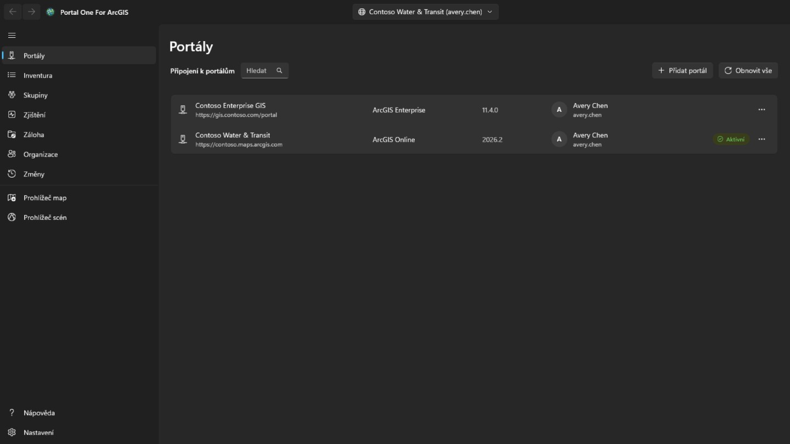

Přidejte připojení podle adresy portálu: pro ArcGIS Online
`https://vaseorg.maps.arcgis.com`, pro ArcGIS Enterprise úplnou adresu včetně
cesty kontextu, například `https://portal.example.com/portal`. V portálu není
třeba nic předem registrovat. Pokud je portál za proxy s identitou, například proxy aplikací Microsoft Entra nebo Google Cloud IAP, zaškrtněte **Portál vyžaduje ověření proxy s identitou**: před načtením portálu se otevře okno pro přihlášení k proxy, samo se zavře, jakmile portál odpoví, a znovu se otevře vždy, když relace proxy skončí — rozpracovaná činnost pak pokračuje.

Přihlaste se uživatelským jménem a heslem, nebo přes vlastní přihlašovací
stránku portálu zobrazenou v aplikaci. **Použijte druhou možnost, pokud vaše
organizace používá jednotné přihlášení nebo vícefaktorové ověření**: do této
aplikace se pak žádné heslo nezadává.

Přihlášeno může být několik připojení najednou, včetně dvou účtů téhož portálu.
**Zůstat přihlášen** uchová přihlašovací údaj zašifrovaný pro váš účet Windows,
takže připojení přežije restart.

Obnovováno je jen to připojení, na které míříte. Ostatní se po vypršení tokenu
odhlásí a při přepnutí se tiše vrátí.

Přihlášené připojení ukazuje profilový obrázek účtu, nebo jeho iniciály, pokud žádný nemá. Vyberte ho pro **Můj profil**, **Moje nastavení** nebo **Nápověda**. **Nápověda** otevře tuto nápovědu na webu nápovědy, ve vašem prohlížeči a v jazyce, který aplikace zobrazuje; bez sítě místo toho otevře stránku **Nápověda** v aplikaci. Vedle profilového obrázku otevře tlačítko **Spouštěč aplikací** aplikace ArcGIS, které tento účet může na tomto portálu používat, tak jak je vypisuje vlastní spouštěč aplikací portálu a v pořadí, které si tam účet uspořádal; aplikace se otevře ve vlastním okně, s přihlášením. **Můj profil** zobrazuje účet tak, jak ho zobrazuje profilová stránka portálu: fotku, jméno, životopis, skupiny a položky sdílené s organizací nebo se všemi; **Upravit profil** mění jména, životopis, viditelnost profilu a fotku. **Moje nastavení** obsahuje oddíly portálu: **Obecné** (e-mailová adresa, úvodní stránka, jazyk, formát čísel a dat, jednotky), **Zabezpečení** (heslo a bezpečnostní otázka pro přihlášení ArcGIS), **Licence** (typ uživatele a role a licencované produkty tak, jak je vypisuje vlastní stránka portálu, s jejími obrázky: balíky aplikací, které se otevírají do svých aplikací, za nimi všechny ostatní produkty, tečka u každé doplňkové licence a vyhledávací pole), **Kredity**, kde je organizace přiděluje, a **Webhooky**, které účet vlastní. Každá změna říká, co zapíše, znovu se načte z portálu a zaznamená se na stránce **Změny**, která umí vrátit změny profilu, nastavení, úvodní stránky, fotky a webhooků; nové heslo, bezpečnostní otázka a odstraněný webhook se pouze zaznamenají. Vícefaktorové ověřování, bezpečnostní klíče, kódy pro obnovení, propojené účty a předvolby e-mailů Esri se jen zobrazují nebo vysvětlují: spravují se na webu ArcGIS. Po změně hesla nebo kdykoli portál přestane připojení přijímat se stránka **Portály** otevře s jeho přihlášením, abyste se mohli znovu přihlásit novým heslem.

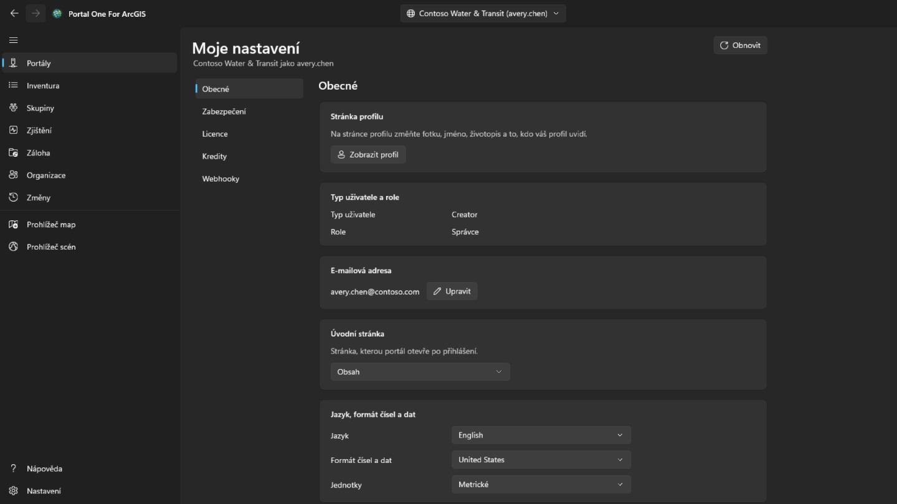

## Inventář

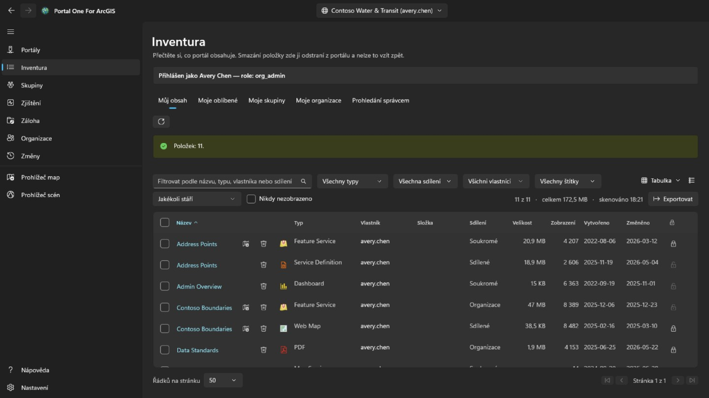

Ukazuje, co vidí váš účet, ve čtyřech kartách jako na stránce obsahu portálu: **Můj obsah**, **Moje oblíbené**, **Moje skupiny** (všechny dohromady nebo jedna, včetně skupin, které vidíte, i když v nich nejste) a **Moje organizace** (co organizace sdílí). Načtou se hned po otevření stránky a zůstanou; tlačítko vedle nich načte zobrazenou kartu znovu. Místní nabídka řádku se řídí typem položky: webovou mapu lze otevřít také v Map Viewer portálu, ve Field Maps Designer nebo v ArcGIS Pro, řídicí panel v Dashboards, příběh v ArcGIS StoryMaps; soubor lze stáhnout; a každou položku lze přidat do oblíbených nebo z nich odebrat. **Porovnat s jinou mapou…** na webové mapě nebo scéně přečte ji i vybranou mapu stejného typu z portálu, jak jsou nyní, a vypíše, čím se liší: vrstvy přidané, odebrané, přesunuté nebo přejmenované, změněné filtry, symbologie, popisky a vyskakovací okna, podkladová mapa, záložky a výchozí pohled; seznam lze zkopírovat. **Vytvořit kopii…** ji zkopíruje do vašeho obsahu na tomto nebo jiném přihlášeném portálu, pod novým názvem, do složky nebo s předáním jinému členovi; kopie je soukromá a na jiném portálu se nejprve vyhledá položka každé vrstvy, a vrstva, jejíž položka tam není, se načte podle adresy, což se ukáže dřív, než se cokoli zapíše. Nabídka zobrazení vpravo nahoře ukáže řádky jako **Tabulku**, **Seznam** s miniaturou a souhrnem každé položky nebo **Mřížku** karet, jako stránka obsahu portálu, a seřadí je; filtry, stránkování a zaškrtnuté řádky zůstávají ve všech třech stejné. Na kartách **Moje oblíbené**, **Moje skupiny** a **Moje organizace** se složka, velikost a ochrana doplní chvíli po zobrazení stránky: hledání je nevrací, proto se čte každá položka, nejdřív viditelná stránka. Složka se ukáže jen u vlastních položek, správci u všech. Název položky v tabulce, seznamu a mřížce otevře stránku položky v samostatném okně rozvrženém jako na portálu: na kartě **Přehled** karta položky s miniaturou, typem, daty a souhrnem, potom její **Popis**, co podle svého typu obsahuje (u služby **Vrstvy** a tabulky, u mapy vrstvy, u geoprocessingové služby úlohy), její **Podmínky použití** a **Komentáře**, kde lze zanechat komentář; vedle nich **Otevřít v prohlížeči map**, **Otevřít v prohlížeči scén**, **Sdílet…** a **Otevřít v ArcGIS Pro** se zbytkem za šipkou — u hostované vrstvy prvků, tak jak je nabízí portál, **Publikovat** (jako dlaždice, vektorové dlaždice, WFS, prvky OGC nebo 3D vrstvu), **Vytvořit vrstvu pohledu** (ve vlastním návrháři pohledů portálu, v okně aplikace), **Exportovat data** (do shapefile, CSV, Excel, souborové geodatabáze, GeoJSON, KML, kolekce prvků nebo položky GeoPackage) a **Aktualizovat data** (přidat nebo aktualizovat prvky ze souboru, pole po poli, nebo přepsat celou vrstvu ze souboru, vše vypsané před spuštěním); u souboru, balíčku nebo definice služby **Publikovat** (hostovaná vrstva z něj, nabízená, dokud nebude jedna publikována; soubor CSV nebo Excel umístěný podle pole zeměpisné šířky a zeměpisné délky, nebo ponechaný jako tabulka) a **Aktualizovat data** (soubor stejného názvu zaujme jeho místo, současný se nejprve uloží na tomto počítači); u vektorové dlaždicové vrstvy **Zobrazit styl**, **Stáhnout styl** a u takové, kterou portál nehostuje, **Aktualizovat styl**; u hostované dlaždicové, vektorové dlaždicové nebo scénové vrstvy **Nahradit vrstvu**; u webové mapy nebo webové scény **Vytvořit aplikaci**; u řídicího panelu, příběhu, prostředí, webové aplikace, webu, formuláře nebo notebooku aplikace, která ho otevře, a pokud ho smíte změnit, ta, která ho upraví — každý typ s tlačítky, která mu dává vlastní stránka položky portálu, ve stejném pořadí; potom u každé položky **Upravit metadata** nebo **Zobrazit metadata** a **Přidat do oblíbených**; každá akce se zaznamená na stránce **Změny** — **Vlastník**, **Podrobnosti** se zdrojem položky a URL ke zkopírování nebo otevření, lišta ukazující úplnost informací s nejpřínosnější změnou a její **Štítky**, **Sdílení**, **Složka** a **Poděkování**, každé s akcí, která je mění; potom karty **Data**, **Vizualizace** a **Nastavení**, které její typ má. **Nastavení** následuje portál: **Obecné** pro každou položku (stav obsahu, ochrana proti smazání a odstranění položky, rozsah používaný vyhledáváním), vlastní sekci položky – u hostované vrstvy prvků úpravy, sledování editorů, synchronizaci, export a skutečné křivky, uložené společně pomocí **Uložit**; u webové mapy nebo scény její offline režim; u ostatních vrstev nastavení služby tak, jak je hlásí – a webhooky hostované vrstvy prvků; každá změna je potvrzena, pokud něco odebírá, znovu načtena z portálu a zaznamenána na stránce **Změny**, která ji může vrátit zpět.

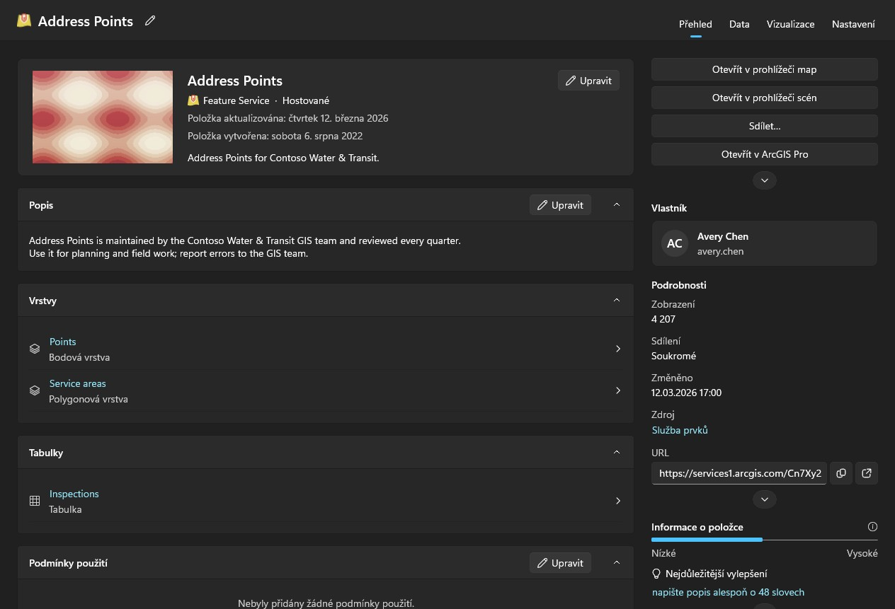

Prohledávat obsah jiných lidí je úkol správce. Účet, který smí číst, co vlastní ostatní členové (portal:admin:viewItems), má na této stránce kartu **Prohledání správcem** a prohledání na stránkách Zjištění a Záloha — jeden člen, jedna skupina nebo celá organizace — a kartu **Převod** stránky **Organizace**; ostatní účty je nevidí. Procházení organizace se každého člena ptá na jeho obsah místo hledání, protože hledání vrací jen sdílené a audit nesmí přehlédnout soukromé položky. Chvíli trvá a lze ho zrušit.

Zjištění, Záloha a prohlížeče si váš vlastní obsah načtou samy, jakmile ho poprvé potřebují, takže není nutné nejdřív navštívit jinou stránku; prohledání správcem ho nahradí tím, co bylo prohledáno. Každá tabulka uvádí, kdy byl její seznam načten. Portál se po načtení dál mění.

Každý řádek nese také tlačítko smazání a je to jediná věc v této aplikaci, kterou nelze vzít zpět: ArcGIS nemá koš. Potvrzení pojmenuje položku, její typ a vlastníka a řekne, zda složka zálohy zapamatovaná pro toto připojení obsahuje kopii a z kdy je. Bez ní neodmítne, ale právě ta řádka je jediné, co by se za smazání mohlo později postavit. Položka chráněná proti smazání v portálu je zde odmítnuta, nikoli potichu odjištěna. Samotnou ochranu změníte zámkem na konci řádku nebo z nabídky řádku: je to samostatný krok, zrušení ochrany se nejprve zeptá a každá změna se ověří zpětným načtením z portálu a zapíše do deníku. Zaškrtněte pole na začátku řádku — nebo to v záhlaví pro všechny řádky, které filtry zobrazují, na všech stránkách — a pracujte s mnoha položkami najednou. **Sdílet** nastaví úroveň sdílení a skupiny; **Štítky** přidá a odebere štítky a ostatní ponechá; **Přesunout** vloží položky jednoho vlastníka do jedné z jeho složek; **Změnit vlastníka** je převede na jiného člena jako karta **Převod** stránky **Organizace** a stránka **Změny** je vrátí; **Smazat** je odstraní po potvrzení, které uvede počet, vlastníky a stav zálohy a vyžaduje zaškrtnutí, že rozumíte. Položky, které tento účet nesmí měnit, a položky chráněné proti smazání zůstanou beze změny a započítají se. Položky se zpracují jedna po druhé a zapíší do deníku; **Zrušit** zastaví mezi dvěma, a souhrn uvede, co selhalo a proč. Z místní nabídky řádku **Sdílet…** změní úroveň a skupiny této položky a **Upravit podrobnosti…** její název, souhrn, popis, štítky, zdroje a podmínky použití. Oba se otevřou na položce tak, jak ji portál právě má, odešlou jen vaše změny, ověří výsledek a zapíší se do deníku.

## Zjištění

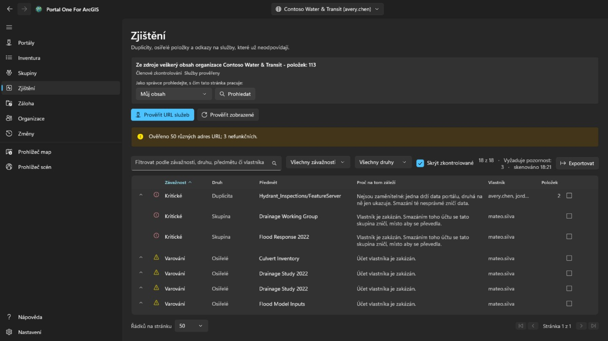

Nadbytečný a mrtvý obsah, seřazený podle toho, kolik pozornosti si zaslouží, ne
podle toho, jak hrozivě zní.

- **Kritické** znamená, že neopatrný zásah zde zničí něco, co jinde neexistuje:
  dvě položky ukazující na tutéž službu, kde smazání té nesprávné nelze vzít
  zpět.
- **Varování** je skutečný problém, se kterým lze bezpečně pracovat: položka,
  jejíž vlastník odešel, služba, která už neodpovídá.
- **Upozornění** stojí za to vědět a může se ukázat, že je vše v pořádku.
- **Neprůkazné** znamená, že to nešlo určit. **Služba, které vypršel časový
  limit, není služba, která zmizela**, a tento nástroj to tvrdit nebude.

Rozbalením řádku uvidíte položky, které zastupuje. Označte jej jako
zkontrolovaný, až rozhodnete, že je v pořádku; rozhodnutí se pamatuje pro každé
připojení a řádek zůstává viditelný, místo aby zmizel.

Tato stránka referuje. **Neřekne vám, kterou ze dvou podobných položek si
nechat**, protože to závisí na tom, kdo je používá a co na ně odkazuje.

## Záloha

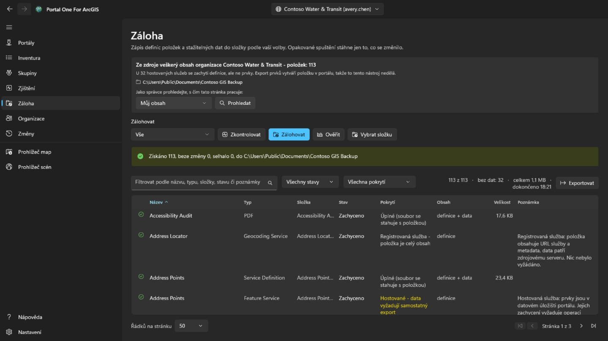

Zapisuje definice položek, prostředky a stažitelná data do složky, kterou
zvolíte. Opakované spuštění do téže složky načte jen to, co se změnilo, takže
**pokračování v přerušené záloze a přírůstková záloha jsou totéž**.

- **Zkontrolovat stav** porovná složku s portálem a ohlásí, co by *udělala*, aniž
  by cokoli zapsala. Tak se odpoví na otázku „je moje záloha aktuální", aniž by
  to stálo hodiny.
- **Ověřit** porovná složku s jejím vlastním záznamem, zcela bez portálu. **To je
  otázka, která zbývá, když portál už není — a to bývá právě chvíle, kdy někdo
  zálohu opravdu otevře.**

Složka se pamatuje pro každé připojení a složka obsahující zálohu jiné
organizace je odmítnuta, nikoli přepsána.

**Co záloha neobsahuje.** Prvky uvnitř hostované služby leží v datovém úložišti
portálu, ne v položce, a jejich vytažení vyžaduje export, který v portálu vytvoří
novou položku — tedy zápis. Tento nástroj to nedělá, takže se tyto řádky zachytí
jako definice bez dat a stránka uvede, kolik jich je. Služby registrované z
jiného serveru jsou svou podstatou ukazatele a nemají co dalšího zachytit.

## Odchod člena

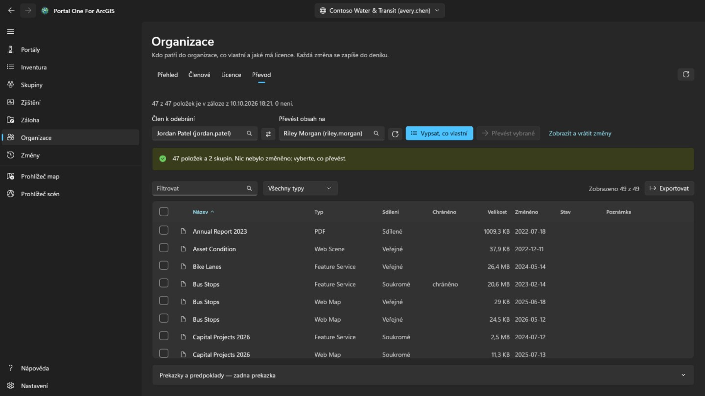

Toto je karta **Převod** stránky **Organizace**, zobrazená jen účtům, které spravují obsah (portal:admin:viewItems). Zjistí, co znamená odebrat člena, a přesune jeho obsah, po jedné věci a vratně.

Člena i příjemce jeho obsahu vyberte ze seznamů; oba pocházejí z adresáře samotné
organizace, takže **jméno nelze přepsat tak, aby padlo na jiné, které existuje**.
**Vypsat, co vlastní** nic nemění: ukáže každou položku a každou skupinu a
zaškrtáváte vy, co se má přesunout.

Nic není zaškrtnuto předem. Přesun celého účtu je jedno kliknutí na políčko v
záhlaví a **to kliknutí je rozhodnutí, ne výchozí nastavení**.

- Skupiny jsou záměrně ve stejné tabulce jako položky. Při smazání člena portál
  skupiny, které ještě vlastní, **zničí** místo aby je převedl, takže
  nezaškrtnutá skupina je **jediná věc na této stránce, která ničí potichu**, a
  řádek s počty to říká.
- Potvrzení vypíše složky příjemce a dovolí přidat novou; položky skončí v té, kterou vyberete. Každý převod se zapíše do záznamu dřív, než začne další, a stránka **Změny** vrátí každou položku do složky, odkud přišla, včetně znovuvytvoření zaniklé složky, jednu po druhé nebo všechny dosud nevrácené najednou.
- Přesun jedné položky může vzít s sebou další. Převod shapefilu vezme hostovanou službu z něj publikovanou, takže řádek může hlásit, že dorazila, i když ji neposlal tento převod. Vrácení jen tohoto řádku na stránce **Změny** ji nepřinese zpět; vrátí se s tím, co ji neslo.
- Po každém přesunu se položka z portálu načte zpět. **Požadavek, který vrátí
  úspěch, je tvrzení o požadavku, ne o tom, kde položka teď je.**

Samotný účet člena se maže na stránce **Organizace**, a to teprve tehdy, když mu už nic nepatří. **Je to jediný krok, který nelze vzít zpět.**

## Organizace

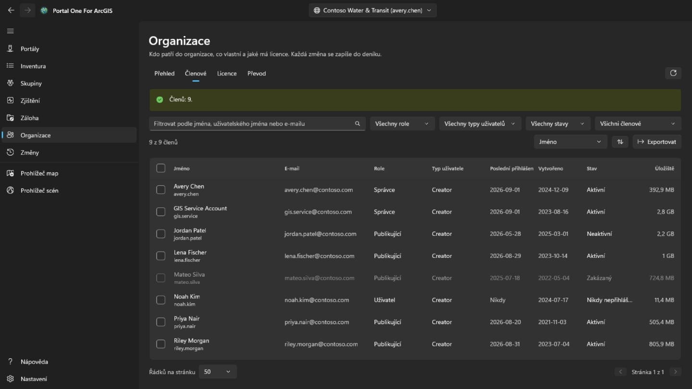

Tuto stránku vidí každý člen, stejně jako v portálu. **Přehled**, který uvádí i kontakty na správce organizace, je pro všechny, a s oprávněním zobrazovat členy také karta **Členové** jen pro čtení, bez e-mailu, přihlášení, stavu a úložiště. Zaškrtávání členů, **Exportovat**, **Licence** a jakékoli změny jsou jen pro účty, které spravují členy (portal:admin:viewUsers). **Přehled** shrnuje organizaci: v ArcGIS Online předplatné, místa a kredity; členy podle stavu, role a typu uživatele; a kolik obsahu a úložiště zabírá.

**Členové** vypisuje všechny v organizaci, s filtrem podle jména, role, typu uživatele, stavu nebo skupiny, s řazením podle libovolného sloupce a s uložením do souboru CSV tlačítkem **Exportovat**. Zaškrtněte členy, chcete-li je zakázat nebo povolit, změnit jim roli nebo typ uživatele, odebrat je ze skupin nebo je smazat; je-li zaškrtnutý jeden, **Odchod** otevře kartu **Převod** této stránky. Vašeho vlastního účtu se to nikdy nedotkne a vlastník skupiny ve skupině zůstává.

Kliknutím pravým tlačítkem na člena otevřete jeho nabídku. **Zobrazit** ukáže jeho **Profil**, **Položky** a správci i **Skupiny**, přímo v aplikaci, ne v portálu; běžný člen vidí jen položky, které mu byly sdíleny. **Spravovat** je pro správce, každá položka jen s oprávněním, které potřebuje: **Doplňkové licence** určí, jaká oprávnění člen má, **Upravit e-mailovou adresu** ji změní u účtu s přihlášením ArcGIS, **Převést obsah** otevře pro něj kartu **Převod** a **Převést člena** dá jinému členovi jeho typ uživatele, roli a doplňkové licence a pak pokračuje na kartě **Převod** s obsahem a skupinami. Stejná nabídka mění typ uživatele, roli, skupiny, stav nebo účet jednoho člena, jako to lišta dělá pro více.

**Smazat** odstraní jen členy, kterým nepatří žádné položky ani skupiny. ArcGIS je při smazání účtu nikomu nepředá, proto je nejprve přesuňte na kartě **Převod**. Než se cokoli stane, napíšete uživatelské jméno, u více členů jejich počet. Smazání nelze vzít zpět.

**Licence** ukazuje, kolik je přiřazeno od každého typu uživatele a v ArcGIS Online kolik jich předplatné obsahuje; **Zobrazit členy** vypíše, kdo tento typ má. Vyberte doplňkovou licenci, abyste viděli, kdo ji drží, a odeberte ji zaškrtnutým členům.

Každá změna se zpětně načte z portálu a zaznamená s tím, co tam bylo předtím, a je uvedena na stránce **Změny**. Tyto změny členů se odtud nevracejí: chcete-li některou obrátit, proveďte opačnou změnu.

## Změny

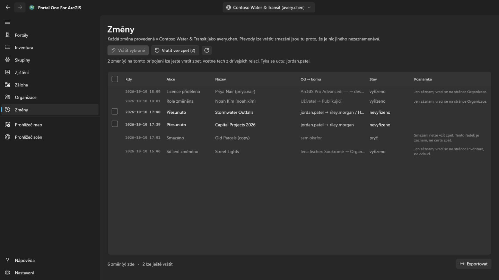

Stránka **Změny** se zobrazuje každému přihlášenému účtu. Od nejnovějších vypisuje vše, co tento nástroj změnil na právě vybraném portálu: převody, smazání, sdílení, štítky, složky, podrobnosti, ochranu a změny členů. Změny provedené na jiných portálech se počítají, ale nevypisují. Seznam lze exportovat do CSV.

Převody, které lze vrátit, mají zaškrtávací pole. **Vrátit vybrané** vrátí zaškrtnuté převody a **Vrátit vše zpět** vrátí po potvrzení, čí obsah to je, vše dosud nevrácené na tomto připojení. Položky se vrátí do složek, odkud přišly, a zaniklá složka se znovu vytvoří. Smazání a změny členů jsou jen záznam: smazání vrátit nelze a změna člena se obrací opačnou změnou. Vrácení převodu je samo převodem a vyžaduje stejné oprávnění (portal:admin:reassignItems, u skupiny reassignGroups); účet bez něj vidí jen záznam.

Webovou mapu uloženou přes původní z prohlížeče map a prvek, který tam byl přidán, upraven nebo odstraněn, vrátíte z nabídky jejich řádku. Úprava prvku se vrátí jen tehdy, je-li prvek stále takový, jak ho úprava zanechala: přidaný prvek se odstraní, upravený dostane zpět dřívější hodnoty a tvar a odstraněný se znovu přidá pod novým ID objektu. I vrácení se zaznamená, takže jej lze vrátit stejně. Před vrácením webové mapy vypíše **Porovnat s aktuální mapou** ve stejné nabídce, čím se liší kopie uložená před tím uložením od mapy, jak ji portál má nyní: podkladová mapa, přidané, odebrané, přejmenované či přesunuté vrstvy a u každé vrstvy viditelnost, průhlednost, styl, popisky, filtr, rozsah měřítka, vyskakovací okno a obnovení, tabulky, záložky a místo, kde se mapa otevírá.

## Prohlížeč map a prohlížeč scén

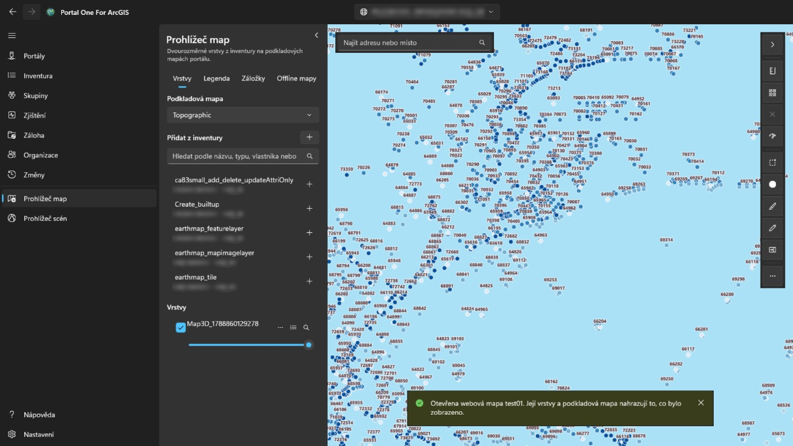

**Prohlížeč map** zobrazuje dvourozměrné vrstvy na podkladových mapách portálu; **prohlížeč scén** zobrazuje tyto i trojrozměrné vrstvy — vrstvy scén, sítě, mračna bodů, 3D Tiles — na glóbu s terénem. Panel vlevo hledá v tom, co bylo pro tento portál načteno — ve vašem vlastním obsahu, který se načítá automaticky, v tom, co prohledal správce, a v tom, co načetly karty stránky Inventura — a nabízí jen to, co daný prohlížeč umí vykreslit. Vyberte položku a tím ji přidáte. Webová mapa se otevře v prohlížeči map a webová scéna v prohlížeči scén, celá, s vlastními vrstvami a podkladovou mapou. Na stránce Inventura otevře tlačítko prohlížeče vedle názvu (také v místní nabídce řádku) položku v prohlížeči, který ji umí zobrazit.

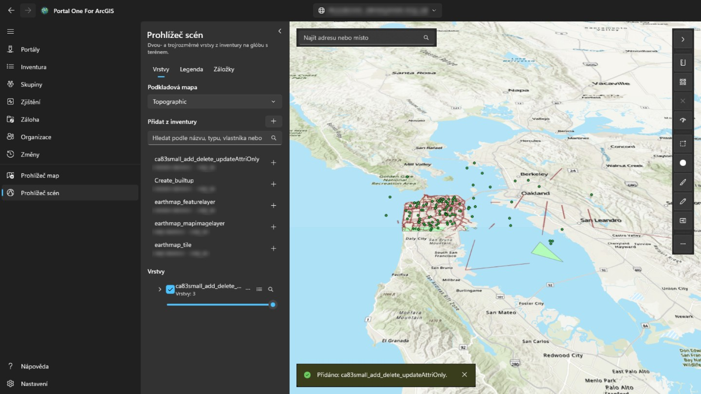

Tlačítko v pravém horním rohu panelu ho sbalí, takže mapa nebo scéna dostane celou šířku, a znovu rozbalí; při každém otevření prohlížeče je panel rozbalený. Každou vrstvu lze zobrazit nebo skrýt, zprůhlednit, posunout nahoru či dolů, přiblížit na ni nebo odebrat. Kliknutím na prvek v mapě se zobrazí jeho pole: má-li vrstva v portálu nastavené automaticky otevírané okno, pak ta, která vybralo, s jeho popisky a formáty; jinak všechna. Karta **Legenda** vedle karty **Vrstvy** ukazuje, co znamenají symboly každé viditelné vrstvy. **Záložky** uvádějí místa uložená s webovou mapou nebo webovou scénou; pojmenováním aktuálního zobrazení tam přidáte vlastní a výběrem se na místo vrátíte. Záložka scény si pamatuje směr a náklon kamery. Tlačítko tabulky u vrstvy s prvky otevře pod mapou její **atributovou tabulku**, po dvou stech řádcích a filtrovanou tak, jak se vrstva kreslí; výběr řádku prvek zvýrazní a přiblíží na něj. **Exportovat** zapíše všechny řádky, které tabulka s filtry a řazením obsahuje (nejvýš 50 000), nejen načtené: jako CSV tak, jak je tabulka ukazuje, jako GeoJSON v zeměpisné šířce a délce, nebo jako zazipovaný shapefile v souřadnicovém systému vrstvy (názvy polí zkrácené na deset znaků). Záhlaví sloupce podle něj tabulku seřadí, vyfiltruje (jako filtr vrstvy, jedna podmínka na sloupec, platí všechny) nebo ukáže jeho statistiku: kolik řádků má hodnotu, nejmenší a největší, u čísel součet, průměr a směrodatnou odchylku a nejčastější hodnoty, ze všech řádků, které filtry projdou, nejen z načtených. **Jen vybrané** zúží tabulku na vybrané řádky. V prohlížeči map měří **Vzdálenost** a **Plocha** nad mapou to, co nakreslíte klikáním bodů: po zemském povrchu, ne na ploché mapě, v metrických nebo imperiálních jednotkách podle oblasti Windows. V prohlížeči scén měří **Vzdálenost** mezi dvěma kliknutími na terén nebo model (přímo, podél země a svisle) a **Plocha** sleduje rohy na terénu. **Uložit jako webovou mapu** vytvoří ve vašem obsahu, ve složce, kterou zvolíte, novou položku webové mapy s právě zobrazenou podkladovou mapou, vrstvami a záložkami; otevře se tam, kde je mapa teď, a jako miniaturu má její obrázek. **Uložit** přepíše webovou mapu otevřenou z portálu, pokud je vaše nebo smíte měnit cizí obsah, po uložení kopie v tomto počítači; prohlížeč scén ukládat neumí. Vyhledávání také najde adresy a místa geokodérem portálu. **Exportovat** uloží PNG pohledu a pokud portál nabízí tiskovou službu, **Tisk** ji spustí. Časové vrstvy otevřou lištu **Čas** pro krokování nebo přehrání rozsahu. Vrstvy zůstanou, zatímco pracujete na jiných stránkách, a začnou znovu, když přepnete na jiný portál. Přihlášení k portálu se používá pro jeho vlastní vrstvy a nikdy se neposílá na server jiné organizace, takže vrstva registrovaná odjinud, která vyžaduje přihlášení, se nenačte. Při měření v mapě náčrt ukončíte dvojklikem, klávesou Enter nebo tlačítkem **Dokončit**: zůstane v mapě i s výsledkem až do dalšího měření nebo do ✕ vedle nástrojů. Esc náčrt zruší a Ctrl+Z nebo Backspace vrátí poslední bod. Tlačítko stylu u vrstvy s prvky mění, jak se kreslí: jeden symbol ve zvolené barvě a velikosti, barva pro každou hodnotu pole (**Kategorie**) nebo třídy číselného pole podél barevné škály (**Třídy**, podle přirozených zlomů, stejného intervalu nebo kvantilu). Mapa sleduje každou změnu; **Použít** ji ponechá, **Zrušit** vrátí předchozí kresbu a **Obnovit původní** styl, se kterým vrstva přišla. Legenda se také aktualizuje a uložením mapy jako webové mapy se styl zachová. Tlačítko **…** ve stejném řádku otevírá také **Popisky…**, které u každého prvku zobrazí hodnotu pole ve zvolené velikosti a barvě, s obrysem a od určitého měřítka, a **Filtr…**, který zobrazí jen prvky splňující podmínky složené z pole, porovnání a hodnoty, všechny nebo kteroukoli; počet vyhovujících se průběžně počítá, filtr z webové mapy vrstvy zůstává a tabulka atributů se jím řídí. Vlevo dole na mapě se kompas otáčí s mapou (vyberte ho, abyste ji natočili k severu); vedle je měřítková lišta měřená v terénu, měřítko a souřadnice pod ukazatelem (vyberte je pro kopírování nebo přepnutí mezi desetinnými stupni a stupni, minutami, sekundami) a tlačítko přehledové mapy, kde kliknutí mapu posune. **Vybrat** vybere prvky všech viditelných vrstev uvnitř obdélníku, volného tvaru nebo polygonu: panel uvede jejich počet ve vrstvách a součet, průměr, minimum a maximum číselného pole a umí je zobrazit v tabulce, přiblížit nebo uložit jako CSV. **Obalová zóna** nakreslí oblast do dané vzdálenosti od vybraných prvků nebo od bodu, čáry či oblasti, kterou nakreslíte, změří ji na zemském povrchu na tomto počítači (bez analytické služby a kreditů) a může vybrat, co pokrývá. **Porovnat** ukáže vrstvu vlevo od posuvné dělicí čáry a mapu bez ní vpravo. **Zkontrolovat mapu** projde každou vrstvu a řekne, co by selhalo nebo mátlo ty, kterým je mapa sdílena: vrstvy, které se nenačtou, položky, které zmizely nebo jsou sdíleny úžeji než mapa, služby přes http nebo mimo portál, zastaralé položky nebo položky jiné organizace, velké vrstvy bez rozsahu měřítka a žádná vyskakovací okna; zprávu lze zkopírovat. Uvede také pole, na která odkazuje vyskakovací okno, symbologie nebo popisky vrstvy a která vrstva nemá, a změří, jak dlouho trvá spočítat prvky každé vrstvy služby: nad 3 sekundy to poznamená, nad 10 nebo bez odpovědi do 30 je to varování. V nabídce **…** vrstvy **Používají…** načte mapy a aplikace z inventáře a vypíše ty, které vrstvu používají přímo nebo přes mapu, a **Vlastnosti…** ukáže původ, vlastníka, vykreslení a u prvků jejich počet a pole. Vyhledávací pole přijímá i souřadnice — dvě desetinná čísla v libovolném pořadí, stupně/minuty/sekundy, UTM nebo MGRS — a přejde tam i bez geokodéru. **Exportovat** umí zkopírovat odkaz, který otevře webovou mapu v prohlížeči portálu na tomto místě, nebo souřadnice středu. Uložení přes webovou mapu uchová její předchozí definici a stránka **Změny** ji umí obnovit z nabídky tohoto uložení. Nastavení vrstvy v její nabídce určuje viditelný rozsah měřítka, vyskakovací okna prvkových vrstev (zástupné symboly názvu, popisky polí, viditelnost a pořadí) a podporované intervaly obnovení; náhled je živý a uložení webové mapy je zachová. Dialog stylu nyní umí kreslit bodové vrstvy jako teplotní mapy, měnit velikost bodových symbolů nebo šířku linií podle číselného pole a zapnout shlukování bodů s popisky počtu; polygonové vrstvy si ponechávají dosavadní barevné styly. Nabídka Přidat na kartě Vrstvy umí přidat také adresu URL služby nebo místní soubor: CSV a GeoJSON se při uložení stanou vloženými kolekcemi prvků, zatímco shapefile a soubory KML nebo KMZ zůstávají místní a před uložením jsou výslovně uvedeny. Skica přidá uloženou vrstvu poznámek s body, liniemi, plochami, obdélníky, kruhy nebo elipsami, tvary od ruky a textem; vyberte prvek skici, chcete-li změnit jeho tvar, styl, odstranit jej, vrátit poslední značku nebo vymazat vrstvu, a kolekce prvků skici se uloží s webovou mapou. Nástroj **Upravit** v prohlížeči map vypíše vrstvy prvků služby, které dovolují úpravy, vysvětlí vrstvy jen pro čtení, umožní nakreslit nový prvek ze šablony nebo vybrat existující prvek v mapě, ověří upravitelná pole a použije potvrzené změny v živé službě prvků. V atributové tabulce upravitelné vrstvy vyberte řádky s klávesou Ctrl nebo Shift (Ctrl+A pro všechny načtené): **Upravit** otevře jeden z nich ve formuláři úprav a **Změnit pole** nastaví jedno pole na jednu hodnotu u všech, po kontrole podle pravidel každého prvku.  **Změnit pole** může také použít výraz — názvy polí v hranatých závorkách, text v apostrofech, + - * / a několik funkcí — takže každý vybraný záznam dostane vlastní hodnotu z ostatních polí.  V panelu Úpravy nabízejí **Nástroje geometrie** **Vybrat na mapě**, **Sloučit** tvary, **Rozdělit** linie nebo polygony řeznou linií, **Oříznout** na nakreslenou oblast nebo **Kopírovat do vrstvy** do jiné upravitelné vrstvy stejného druhu tvaru; každá akce se zapíše na stránce **Změny**. Každá úprava se zaznamená na stránce **Změny**, změna pole jako jeden záznam, a odtud se vrací. U vybraného prvku formulář úprav také vypíše jeho přílohy, pokud je vrstva uchovává, k otevření, přidání nebo odebrání (odebíraný soubor se nejprve zkopíruje na tento počítač a každá změna se zaznamená na stránce **Změny**), a ukáže s ním související záznamy, jen ke čtení. Při kreslení nebo úpravě tvaru prvku se jeho vrcholy přichytávají k prvkům vrstev zaškrtnutých v části **Přichytávání** panelu úprav a geometrická vodítka nabízejí pravé úhly a rovnoběžky; obojí lze vypnout a nastavit vzdálenost přichycení. Měření, skica a ostatní nástroje nepřichytávají. **Sdílet** vedle **Uložit jako webovou mapu** sdílí zobrazenou webovou mapu nebo webovou scénu stejně, jako stránka Inventura sdílí položku, pokud ji tento účet vlastní nebo smí sdílet obsah jiných: po výběru úrovně a skupin se mapa zkontroluje tak, jak by byla sdílena, a co by na té úrovni selhalo nebo mátlo, se vypíše dříve, než sdílení proběhne. **Podrobnosti** upravují název, souhrn, popis, značky, poděkování a podmínky použití položky stejně jako stránka Inventura a umí také použít obrázek zobrazení jako miniaturu a nastavit rozsah položky, který používá vyhledávání portálu, na zobrazení; kde se mapa otevírá, určuje uložení přes ni. Vyskakovací okno prvku také ukáže, v pořadí určeném autorem, obrázky, grafy a přílohy okna nastaveného v portálu a související záznamy; výrazy Arcade se vyhodnotí předem. Grafy se kreslí v motivu aplikace, obrázky se načítají jen z adres https a příloha se otevře kliknutím. Když se služba přesune nebo nahradí, **Nahradit ve webových mapách…** v nabídce **…** vrstvy přesměruje každou webovou mapu a webovou scénu z inventáře, která ji používá, na novou adresu (vrstvy celé služby si ponechají svá čísla), po výpisu toho, co se v každé změní; každá mapa se před zápisem uloží a zaznamená na stránce **Změny**, kde ji lze porovnat a obnovit. Seznam vrstev zobrazuje skupinové vrstvy jako strom: rozbalte skupinu a spravujte její vrstvy, přejmenujte libovolnou vrstvu, vytvořte novou skupinu z vybraných vrstev nejvyšší úrovně, přesuňte vrstvu do skupiny nebo z ní, případně seskupení znovu zrušte. Prohlížeč map může z linie vykreslit výškový profil, používá dlaždicový terén místo analytických služeb spotřebovávajících kredity a umožňuje kopírovat nebo exportovat vzorkované vzdálenosti a výšky. Vrstva prvků služby může pod mapou otevřít také graf jen pro čtení; používá statistiky služby místo stahování všech prvků, lze ho omezit na zobrazení nebo výběr, exportuje PNG nebo CSV a neukládá se do webové mapy.  Soubor CSV, GeoJSON nebo shapefile přidaný z počítače lze z nabídky vrstvy publikovat jako hostovanou vrstvu prvků: zdrojový soubor se nahraje, služba se vytvoří ve vašem obsahu a místní vrstva se nahradí. KML a KMZ nejsou nabízeny, protože portál je nepublikuje jako služby prvků.  Dialog stylu nabízí také typy s polem velikosti a mapy vztahu ze dvou polí; plynulé barevné rampy, hustota bodů a binning se nezobrazují, protože je ArcGIS Maps SDK for .NET 300.1 zde bezpečně nepodporuje. Popisky a pole vyskakovacích oken mohou používat také výrazy Arcade, s vložením polí, běžnými úryvky a testem na skutečném prvku před použitím.  Upravitelné vrstvy prvků mohou nést také formulář uložený ve webové mapě: panel editace respektuje jeho skupiny, povinná pravidla a vypočtené hodnoty a příkaz **Formulář…** v nabídce vrstvy tento formulář upravuje. Webové mapy portálu lze v prohlížeči map převést do offline režimu: aplikace zkontroluje offline schopnosti, stáhne předem připravenou oblast nebo aktuální zobrazení do LocalState, otevře je na kartě Offline mapy, uloží úpravy místně a synchronizuje je zpět jako jednu položku Changes, když má účet licenci Runtime Basic nebo vyšší.  Síťová analýza mapy přidává trasy, oblasti služeb a nejbližší zařízení ze služeb portálu; ArcGIS Online spotřebovává kredity.  Oddíly souvisejících záznamů také čtou relace přes relační tabulky ve skryté mapě SDK, takže relace M:N a relace s atributy fungují i tehdy, když související tabulky nejsou ve webové mapě.  Ve scénách lze vrstvy prvků také vybírat kliknutím, obdélníkem promítnutým na povrch nebo naklikaným polygonem, vytvářet obalové zóny z vybraných prvků nebo z naklikaného bodu, linie či plochy, zobrazovat grafy a upravovat: atributy přes formulář vrstvy, nové prvky a překreslení celého tvaru z naklikaných bodů a také sloučení, kopírování, rozdělení a oříznutí; pouze úprava vrchol po vrcholu zůstává jen pro mapu, protože SDK zpřístupňuje editor geometrie pouze pro MapView. Skici ve scénách (body, linie, polygony, obdélníky, elipsy a text umístěné kliknutím) vydrží jen po dobu relace, protože webové scény zde nelze uložit; kreslení od ruky je jen v mapě. **Exportovat skicu jako GeoJSON** v panelu Skica uloží značky z obou prohlížečů do souboru. Ve scénách lze také vykreslit **Výškový profil** podél naklikané linie, čtený z vlastního terénu scény, pokud nějaký má, jinak ze stejného zdroje jako v prohlížeči map, a funguje tam i panel **Síť**: kliknutí na terén umísťuje zastávky, zařízení a incidenty, výsledky se kreslí přes scénu a trasa přidaná jako vrstva vydrží jen po dobu relace.  Akce scén také sdílejí, upravují podrobnosti, kopírují odkazy nebo středy, exportují obrázky, kontrolují vrstvy, ukazují použití a nahrazují zdroje; widgety scény ukazují směr, souřadnice ukazatele, přehled a výšku kamery a místní mobilní balíčky scén se otevírají jen pro čtení. **Posun** ve scéně používá synchronizovanou oříznutou kopii celé scény; navigace zůstává v hlavní scéně a oddělovač ji porovnává s vybranou vrstvou a bez ní.  Krátké pole pro hledání míst zůstává vlevo nahoře; šipka na pravé liště nástrojů obě části animovaně skryje nebo obnoví a Další příkazy obsahuje méně používané příkazy položky, kontroly, času a exportu.

## Běh na pozadí

Zavření okna uloží aplikaci do oznamovací oblasti místo jejího ukončení, **aby
několikahodinový průchod nebo záloha nezemřely gestem, kterým se okno odsouvá z
cesty**. Ikona říká, co běží, a **Ukončit** tam je skutečný východ. Jeho nabídka také umožňuje přidat portál a vyhledat aktualizaci v Microsoft Storu nebo nainstalovat tu nalezenou.

Vypnete-li ikonu v oznamovací oblasti, zavření okna aplikaci ukončí — bez ikony
by nebylo nic, co by okno vrátilo.

**Spouštět se systémem Windows** spustí aplikaci při přihlášení rovnou do
oznamovací oblasti, takže používané připojení je už přihlášené, když ji otevřete.

## Nastavení

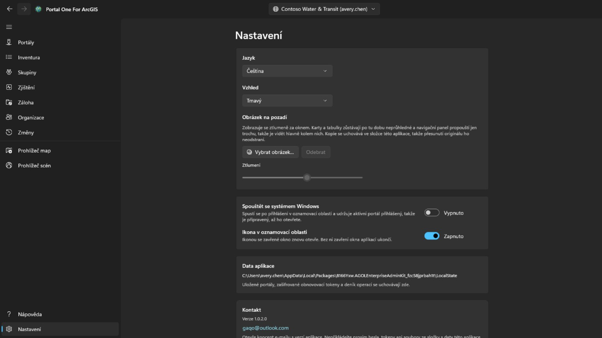

Světlý, tmavý, nebo podle Windows; motiv se změní ve chvíli volby. Když má Microsoft Store novější verzi, objeví se v navigačním panelu vedle Nastavení tlačítko **Aktualizovat**; během instalace se aplikace zavře, spustí se v nové verzi a tlačítko zmizí. Pod okno lze nastavit **obrázek na pozadí**; dokud je zobrazen, karty a tabulky zůstávají neprůhledné a navigační panel propouští jen trochu, takže je vidět hlavně kolem nich, a **Ztlumení** určuje, jak moc je ztmavený.

Rozhraní je dodáváno ve čtrnácti jazycích a řídí se Windows, pokud jeden
nepřipnete. **Změna jazyka se projeví při příštím startu**, nabízená tam
tlačítkem, protože framework čte text každé obrazovky jednou, při jejím
sestavení: okamžité použití by změnilo jen to, co se otevře potom.

**Předplatné** je to, co snímá značku ze stránek, a nic dalšího za ním nestojí: přihlášení k portálu, jeho inventura, záloha a tisk mapy zůstávají zdarma, ať už je zaplaceno, nebo ne. Je to měsíční předplatné kupované přes Microsoft Store, které lze kdykoli zrušit; jakmile existuje, karta říká, kolik stojí a kdy se obnoví. *Obnovit nákup* je pro případ, že jste zaplatili a značka je tu pořád: předplatné mohlo být koupeno ve vlastním okně Store, o čemž se tato aplikace nedozví.

**Vodoznak** vloží vlastní řádek do pravého dolního rohu každé stránky: nejvýše dvacet čtyři znaků, v písmu, velikosti, tloušťce, barvě a síle, které zvolíte za **Další nastavení** — karta sama neukazuje nic než přepínač, který ho zapíná. Začíná jako třicet pixelů výrazné červené v plné síle a každých šest minut se minutu pohybuje po stránce: pět minut v rohu, minutu na cestě, pak zpět do rohu. Pohybuje se proto, že kdo dělá snímek okna, rozhoduje o tom, kde budou jeho okraje, a roh je ta část, která nejlehčeji zůstane mimo záběr; odpočívá proto, že na stránce, na které se pracuje, by neměl řádek procházet přes její řádky — přepínač, který pohyb úplně vypne, je za **Další nastavení**. Je zapnutý, když sem přijdete poprvé, a čte se *Bez předplatného* — co z aplikace odejde, je viděno někde, kde nic neříká, čím bylo uděláno. **Síla** je, kolik z té barvy se použije: úplně dole vyjde každá barva jako stejný bledý nádech, takže samotná barva neodpoví, jak je to vidět. Prázdný řádek se vrací k výchozímu textu. Dokud si nepředplatíte, na této kartě se nedá nic změnit — ani přepínač, ani text: čte se *Bez předplatného* a stisknutí otevře kartu výše; předplatné je to, co dovolí ji vypnout a zvolit, co říká; když nic nezvolíte, čte se jméno aplikace. Označuje se obrazovka: obrázky, které aplikace ukládá, přicházejí z tiskové služby portálu a odcházejí tak, jak je portál poslal.

## Klávesnice

V kterékoli z tabulek:

- **Ctrl+F** umístí kurzor do pole filtru.
- **Ctrl+E** exportuje zobrazené řádky, se sloupci a pořadím, které máte před sebou.

## Kde co leží

- Zálohy jdou do složky, kterou jste zvolili — do běžné složky, kterou lze
  otevřít, zkopírovat a přesunout.
- Připojení, předvolby a záznam změn jsou ve vlastním úložišti aplikace,
  zašifrované tam, kde jde o přihlašovací údaje.
- Exportované soubory CSV leží tam, kam je uložíte.

Nic se nikam neodesílá. **U tvůrců tohoto nástroje neexistuje žádný účet ani
telemetrie.**

## Kontakt

Něco nefunguje nebo nedělá, co jste čekali: **gaqo@outlook.com**.

Nejvíc pomůže, co jste dělali, co se místo toho stalo, zda je portál ArcGIS Online nebo ArcGIS Enterprise a v jaké verzi — stránka Připojení ukazuje obojí — a v jakém jazyce rozhraní běželo.

Nepřikládejte prosím hesla, tokeny ani soubory ze složky s daty aplikace. Je v ní uložena přihlášená relace a nic z toho není k zodpovězení dotazu potřeba.
