# Hilfe

**Portal One For ArcGIS** prüft und pflegt eine ArcGIS-Organisation von Ihrem eigenen Rechner aus. Es arbeitet mit **ArcGIS Online** und **ArcGIS Enterprise** auf dieselbe Weise.

Warum der Name: ArcGIS Online und ArcGIS Enterprise sind im Kern beide ein Portal, daher deckt das eine Wort **Portal** beide ab – und so nennt diese App sie auch, auf der Seite **Portale**, auf der Sie sie hinzufügen. **One** ist die App: ein Ort für jedes Portal, mit dem Sie arbeiten, auch mehrere gleichzeitig angemeldet. **For ArcGIS** sagt, für welche Plattform sie gebaut ist.

Diese App spricht mit den Portalen, bei denen Sie sich anmelden, mit den Kartendiensten, Grundkarten und Höhendaten, auf die deren Inhalte verweisen, und mit ihrer Hilfewebsite, von der diese Seite die neueste Hilfe liest – wenn die Website nicht erreichbar ist, zeigt sie die mit der App installierte Hilfe – sowie mit Microsoft Store für Updates und das Abonnement. Ihre Anmeldedaten werden für Ihr Windows-Konto verschlüsselt und nur an das Portal gesendet, zu dem sie gehören.

## Die Reihenfolge der Seiten ist die Reihenfolge der Arbeit

Lesen, sichern, Probelauf, ausführen. Jede Seite macht die nächste sicher, und
die Navigation ist so angeordnet, dass der Weg nach unten der sichere ist.

## Verbindungen

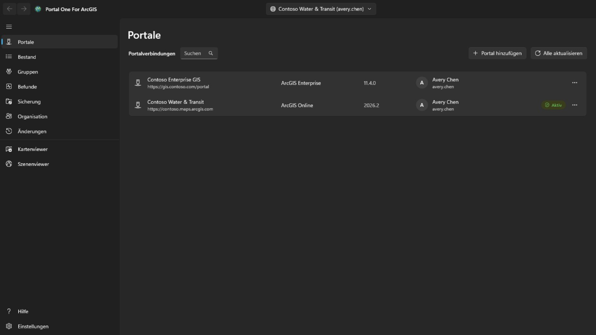

Legen Sie eine Verbindung mit der Portaladresse an: für ArcGIS Online
`https://ihreorg.maps.arcgis.com`, für ArcGIS Enterprise die vollständige
Adresse samt Kontextpfad, etwa `https://portal.example.com/portal`. Im Portal
muss vorher nichts registriert werden. Liegt das Portal hinter einem identitätsbasierten Proxy wie dem Microsoft Entra-Anwendungsproxy oder Google Cloud IAP, aktivieren Sie **Portal erfordert identitätsbasierte Proxy-Authentifizierung**: Ein Fenster zur Anmeldung am Proxy öffnet sich, bevor das Portal gelesen wird, schließt sich von selbst, sobald das Portal antwortet, und öffnet sich erneut, wann immer die Sitzung des Proxys endet – was gerade lief, wird fortgesetzt.

Melden Sie sich mit Benutzername und Kennwort an oder über die Anmeldeseite des
Portals, die in der App angezeigt wird. **Nutzen Sie die zweite Variante, wenn
Ihre Organisation Single Sign-on oder Mehrfaktor-Authentifizierung verwendet**:
dann wird in dieser App überhaupt kein Kennwort eingegeben.

Mehrere Verbindungen können gleichzeitig angemeldet sein, auch zwei Konten
desselben Portals. **Angemeldet bleiben** verschlüsselt die Anmeldedaten für Ihr
Windows-Konto, sodass die Verbindung nach einem Neustart weiterbesteht.

Nur die aktuell gewählte Verbindung wird erneuert. Die übrigen werden beim
Ablauf ihres Tokens abgemeldet und kehren beim Umschalten still zurück.

Eine angemeldete Verbindung zeigt das Profilbild des Kontos oder, wenn es keines gibt, seine Initialen. Wählen Sie es für **Mein Profil**, **Meine Einstellungen** oder **Hilfe**. **Hilfe** öffnet diese Hilfe auf der Hilfewebsite, in Ihrem Browser und in der Sprache, die die App anzeigt; ohne Netzwerk öffnet sie stattdessen die Seite **Hilfe** der App. Neben dem Profilbild öffnet die Schaltfläche **App-Startprogramm** die ArcGIS-Apps, die dieses Konto auf diesem Portal nutzen darf, so wie das App-Startprogramm des Portals sie auflistet und in der Reihenfolge, in der das Konto sie dort angeordnet hat; eine App öffnet angemeldet in einem eigenen Fenster. **Mein Profil** zeigt das Konto so, wie es die Profilseite des Portals tut: Foto, Name, Biografie, Gruppen und die Elemente, die es für die Organisation oder öffentlich freigibt; **Profil bearbeiten** ändert Namen, Biografie, Profilsichtbarkeit und Foto. **Meine Einstellungen** enthält die Bereiche des Portals: **Allgemein** (E-Mail-Adresse, Startseite, Sprache, Zahlen- und Datumsformat, Einheiten), **Sicherheit** (Kennwort und Sicherheitsfrage für eine ArcGIS-Anmeldung), **Lizenzen**, **Credits**, wo die Organisation sie zuweist, und die **Webhooks**, die das Konto besitzt. Jede Änderung sagt, was geschrieben wird, wird aus dem Portal erneut gelesen und auf der Seite **Änderungen** aufgezeichnet; dort lassen sich Änderungen an Profil, Einstellungen, Startseite, Foto und Webhooks zurücksetzen. Ein neues Kennwort, eine Sicherheitsfrage und ein gelöschter Webhook werden nur aufgezeichnet. Multifaktor-Authentifizierung, Sicherheitsschlüssel, Wiederherstellungscodes, verknüpfte Konten und Esri-E-Mail-Einstellungen werden nur angezeigt oder erklärt: Sie werden auf der ArcGIS-Website verwaltet. Nach einer Kennwortänderung, oder immer wenn das Portal die Verbindung nicht mehr akzeptiert, öffnet sich die Seite **Portale** mit der Anmeldung dieser Verbindung, damit Sie sich mit dem neuen Kennwort erneut anmelden können.

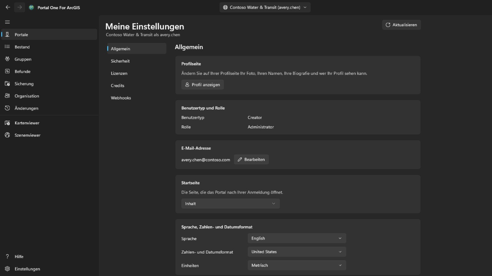

## Bestand

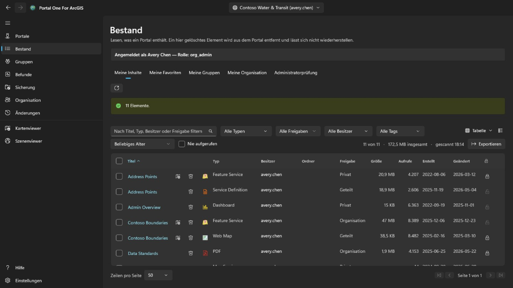

Zeigt, was Ihr Konto sehen kann, in vier Registerkarten wie auf der Inhaltsseite des Portals: **Meine Inhalte**, **Meine Favoriten**, **Meine Gruppen** (alle zusammen oder eine Gruppe, auch Gruppen, die Sie sehen, ohne Mitglied zu sein) und **Meine Organisation** (was die Organisation teilt). Sie werden gelesen, sobald die Seite geöffnet wird, und bleiben erhalten; die Schaltfläche daneben liest die angezeigte Registerkarte neu. Das Kontextmenü einer Zeile richtet sich nach dem Elementtyp: Eine Webkarte lässt sich auch im Map Viewer des Portals, in Field Maps Designer oder in ArcGIS Pro öffnen, ein Dashboard in Dashboards, eine Story in ArcGIS StoryMaps; eine Datei kann heruntergeladen werden; und jedes Element lässt sich zu den Favoriten hinzufügen oder daraus entfernen. **Mit einer anderen Karte vergleichen…** auf einer Webkarte oder Webszene liest sie und eine gewählte Karte desselben Typs so aus dem Portal, wie sie jetzt sind, und listet die Unterschiede auf: hinzugefügte, entfernte, verschobene oder umbenannte Layer, geänderte Filter, Symbolisierung, Beschriftungen und Pop-ups, Grundkarte, Lesezeichen und Anfangsansicht; die Liste lässt sich kopieren. **Kopie erstellen…** kopiert sie in Ihre Inhalte auf diesem oder einem anderen angemeldeten Portal, unter neuem Titel, in einen Ordner oder weitergegeben an ein anderes Mitglied; die Kopie ist privat, auf einem anderen Portal wird zuerst das Element jedes Layers gesucht, und ein Layer, dessen Element dort fehlt, wird über seine Adresse geladen – das wird angezeigt, bevor etwas geschrieben wird. Das Ansichtsmenü oben rechts zeigt die Zeilen als **Tabelle**, als **Liste** mit Miniaturbild und Zusammenfassung jedes Elements oder als **Kacheln**, wie die Inhaltsseite des Portals, und sortiert sie; Filter, Seiten und angehakte Zeilen bleiben in allen drei Ansichten gleich. Auf **Meine Favoriten**, **Meine Gruppen** und **Meine Organisation** erscheinen Ordner, Größe und Schutz kurz nach der Seite: Eine Suche liefert sie nicht, daher wird jedes Element gelesen, die sichtbare Seite zuerst. Ein Ordner wird nur bei eigenen Elementen angezeigt, für Administratoren bei allen. Der Titel eines Elements in Tabelle, Liste und Kachelansicht öffnet die Elementseite in einem eigenen Fenster, aufgebaut wie im Portal: auf **Übersicht** die Elementkarte mit Miniaturansicht, Typ, Datumsangaben und Zusammenfassung, danach **Beschreibung**, was es für seinen Typ enthält (die **Layer** und Tabellen eines Service, die Layer einer Karte, die Tasks eines Geoverarbeitungs-Service), seine **Nutzungsbedingungen** und seine **Kommentare**, wo ein Kommentar hinterlassen werden kann; daneben **Im Kartenviewer öffnen**, **Im Szenenviewer öffnen**, **Freigeben…** und **In ArcGIS Pro öffnen** mit den übrigen Befehlen hinter einem Chevron, der **Besitzer**, die **Details** mit der Quelle des Elements und der URL zum Kopieren oder Öffnen, eine Leiste, die zeigt, wie vollständig seine Informationen sind und welche Änderung am meisten helfen würde, sowie seine **Tags**, **Freigabe**, **Ordner** und **Quellenangaben**, jeweils mit der Aktion, die sie ändert; danach die Registerkarten **Daten**, **Visualisierung** und **Einstellungen**, die sein Typ besitzt. **Einstellungen** folgt dem Portal: **Allgemein** für jedes Element (Inhaltsstatus, Löschschutz und Löschen des Elements, die Ausdehnung, die Suchvorgänge nutzen), der eigene Abschnitt des Elements – bei einem gehosteten Feature-Layer Bearbeitung, Editor-Tracking, Synchronisierung, Export und echte Kurven, gemeinsam mit **Speichern** gespeichert; bei einer Webkarte oder Webszene der Offline-Modus; bei anderen Layern die Service-Einstellungen, wie der Service sie meldet – und die Webhooks eines gehosteten Feature-Layers; jede Änderung wird bestätigt, wenn sie etwas wegnimmt, aus dem Portal erneut gelesen und auf der Seite **Änderungen** aufgezeichnet, wo sie wiederhergestellt werden kann.

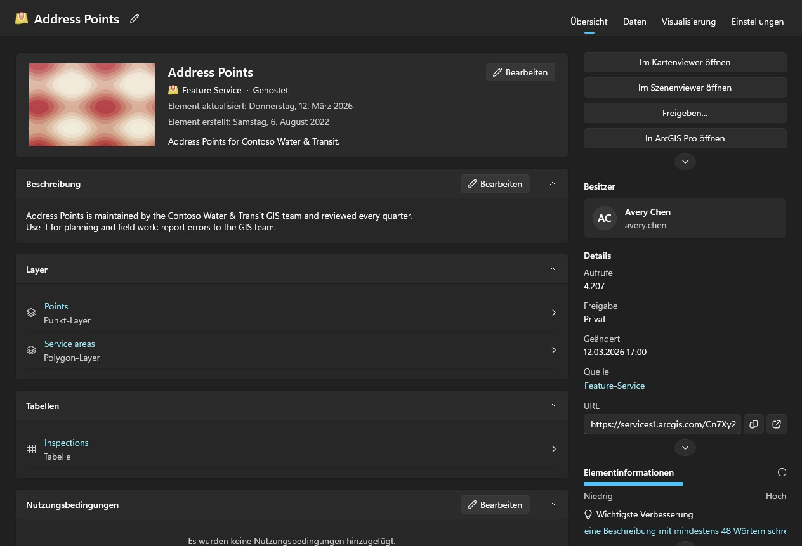

Die Inhalte anderer zu prüfen ist Aufgabe von Administratoren. Ein Konto, das lesen darf, was andere Mitglieder besitzen (portal:admin:viewItems), erhält auf dieser Seite die Registerkarte **Administratorprüfung** und auf den Seiten „Befunde“ und „Sicherung“ eine Prüfung – ein Mitglied, eine Gruppe oder die gesamte Organisation – sowie die Registerkarte **Übertragen** der Seite **Organisation**; andere Konten sehen diese nicht. Der Durchlauf durch die Organisation fragt jedes Mitglied nach seinen Inhalten, statt zu suchen, denn die Suche liefert nur Geteiltes, und eine Prüfung darf keine privaten Elemente übersehen. Er dauert eine Weile und lässt sich abbrechen.

Befunde, Sicherung und die Viewer lesen Ihre eigenen Inhalte selbst, sobald sie sie brauchen, sodass vorher keine andere Seite besucht werden muss; die Prüfung eines Administrators ersetzt sie durch das Geprüfte. Jede Tabelle sagt, wann ihre Liste gelesen wurde. Ein Portal ändert sich weiter, nachdem es gelesen wurde.

Jede Zeile trägt außerdem eine Schaltfläche zum Löschen, und das ist das Einzige in dieser App, das sich nicht rückgängig machen lässt: ArcGIS kennt kein Wiederherstellen. Die Bestätigung nennt das Element, seinen Typ und seinen Besitzer und sagt, ob der für diese Verbindung gemerkte Sicherungsordner eine Kopie enthält und wann sie entstand. Ohne eine solche wird nicht abgelehnt, aber diese Zeile ist das Einzige, was hinterher für die Löschung einstehen könnte. Ein im Portal löschgeschütztes Element wird hier abgelehnt statt stillschweigend freigegeben. Den Schutz selbst ändern Sie mit dem Schloss am Ende der Zeile oder über das Menü der Zeile: Das ist ein eigener Schritt, das Aufheben fragt zuerst nach, und jede Änderung wird vom Portal zurückgelesen und ins Journal geschrieben. Haken Sie das Kästchen am Zeilenanfang an – oder das in der Kopfzeile für alle Zeilen, die die Filter zeigen, auf allen Seiten –, um viele Elemente auf einmal zu bearbeiten. **Freigeben** setzt Freigabestufe und Gruppen; **Tags** fügt Tags hinzu und entfernt welche, die übrigen bleiben; **Verschieben** legt Elemente eines Besitzers in einen seiner Ordner; **Besitzer ändern** überträgt sie an ein anderes Mitglied, wie die Registerkarte **Übertragen** der Seite **Organisation**, und die Seite **Änderungen** holt sie zurück; **Löschen** entfernt sie nach einer Bestätigung, die Anzahl, Besitzer und Sicherungsstand nennt und ein Häkchen verlangt, dass Sie verstanden haben. Elemente, die dieses Konto nicht ändern darf, und löschgeschützte bleiben unverändert und werden gezählt. Es wird ein Element nach dem anderen bearbeitet und protokolliert; **Abbrechen** hält zwischen zwei Elementen an, und die Zusammenfassung nennt, was fehlschlug und warum. Über das Kontextmenü einer Zeile ändert **Freigeben…** Freigabestufe und Gruppen dieses Elements, **Details bearbeiten…** Titel, Zusammenfassung, Beschreibung, Tags, Quellenangaben und Nutzungsbedingungen. Beide öffnen das Element so, wie das Portal es jetzt hält, senden nur Ihre Änderungen, prüfen das Ergebnis und werden protokolliert.

## Befunde

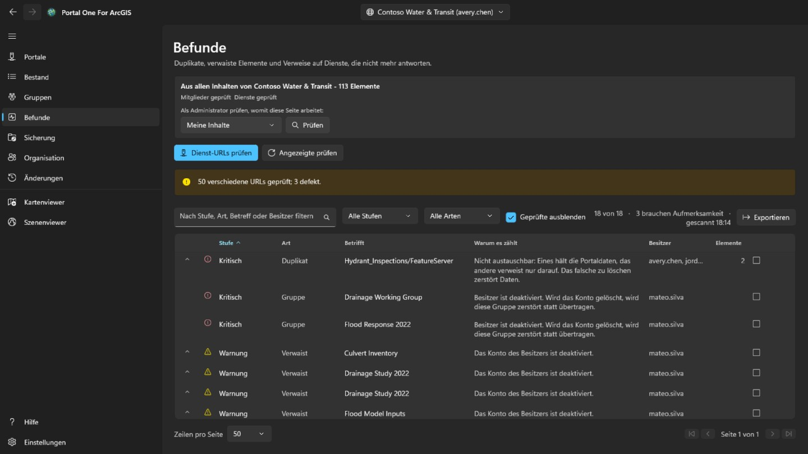

Überflüssige und tote Inhalte, sortiert nach der Aufmerksamkeit, die sie
verdienen, nicht danach, wie schlimm sie klingen.

- **Kritisch** heißt, dass unachtsames Handeln hier etwas zerstört, das sonst
  nirgends existiert — zwei Elemente auf denselben Dienst, bei denen das Löschen
  des falschen nicht rückholbar ist.
- **Warnung** ist ein echtes Problem, das gefahrlos behandelt werden kann: ein
  Element, dessen Besitzer gegangen ist, ein Dienst, der nicht mehr antwortet.
- **Hinweis** ist wissenswert und kann sich als völlig in Ordnung erweisen.
- **Unbestimmt** heißt, es ließ sich nicht feststellen. **Ein Dienst mit
  Zeitüberschreitung ist kein verschwundener Dienst**, und dieses Werkzeug wird
  das auch nicht behaupten.

Öffnen Sie eine Zeile, um die Elemente zu sehen, für die sie steht. Markieren
Sie sie als geprüft, wenn Sie entschieden haben, dass alles in Ordnung ist; die
Entscheidung wird je Verbindung gemerkt, und die Zeile bleibt sichtbar.

Diese Seite berichtet. **Sie sagt Ihnen nicht, welches von zwei ähnlichen
Elementen zu behalten ist**, denn das hängt davon ab, wer sie nutzt und was auf
sie verweist.

## Sicherung

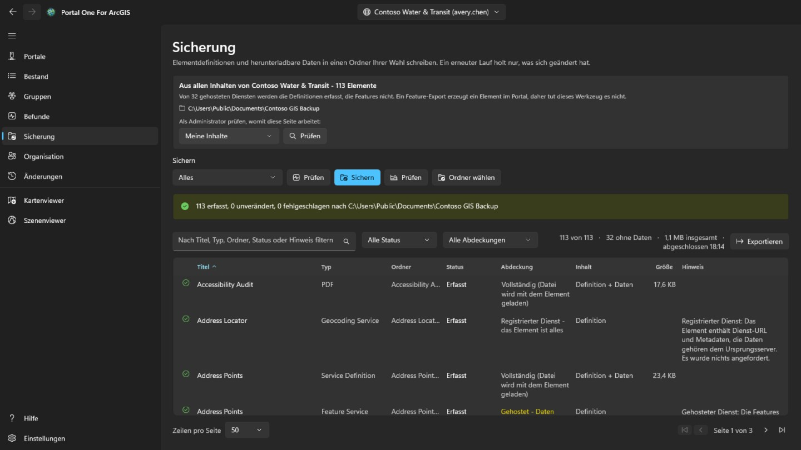

Schreibt Elementdefinitionen, Ressourcen und herunterladbare Daten in einen von
Ihnen gewählten Ordner. Ein erneuter Lauf in denselben Ordner holt nur
Verändertes, **deshalb sind das Fortsetzen einer abgebrochenen Sicherung und
eine inkrementelle Sicherung dasselbe**.

- **Prüfen** vergleicht den Ordner mit dem Portal und meldet, was geschehen
  *würde*, ohne etwas zu schreiben. So beantworten Sie „ist meine Sicherung
  aktuell", ohne Stunden dafür aufzuwenden.
- **Überprüfen** vergleicht den Ordner mit seiner eigenen Aufzeichnung, ganz
  ohne Portal. **Das ist die Frage, die bleibt, wenn das Portal fort ist — und
  genau dann liest jemand eine Sicherung im Ernst.**

Der Ordner wird je Verbindung gemerkt; ein Ordner mit der Sicherung einer
anderen Organisation wird abgelehnt statt überschrieben.

**Was eine Sicherung nicht enthält.** Die Features in einem gehosteten Dienst
liegen im Datenspeicher des Portals, nicht im Element, und sie herauszuholen
verlangt einen Export, der im Portal ein neues Element anlegt — ein Schreibvorgang.
Dieses Werkzeug tut das nicht, also werden solche Zeilen als Definition ohne
Daten erfasst, und die Seite nennt deren Anzahl. Von einem anderen Server
registrierte Dienste sind ihrem Wesen nach Verweise und haben nichts weiter.

## Offboarding

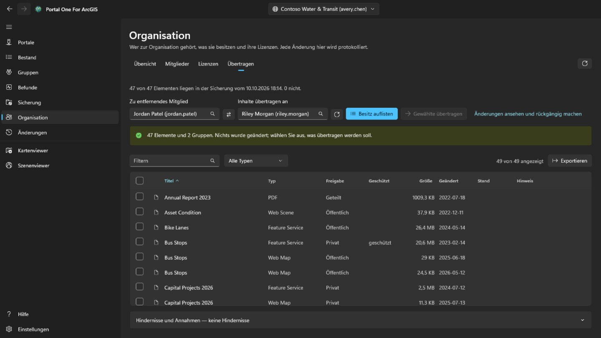

Dies ist die Registerkarte **Übertragen** der Seite **Organisation**, sichtbar nur für Konten, die Inhalte verwalten (portal:admin:viewItems). Sie ermittelt, was das Entfernen eines Mitglieds bedeutet, und überträgt seine Inhalte — Stück für Stück und umkehrbar.

Wählen Sie das Mitglied und den Empfänger aus den Listen; beide stammen aus dem
Verzeichnis der Organisation, **ein Name kann also nicht zu einem anderen
existierenden verschrieben werden**. **Besitz auflisten** ändert nichts; es
zeigt jedes Element und jede Gruppe, und Sie haken an, was gehen soll.

Nichts ist für Sie vorausgewählt. Ein ganzes Konto zu übertragen ist ein Klick
auf das Kästchen in der Kopfzeile, und **dieser Klick ist eine Entscheidung,
keine Voreinstellung**.

- Gruppen stehen bewusst in derselben Tabelle wie Elemente. Beim Löschen eines
  Mitglieds **zerstört** das Portal dessen Gruppen, statt sie zu übertragen, also
  ist eine nicht angehakte Gruppe **das einzige still zerstörerische auf dieser
  Seite** — die Zählzeile sagt es.
- Die Bestätigung listet die Ordner des Empfängers auf und erlaubt einen neuen; die Elemente landen im gewählten Ordner. Jede Übertragung wird in die Aufzeichnung geschrieben, bevor die nächste beginnt, und die Seite **Änderungen** bringt jedes Element in den Ordner zurück, aus dem es kam, legt einen verschwundenen Ordner neu an, einzeln oder alle noch offenen auf einmal.
- Ein Element zu verschieben kann andere mitverschieben. Die Übertragung eines Shapefiles nimmt den daraus veröffentlichten gehosteten Dienst mit, daher kann eine Zeile melden, dass er angekommen ist, ohne dass diese Übertragung ihn geschickt hat. Nur diese Zeile auf der Seite **Änderungen** zurückzunehmen bringt ihn nicht zurück; er kehrt mit dem zurück, was ihn getragen hat.
- Nach jedem Verschieben wird das Element aus dem Portal zurückgelesen. **Eine
  Anfrage, die Erfolg meldet, ist eine Aussage über die Anfrage, nicht darüber,
  wo das Element jetzt liegt.**

Das Mitgliedskonto selbst wird auf der Seite **Organisation** gelöscht, und erst, wenn dem Mitglied nichts mehr gehört. **Es ist der eine Schritt, der sich nicht rückgängig machen lässt.**

## Organisation

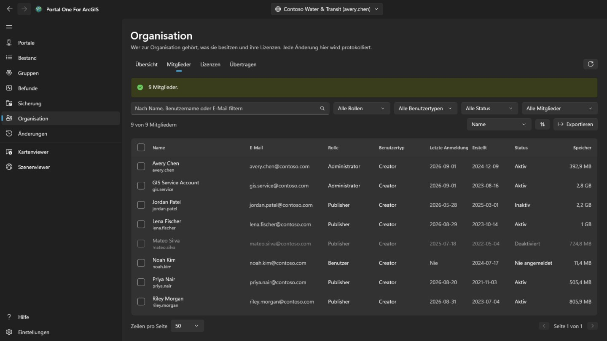

Jedes Mitglied sieht diese Seite, wie im Portal. **Übersicht**, die auch die administrativen Kontakte der Organisation nennt, ist für alle da, und mit dem Recht, Mitglieder anzuzeigen, auch ein schreibgeschützter Tab **Mitglieder** ohne E-Mail, Anmeldungen, Status und Speicher. Mitglieder markieren, **Exportieren**, **Lizenzen** und jede Änderung gibt es nur für Konten, die Mitglieder verwalten (portal:admin:viewUsers). **Übersicht** fasst die Organisation zusammen: in ArcGIS Online Abonnement, Plätze und Credits; die Mitglieder nach Status, Rolle und Benutzertyp; und wie viel Inhalt und Speicher sie belegt.

**Mitglieder** listet alle in der Organisation auf, gefiltert nach Name, Rolle, Benutzertyp, Status oder Gruppe, nach jeder Spalte sortierbar und mit **Exportieren** als CSV-Datei zu speichern. Markieren Sie Mitglieder, um sie zu deaktivieren oder zu aktivieren, ihre Rolle oder ihren Benutzertyp zu ändern, sie aus Gruppen zu entfernen oder sie zu löschen; ist genau eines markiert, öffnet **Offboarding** die Registerkarte **Übertragen** dieser Seite. Ihr eigenes Konto bleibt immer unangetastet, und der Besitzer einer Gruppe bleibt in ihr.

Ein Rechtsklick auf ein Mitglied öffnet sein eigenes Menü. **Ansicht** zeigt **Profil**, **Elemente** und, für Administratoren, **Gruppen** – hier in der App statt im Portal; ein einfaches Mitglied sieht nur die mit ihm geteilten Elemente. **Verwalten** ist Administratoren vorbehalten, jeder Eintrag nur mit dem Recht, das er braucht: **Add-on-Lizenzen** legt fest, welche Berechtigungen das Mitglied hat, **E-Mail-Adresse bearbeiten** ändert sie bei Konten mit ArcGIS-Anmeldung, **Inhalte übertragen** öffnet für das Mitglied die Registerkarte **Übertragen**, und **Mitglied übertragen** gibt einem anderen Mitglied Benutzertyp, Rolle und Add-on-Lizenzen und setzt dann auf der Registerkarte **Übertragen** mit Inhalten und Gruppen fort. Dasselbe Menü ändert Benutzertyp, Rolle, Gruppen, Status oder Konto eines Mitglieds, wie es die Leiste für mehrere tut.

**Löschen** entfernt nur Mitglieder, denen keine Elemente und keine Gruppen gehören. ArcGIS gibt diese beim Löschen eines Kontos nicht weiter, verschieben Sie sie also zuerst auf der Registerkarte **Übertragen**. Bevor etwas geschieht, tippen Sie den Benutzernamen ein, bei mehreren Mitgliedern deren Anzahl. Löschen lässt sich nicht rückgängig machen.

**Lizenzen** zeigt, wie viele von jedem Benutzertyp vergeben sind und, in ArcGIS Online, wie viele das Abonnement umfasst; **Mitglieder anzeigen** listet, wer diesen Typ hat. Wählen Sie eine Add-on-Lizenz, um zu sehen, wer sie hält, und entziehen Sie sie den markierten Mitgliedern.

Jede Änderung wird vom Portal zurückgelesen und mit dem vorherigen Stand aufgezeichnet; sie erscheint auf der Seite **Änderungen**. Diese Mitgliedsänderungen werden dort nicht rückgängig gemacht: Um eine umzukehren, nehmen Sie die entgegengesetzte Änderung vor.

## Änderungen

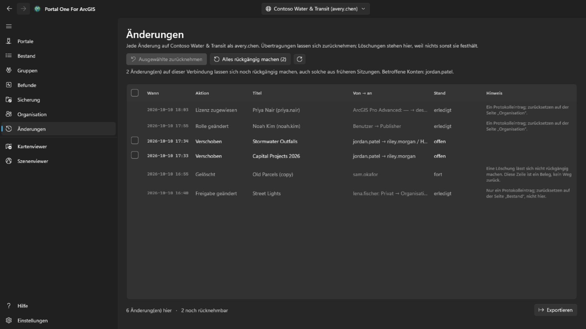

Die Seite **Änderungen** wird jedem angemeldeten Konto angezeigt. Sie listet, neueste zuerst, alles auf, was dieses Werkzeug am jetzt ausgewählten Portal geändert hat: Übertragungen, Löschungen, Freigaben, Tags, Ordner, Details, Schutz und Mitgliedsänderungen. Änderungen auf anderen Portalen werden gezählt, aber nicht aufgelistet. Die Liste lässt sich als CSV exportieren.

Übertragungen, die zurückgesetzt werden können, haben ein Kästchen. **Ausgewählte zurücknehmen** holt die angehakten Übertragungen zurück, und **Alles rückgängig machen** holt nach einer Bestätigung, wessen Inhalte es sind, alles noch Offene auf dieser Verbindung zurück. Elemente kehren in die Ordner zurück, aus denen sie kamen; ein verschwundener Ordner wird neu angelegt. Löschungen und Mitgliedsänderungen sind dort nur Aufzeichnungen: Eine Löschung kann nicht rückgängig gemacht werden, und eine Mitgliedsänderung wird durch die entgegengesetzte Änderung umgekehrt. Eine Übertragung zurückzunehmen ist selbst eine Übertragung und braucht dasselbe Recht (portal:admin:reassignItems, bei einer Gruppe reassignGroups); ein Konto ohne dieses Recht sieht nur das Protokoll.

Eine aus dem Kartenviewer überschriebene Webkarte und ein dort hinzugefügtes, bearbeitetes oder gelöschtes Feature werden über das Menü ihrer Zeile zurückgenommen. Eine Feature-Bearbeitung wird nur zurückgenommen, solange das Feature noch so ist, wie die Bearbeitung es hinterlassen hat: Ein hinzugefügtes Feature wird gelöscht, ein bearbeitetes erhält seine früheren Werte und seine Form zurück, ein gelöschtes wird unter einer neuen Objekt-ID wieder hinzugefügt. Auch das Zurücknehmen wird aufgezeichnet und kann ebenso zurückgenommen werden. Bevor eine Webkarte zurückgesetzt wird, listet **Mit der aktuellen Karte vergleichen** im selben Menü auf, worin sich die vor diesem Speichern aufbewahrte Kopie von der Karte unterscheidet, wie das Portal sie jetzt hält: Grundkarte, hinzugefügte, entfernte, umbenannte oder verschobene Layer und je Layer Sichtbarkeit, Deckkraft, Stil, Beschriftung, Filter, Maßstabsbereich, Pop-up und Aktualisierung, Tabellen, Lesezeichen und wo die Karte öffnet.

## Kartenviewer und Szenenviewer

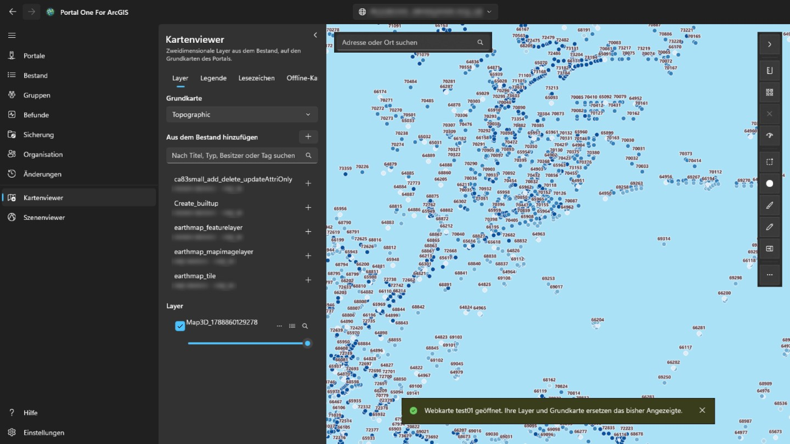

Der **Kartenviewer** zeigt zweidimensionale Layer auf den Grundkarten des Portals; der **Szenenviewer** zeigt diese und dreidimensionale – Szenen-Layer, Meshes, Punktwolken, 3D Tiles – auf einem Globus mit Gelände. Der Bereich links durchsucht, was für dieses Portal gelesen wurde – Ihre eigenen Inhalte, die automatisch gelesen werden, alles von einem Administrator Geprüfte und was die Registerkarten der Seite „Bestand“ gelesen haben – und listet nur, was der jeweilige Viewer darstellen kann. Wählen Sie ein Element, um es hinzuzufügen. Eine Webkarte öffnet sich im Kartenviewer, eine Webszene im Szenenviewer, jeweils als Ganzes mit eigenen Layern und eigener Grundkarte. Auf der Seite „Bestand“ öffnet die Viewer-Schaltfläche neben einem Titel (auch im Kontextmenü der Zeile) das Element in dem Viewer, der es anzeigen kann.

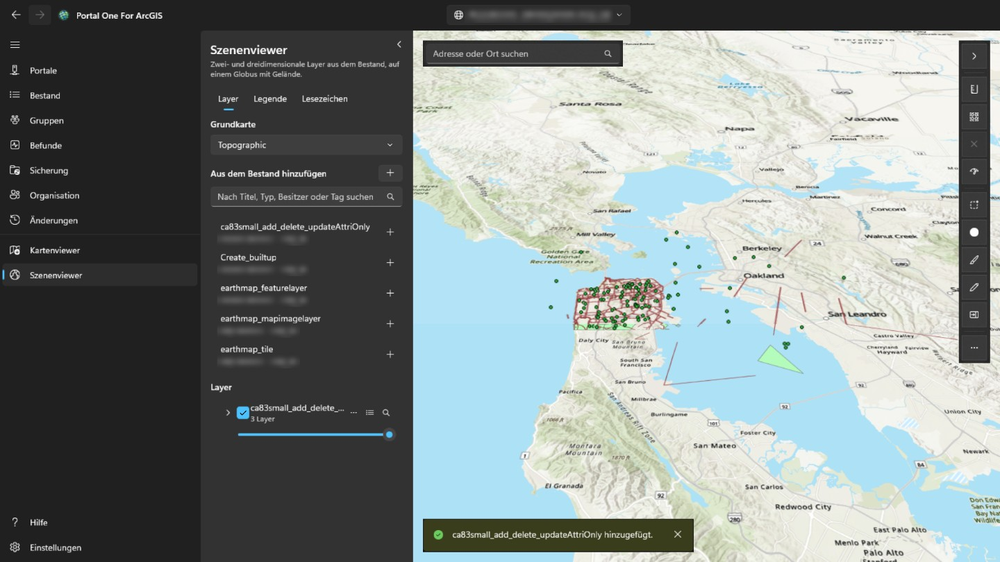

Die Schaltfläche oben rechts im Bereich klappt ihn ein, sodass Karte oder Szene die ganze Breite erhalten, und wieder aus; beim Aufrufen des Viewers ist er immer ausgeklappt. Jeder Layer lässt sich ein- oder ausblenden, transparenter machen, nach oben oder unten verschieben, heranzoomen oder entfernen. Ein Klick auf ein Feature zeigt seine Felder: hat der Layer im Portal ein Pop-up eingerichtet, die dort gewählten, mit dessen Beschriftungen und Formaten; sonst alle. Die Registerkarte **Legende** neben **Layer** zeigt, wofür die Symbole jedes sichtbaren Layers stehen. **Lesezeichen** listet die mit einer Webkarte oder Webszene gespeicherten Orte; benennen Sie dort die aktuelle Ansicht, um eigene hinzuzufügen, und wählen Sie eines aus, um dorthin zurückzukehren. Ein Szenen-Lesezeichen behält Blickrichtung und Neigung der Kamera. Die Tabellenschaltfläche eines Layers mit Features öffnet unter der Karte seine **Attributtabelle**, zweihundert Zeilen auf einmal und so gefiltert, wie der Layer gezeichnet wird; ein Klick auf eine Zeile hebt das Feature hervor und zoomt darauf. **Exportieren** schreibt alle Zeilen, die die Tabelle mit ihren Filtern und ihrer Sortierung enthält (bis zu 50.000), nicht nur die geladenen: als CSV so, wie die Tabelle sie zeigt, als GeoJSON in Breite und Länge oder als gezipptes Shapefile im Koordinatensystem des Layers (Feldnamen auf zehn Zeichen gekürzt). Die Spaltenüberschrift sortiert die Tabelle danach, filtert sie (wie der Layerfilter, eine Bedingung je Spalte, alle zugleich) oder zeigt ihre Statistik: wie viele Zeilen einen Wert haben, kleinster und größter Wert, bei Zahlen Summe, Mittelwert und Standardabweichung, dazu die häufigsten Werte – über alle Zeilen, die die Filter passieren, nicht nur die geladenen. **Nur ausgewählte** beschränkt die Tabelle auf die ausgewählten Zeilen. Im Kartenviewer messen **Entfernung** und **Fläche** über der Karte, was Sie durch Klicken von Punkten skizzieren: entlang der Erdoberfläche, nicht auf der flachen Karte, metrisch oder imperial, wie es Ihre Windows-Region vorgibt. Im Szenenviewer misst **Entfernung** zwischen zwei Klicks auf Gelände oder Modell (direkt, am Boden und vertikal), und **Fläche** folgt Ecken, die auf das Gelände gelegt sind. **Als Webkarte speichern** erstellt in Ihren eigenen Inhalten, in einem Ordner Ihrer Wahl, ein neues Webkarten-Element mit der Grundkarte, den Layern und den Lesezeichen, die jetzt angezeigt werden; es öffnet dort, wo die Karte jetzt steht, und hat ein Bild davon als Miniatur. **Speichern** überschreibt eine aus dem Portal geöffnete Webkarte, wenn sie Ihnen gehört oder Sie fremde Inhalte ändern dürfen, nachdem eine Kopie auf diesem Rechner angelegt wurde; der Szenenviewer kann nicht speichern. Das Suchfeld findet Adressen und Orte über den Geocoder des Portals. **Exportieren** speichert ein PNG der Ansicht und, wenn das Portal einen Druckdienst auflistet, startet **Drucken** ihn. Zeitbezogene Layer öffnen eine **Zeit**-Leiste zum Schrittweisen Durchlaufen oder Abspielen. Die Layer bleiben erhalten, während Sie auf anderen Seiten arbeiten, und beginnen neu, wenn Sie zu einem anderen Portal wechseln. Die Anmeldung beim Portal wird für dessen eigene Layer verwendet und nie an den Server einer anderen Organisation gesendet; ein anderswo registrierter Layer, der eine Anmeldung verlangt, wird daher nicht geladen. Beim Messen in der Karte beendet ein Doppelklick, die Eingabetaste oder **Fertig** die Skizze: Sie bleibt mit ihrem Ergebnis auf der Karte, bis zur nächsten Messung oder bis zum ✕ neben den Werkzeugen. Esc bricht die Skizze ab, Strg+Z oder die Rücktaste nimmt den letzten Punkt zurück. Die Stil-Schaltfläche an einem Layer mit Features ändert, wie er gezeichnet wird: ein Symbol in Farbe und Größe Ihrer Wahl, eine Farbe je Wert eines Felds (**Kategorien**) oder Klassen eines numerischen Felds entlang eines Farbverlaufs (**Klassen**, nach natürlichen Unterbrechungen, gleichem Intervall oder Quantil). Die Karte folgt jeder Änderung; **Übernehmen** behält sie, **Abbrechen** stellt das vorher Gezeichnete wieder her und **Original wiederherstellen** den Stil, mit dem der Layer kam. Die Legende folgt ebenfalls, und beim Speichern als Webkarte bleibt der Stil erhalten. Die Schaltfläche **…** in derselben Zeile öffnet auch **Beschriftung…**, um den Wert eines Felds an jedem Feature in Größe und Farbe Ihrer Wahl anzuzeigen, mit Halo und ab einem Maßstab, und **Filter…**, um nur die Features zu zeigen, die aus Feld, Vergleich und Wert gebildete Bedingungen erfüllen, alle oder eine davon; die Anzahl der Treffer wird laufend gezählt, ein Filter aus der Webkarte des Layers bleibt erhalten, und die Attributtabelle folgt ihm. Unten links auf der Karte dreht sich ein Kompass mit der Karte (auswählen, um sie wieder nach Norden auszurichten); daneben ein über dem Gelände gemessener Maßstabsbalken, der Maßstab und die Koordinaten unter dem Zeiger (auswählen zum Kopieren oder zum Wechsel zwischen Dezimalgrad und Grad, Minuten, Sekunden) sowie eine Schaltfläche für eine Übersichtskarte, in der ein Klick die Karte verschiebt. **Auswählen** wählt die Features aller sichtbaren Layer in einem Rechteck, einer Freihandform oder einem Polygon aus: Ein Bereich nennt die Anzahl je Layer sowie Summe, Mittelwert, Minimum und Maximum eines numerischen Felds und zeigt sie in der Tabelle, zoomt auf sie oder speichert sie als CSV-Datei. **Puffer** zeichnet den Bereich im gewählten Abstand um die ausgewählten Features oder um einen Punkt, eine Linie oder Fläche, die Sie zeichnen, misst ihn auf diesem Computer über der Erdoberfläche (kein Analysedienst, keine Credits) und kann die abgedeckten Features auswählen. **Wischen** zeigt einen Layer links einer verschiebbaren Trennlinie und die Karte ohne ihn rechts davon. **Karte prüfen** untersucht jeden Layer der Karte und nennt, was bei denen, für die sie freigegeben ist, fehlschlagen oder in die Irre führen würde: Layer, die nicht laden, Elemente, die fehlen oder enger freigegeben sind als die Karte, Dienste über http oder außerhalb des Portals, veraltete Elemente, Elemente anderer Organisationen, große Layer ohne Maßstabsbereich und gar keine Pop-ups; der Bericht lässt sich kopieren. Außerdem nennt sie Felder, auf die Pop-up, Symbolisierung oder Beschriftung eines Layers verweisen, die der Layer aber nicht hat, und misst, wie lange das Zählen der Features jedes Dienst-Layers dauert: ab 3 Sekunden wird es vermerkt, ab 10 oder ohne Antwort binnen 30 ist es eine Warnung. Im Menü **…** eines Layers liest **Verwendet von…** die Karten und Apps im Inventar und nennt jene, die den Layer direkt oder über eine Karte nutzen; **Eigenschaften…** zeigt Herkunft, Besitzer, Darstellung und bei Features deren Anzahl und Felder. Das Suchfeld nimmt auch Koordinaten an — zwei Dezimalzahlen in beliebiger Reihenfolge, Grad/Minuten/Sekunden, UTM oder MGRS — und springt ohne Geocoder dorthin. Über **Exportieren** lässt sich ein Link kopieren, der die Webkarte im Viewer des Portals an dieser Stelle öffnet, oder die Koordinaten der Mitte. Über „Layer-Einstellungen“ im Layermenü legen Sie den sichtbaren Maßstabsbereich, Pop-ups für Feature-Layer (Titelplatzhalter, Feldbeschriftungen, Sichtbarkeit und Reihenfolge) und unterstützte Aktualisierungsintervalle fest; die Vorschau ist live, und beim Speichern der Webkarte bleiben sie erhalten. Der Stildialog kann Punkt-Layer nun als Heatmaps zeichnen, Punktsymbole oder Linienbreiten aus einem Zahlenfeld skalieren und Punkt-Clustering mit Anzahlbeschriftungen einschalten; Polygon-Layer behalten die vorhandenen Farbstile. Das Menü Hinzufügen auf der Registerkarte Layer kann auch eine Service-URL oder eine lokale Datei hinzufügen: CSV und GeoJSON werden beim Speichern eingebettete Feature-Sammlungen, während Shapefiles und KML- oder KMZ-Dateien lokal bleiben und vor dem Speichern genannt werden. Skizze fügt einen gespeicherten Markup-Layer mit Punkten, Linien, Flächen, Rechtecken, Kreisen oder Ellipsen, Freihandformen und Text hinzu; wählen Sie ein Skizzen-Feature aus, um es umzuformen, neu zu stylen, zu löschen, die letzte Markierung rückgängig zu machen oder den Layer zu leeren, und die Skizzen-Feature-Collection wird mit der Webkarte gespeichert. Das **Bearbeiten**-Werkzeug des Karten-Viewers listet Service-Feature-Layer mit Bearbeitungsrecht, erklärt schreibgeschützte Layer, lässt ein neues Feature aus einer Vorlage zeichnen oder ein vorhandenes auf der Karte wählen, prüft die bearbeitbaren Felder und sendet bestätigte Änderungen an den Live-Feature-Service. Wählen Sie in der Attributtabelle eines bearbeitbaren Layers Zeilen mit Strg oder Umschalt aus (Strg+A für alle geladenen): **Bearbeiten** öffnet eine davon im Bearbeitungsformular, und **Feld ändern** setzt ein Feld bei allen auf einen Wert, nachdem er gegen die Regeln jedes Features geprüft wurde.  **Feld ändern** kann auch einen Ausdruck verwenden — Feldnamen in eckigen Klammern, Text in Anführungszeichen, + - * / und einige Funktionen — sodass jede ausgewählte Zeile ihren eigenen Wert aus anderen Feldern erhält.  Im Bearbeitungsbereich bieten **Geometrietools** **Auf Karte auswählen**, **Zusammenführen**, **Teilen** von Linien oder Polygonen mit einer Schnittlinie, **Zuschneiden** auf einen gezeichneten Bereich und **In Layer kopieren** in einen anderen bearbeitbaren Layer derselben Form; jede Aktion wird auf der Seite **Änderungen** aufgezeichnet. Beides wird auf der Seite **Änderungen** aufgezeichnet, eine Feldänderung als ein Eintrag, und dort zurückgenommen. Für ein ausgewähltes Feature listet das Bearbeitungsformular auch seine Anhänge auf, sofern der Layer welche führt, zum Öffnen, Hinzufügen oder Entfernen (eine entfernte Datei wird zuerst auf diesen Computer kopiert, und jede Änderung wird auf der Seite **Änderungen** aufgezeichnet), und zeigt die mit ihm verknüpften Datensätze schreibgeschützt an. Beim Zeichnen oder Umformen eines Features fangen seine Stützpunkte an den Features der Layer, die im Bearbeitungsbereich unter **Fangen** angehakt sind, und Geometriehilfen bieten rechte Winkel und Parallelen an; beides lässt sich ausschalten und der Fangabstand einstellen. Messen, Skizze und die übrigen Werkzeuge fangen nicht. **Freigeben** neben **Als Webkarte speichern** gibt die angezeigte Webkarte oder Webszene frei, wie die Seite „Bestand“ ein Element freigibt, wenn sie diesem Konto gehört oder es Inhalte anderer freigeben darf: Nach der Wahl von Stufe und Gruppen wird die Karte so geprüft, wie sie freigegeben würde, und was auf dieser Stufe fehlschlagen oder in die Irre führen würde, wird aufgelistet, bevor die Freigabe erfolgt. **Details** bearbeitet Titel, Zusammenfassung, Beschreibung, Tags, Quellenangaben und Nutzungsbedingungen des Elements wie die Seite „Bestand“ und kann außerdem ein Bild der Ansicht als Miniatur verwenden und die Ausdehnung des Elements, die die Suche des Portals nutzt, auf die Ansicht setzen; wo die Karte öffnet, legt das Speichern über sie fest. Das Pop-up eines Features zeigt außerdem, in der vom Autor festgelegten Reihenfolge, die Bilder, Diagramme und Anhänge des im Portal eingerichteten Pop-ups sowie seine verknüpften Datensätze; Arcade-Ausdrücke werden vorher ausgewertet. Diagramme erscheinen im Design der App, Bilder werden nur von https-Adressen geladen, und ein Anhang öffnet sich per Klick. Wenn ein Service umzieht oder ersetzt wird, richtet **In Webkarten ersetzen…** im Menü **…** eines Layers jede Webkarte und Webszene im Bestand, die ihn nutzt, auf die neue Adresse aus (die Layer eines ganzen Service behalten ihre Nummern), nachdem aufgelistet wurde, was sich in jeder ändert; jede Karte wird vor dem Schreiben aufbewahrt und auf der Seite **Änderungen** aufgezeichnet, wo sie verglichen und wiederhergestellt werden kann. Die Layer-Liste zeigt Gruppen-Layer als Baum: Klappen Sie eine Gruppe auf, um die Layer darin zu verwalten, benennen Sie beliebige Layer um, bilden Sie aus ausgewählten Layern der obersten Ebene eine neue Gruppe, verschieben Sie einen Layer in eine Gruppe oder aus ihr heraus, oder heben Sie die Gruppierung wieder auf. Der Karten-Viewer kann aus einer Linie ein Höhenprofil zeichnen, nutzt dafür gekacheltes Gelände statt kostenpflichtiger Analysedienste und lässt die abgetasteten Entfernungen und Höhen kopieren oder exportieren. Ein Service-Feature-Layer kann außerdem ein schreibgeschütztes Diagramm unter der Karte öffnen; es nutzt Servicestatistiken statt alle Features herunterzuladen, kann auf Ansicht oder Auswahl begrenzt werden, exportiert PNG oder CSV und wird nicht in der Webkarte gespeichert.  Eine vom Computer hinzugefügte CSV-, GeoJSON- oder Shapefile-Datei kann über das Layer-Menü als gehosteter Feature-Layer veröffentlicht werden; dabei wird die Quelldatei hochgeladen, der Service in Ihren Inhalten erstellt und der lokale Layer ersetzt. KML und KMZ werden nicht angeboten, weil das Portal sie nicht als Feature-Services veröffentlicht.  Der Stildialog bietet auch Typen mit einem Größenfeld und Beziehungsdarstellungen aus zwei Feldern; kontinuierliche Farbrampen, Punktdichte und Binning werden nicht angezeigt, weil ArcGIS Maps SDK for .NET 300.1 sie hier nicht sicher unterstützt. Beschriftungen und Pop-up-Felder können auch Arcade-Ausdrücke verwenden, mit Feldeinfügung, häufigen Bausteinen und einem Test an einem echten Feature vor dem Anwenden.  Editierbare Feature-Layer können außerdem ein in der Webkarte gespeichertes Formular tragen: Der Bearbeitungsbereich folgt dessen Gruppen, Pflichtregeln und berechneten Werten, und der Befehl **Formular…** im Layer-Menü bearbeitet dieses Formular. Portal-Webkarten können im Map Viewer offline genommen werden: Die App prüft die Offline-Fähigkeiten, lädt einen vorbereiteten Bereich oder die aktuelle Ansicht unter LocalState herunter, öffnet ihn auf der Registerkarte Offline-Karten, schreibt Änderungen lokal fest und synchronisiert sie als einen Changes-Eintrag zurück, wenn das Konto eine Basic-Runtime-Lizenz oder höher hat.  Netzwerkanalyse im Karten-Viewer fügt Routen, Einzugsgebiete und nächste Einrichtungen aus Portal-Hilfsdiensten hinzu; ArcGIS Online verbraucht Credits.  Abschnitte mit zugehörigen Datensätzen lesen Beziehungen über Beziehungstabellen auch in einer verborgenen SDK-Karte, sodass Viele-zu-viele- und attributierte Beziehungen funktionieren, wenn die zugehörigen Tabellen nicht in der Webkarte enthalten sind.  In Szenen können Feature-Layer außerdem per Klick, Bodenrechteck oder geklicktem Polygon ausgewählt, aus ausgewählten Features oder aus einem geklickten Punkt, einer Linie oder Fläche gepuffert, in Diagrammen ausgewertet und bearbeitet werden: Attribute über das Formular des Layers, neue Features und das Neuzeichnen der ganzen Form aus geklickten Punkten sowie Zusammenführen, Kopieren, Teilen und Zuschneiden; nur das Umformen Stützpunkt für Stützpunkt bleibt kartenbezogen, weil das SDK den Geometrie-Editor nur für MapView bereitstellt. Skizzen in Szenen (per Klick gesetzte Punkte, Linien, Polygone, Rechtecke, Ellipsen und Texte) gelten nur für die Sitzung, da Webszenen hier nicht gespeichert werden können; Freihandzeichnen gibt es nur in der Karte. **Skizze als GeoJSON exportieren** im Bereich Skizze sichert die Markierungen beider Viewer als Datei. Szenen zeichnen außerdem ein **Höhenprofil** entlang einer geklickten Linie, gelesen aus dem eigenen Gelände der Szene, wenn sie eines hat, sonst aus derselben Quelle wie im Kartenviewer, und auch der Bereich **Netz** funktioniert dort: Klicks auf den Boden setzen Stopps, Einrichtungen und Vorfälle, Ergebnisse liegen auf der Szene, und eine als Layer hinzugefügte Route bleibt nur für die Sitzung erhalten.  Szenenaktionen geben auch frei, bearbeiten Details, kopieren Links oder Mittelpunkte, exportieren Bilder, prüfen Layer, zeigen Verwendungen und ersetzen Quellen; Szeneninstrumente zeigen Richtung, Zeigerkoordinaten, Übersicht und Kamerahöhe, und lokale mobile Szenenpakete öffnen schreibgeschützt. **Vergleichen** in Szenen verwendet eine synchronisierte, zugeschnittene Kopie der vollständigen Szene; navigiert wird weiter in der Hauptszene, während die Trennlinie sie mit und ohne den gewählten Layer vergleicht.  Das kurze Feld für die Ortssuche bleibt oben links; der Pfeil an der rechten Werkzeugleiste blendet beide animiert aus oder wieder ein, und Weitere Befehle enthält die seltener verwendeten Element-, Prüf-, Zeit- und Exportbefehle.

## Im Hintergrund

Das Schließen des Fensters legt die App in den Infobereich, statt sie zu
beenden, **damit ein stundenlanger Durchlauf nicht von der Geste beendet wird,
mit der man ein Fenster beiseiteschiebt**. Das Symbol nennt das Laufende, und
**Beenden** dort ist der Ausgang. Über sein Menü können Sie außerdem ein Portal hinzufügen und im Microsoft Store nach einem Update suchen oder das gefundene installieren.

Schalten Sie das Symbol im Infobereich ab, beendet das Schließen die App — ohne
Symbol gäbe es nichts, was das Fenster zurückholt.

**Mit Windows starten** startet die App bei der Anmeldung in den Infobereich, so
ist die genutzte Verbindung schon angemeldet, wenn Sie die App öffnen.

## Einstellungen

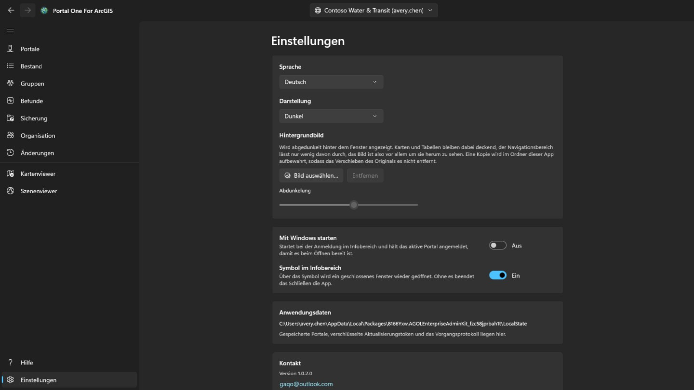

Hell, dunkel oder wie Windows; das Design wechselt beim Auswählen. Hat der Microsoft Store eine neuere Version, erscheint im Navigationsbereich neben Einstellungen eine Schaltfläche **Aktualisieren**; die App schließt sich während der Installation, startet mit der neuen Version, und die Schaltfläche ist verschwunden. Unter dem Fenster lässt sich ein **Hintergrundbild** festlegen; solange es angezeigt wird, bleiben Karten und Tabellen deckend und der Navigationsbereich lässt nur wenig davon durch, es erscheint also vor allem um sie herum, und **Abdunkelung** legt fest, wie stark es abgedunkelt wird.

Die Oberfläche gibt es in vierzehn Sprachen und folgt Windows, sofern Sie keine
festlegen. **Ein Sprachwechsel wirkt beim nächsten Start**, dort als Schaltfläche
angeboten — das Framework liest den Text jeder Ansicht einmal beim Aufbau:
sofortiges Anwenden würde nur später geöffnete Teile umstellen.

**Abonnement** ist es, was die Markierung von den Seiten nimmt, und sonst steht hier nichts dahinter: die Anmeldung an einem Portal, seine Bestandsaufnahme, die Sicherung und das Drucken einer Karte bleiben kostenlos, ob gezahlt wurde oder nicht. Es ist ein monatliches Abonnement, das über den Microsoft Store gekauft wird und jederzeit kündbar ist; die Karte sagt, was es kostet und wann es sich verlängert, sobald es eines gibt. *Kauf wiederherstellen* ist für den Fall gedacht, dass Sie gezahlt haben und die Markierung noch da ist — das Abonnement kann im eigenen Fenster des Store gekauft worden sein, wovon diese App nichts erfährt.

**Wasserzeichen** setzt eine eigene Zeile in die rechte untere Ecke jeder Seite: bis zu vierundzwanzig Zeichen, in der Schriftart, Größe, Schriftschnitt, Farbe und Stärke, die Sie hinter **Weitere Einstellungen** wählen — die Karte selbst zeigt nichts als den Schalter, der die Markierung einschaltet. Sie beginnt mit dreißig Pixeln in einem kräftigen Rot bei voller Stärke und wandert alle sechs Minuten eine Minute über die Seite: fünf Minuten in der Ecke, eine Minute unterwegs, dann zurück in die Ecke. Sie wandert, weil wer ein Bild des Fensters macht, entscheidet, wo dessen Ränder liegen, und eine Ecke ist der Teil, der am leichtesten wegfällt; sie ruht, weil auf einer Seite, an der gearbeitet wird, keine Zeile quer durch deren Zeilen laufen sollte — der Schalter für das Wandern steht hinter **Weitere Einstellungen**. Es ist eingeschaltet, wenn Sie zum ersten Mal hierher kommen, und liest *Nicht abonniert* — was diese App verlässt, wird irgendwo gesehen, das nichts darüber sagt, womit es gemacht wurde. **Stärke** ist, wie viel von der Farbe genommen wird: ganz unten kommt jede Farbe als derselbe blasse Hauch heraus, eine Farbe allein kann also nicht beantworten, wie sichtbar es ist. Leer gelassen greift die Voreinstellung. Bis Sie abonnieren, lässt sich auf dieser Karte nichts ändern — weder der Schalter noch der Text: sie liest *Nicht abonniert*, und ein Druck darauf öffnet die Karte weiter oben. Das Abonnement ist es, was sie abschalten und selbst bestimmen lässt, was sie sagt; ohne eigene Wahl steht dort der Name der App. Markiert wird der Bildschirm: die Bilder, die die App speichert, kommen vom Druckdienst des Portals und gehen so hinaus, wie das Portal sie geschickt hat.

## Tastatur

In jeder der Tabellen:

- **Strg+F** setzt den Cursor in das Filterfeld.
- **Strg+E** exportiert die angezeigten Zeilen, mit den Spalten und der Sortierung, die Sie gerade sehen.

## Wo was liegt

- Sicherungen liegen in dem von Ihnen gewählten Ordner, einem gewöhnlichen
  Ordner zum Öffnen, Kopieren und Verschieben.
- Verbindungen, Einstellungen und das Änderungsaufzeichnungen liegen im Speicher
  dieser App, verschlüsselt, soweit es Anmeldedaten sind.
- Exportierte CSV-Dateien liegen dort, wo Sie sie speichern.

Nichts wird irgendwohin hochgeladen. **Es gibt kein Konto bei den Herstellern
dieses Werkzeugs und keine Telemetrie.**

## Kontakt

Etwas funktioniert nicht oder tut nicht, was Sie erwartet haben: **gaqo@outlook.com**.

Am meisten hilft, was Sie getan haben, was stattdessen geschah, ob das Portal ArcGIS Online oder ArcGIS Enterprise ist und in welcher Version — die Seite „Verbindungen“ zeigt beides — und in welcher Sprache die Oberfläche lief.

Bitte hängen Sie keine Kennwörter, Token oder Dateien aus dem Speicherordner der App an. Dort liegt eine angemeldete Sitzung, und nichts davon wird gebraucht, um eine Frage zu beantworten.
