# Help

**Portal One For ArcGIS** audits and maintains an ArcGIS organization from your own machine. It works the same way against **ArcGIS Online** and **ArcGIS Enterprise**.

Why the name: ArcGIS Online and ArcGIS Enterprise are both, at heart, a portal, so the single word **Portal** covers both of them — and it is what this app calls them too, on the **Portals** page where you add them. **One** is the app: one place for every portal you work with, several of them signed in at once. **For ArcGIS** says which platform it is built for.

This app talks to the portals you sign in to, to the map services, basemaps and elevation data their content points at, to its help website, where this page reads the latest help — when the website cannot be reached, it shows the help installed with the app — and to Microsoft Store, for updates and the subscription. Your credentials are encrypted for your Windows account and are sent only to the portal they belong to.

## The order the pages are in is the order to use them

Read, back up, dry run, execute. Each page makes the next one safe, and the
navigation is arranged so that working down it is the safe path.

## Connections

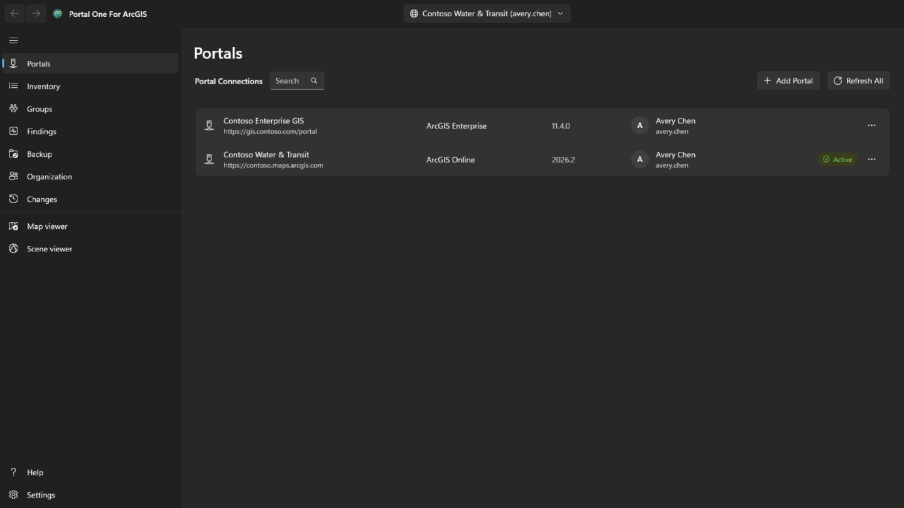

Add a connection with its portal address: `https://yourorg.maps.arcgis.com` for
ArcGIS Online, or the full address including the context path for ArcGIS
Enterprise, such as `https://portal.example.com/portal`. Nothing has to be
registered in the portal first. If the portal sits behind an identity-aware proxy such as Microsoft Entra application proxy or Google Cloud IAP, tick **Portal requires identity-aware proxy authentication**: a window opens to sign in to the proxy before the portal is read, closes by itself once the portal answers, and opens again whenever the proxy's session ends — what was running then carries on.

Sign in with a username and password, or through the portal's own sign-in page
shown inside the app. Use the second if your organization uses single sign-on
or multi-factor authentication: no password is typed into this app at all.

Several connections can be signed in at once, including two accounts on the same
portal. **Stay signed in** keeps the credential encrypted for your Windows
account, so the connection is still live after a restart.

Only the connection you are pointed at is kept renewed. The others are signed
out when their token expires and come back silently when you switch to one.

A signed-in connection shows the account's profile picture, or its initials when there is none. Select it for **My profile**, **My settings** or **Help**. **Help** opens this help on the help website, in your browser and in the language the app is showing; with no network, it opens the app's **Help** page instead. **My profile** shows the account as the portal's profile page does: photo, name, bio, groups and the items it shares with the organization or with everyone; **Edit profile** changes the names, bio, profile visibility and photo. **My settings** has the portal's sections: **General** (email address, start page, language, number and date format, units), **Security** (password and security question, for an ArcGIS login), **Licenses**, **Credits** where the organization allocates them, and the **Webhooks** the account owns. Each change says what it will write, is read back from the portal and is recorded on the **Changes** page, which can put back changes to the profile, settings, start page, photo and webhooks; a new password, a security question and a deleted webhook are recorded only. Multifactor authentication, security keys, recovery codes, linked accounts and Esri email preferences are shown or explained only: they are managed on the ArcGIS website. After a password change, or whenever the portal stops accepting the connection, the **Portals** page opens with its sign-in so you can sign in again with the new password.

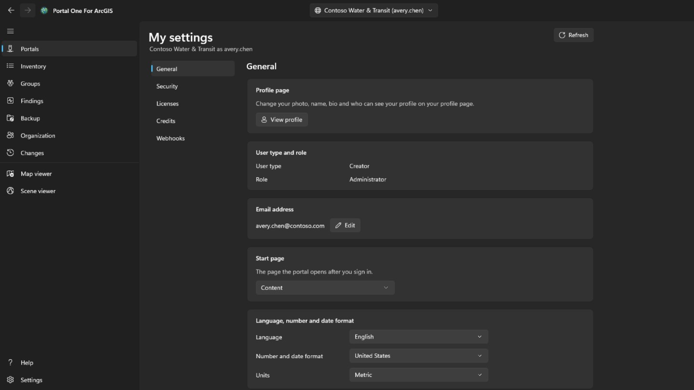

## Inventory

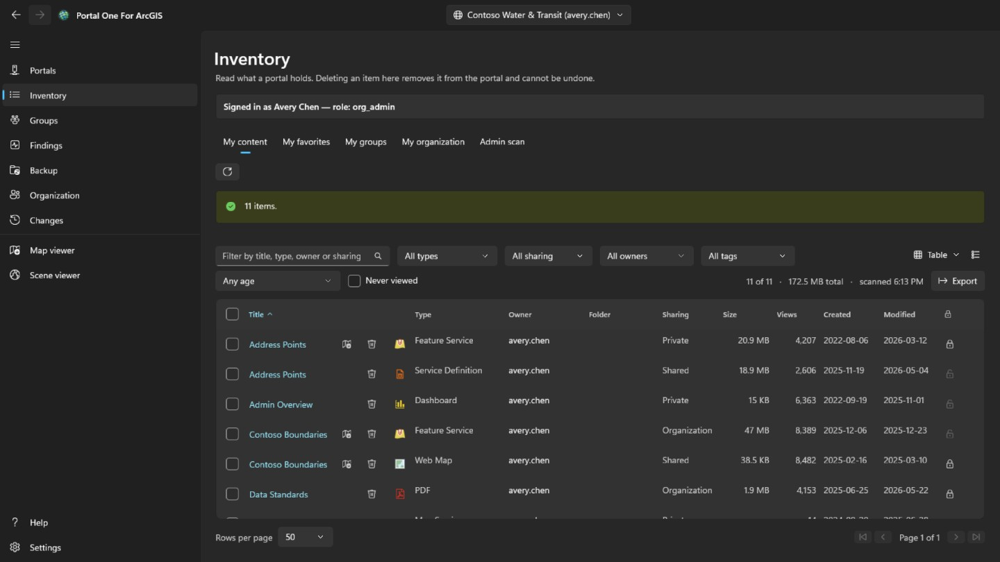

Shows what your account can see, in four tabs as the portal's own content page has them: **My content**, **My favorites**, **My groups** (all of them together, or one group, including groups you can see without belonging to) and **My organization** (what the organization shares). They are read as soon as the page opens and kept; the button beside them reads the tab shown again. A row's right-click menu follows the item's type: a web map can also open in the portal's Map Viewer, in Field Maps Designer or in ArcGIS Pro, a dashboard in Dashboards, a story in ArcGIS StoryMaps; a file can be downloaded; and any item can be added to or removed from your favorites. **Compare with another map…** on a web map or web scene reads it and a chosen map of the same type from the portal as they are now, and lists what differs: layers added, removed, moved or renamed, changed filters, symbology, labels and popups, the basemap, bookmarks and the initial view; the list can be copied. **Make a copy…** copies it into your content on this portal or another one you are signed in to, under a new title, in a folder or given on to another member; the copy is private, and on another portal each layer's item is looked up first, and a layer whose item is not there loads by its address, shown before anything is written. The view menu at the top right shows the rows as a **Table**, a **List** with each item's thumbnail and summary, or a **Grid** of cards, as the portal's content page does, and sorts them; the filters, the paging and the ticked rows stay the same in all three. On **My favorites**, **My groups** and **My organization** the folder, size and protection fill in a moment after a page appears: a search does not return them, so each item is read, the page in view first. A folder is shown only for your own items, or for anyone's to an administrator. An item's title, in the table, the list and the grid, opens the item's page in a window of its own, laid out as the portal's: on **Overview**, the item's card with its thumbnail, type, dates and summary, then its **Description**, what it holds for its type (a service's **Layers** and tables, a map's layers, a geoprocessing service's tasks), its **Terms of use** and its **Comments**, where a comment can be left; beside them, **Open in the map viewer**, **Open in the scene viewer**, **Share…** and **Open in ArcGIS Pro** with the rest behind a chevron, the **Owner**, the **Details** with the item's source and the URL to copy or open, a bar showing how complete its information is with the change that would help most, and its **Tags**, **Sharing**, **Folder** and **Acknowledgments**, each with the action that changes it; then the **Data**, **Visualization** and **Settings** tabs its type has. **Settings** follows the portal's: **General** for every item (content status, delete protection and deleting the item, the extent searches use), the item's own section — for a hosted feature layer editing, editor tracking, sync, export and true curves, saved together with **Save**; for a web map or scene its offline mode; for other layers the service's settings as it reports them — and a hosted feature layer's webhooks; each change is confirmed where it takes something away, read back from the portal and recorded on the **Changes** page, which can put it back.

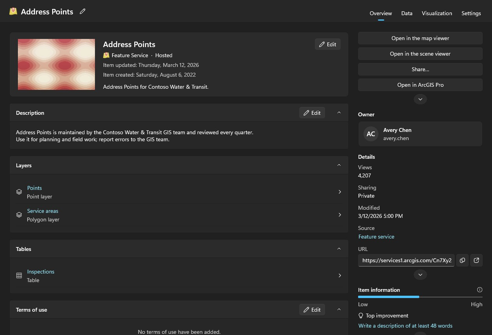

Scanning other people's content is an administrator's job. An account that may read what other members hold (portal:admin:viewItems) gets an **Admin scan** tab on this page and a scan on the Findings and Backup pages — one member, one group or the whole organization — and the **Organization** page's **Transfer** tab; other accounts do not see them. The organization walk asks each member for their content rather than searching, because search only returns what has been shared and an audit must not miss private items. It takes a while and can be cancelled.

Findings, Backup and the viewers read your own content by themselves the first time they need it, so no other page has to be visited first; an administrator's scan replaces it with what was scanned. Every table says when its list was read. A portal keeps changing after it has been read.

Each row also carries a delete button, and it is the one thing in this app that cannot be undone: ArcGIS has no undelete. The confirmation names the item, its type and its owner, and says whether the backup folder remembered for this connection holds a copy and when it was taken. It does not refuse without one, but that line is the only thing that could answer for the deletion afterwards. An item marked delete-protected in the portal is refused here rather than quietly unprotected. To change the protection itself, use the lock at the end of the row or the row's menu: it is a step of its own, removing protection asks first, and every change is read back from the portal and written to the journal. Tick the box at the start of a row — or the one in the header, for every row the filters show on every page — to act on many items at once. **Share** sets their sharing level and the groups they are shared with; **Tags** adds and removes tags and keeps the rest; **Move** puts one owner's items into one of that owner's folders; **Change owner** transfers them to another member, as the **Organization** page's **Transfer** tab does, and the **Changes** page puts them back; **Delete** removes them after a confirmation that says how many, whose, and how many the backup holds, and asks you to tick that you understand. Items this account may not change, and delete-protected ones, are left alone and counted. Items are done one at a time and journalled; **Cancel** stops between two of them, and the summary names what failed and why. From a row's right-click menu, **Share…** changes that item's level and the groups it is shared with, and **Edit details…** its title, summary, description, tags, credits and terms of use. Both open on the item as the portal holds it now, send only what you changed, check the result and are journalled.

## Findings

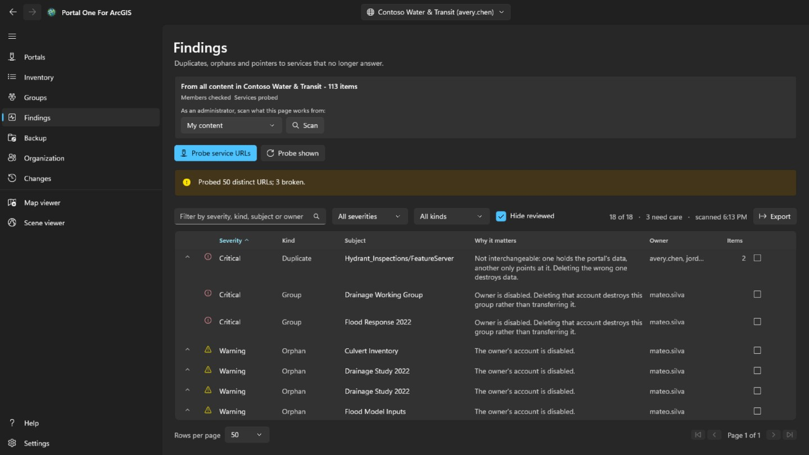

Redundant and dead content, sorted by how much attention it is owed rather than
by how bad it sounds.

- **Critical** means acting carelessly here destroys something that exists
  nowhere else — two items pointing at the same service, where deleting the
  wrong one is not recoverable.
- **Warning** is a real problem that is safe to act on: an item whose owner has
  left, a service that no longer answers.
- **Advisory** is worth knowing and may turn out to be fine.
- **Inconclusive** means it could not be determined. A service that timed out is
  not a service that is gone, and this tool will not say it is.

Open a row to see the items it stands for. Mark one as reviewed when you have
decided it is fine; the decision is remembered per connection and the row stays
visible rather than disappearing.

This page reports. It does not tell you which of two lookalike items to keep,
because that depends on who uses them and what points at them.

## Backup

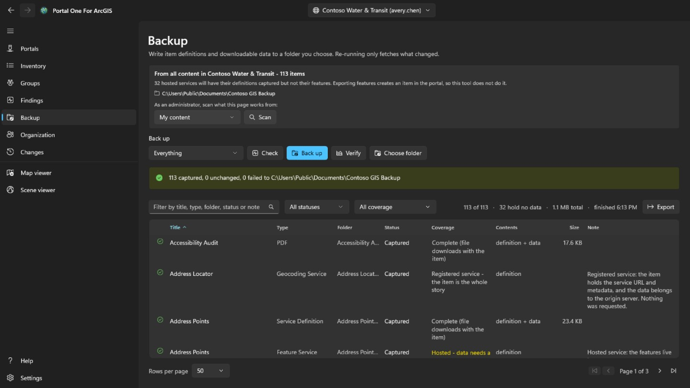

Writes item definitions, resources and downloadable data to a folder you choose.
Re-running against the same folder only fetches what changed, so resuming an
interrupted run and taking an incremental backup are the same thing.

- **Check** compares the folder against the portal and reports what it *would*
  do, writing nothing. This is how to answer "is my backup current" without
  spending hours finding out.
- **Verify** checks a folder against its own record, with no portal involved.
  That is the question left when the portal is gone, which is usually when
  anyone reads a backup in earnest.

The folder is remembered per connection, and a folder holding another
organization's backup is refused rather than written over.

**What a backup does not hold.** The features inside a hosted service live in
the portal's data store, not in the item, and getting them out needs an export
that creates a new item in the portal — a write. This tool does not do that, so
those rows are captured as a definition without their data, and the page says
how many. Services registered from another server are pointers by nature and
have nothing more to capture.

## Offboarding

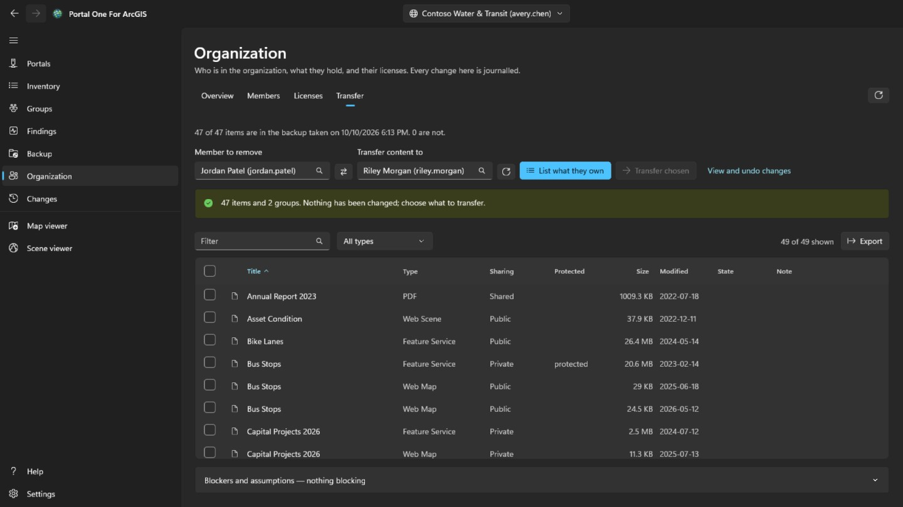

This is the **Transfer** tab of the **Organization** page, shown only to accounts that administer content (portal:admin:viewItems). It works out what removing a member involves, and moves their content, one thing at a time and reversibly.

Choose the member and the person receiving their content from the lists — both
come from the organization's own directory, so a name cannot be mistyped into
something that exists. **List what they own** changes nothing; it shows every
item and every group, and you tick what should move.

Nothing is ticked for you. Moving an entire account is one click on the header
checkbox, and that click is a decision rather than a default.

- Groups are in the same table as items on purpose. Deleting a member destroys
  the groups they still own instead of transferring them, so a group nobody
  ticked is the one quietly destructive thing on the page, and the count line
  says so.
- The confirmation lists the receiver's folders and lets you add a new one; the items land in the one you pick. Every transfer is written to the record before the next begins, and the **Changes** page puts each back in the folder it came from, recreating a folder that has gone, one at a time or all outstanding at once.
- Moving one item can move others with it. Transferring a shapefile takes the hosted service published from it, so a row may report that it arrived without this transfer being what sent it. Reversing that row alone on the **Changes** page will not bring it back; it returns with whatever carried it.
- After each move the item is read back from the portal. A request that returns
  success is a statement about the request, not about where the item now is.

The member's account itself is deleted on the **Organization** page, and only once they own nothing. It is the one step that cannot be undone.

## Organization

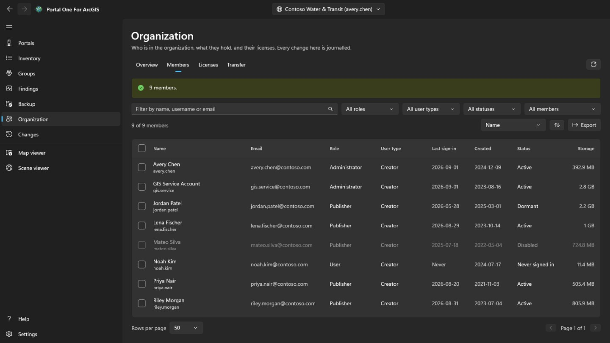

Every member sees this page, as in the portal. **Overview**, which also names the organization's administrative contacts, is for everyone, and with the privilege to view members so is a read-only **Members** tab, without email, sign-ins, status or storage. Ticking members, **Export**, **Licenses** and every change are only for accounts that administer members (portal:admin:viewUsers). **Overview** sums up the organization: on ArcGIS Online its subscription, seats and credits; the members by status, role and user type; and how much content and storage it holds.

**Members** lists everyone in the organization, filtered by name, role, user type, status or group, sorted by any column, and saved to a CSV file with **Export**. Tick members to disable or enable them, change their role or user type, remove them from groups, or delete them; with one ticked, **Offboard** opens this page's **Transfer** tab. Your own account is always left alone, and a group's owner stays in the group.

Right-click a member for their own menu. **View** shows their **Profile**, their **Items** and, for an administrator, their **Groups**, here in the app rather than in the portal; a plain member sees only the items shared with them. **Manage** is for administrators, each entry only with the privilege it needs: **Add-on licenses** sets which entitlements the member holds, **Edit email address** changes it for an account that signs in with ArcGIS, **Transfer content** opens the **Transfer** tab on them, and **Transfer member** gives another member their user type, role and add-on licenses, then continues on the **Transfer** tab with their content and groups. The same menu changes one member's user type, role, groups, status or account as the bar does for several.

**Delete** only removes members who own no items and no groups. ArcGIS does not hand those on when an account is deleted, so move them first on the **Transfer** tab. Before anything happens you type the username, or for several members how many there are. Deleting cannot be undone.

**Licenses** shows how many of each user type are assigned and, on ArcGIS Online, how many the subscription has; **Show members** lists who has that type. Choose an add-on license to see who holds it, and revoke it from the members you tick.

Every change is read back from the portal and recorded with what was there before, and is listed on the **Changes** page. These member changes are not undone from there: to reverse one, make the opposite change.

## Changes

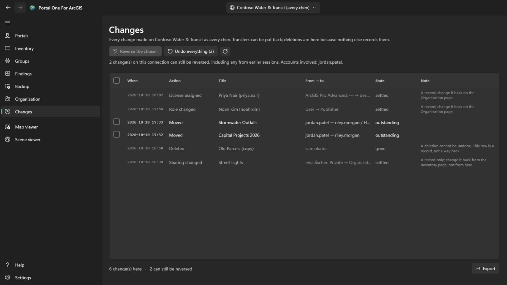

The **Changes** page is shown to every signed-in account. It lists, newest first, everything this tool has changed on the portal now selected: transfers, deletions, sharing, tags, folders, details, protection and member changes. Changes made on other portals are counted, not listed. The list can be exported to CSV.

Transfers that can be put back have a tick box. **Reverse the chosen** puts back the ticked transfers, and **Undo everything** puts back everything outstanding on this connection after a confirmation naming whose content it is. Items return to the folders they came from, recreating a folder that has gone. Deletions and member changes are records only: a deletion cannot be undone, and a member change is reversed by making the opposite change. Putting a transfer back is itself a transfer and needs the same privilege (portal:admin:reassignItems, or reassignGroups for a group); an account without it sees the record only.

A web map saved over from the map viewer, and a feature added, edited or deleted there, is put back from its row's menu. A feature edit goes back only while the feature is still as the edit left it: an added feature is deleted, an edited one gets its earlier values and shape, and a deleted one is added again under a new object id. Putting it back is recorded too, so it can be put back in turn. Before putting a web map back, **Compare with the map now** in the same menu lists what differs between the copy kept before that save and the map as the portal holds it now: the basemap, layers added, removed, renamed or moved, and each layer's visibility, opacity, style, labels, filter, scale range, pop-up and refresh, tables, bookmarks and where the map opens.

## Map viewer and scene viewer

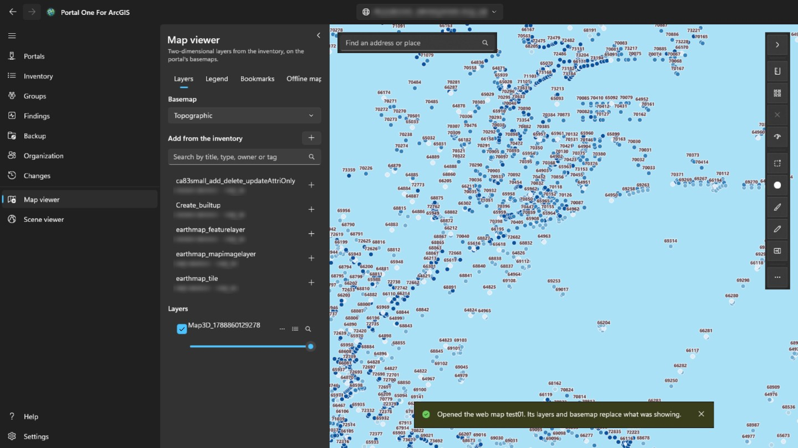

The **Map viewer** shows two-dimensional layers on the portal's own basemaps; the **Scene viewer** shows those and three-dimensional ones — scene layers, meshes, point clouds, 3D tiles — on a globe, with terrain. The panel on the left searches what has been read for this portal — your own content, which is read automatically, anything an administrator has scanned, and what the Inventory page's tabs have read — and lists only what that viewer can draw. Pick an item to add it. A web map opens in the map viewer, and a web scene in the scene viewer, as a whole, with its own layers and basemap. On the Inventory page, the viewer button beside a title (also in the row's right-click menu) opens that item in the viewer that can show it.

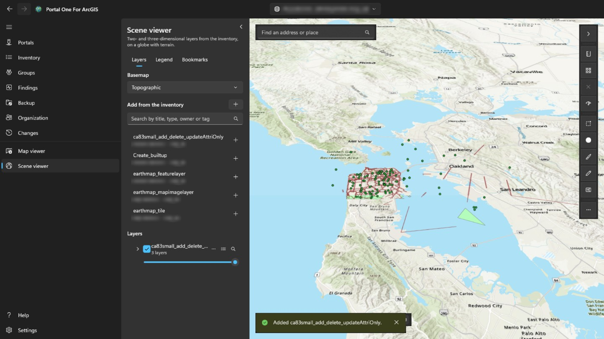

The button in the panel's top-right corner folds the panel away, giving the map or scene the whole width, and opens it again; it is open whenever you come to the viewer. Each layer can be shown or hidden, made more transparent, moved up or down, zoomed to, or removed. Clicking a feature on the map shows its fields: when the layer has a popup set up in the portal, the ones it chose, under its labels and formats; otherwise all of them. The **Legend** tab, beside **Layers**, shows what the symbols of each visible layer stand for. **Bookmarks** lists the places saved with a web map or web scene; name the current view there to add your own, and pick one to go back to it. A scene bookmark keeps the camera's heading and tilt. The table button on a layer with features opens its **attribute table** under the map, two hundred rows at a time, filtered as the layer is drawn; picking a row highlights that feature and zooms to it. **Export** writes every row the table holds with its filters and sort, up to 50,000, not only those loaded: as CSV the way the table shows them, as GeoJSON in latitude and longitude, or as a zipped shapefile in the layer's own coordinate system (field names cut to ten characters). A column's header sorts the table by it, filters it (as the layer filter does, one test per column, all of them applied) or shows its statistics: how many rows have a value, the least and greatest, for numbers the total, mean and standard deviation, and the most common values, over every row that passes the filters rather than only those loaded. **Selected only** narrows the table to the rows selected. In the map viewer, **Distance** and **Area** over the map measure what you sketch by clicking points: along the earth's surface, not on the flat map, in metric or imperial units as your Windows region uses. In the scene viewer, **Distance** measures between two clicks on the terrain or a model (direct, along the ground, and vertical), and **Area** follows corners draped on the terrain. **Save as web map** creates a new web map item in your own content, in a folder you choose, with the basemap, layers and bookmarks now showing, opening where the map is now and with a picture of it as the thumbnail. **Save** overwrites a web map you opened from the portal when you own it or may update others' content, after keeping a copy on this computer; the scene viewer cannot save. The search box also finds an address or place with the portal's geocoder. **Export** saves a PNG of the view and, when the portal lists a print service, **Print** runs it. Time-aware layers open a **Time** bar to step or play through their span. The layers stay there while you work on other pages, and start afresh when you switch to another portal. The portal's sign-in is used for its own layers and never sent to another organization's server, so a layer registered from somewhere else that asks for a sign-in will not load. While measuring on the map, double-click, press Enter or choose **Finish** to end the sketch: it stays on the map with its result until the next measurement or the ✕ beside the tools. Esc cancels the sketch, and Ctrl+Z or Backspace takes back the last point. The style button on a layer with features changes how it is drawn: one symbol in a colour and size of your choosing, a colour for each value of a field (**Categories**), or classes of a numeric field along a colour ramp (**Classes**, by natural breaks, equal interval or quantile). The map follows each change; **Apply** keeps it, **Cancel** puts back what was drawn, and **Restore original** the style the layer came with. The legend follows too, and saving the map as a web map keeps the style. The **…** button on the same row also opens **Labels…**, to show a field's value on each feature in a size and colour of your choosing, with a halo and from a scale on, and **Filter…**, to show only the features that match conditions you build from a field, a comparison and a value, all of them or any; it counts how many match as you go, keeps a filter the layer came with from its web map, and the attribute table follows it. At the map's bottom-left, a compass turns with the map (select it to face north again), a scale bar measured over the ground and the scale sit beside the coordinates under the pointer (select them to copy, or to switch between decimal degrees and degrees, minutes and seconds), and a button shows an overview map, where a click moves the map. **Select** chooses the features of every visible layer inside a rectangle, a freehand shape or a polygon: a panel lists how many in each layer, the total, mean, least and greatest of a numeric field, and shows them in the table, zooms to them or saves them as a CSV file. **Buffer** draws the area within a distance of the selected features, or of a point, line or area you draw, measures it over the earth's surface on this computer (no analysis service, no credits) and can select what it covers. **Swipe** shows a layer to the left of a divider you drag and the map without it to the right. **Check map** looks at every layer on the map and says what would fail or mislead the people it is shared with: layers that do not load, items that are gone or shared more narrowly than the map, services over http or outside the portal, deprecated items, items of another organization, large layers drawn at every scale, and no popups at all; the report can be copied. It also names the fields a layer's popup, style or labels refer to that the layer does not have, and times a count of each service layer's features: past 3 seconds that is noted, past 10, or with no answer in 30, it is a warning. On a layer's **…** menu, **Used by…** reads the maps and apps the inventory holds and lists those that use the layer, directly or through a map, and **Properties…** shows where it comes from, whose it is, how it is drawn and, for features, their count and fields. The search box also takes coordinates — two decimal numbers in either order, degrees, minutes and seconds, UTM or MGRS — and goes there without a geocoder. **Export** can copy a link that opens the web map in the portal's own viewer where it is now, or the centre's coordinates. Saving over a web map keeps its previous definition, and the **Changes** page can put it back from that save's menu. Layer settings on a layer menu set visible scale range, feature-layer pop-ups (title placeholders, field labels, visibility and order) and supported refresh intervals; the preview is live and saving the web map keeps them. The style dialog can now draw point layers as heat maps, size point symbols or line widths from a numeric field, and turn on point clustering with count labels; polygon layers keep the existing colour styles. The Add menu on the Layers tab can also add a service URL or a local file: CSV and GeoJSON become embedded feature collections when saved, while shapefiles and KML or KMZ files stay local and are called out before saving. Sketch adds a saved markup layer with points, lines, areas, rectangles, circles or ellipses, freehand shapes and text; select a sketch feature to reshape it, restyle it, delete it, undo the last mark or clear the layer, and the Sketch feature collection is saved with the web map. The map viewer's **Edit** tool lists service feature layers that allow editing, explains read-only layers, lets you draw a new feature from a template or select one already on the map, validates the editable fields, and applies confirmed changes to the live feature service. In the attribute table of an editable layer, select rows with Ctrl or Shift (Ctrl+A for all those loaded): **Edit** opens one of them in the Edit form, and **Change a field** sets one field to one value on all of them after checking it against each feature's own rules.  In the Edit panel, **Geometry tools** lets you **Select on map**, **Merge** shapes, **Split** lines or polygons with a cutting line, **Clip** to a drawn area, or **Copy to layer** into another editable layer of the same shape kind; each is recorded on the **Changes** page.  **Change a field** can also use an expression — bracketed field names, quoted text, + - * / and a few functions — so each selected row gets its own value from its other fields.Each is recorded on the **Changes** page, a field change as one entry, and put back from there. For a selected feature, the Edit form also lists its attachments, when the layer keeps them, to open, add or remove (a removed file is copied to this computer first, and each change is recorded on the **Changes** page), and shows the records related to it, read-only. While a feature is drawn or reshaped, its vertices snap to the features of the layers ticked under **Snapping** in the Edit panel, and geometry guides offer right angles and parallels; both can be switched off, and the snap distance set. Measuring, Sketch and the other tools do not snap. **Share**, beside **Save as web map**, shares the web map or web scene on screen as the Inventory page shares an item, when this account owns it or may share others' content: once a level and groups are chosen, the map is checked as it would be shared, and anything that would fail or mislead at that level is listed before sharing goes ahead. **Details** edits the item's title, summary, description, tags, credits and terms of use as the Inventory page does, and can also use a picture of the view as its thumbnail and set its extent, which the portal's search uses, to the view; where the map opens is set by saving over it. A feature's popup also shows, in the order its author set, the images, charts and attachments of the popup configured in the portal, and its related records; Arcade expressions are evaluated first. Charts are drawn in the theme of the app, images load only from https addresses, and an attachment opens with a click. When a service moves or is replaced, **Replace in web maps…** on a layer's **…** menu points every web map and web scene in the inventory that uses it at the new address (a whole service's layers keep their numbers), after listing what would change in each; each map is kept before it is written and recorded on the **Changes** page, where it can be compared and restored. The layer list shows group layers as a tree: expand a group to manage the layers in it, rename any layer, make a new group from chosen top-level layers, move a layer into or out of a group, or ungroup it again. The map viewer can draw an elevation profile from a line, using tiled terrain rather than credit-consuming analysis services, and lets you copy or export the sampled distances and elevations. A service feature layer can also open a read-only chart under the map; it uses service statistics rather than downloading every feature, can be limited to the view or selection, exports PNG or CSV, and is not saved into the web map.  A CSV, GeoJSON or shapefile added from your computer can be published from the layer menu as a hosted feature layer, which uploads the source file, creates the service in your content, and replaces the local layer; KML and KMZ are not offered because the portal does not publish them to feature services.  The style dialog also offers types with a size field and two-field relationship maps; continuous colour ramps, dot density and binning are not shown because ArcGIS Maps SDK for .NET 300.1 does not support them safely here. Labels and pop-up fields can also use Arcade expressions, with field insertion, common snippets, and a test against a real feature before applying.  Editable feature layers can also carry a form saved in the web map: the Edit panel follows its groups, required rules and calculated values, and the layer menu's **Form…** command edits that form. Portal web maps can be taken offline from the map viewer: the app checks offline capabilities, downloads a preplanned area or the current view under LocalState, opens it from the Offline maps tab, commits edits locally, and synchronizes them back as one Changes entry when the account has a Basic Runtime license or higher.  Map viewer network analysis adds directions, service areas and closest-facility routes from portal utility services; ArcGIS Online solves consume credits.  Related-record sections also read relationships through relationship tables in a hidden SDK map, so many-to-many and attributed relationships work when the related tables are not in the web map.  In scenes, feature layers can also be selected by click, ground rectangle or clicked polygon, buffered from selected features or from a clicked point, line or area, charted, and edited: attributes through the layer's form, new features and whole-shape redraws from clicked points, and merge, copy, split and clip; only vertex-by-vertex reshaping stays map-only, because the SDK exposes the geometry editor only on MapView. Scene sketches (points, lines, polygons, rectangles, ellipses and text, placed by clicking) last for the session, as web scenes cannot be saved here; freehand drawing is map-only. **Export sketch as GeoJSON** in the Sketch panel keeps the marks of either viewer as a file. Scenes also draw an **Elevation profile** along a clicked line, read from the scene's own ground when it has one and otherwise from the same source as the map viewer, and the **Network** panel works there too: clicks on the ground place stops, facilities and incidents, results are draped on the scene, and a route added as a layer lasts for the session.  Scene item actions also share, edit details, copy links or centres, export images, check layers, show uses and replace sources; scene widgets show heading, pointer coordinates, overview and camera altitude, and local mobile scene packages open read-only. Scene **Swipe** uses a synchronized, clipped copy of the full scene; navigation stays on the main scene while the divider compares it with and without the chosen layer.  The short place-search box stays at the upper left; the arrow on the right tool rail hides or restores both with an animation, and More holds the less-used item, check, time and export commands.

## Running in the background

Closing the window puts the app in the notification area rather than ending it,
so a scan or a backup that takes hours is not killed by the gesture people use
to get a window out of the way. The tray icon says what is running, and **Exit**
there is the way out. Its menu can also add a portal, and check the Microsoft Store for an update or install the one it found.

Turn the notification area icon off and closing the window ends the app instead
— with no icon there would be nothing to bring it back.

**Start with Windows** launches the app into the notification area at sign-in,
so the connection you use is already signed in when you open it.

## Settings

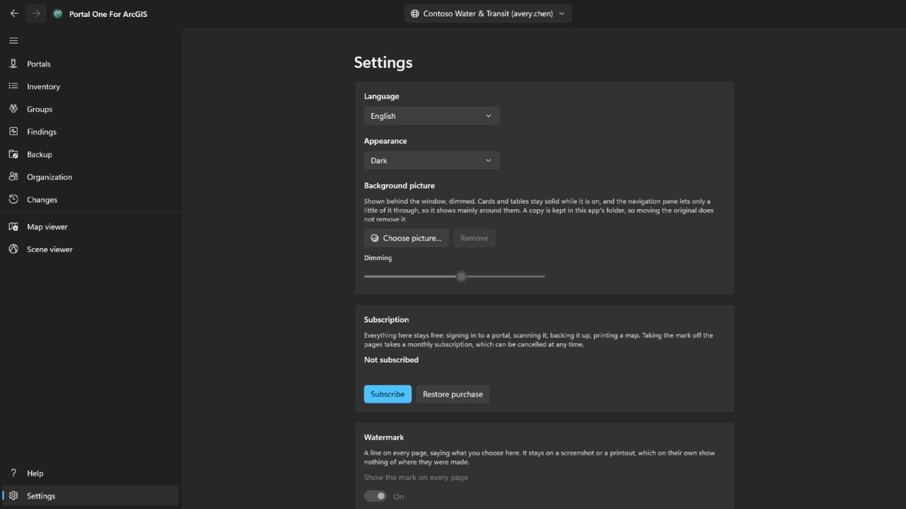

Light, dark or whatever Windows is set to; the theme changes as you pick it. When the Microsoft Store has a newer version, an **Update** button appears beside Settings in the navigation pane; the app closes while it installs and starts again on the new version, and the button is gone. A **background picture** can be set beneath the window; while it shows, cards and tables stay solid and the navigation pane lets only a little through, so it appears mainly around them, and **Dimming** sets how far it is darkened.

The interface ships in fourteen languages and follows Windows unless you pin one.
A language change takes effect at the next start, offered there as a button,
because the framework reads each screen's text once when that screen is built:
applying it immediately would switch only the parts opened afterwards.

**Subscription** is what takes the mark off the pages, and nothing else here is behind it: signing in to a portal, scanning it, backing it up and printing a map stay free whether or not you have paid. It is a monthly subscription bought through Microsoft Store, cancellable at any time, and once there is one the card says what it costs and when it renews. *Restore purchase* is for the case where you have paid and the mark is still there — the subscription may have been bought in the Store's own window, which this app is not told about.

**Watermark** puts a line of your own in the bottom-right corner of every page: up to twenty-four characters, in the font, size, weight, colour and strength chosen behind **More settings** — the card itself shows nothing but the switch that turns the mark on. It starts out set at thirty pixels, in red at full strength, and it walks about the page for one minute in every six: five minutes in the corner, one crossing the page, then back to the corner. It walks because whoever takes a picture of the window decides where its edges are, and a corner is the easiest part to leave out; it rests because a page being worked on should not have a line crossing its rows, and the last switch behind **More settings** is what stops it walking at all. It is on when you first come here and reads *Not subscribed*, because what leaves this app is a picture seen somewhere that shows nothing of where it was made. **Strength** is how much of the colour is used: at the low end every colour comes out as the same faint wash, so the colour on its own cannot answer how visible it is. Left blank, the line falls back to its default. Until you subscribe, nothing on this card can be changed — not the switch, not what it says: it says *Not subscribed*, and pressing it opens the card above. Subscribing is what lets you turn it off and choose what it says; with nothing chosen it reads the app's own name. What is marked is the screen — the pictures the app saves come from the portal's own print service and go out as the portal sent them.

## Keyboard

On any of the tables:

- **Ctrl+F** puts the cursor in the filter box.
- **Ctrl+E** exports the rows the table is showing, with the columns and the order you are looking at.

## Where things are kept

- Backups go to the folder you picked, which is an ordinary folder you can open,
  copy and move.
- Connections, preferences and the change records are kept in this app's
  own storage, encrypted where they are credentials.
- Exported CSV files go wherever you save them.

Nothing is uploaded anywhere. There is no account with the makers of this tool
and no telemetry.

## Getting in touch

Something not working, or not doing what you expected: **gaqo@outlook.com**.

What helps most is what you were doing, what happened instead, whether the portal is ArcGIS Online or ArcGIS Enterprise and which version — the Connections page shows both — and the language the interface was in.

Please do not attach passwords, tokens, or files from the app's own storage folder. A signed-in session is kept in there, and none of it is needed to answer a question.
