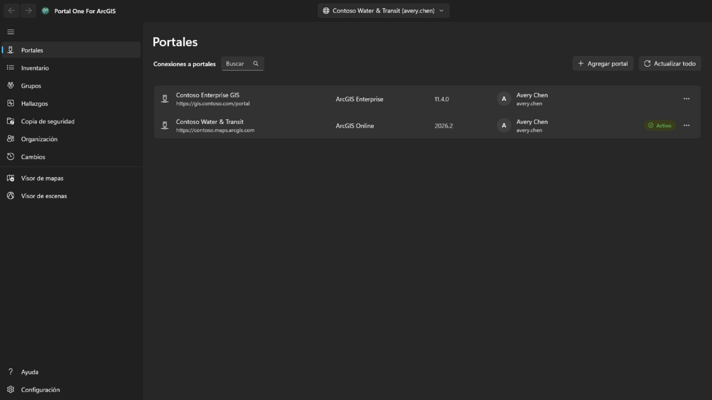
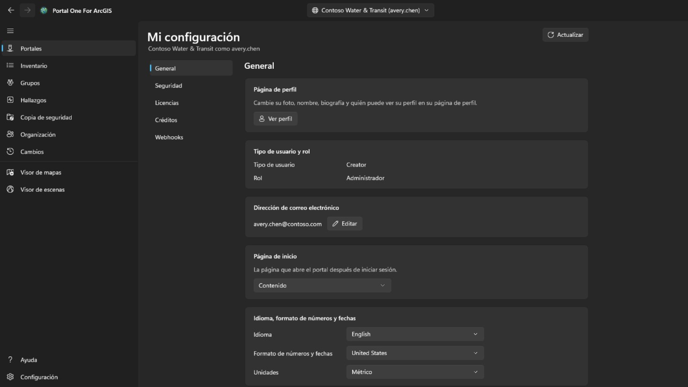
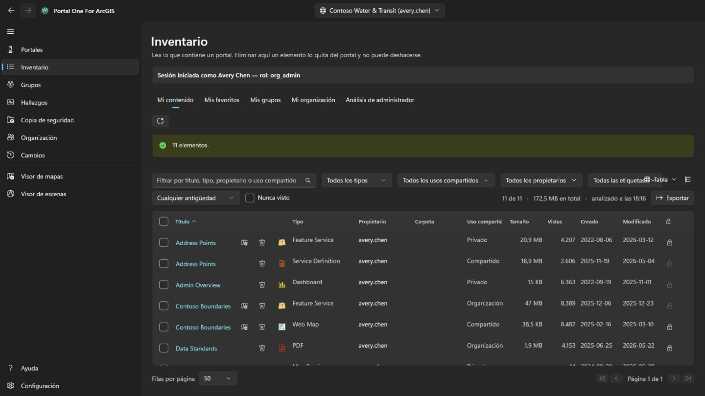
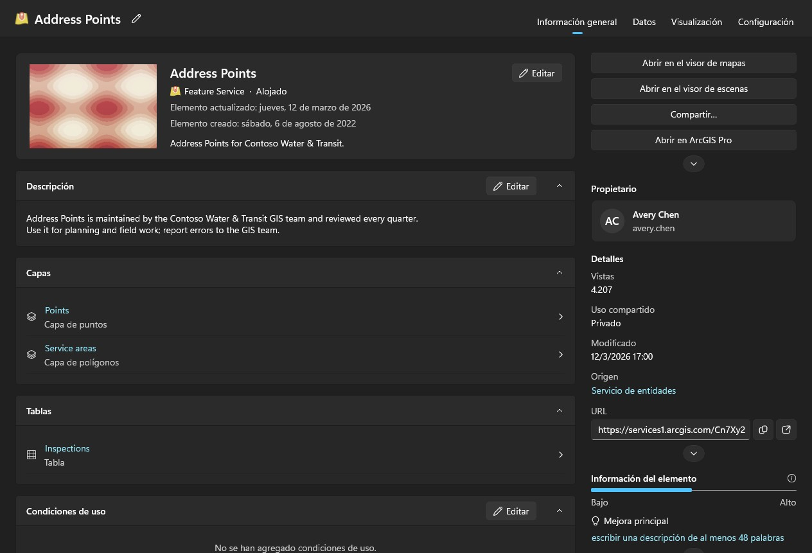
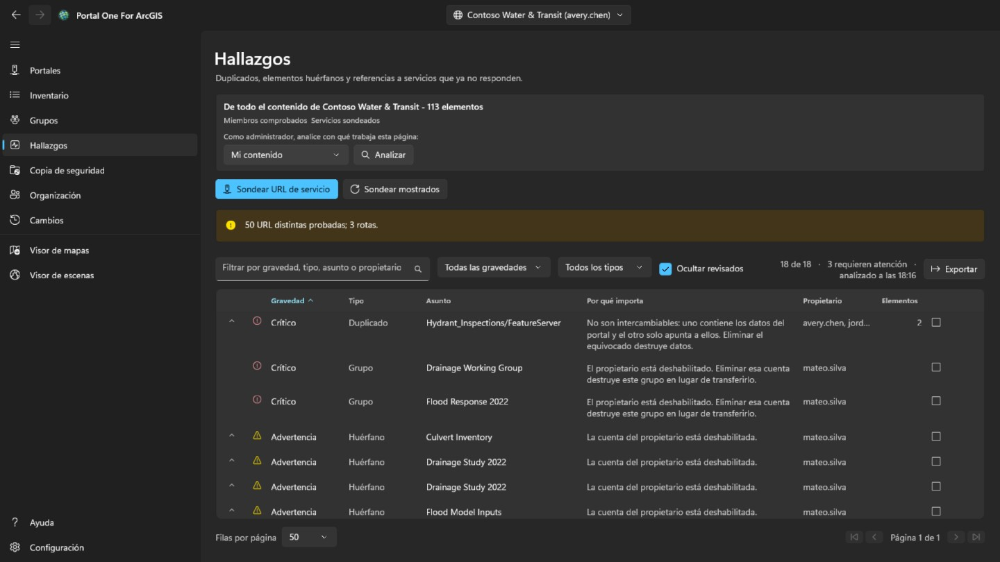
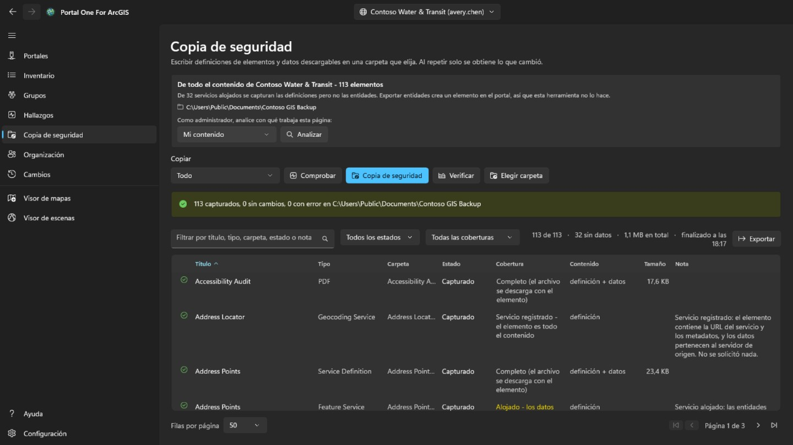
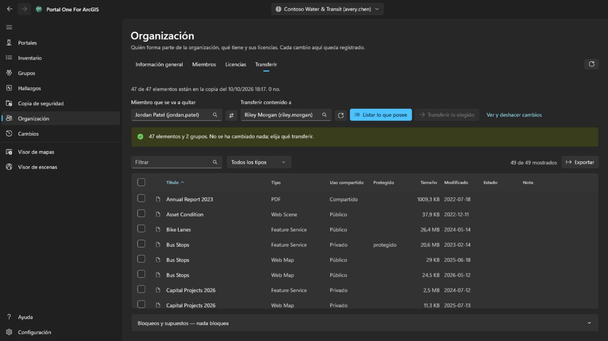
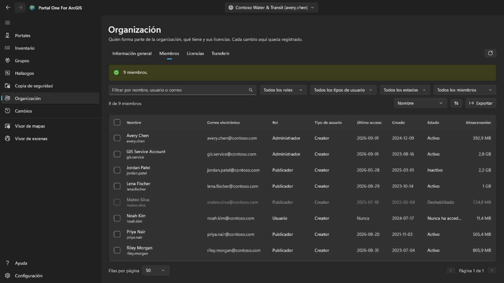
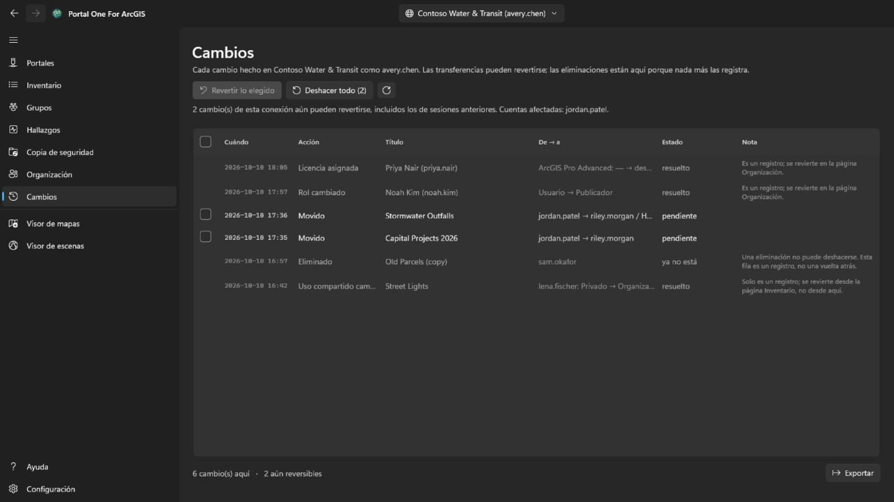
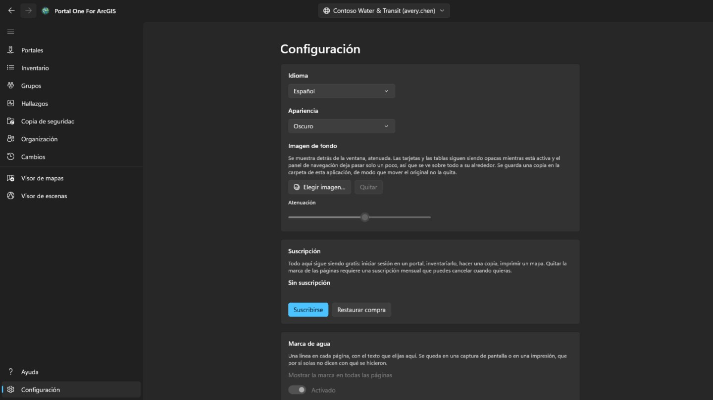

# Ayuda

**Portal One For ArcGIS** audita y mantiene una organización de ArcGIS desde su propio equipo. Funciona igual con **ArcGIS Online** y con **ArcGIS Enterprise**.

Por qué el nombre: ArcGIS Online y ArcGIS Enterprise son, en el fondo, un portal; por eso la palabra **Portal** cubre ambos, y así los llama también esta aplicación en la página **Portales**, donde se añaden. **One** es la aplicación: un único lugar para cada portal con el que trabaja, varios de ellos con sesión iniciada a la vez. **For ArcGIS** indica para qué plataforma está creada.

Esta aplicación se comunica con los portales en los que inicia sesión, con los servicios de mapas, mapas base y datos de elevación a los que apunta su contenido, y con su sitio de ayuda, desde donde esta página lee la ayuda más reciente; cuando no se puede acceder al sitio, muestra la ayuda instalada con la aplicación. Sus credenciales se cifran para su cuenta de Windows y solo se envían al portal al que pertenecen.

## El orden de las páginas es el orden de trabajo

Leer, hacer copia, simular, ejecutar. Cada página hace segura la siguiente, y la
navegación está dispuesta de modo que bajar por ella es el camino seguro.

## Conexiones

Añada una conexión con la dirección del portal: para ArcGIS Online
`https://suorg.maps.arcgis.com`; para ArcGIS Enterprise, la dirección completa
incluida la ruta de contexto, como `https://portal.example.com/portal`. No hace
falta registrar nada en el portal de antemano. Si el portal está detrás de un proxy con identidad, como el proxy de aplicación de Microsoft Entra o Google Cloud IAP, marque **El portal requiere autenticación de proxy con identidad**: se abre una ventana para iniciar sesión en el proxy antes de leer el portal, se cierra sola cuando el portal responde y vuelve a abrirse cada vez que termina la sesión del proxy; lo que estaba en curso continúa.

Inicie sesión con usuario y contraseña, o mediante la propia página de inicio de
sesión del portal mostrada dentro de la aplicación. **Use la segunda si su
organización utiliza inicio de sesión único o autenticación multifactor**: así
no se escribe ninguna contraseña en esta aplicación.

Puede haber varias conexiones iniciadas a la vez, incluidas dos cuentas del
mismo portal. **Mantener la sesión iniciada** guarda la credencial cifrada para
su cuenta de Windows, de modo que la conexión sigue viva tras reiniciar.

Solo se renueva la conexión a la que apunta. Las demás se cierran al caducar su
token y vuelven en silencio cuando cambia a una de ellas.

Una conexión con sesión iniciada muestra la foto de perfil de la cuenta, o sus iniciales si no tiene. Selecciónela para **Mi perfil**, **Mi configuración** o **Ayuda**. **Mi perfil** muestra la cuenta como lo hace la página de perfil del portal: foto, nombre, biografía, grupos y los elementos que comparte con la organización o con todos; **Editar perfil** cambia los nombres, la biografía, la visibilidad del perfil y la foto. **Mi configuración** contiene las secciones del portal: **General** (dirección de correo electrónico, página de inicio, idioma, formato de números y fechas, unidades), **Seguridad** (contraseña y pregunta de seguridad para un inicio de sesión de ArcGIS), **Licencias**, **Créditos** donde los asigna la organización, y los **Webhooks** que posee la cuenta. Cada cambio indica qué escribirá, se vuelve a leer desde el portal y queda registrado en la página **Cambios**, que puede restaurar cambios del perfil, la configuración, la página de inicio, la foto y los webhooks; una contraseña nueva, una pregunta de seguridad y un webhook eliminado solo quedan registrados. La autenticación multifactor, las claves de seguridad, los códigos de recuperación, las cuentas vinculadas y las preferencias de correo electrónico de Esri solo se muestran o explican: se administran en el sitio web de ArcGIS. Después de cambiar la contraseña, o siempre que el portal deje de aceptar la conexión, se abre la página **Portales** con su inicio de sesión para que pueda volver a iniciar sesión con la nueva contraseña.

## Inventario

Muestra lo que su cuenta puede ver, en cuatro pestañas como las de la página de contenido del portal: **Mi contenido**, **Mis favoritos**, **Mis grupos** (todos juntos o uno, incluidos grupos que puede ver sin pertenecer a ellos) y **Mi organización** (lo que comparte la organización). Se leen en cuanto se abre la página y se conservan; el botón junto a ellas vuelve a leer la pestaña mostrada. El menú contextual de una fila depende del tipo de elemento: un mapa web también puede abrirse en Map Viewer del portal, en Field Maps Designer o en ArcGIS Pro, un panel en Dashboards, una historia en ArcGIS StoryMaps; un archivo puede descargarse; y cualquier elemento puede añadirse a favoritos o quitarse de ellos. **Comparar con otro mapa…** en un mapa web o una escena web lee ese mapa y otro elegido del mismo tipo tal como están ahora en el portal y enumera lo que difiere: capas añadidas, quitadas, movidas o renombradas, filtros, simbología, etiquetas y ventanas emergentes cambiados, el mapa base, los marcadores y la vista inicial; la lista se puede copiar. **Hacer una copia…** la copia en su contenido de este portal o de otro con sesión iniciada, con un título nuevo, en una carpeta o entregada a otro miembro; la copia es privada y, en otro portal, primero se busca el elemento de cada capa, y una capa cuyo elemento no está allí se carga por su dirección, lo que se muestra antes de escribir nada. El menú de vista, arriba a la derecha, muestra las filas como **Tabla**, como **Lista** con la miniatura y el resumen de cada elemento o como **Cuadrícula** de tarjetas, igual que la página de contenido del portal, y las ordena; los filtros, la paginación y las filas marcadas son los mismos en las tres. En **Mis favoritos**, **Mis grupos** y **Mi organización**, la carpeta, el tamaño y la protección aparecen poco después de mostrarse la página: una búsqueda no los devuelve, así que se lee cada elemento, primero la página visible. La carpeta solo se muestra para sus propios elementos, o para los de cualquiera si es administrador. El título de un elemento, en la tabla, la lista y la cuadrícula, abre la página del elemento en una ventana propia, con el diseño del portal: en **Información general**, la tarjeta del elemento con su miniatura, tipo, fechas y resumen; luego su **Descripción**, lo que contiene según su tipo (las **Capas** y tablas de un servicio, las capas de un mapa, las tareas de un servicio de geoprocesamiento), sus **Condiciones de uso** y sus **Comentarios**, donde se puede dejar un comentario; al lado, **Abrir en el visor de mapas**, **Abrir en el visor de escenas**, **Compartir…** y **Abrir en ArcGIS Pro**, con el resto detrás de un chevrón, el **Propietario**, los **Detalles** con el origen del elemento y la URL para copiar o abrir, una barra que muestra lo completa que está su información y el cambio que más ayudaría, y sus **Etiquetas**, **Uso compartido**, **Carpeta** y **Agradecimientos**, cada uno con la acción que lo cambia; después, las pestañas **Datos**, **Visualización** y **Configuración** que tenga su tipo. **Configuración** sigue al portal: **General** para cada elemento (estado del contenido, protección contra eliminación y eliminación del elemento, la extensión que usan las búsquedas), la sección propia del elemento —para una capa de entidades alojada, edición, seguimiento del editor, sincronización, exportación y curvas verdaderas, guardados juntos con **Guardar**; para un mapa web o una escena web, su modo sin conexión; para otras capas, la configuración del servicio tal como este la comunica— y los webhooks de una capa de entidades alojada; cada cambio se confirma cuando quita algo, se vuelve a leer desde el portal y queda registrado en la página **Cambios**, que puede restaurarlo.

Analizar el contenido de otras personas es tarea de administradores. Una cuenta que puede leer lo que tienen otros miembros (portal:admin:viewItems) dispone de la pestaña **Análisis de administrador** en esta página y de un análisis en las páginas Hallazgos y Copia de seguridad —un miembro, un grupo o toda la organización— y de la pestaña **Transferir** de la página **Organización**; las demás cuentas no los ven. El recorrido de la organización pide a cada miembro su contenido en lugar de buscar, porque la búsqueda solo devuelve lo compartido y una auditoría no puede pasar por alto elementos privados. Tarda un rato y se puede cancelar.

Hallazgos, Copia de seguridad y los visores leen su propio contenido por sí mismos la primera vez que lo necesitan, así que no hace falta visitar antes otra página; el análisis de un administrador lo sustituye por lo analizado. Cada tabla indica cuándo se leyó su lista. Un portal sigue cambiando después de leerse.

Cada fila lleva además un botón de eliminar, y es lo único en esta aplicación que no puede deshacerse: ArcGIS no tiene papelera. La confirmación nombra el elemento, su tipo y su propietario, y dice si la carpeta de copia recordada para esta conexión tiene una copia y de cuándo es. No se niega a eliminar sin ella, pero esa línea es lo único que podría responder por la eliminación después. Un elemento con protección contra eliminación en el portal se rechaza aquí en lugar de quitarle la protección sin avisar. Para cambiar la propia protección, use el candado al final de la fila o el menú de la fila: es un paso aparte, quitarla pide confirmación antes, y cada cambio se vuelve a leer del portal y se escribe en el registro. Marque la casilla al principio de una fila —o la del encabezado, para todas las filas que muestran los filtros en todas las páginas— para actuar sobre muchos elementos a la vez. **Compartir** fija su nivel de uso compartido y los grupos; **Etiquetas** añade y quita etiquetas y conserva las demás; **Mover** lleva los elementos de un propietario a una de sus carpetas; **Cambiar propietario** los transfiere a otro miembro, como la pestaña **Transferir** de la página **Organización**, y la página **Cambios** los devuelve; **Eliminar** los quita tras una confirmación que dice cuántos, de quién y cuántos tiene la copia de seguridad, y pide marcar que lo entiende. Los elementos que esta cuenta no puede cambiar y los protegidos contra eliminación no se tocan y se cuentan. Se procesa un elemento cada vez y se registra; **Cancelar** se detiene entre dos, y el resumen indica qué falló y por qué. Desde el menú contextual de una fila, **Compartir…** cambia el nivel y los grupos de ese elemento, y **Editar detalles…** su título, resumen, descripción, etiquetas, créditos y condiciones de uso. Ambos abren el elemento tal como lo tiene ahora el portal, envían solo lo que cambió, comprueban el resultado y quedan registrados.

## Hallazgos

Contenido redundante y muerto, ordenado por la atención que merece y no por lo
grave que suene.

- **Crítico** significa que actuar sin cuidado aquí destruye algo que no existe
  en ningún otro sitio: dos elementos que apuntan al mismo servicio, donde
  eliminar el equivocado no tiene vuelta atrás.
- **Advertencia** es un problema real y seguro de tratar: un elemento cuyo
  propietario se ha ido, un servicio que ya no responde.
- **Aviso** conviene saberlo y puede resultar que esté bien.
- **No concluyente** significa que no pudo determinarse. **Un servicio que agotó
  el tiempo de espera no es un servicio desaparecido**, y esta herramienta no
  dirá que lo es.

Abra una fila para ver los elementos que representa. Márquela como revisada
cuando haya decidido que está bien; la decisión se recuerda por conexión y la
fila permanece visible en lugar de desaparecer.

Esta página informa. **No le dice cuál de dos elementos parecidos conservar**,
porque eso depende de quién los usa y de qué apunta a ellos.

## Copia de seguridad

Escribe definiciones de elementos, recursos y datos descargables en una carpeta
que usted elija. Repetir la copia sobre la misma carpeta solo trae lo que ha
cambiado, así que **reanudar una copia interrumpida y hacer una copia incremental
son lo mismo**.

- **Comprobar** compara la carpeta con el portal e informa de lo que *haría*, sin
  escribir nada. Así se responde a «¿está mi copia al día?» sin dedicarle horas.
- **Verificar** compara la carpeta con su propio registro, sin portal alguno.
  **Esa es la pregunta que queda cuando el portal ya no está, que suele ser
  justo cuando alguien lee una copia en serio.**

La carpeta se recuerda por conexión, y una carpeta que contiene la copia de otra
organización se rechaza en lugar de sobrescribirse.

**Lo que una copia no contiene.** Las entidades de un servicio alojado viven en
el almacén de datos del portal, no en el elemento, y sacarlas exige una
exportación que crea un elemento nuevo en el portal: una escritura. Esta
herramienta no lo hace, así que esas filas se capturan como definición sin
datos, y la página dice cuántas son. Los servicios registrados desde otro
servidor son punteros por naturaleza y no tienen nada más que capturar.

## Baja de miembros

Esta es la pestaña **Transferir** de la página **Organización**, solo visible para cuentas que administran contenido (portal:admin:viewItems). Calcula qué implica quitar a un miembro y mueve su contenido, de uno en uno y de forma reversible.

Elija de las listas al miembro y a quien recibe su contenido; ambas proceden del
directorio de la propia organización, así que **un nombre no puede escribirse
mal y acabar en otro que sí existe**. **Listar lo que posee** no cambia nada:
muestra cada elemento y cada grupo, y usted marca lo que debe moverse.

No hay nada marcado de antemano. Mover una cuenta entera es un clic en la
casilla de la cabecera, y **ese clic es una decisión, no un valor por defecto**.

- Los grupos están a propósito en la misma tabla que los elementos. Al eliminar
  a un miembro, el portal **destruye** los grupos que aún posee en lugar de
  transferirlos, así que un grupo sin marcar es **lo único silenciosamente
  destructivo de esta página**, y la línea de recuento lo dice.
- La confirmación muestra las carpetas del receptor y permite añadir una nueva; los elementos van a la que elija. Cada transferencia se escribe en el registro antes de que empiece la siguiente, y la página **Cambios** devuelve cada una a la carpeta de la que salió, volviendo a crear la que ya no exista, de una en una o todas las pendientes a la vez.
- Mover un elemento puede mover otros con él. Transferir un shapefile se lleva el servicio alojado publicado a partir de él, así que una fila puede informar de que llegó sin que esta transferencia fuera la que lo envió. Revertir solo esa fila en la página **Cambios** no lo traerá de vuelta; vuelve con lo que lo arrastró.
- Tras cada movimiento se vuelve a leer el elemento desde el portal. **Una
  petición que devuelve éxito es una afirmación sobre la petición, no sobre
  dónde está ahora el elemento.**

La cuenta del miembro se elimina en la página **Organización**, y solo cuando ya no posee nada. **Es el único paso que no puede deshacerse.**

## Organización

Todos los miembros ven esta página, como en el portal. **Información general**, que también nombra los contactos administrativos de la organización, es para todos, y con el privilegio de ver miembros también una pestaña **Miembros** de solo lectura, sin correo, inicios de sesión, estado ni almacenamiento. Marcar miembros, **Exportar**, **Licencias** y cualquier cambio son solo para cuentas que administran miembros (portal:admin:viewUsers). **Información general** resume la organización: en ArcGIS Online, su suscripción, puestos y créditos; los miembros por estado, rol y tipo de usuario; y cuánto contenido y almacenamiento ocupa.

**Miembros** enumera a todos los de la organización, filtrados por nombre, rol, tipo de usuario, estado o grupo, ordenados por cualquier columna y guardados en un archivo CSV con **Exportar**. Marque miembros para deshabilitarlos o habilitarlos, cambiar su rol o tipo de usuario, quitarlos de grupos o eliminarlos; con uno solo marcado, **Dar de baja** abre la pestaña **Transferir** de esta página. Su propia cuenta nunca se toca, y el propietario de un grupo sigue en él.

Haga clic con el botón derecho en un miembro para abrir su menú. **Ver** muestra su **Perfil**, sus **Elementos** y, para un administrador, sus **Grupos**, aquí en la aplicación y no en el portal; un miembro sin privilegios solo ve los elementos compartidos con él. **Administrar** es para administradores, cada opción solo con el privilegio que necesita: **Licencias complementarias** fija qué derechos tiene el miembro, **Editar dirección de correo** la cambia en cuentas que inician sesión con ArcGIS, **Transferir contenido** abre la pestaña **Transferir** con ese miembro, y **Transferir miembro** da a otro miembro su tipo de usuario, rol y licencias complementarias y después continúa en la pestaña **Transferir** con su contenido y grupos. El mismo menú cambia el tipo de usuario, el rol, los grupos, el estado o la cuenta de un miembro, como la barra lo hace para varios.

**Eliminar** solo quita a miembros que no poseen elementos ni grupos. ArcGIS no los traspasa al eliminar una cuenta, así que muévalos antes en la pestaña **Transferir**. Antes de que ocurra nada, escriba el nombre de usuario o, si son varios miembros, cuántos son. La eliminación no puede deshacerse.

**Licencias** muestra cuántos de cada tipo de usuario están asignados y, en ArcGIS Online, cuántos incluye la suscripción; **Mostrar miembros** enumera quién tiene ese tipo. Elija una licencia complementaria para ver quién la tiene y revóquela a los miembros que marque.

Cada cambio se vuelve a leer del portal y se registra con lo que había antes, y aparece en la página **Cambios**. Estos cambios de miembros no se deshacen desde allí: para revertir uno, haga el cambio contrario.

## Cambios

La página **Cambios** se muestra a toda cuenta con sesión iniciada. Enumera, de más nuevo a más antiguo, todo lo que esta herramienta ha cambiado en el portal seleccionado ahora: transferencias, eliminaciones, uso compartido, etiquetas, carpetas, detalles, protección y cambios de miembros. Los cambios hechos en otros portales se cuentan, pero no se listan. La lista puede exportarse a CSV.

Las transferencias que pueden devolverse tienen una casilla. **Revertir lo elegido** devuelve las transferencias marcadas, y **Deshacer todo** devuelve todo lo pendiente en esta conexión después de una confirmación que nombra de quién es el contenido. Los elementos vuelven a las carpetas de las que salieron, volviendo a crear la que haya desaparecido. Las eliminaciones y los cambios de miembros son solo un registro: una eliminación no puede deshacerse, y un cambio de miembro se revierte haciendo el cambio contrario. Revertir una transferencia es otra transferencia y necesita el mismo privilegio (portal:admin:reassignItems, o reassignGroups para un grupo); una cuenta sin él solo ve el registro.

Un mapa web sobrescrito desde el visor de mapas, y una entidad agregada, editada o eliminada allí, se revierten desde el menú de su fila. Una edición de entidad solo se revierte mientras la entidad sigue como la dejó la edición: una entidad agregada se elimina, una editada recupera sus valores y su forma anteriores, y una eliminada se vuelve a agregar con un nuevo id de objeto. La reversión también queda registrada, de modo que puede revertirse a su vez. Antes de restaurar un mapa web, **Comparar con el mapa actual** en el mismo menú enumera en qué se diferencia la copia guardada antes de ese guardado del mapa tal como lo tiene ahora el portal: el mapa base, las capas agregadas, quitadas, renombradas o movidas, y de cada capa la visibilidad, la opacidad, el estilo, las etiquetas, el filtro, el rango de escala, la ventana emergente y la actualización, las tablas, los marcadores y dónde se abre el mapa.

## Visor de mapas y visor de escenas

El **visor de mapas** muestra capas bidimensionales sobre los mapas base del portal; el **visor de escenas** muestra esas y las tridimensionales —capas de escena, mallas, nubes de puntos, 3D Tiles— sobre un globo con relieve. El panel de la izquierda busca en lo que se ha leído de este portal —su propio contenido, que se lee automáticamente, lo que haya analizado un administrador y lo que han leído las pestañas de la página Inventario— y solo muestra lo que ese visor puede dibujar. Elija un elemento para agregarlo. Un mapa web se abre en el visor de mapas y una escena web en el visor de escenas, completos, con sus propias capas y su mapa base. En la página Inventario, el botón de visor junto a un título (también en el menú contextual de la fila) abre ese elemento en el visor que puede mostrarlo.

El botón de la esquina superior derecha del panel lo oculta, para que el mapa o la escena ocupen todo el ancho, y lo vuelve a abrir; al entrar en el visor siempre está abierto. Cada capa se puede mostrar u ocultar, hacer más transparente, subir o bajar, usar para acercarse o quitar. Al hacer clic en una entidad del mapa se muestran sus campos: si la capa tiene una ventana emergente configurada en el portal, los que esta eligió, con sus etiquetas y formatos; si no, todos. La pestaña **Leyenda**, junto a **Capas**, muestra qué representan los símbolos de cada capa visible. **Marcadores** muestra los lugares guardados con un mapa web o una escena web; ponga nombre allí a la vista actual para añadir los suyos y elija uno para volver a él. Un marcador de escena conserva el rumbo y la inclinación de la cámara. El botón de tabla de una capa con entidades abre su **tabla de atributos** bajo el mapa, de doscientas en doscientas filas y filtrada como se dibuja la capa; al elegir una fila se resalta esa entidad y se acerca a ella. **Exportar** escribe todas las filas que la tabla contiene con sus filtros y su orden, hasta 50 000, no solo las cargadas: como CSV tal como las muestra la tabla, como GeoJSON en latitud y longitud o como shapefile comprimido en el sistema de coordenadas de la capa (nombres de campo recortados a diez caracteres). El encabezado de una columna ordena la tabla por ella, la filtra (como el filtro de capa, una condición por columna, aplicadas todas) o muestra sus estadísticas: cuántas filas tienen valor, el menor y el mayor, para números el total, la media y la desviación estándar, y los valores más frecuentes, sobre todas las filas que pasan los filtros y no solo las cargadas. **Solo seleccionadas** reduce la tabla a las filas seleccionadas. En el visor de mapas, **Distancia** y **Área**, sobre el mapa, miden lo que dibuja haciendo clic en puntos: sobre la superficie terrestre, no en el mapa plano, en unidades métricas o imperiales según su región de Windows. En el visor de escenas, **Distancia** mide entre dos clics en el terreno o un modelo (directa, sobre el suelo y vertical), y **Área** sigue esquinas sobre el terreno. **Guardar como mapa web** crea un elemento de mapa web nuevo en su propio contenido, en la carpeta que elija, con el mapa base, las capas y los marcadores que se muestran ahora; se abre donde está el mapa ahora y lleva una imagen suya como miniatura. **Guardar** sobrescribe un mapa web abierto desde el portal cuando es suyo o puede actualizar contenido ajeno, tras guardar una copia en este equipo; el visor de escenas no puede guardar. La búsqueda también encuentra direcciones y lugares con el geocodificador del portal. **Exportar** guarda un PNG de la vista y, si el portal ofrece un servicio de impresión, **Imprimir** lo ejecuta. Las capas temporales abren una barra **Tiempo** para recorrer o reproducir su intervalo. Las capas se mantienen mientras trabaja en otras páginas y empiezan de nuevo al cambiar a otro portal. El inicio de sesión del portal se usa para sus propias capas y nunca se envía al servidor de otra organización, así que una capa registrada desde otro lugar que pida iniciar sesión no se cargará. Al medir en el mapa, haga doble clic, pulse Entrar o elija **Terminar** para acabar el dibujo: queda en el mapa con su resultado hasta la siguiente medición o hasta la ✕ junto a las herramientas. Esc cancela el dibujo, y Ctrl+Z o Retroceso quita el último punto. El botón de estilo de una capa con entidades cambia cómo se dibuja: un símbolo del color y tamaño que elija, un color por cada valor de un campo (**Categorías**) o clases de un campo numérico a lo largo de una rampa de color (**Clases**, por cortes naturales, intervalo igual o cuantil). El mapa sigue cada cambio; **Aplicar** lo conserva, **Cancelar** devuelve lo que se dibujaba y **Restaurar el original** el estilo con el que llegó la capa. La leyenda también se actualiza, y guardar el mapa como mapa web conserva el estilo. El botón **…** de la misma fila también abre **Etiquetas…**, para mostrar el valor de un campo en cada entidad con el tamaño y color que elija, con halo y a partir de una escala, y **Filtro…**, para mostrar solo las entidades que cumplen condiciones formadas por un campo, una comparación y un valor, todas o cualquiera; cuenta las coincidencias sobre la marcha, conserva el filtro que la capa trae de su mapa web y la tabla de atributos lo sigue. Abajo a la izquierda del mapa, una brújula gira con el mapa (selecciónela para volver al norte); a su lado, una barra de escala medida sobre el terreno, la escala y las coordenadas bajo el puntero (selecciónelas para copiarlas o cambiar entre grados decimales y grados, minutos y segundos), y un botón que muestra un mapa de ubicación donde un clic mueve el mapa. **Seleccionar** elige las entidades de todas las capas visibles dentro de un rectángulo, una forma a mano alzada o un polígono: un panel indica cuántas hay en cada capa y el total, la media, el mínimo y el máximo de un campo numérico, y las muestra en la tabla, acerca a ellas o las guarda como CSV. **Área de influencia** dibuja la zona a una distancia de las entidades seleccionadas o de un punto, línea o área que dibuje, la mide sobre la superficie terrestre en este equipo (sin servicio de análisis ni créditos) y puede seleccionar lo que cubre. **Deslizar** muestra una capa a la izquierda de un divisor que se arrastra y el mapa sin ella a la derecha. **Revisar mapa** examina cada capa del mapa e indica lo que fallaría o confundiría a quienes lo tienen compartido: capas que no cargan, elementos que ya no existen o están compartidos con menos gente que el mapa, servicios por http o fuera del portal, elementos en desuso o de otra organización, capas grandes sin rango de escala y ninguna ventana emergente; el informe se puede copiar. También nombra los campos a los que remiten la ventana emergente, la simbología o las etiquetas de una capa y que la capa no tiene, y mide cuánto tarda en contar las entidades de cada capa de servicio: a partir de 3 segundos lo anota, a partir de 10 o sin respuesta en 30 es una advertencia. En el menú **…** de una capa, **Usado por…** lee los mapas y aplicaciones del inventario y enumera los que usan la capa, directamente o a través de un mapa, y **Propiedades…** muestra su origen, propietario, representación y, para entidades, su número y campos. El cuadro de búsqueda también acepta coordenadas —dos números decimales en cualquier orden, grados/minutos/segundos, UTM o MGRS— y va allí sin geocodificador. **Exportar** puede copiar un vínculo que abre el mapa web en el visor del portal en este lugar, o las coordenadas del centro. Al guardar sobre un mapa web se conserva su definición anterior, y la página **Cambios** puede restaurarla desde el menú de ese guardado. Configuración de capa, en el menú de una capa, define el rango de escala visible, los elementos emergentes de capas de entidades (marcadores de título, etiquetas de campos, visibilidad y orden) y los intervalos de actualización admitidos; la vista previa es inmediata y se conserva al guardar el mapa web. El cuadro de estilo ahora puede dibujar capas de puntos como mapas de calor, escalar símbolos de puntos o anchos de línea desde un campo numérico y activar clústeres de puntos con etiquetas de recuento; las capas de polígonos conservan los estilos de color existentes. El menú Agregar de la pestaña Capas también puede agregar una URL de servicio o un archivo local: CSV y GeoJSON se convierten en colecciones de entidades incrustadas al guardar, mientras que los shapefiles y archivos KML o KMZ permanecen locales y se señalan antes de guardar. Boceto agrega una capa de anotaciones guardada con puntos, líneas, áreas, rectángulos, círculos o elipses, formas a mano alzada y texto; seleccione una entidad de boceto para remodelarla, cambiar su estilo, eliminarla, deshacer la última marca o limpiar la capa, y la colección de entidades de boceto se guarda con el mapa web. La herramienta **Editar** del visor de mapas enumera las capas de entidades de servicio que permiten edición, explica las capas de solo lectura, permite dibujar una entidad nueva desde una plantilla o seleccionar una existente en el mapa, valida los campos editables y aplica los cambios confirmados al servicio de entidades en vivo. En la tabla de atributos de una capa editable, seleccione filas con Ctrl o Mayús (Ctrl+A para todas las cargadas): **Editar** abre una de ellas en el formulario de edición y **Cambiar un campo** asigna un valor a un campo en todas, tras comprobarlo con las reglas de cada entidad.  **Cambiar un campo** también puede usar una expresión — nombres de campo entre corchetes, texto entre comillas, + - * / y algunas funciones — de modo que cada fila seleccionada obtenga su propio valor a partir de otros campos.  En el panel Editar, **Herramientas de geometría** permite **Seleccionar en el mapa**, **Combinar** formas, **Dividir** líneas o polígonos con una línea de corte, **Recortar** a un área dibujada o **Copiar a capa** en otra capa editable del mismo tipo de forma; cada cambio queda en la página **Cambios**. Cada cambio queda registrado en la página **Cambios**, un cambio de campo como una sola entrada, y se revierte desde allí. Para una entidad seleccionada, el formulario de edición también muestra sus adjuntos, si la capa los guarda, para abrirlos, agregarlos o quitarlos (un archivo quitado se copia antes a este equipo y cada cambio queda registrado en la página **Cambios**), y muestra sus registros relacionados, de solo lectura. Mientras se dibuja o remodela una entidad, sus vértices se ajustan a las entidades de las capas marcadas en **Ajuste** del panel de edición, y las guías geométricas ofrecen ángulos rectos y paralelas; ambas cosas se pueden desactivar y la distancia de ajuste se puede fijar. Medir, Boceto y las demás herramientas no ajustan. **Compartir**, junto a **Guardar como mapa web**, comparte el mapa web o la escena web en pantalla como la página Inventario comparte un elemento, cuando esta cuenta es su propietaria o puede compartir contenido ajeno: tras elegir el nivel y los grupos, el mapa se revisa tal como se compartiría, y lo que fallaría o confundiría en ese nivel se enumera antes de compartir. **Detalles** edita el título, el resumen, la descripción, las etiquetas, los créditos y las condiciones de uso del elemento como la página Inventario, y además puede usar una imagen de la vista como miniatura y fijar la extensión del elemento, que usa la búsqueda del portal, en la vista; dónde se abre el mapa se fija al guardarlo encima. La ventana emergente de una entidad también muestra, en el orden que fijó su autor, las imágenes, los gráficos y los adjuntos de la ventana configurada en el portal, y sus registros relacionados; las expresiones Arcade se evalúan antes. Los gráficos se dibujan con el tema de la aplicación, las imágenes solo se cargan desde direcciones https y un adjunto se abre con un clic. Cuando un servicio se traslada o se sustituye, **Reemplazar en mapas web…** del menú **…** de una capa apunta a la nueva dirección cada mapa web y escena web del inventario que lo usa (las capas de un servicio completo conservan sus números), tras enumerar lo que cambiaría en cada uno; cada mapa se guarda antes de escribirlo y queda registrado en la página **Cambios**, donde se puede comparar y restaurar. La lista de capas muestra las capas de grupo como un árbol: expanda un grupo para administrar sus capas, cambie el nombre de cualquier capa, cree un grupo nuevo con capas de nivel superior elegidas, mueva una capa dentro o fuera de un grupo, o desagrúpelo de nuevo. El visor de mapas puede dibujar un perfil de elevación a partir de una línea, usando terreno teselado en lugar de servicios de análisis que consumen créditos, y permite copiar o exportar las distancias y elevaciones muestreadas. Una capa de entidades de servicio también puede abrir un gráfico de solo lectura bajo el mapa; usa estadísticas del servicio en vez de descargar todas las entidades, puede limitarse a la vista o la selección, exporta PNG o CSV y no se guarda en el mapa web.  Un CSV, GeoJSON o shapefile agregado desde el equipo se puede publicar desde el menú de la capa como capa de entidades alojada; se carga el archivo de origen, se crea el servicio en su contenido y se reemplaza la capa local. KML y KMZ no se ofrecen porque el portal no los publica como servicios de entidades.  El cuadro de estilo también ofrece tipos con un campo de tamaño y mapas de relación de dos campos; las rampas de color continuas, la densidad de puntos y la agregación en bins no se muestran porque ArcGIS Maps SDK for .NET 300.1 no las admite con seguridad aquí. Las etiquetas y los campos emergentes también pueden usar expresiones Arcade, con inserción de campos, fragmentos comunes y una prueba con una entidad real antes de aplicar.  Las capas de entidades editables también pueden llevar un formulario guardado en el mapa web: el panel Editar sigue sus grupos, reglas obligatorias y valores calculados, y el comando **Formulario…** del menú de la capa edita ese formulario. Los mapas web del portal se pueden llevar sin conexión desde el visor de mapas: la aplicación comprueba las capacidades sin conexión, descarga un área preplanificada o la vista actual en LocalState, la abre desde la pestaña Mapas sin conexión, confirma las ediciones localmente y las sincroniza como una entrada de Changes cuando la cuenta tiene una licencia Runtime Basic o superior.  El análisis de red del visor agrega rutas, áreas de servicio e instalaciones cercanas desde servicios del portal; ArcGIS Online consume créditos.  Las secciones de registros relacionados también leen relaciones mediante tablas de relación en un mapa oculto del SDK, de modo que las relaciones de muchos a muchos y con atributos funcionan aunque las tablas relacionadas no estén en el mapa web.  En las escenas, las capas de entidades también se pueden seleccionar con un clic, un rectángulo sobre el suelo o un polígono marcado con clics, generar zonas de influencia desde las entidades seleccionadas o desde un punto, una línea o un área marcados con clics, crear gráficos y editar: atributos con el formulario de la capa, entidades nuevas y el redibujado de la forma completa a partir de clics, además de fusionar, copiar, dividir y recortar; solo la remodelación vértice a vértice sigue siendo del mapa porque el SDK expone el editor de geometría únicamente en MapView. Los bocetos de escena (puntos, líneas, polígonos, rectángulos, elipses y textos colocados con clics) duran solo la sesión, ya que aquí no se pueden guardar escenas web; el dibujo a mano alzada es solo del mapa. **Exportar boceto como GeoJSON** en el panel Boceto guarda en un archivo las marcas de cualquiera de los dos visores. Las escenas también dibujan un **Perfil de elevación** a lo largo de una línea marcada con clics, leído del terreno propio de la escena cuando lo tiene y, si no, de la misma fuente que el visor de mapas, y el panel **Red** también funciona ahí: los clics sobre el suelo colocan paradas, instalaciones e incidentes, los resultados se dibujan sobre la escena y una ruta agregada como capa dura solo la sesión.  Las acciones de escenas también comparten, editan detalles, copian vínculos o centros, exportan imágenes, comprueban capas, muestran usos y reemplazan fuentes; los widgets de escena muestran rumbo, coordenadas del puntero, vista general y altitud de cámara, y los paquetes de escena móvil locales se abren en solo lectura. **Comparar** en escenas usa una copia sincronizada y recortada de la escena completa; la navegación permanece en la escena principal mientras el divisor la compara con la capa elegida y sin ella.  El cuadro corto de búsqueda de lugares permanece arriba a la izquierda; la flecha de la barra de herramientas derecha oculta o restaura ambos con una animación, y Más comandos contiene las acciones menos usadas de elemento, comprobación, tiempo y exportación.

## En segundo plano

Cerrar la ventana deja la aplicación en el área de notificación en lugar de
terminarla, **para que un análisis o una copia de horas no muera por el gesto
con el que se aparta una ventana**. El icono dice qué se está ejecutando, y
**Salir** allí es la forma de terminar. Su menú también permite agregar un portal y buscar una actualización en Microsoft Store o instalar la que encontró.

Si desactiva el icono del área de notificación, cerrar la ventana sí termina la
aplicación: sin icono no habría nada que la devolviera.

**Iniciar con Windows** arranca la aplicación en el área de notificación al
iniciar sesión, de modo que la conexión que usa ya esté iniciada cuando la abra.

## Configuración

Claro, oscuro o lo que tenga Windows; el tema cambia al elegirlo. Cuando Microsoft Store tiene una versión más reciente, aparece un botón **Actualizar** junto a Configuración en el panel de navegación; la aplicación se cierra mientras se instala, vuelve a abrirse con la nueva versión y el botón desaparece. Se puede poner una **imagen de fondo** debajo de la ventana; mientras se muestra, las tarjetas y las tablas siguen opacas y el panel de navegación deja pasar solo un poco, así que aparece sobre todo a su alrededor, y **Atenuación** fija cuánto se oscurece.

La interfaz se entrega en catorce idiomas y sigue a Windows salvo que fije uno.
**Un cambio de idioma surte efecto en el siguiente inicio**, ofrecido allí como
un botón, porque el marco lee el texto de cada pantalla una vez al construirla:
aplicarlo de inmediato solo cambiaría lo que se abra después.

**Suscripción** es lo que quita la marca de las páginas, y nada más aquí depende de ella: iniciar sesión en un portal, inventariarlo, hacer una copia e imprimir un mapa siguen siendo gratis, hayas pagado o no. Es una suscripción mensual que se compra por Microsoft Store y puedes cancelar cuando quieras; la tarjeta dice cuánto cuesta y cuándo se renueva una vez que existe. *Restaurar compra* está para el caso de que hayas pagado y la marca siga ahí: la suscripción pudo comprarse en la propia ventana de la Store, de la que esta app no se entera.

**Marca de agua** pone una línea propia en la esquina inferior derecha de cada página: hasta veinticuatro caracteres, con la fuente, el tamaño, el grosor, el color y la intensidad que elijas detrás de **Más ajustes** — la tarjeta solo muestra el interruptor que la activa. Empieza con treinta píxeles, en rojo fuerte a plena intensidad, y se mueve por la página un minuto de cada seis: cinco minutos en la esquina, uno cruzando la página y vuelta a la esquina. Se mueve porque quien toma la imagen decide dónde quedan sus bordes, y una esquina es la parte más fácil de dejar fuera; descansa porque una página en la que se está trabajando no debería tener una línea cruzando sus filas — el interruptor que hay detrás de **Más ajustes** es lo que la para del todo. Está activada la primera vez que llegas aquí y dice *Sin suscripción* — lo que sale de la aplicación se ve en un sitio que no dice nada de con qué se hizo. **Intensidad** es cuánto del color se usa: en el extremo bajo cualquier color queda en el mismo velo tenue, así que el color por sí solo no responde a cuánto se ve. En blanco, la línea vuelve a su valor predeterminado. Hasta que te suscribas no se puede cambiar nada en esta tarjeta — ni el interruptor ni el texto: dice *Sin suscripción* y al pulsarla se abre la tarjeta de más arriba; suscribirte es lo que permite desactivarla y elegir qué dice; si no eliges nada, dice el nombre de la aplicación. Lo que se marca es la pantalla: las imágenes que guarda la aplicación vienen del servicio de impresión del portal y salen tal como el portal las envió.

## Teclado

En cualquiera de las tablas:

- **Ctrl+F** pone el cursor en el cuadro de filtro.
- **Ctrl+E** exporta las filas que la tabla muestra, con las columnas y el orden que está viendo.

## Dónde queda cada cosa

- Las copias van a la carpeta que eligió, una carpeta corriente que puede abrir,
  copiar y mover.
- Conexiones, preferencias y el registro de cambios quedan en el almacenamiento
  propio de la aplicación, cifrados cuando son credenciales.
- Los CSV exportados quedan donde usted los guarde.

Nada se sube a ninguna parte. **No hay cuenta con los autores de esta
herramienta ni telemetría.**

## Contacto

Si algo no funciona o no hace lo que esperaba: **gaqo@outlook.com**.

Lo que más ayuda es qué estaba haciendo, qué ocurrió en su lugar, si el portal es ArcGIS Online o ArcGIS Enterprise y qué versión —la página Conexiones muestra ambas cosas— y en qué idioma estaba la interfaz.

Por favor, no adjunte contraseñas, tokens ni archivos de la carpeta de almacenamiento de la aplicación. Allí se guarda una sesión iniciada, y nada de eso hace falta para responder a una pregunta.
