# Aide

**Portal One For ArcGIS** audite et entretient une organisation ArcGIS depuis votre propre poste. Il fonctionne de la même manière avec **ArcGIS Online** et **ArcGIS Enterprise**.

Pourquoi ce nom : ArcGIS Online et ArcGIS Enterprise sont tous deux, au fond, un portail ; le seul mot **Portal** couvre donc les deux, et c’est aussi ainsi que cette application les appelle, sur la page **Portails** où vous les ajoutez. **One**, c’est l’application : un seul endroit pour chaque portail avec lequel vous travaillez, plusieurs étant connectés en même temps. **For ArcGIS** indique pour quelle plateforme elle est conçue.

Cette application communique avec les portails auxquels vous vous connectez, avec les services cartographiques, fonds de carte et données d'altitude vers lesquels pointe leur contenu, avec son site d'aide, d'où cette page lit l'aide la plus récente ; lorsque le site est inaccessible, elle affiche l'aide installée avec l'application, ainsi qu'avec Microsoft Store pour les mises à jour et l'abonnement. Vos identifiants sont chiffrés pour votre compte Windows et envoyés uniquement au portail auquel ils appartiennent.

## L'ordre des pages est l'ordre du travail

Lire, sauvegarder, simuler, exécuter. Chaque page rend la suivante sûre, et la
navigation est disposée de sorte que la descendre soit le chemin sûr.

## Connexions

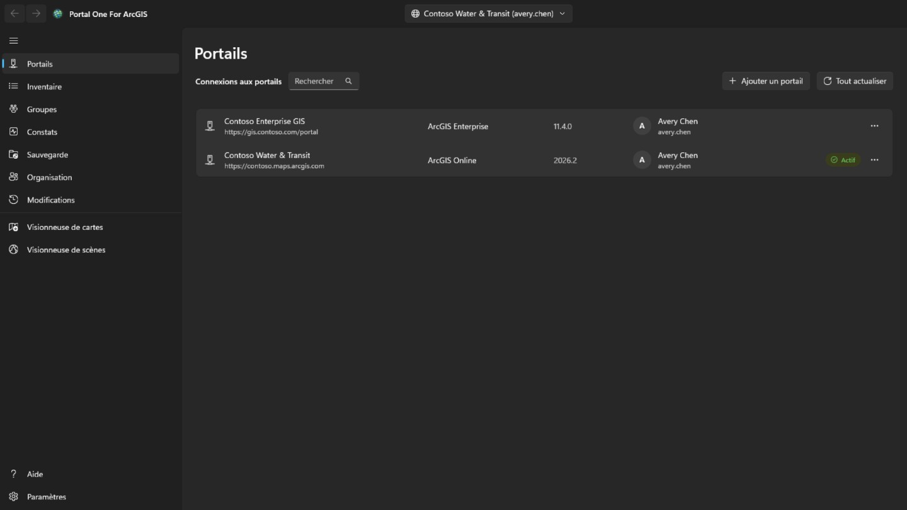

Ajoutez une connexion avec l'adresse du portail : pour ArcGIS Online
`https://votreorg.maps.arcgis.com` ; pour ArcGIS Enterprise, l'adresse complète
avec le chemin de contexte, par exemple `https://portal.example.com/portal`.
Rien n'a besoin d'être enregistré au préalable dans le portail. Si le portail se trouve derrière un proxy avec identité comme le proxy d'application Microsoft Entra ou Google Cloud IAP, cochez **Le portail exige une authentification par proxy avec identité** : une fenêtre s'ouvre pour se connecter au proxy avant la lecture du portail, se ferme d'elle-même dès que le portail répond et se rouvre chaque fois que la session du proxy prend fin ; ce qui était en cours reprend.

Connectez-vous avec un nom d'utilisateur et un mot de passe, ou via la page de
connexion du portail affichée dans l'application. **Utilisez la seconde si votre
organisation emploie l'authentification unique ou multifacteur** : aucun mot de
passe n'est alors saisi dans cette application.

Plusieurs connexions peuvent être ouvertes en même temps, y compris deux comptes
du même portail. **Rester connecté** conserve l'identifiant chiffré pour votre
compte Windows, de sorte que la connexion survit à un redémarrage.

Seule la connexion visée est renouvelée. Les autres sont déconnectées à
l'expiration de leur jeton et reviennent en silence quand vous basculez.

Une connexion ouverte affiche la photo de profil du compte, ou ses initiales s’il n’en a pas. Sélectionnez-la pour **Mon profil**, **Mes paramètres** ou **Aide**. **Aide** ouvre cette aide sur le site d'aide, dans votre navigateur et dans la langue affichée par l'application ; sans réseau, elle ouvre à la place la page **Aide** de l'application. **Mon profil** affiche le compte comme la page de profil du portail : photo, nom, bio, groupes et éléments partagés avec l’organisation ou avec tout le monde ; **Modifier le profil** change les noms, la bio, la visibilité du profil et la photo. **Mes paramètres** reprend les sections du portail : **Général** (adresse e-mail, page de démarrage, langue, format des nombres et des dates, unités), **Sécurité** (mot de passe et question de sécurité, pour une connexion ArcGIS), **Licences**, **Crédits** alloués par l’organisation, et les **Webhooks** que le compte possède. Chaque modification indique ce qu’elle écrit, est relue depuis le portail et est consignée sur la page **Modifications**, qui peut restaurer les changements du profil, des paramètres, de la page de démarrage, de la photo et des webhooks ; un nouveau mot de passe, une question de sécurité et un webhook supprimé sont seulement consignés. L’authentification multifacteur, les clés de sécurité, les codes de récupération, les comptes liés et les préférences d’e-mail Esri sont seulement affichés ou expliqués : ils sont gérés sur le site web ArcGIS. Après un changement de mot de passe, ou chaque fois que le portail cesse d’accepter la connexion, la page **Portails** s’ouvre avec sa connexion pour que vous puissiez vous reconnecter avec le nouveau mot de passe.

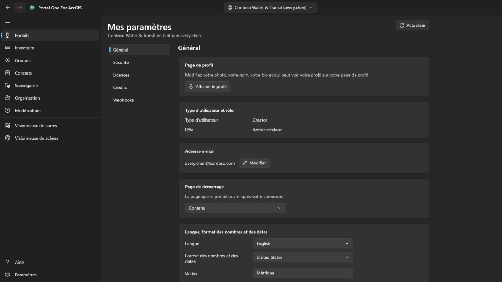

## Inventaire

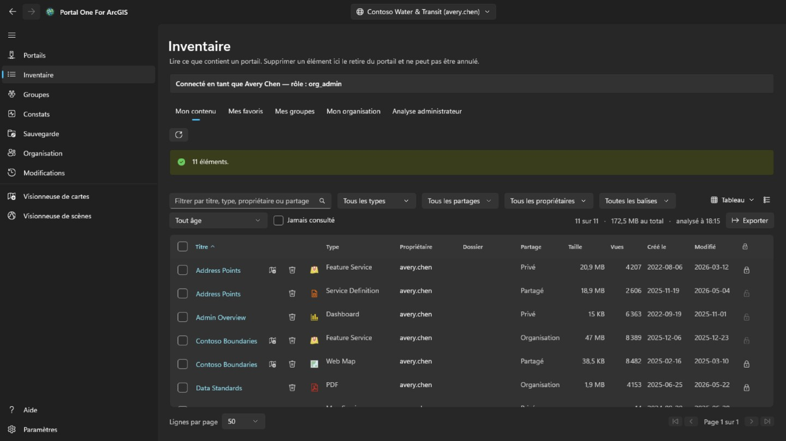

Montre ce que votre compte peut voir, en quatre onglets comme sur la page de contenu du portail : **Mon contenu**, **Mes favoris**, **Mes groupes** (tous ensemble ou un seul, y compris des groupes visibles dont vous n'êtes pas membre) et **Mon organisation** (ce que l'organisation partage). Ils sont lus dès l'ouverture de la page et conservés ; le bouton à côté relit l'onglet affiché. Le menu contextuel d'une ligne dépend du type de l'élément : une carte web peut aussi s'ouvrir dans Map Viewer du portail, dans Field Maps Designer ou dans ArcGIS Pro, un tableau de bord dans Dashboards, une story dans ArcGIS StoryMaps ; un fichier peut être téléchargé ; et tout élément peut être ajouté aux favoris ou en être retiré. **Comparer avec une autre carte…** sur une carte web ou une scène web lit celle-ci et une carte choisie du même type telles que le portail les conserve maintenant, puis liste ce qui diffère : couches ajoutées, supprimées, déplacées ou renommées, filtres, symbologie, étiquettes et fenêtres contextuelles modifiés, fond de carte, géosignets et vue initiale ; la liste peut être copiée. **Faire une copie…** la copie dans votre contenu, sur ce portail ou un autre où vous êtes connecté, sous un nouveau titre, dans un dossier ou donnée à un autre membre ; la copie est privée, et sur un autre portail l’élément de chaque couche y est d’abord recherché : une couche dont l’élément manque se charge par son adresse, ce qui est montré avant toute écriture. Le menu d'affichage en haut à droite présente les lignes en **Tableau**, en **Liste** avec la miniature et le résumé de chaque élément, ou en **Grille** de cartes, comme la page de contenu du portail, et les trie ; les filtres, la pagination et les lignes cochées restent les mêmes dans les trois. Dans **Mes favoris**, **Mes groupes** et **Mon organisation**, le dossier, la taille et la protection s'affichent peu après la page : une recherche ne les renvoie pas, chaque élément est donc lu, la page visible d'abord. Le dossier n'apparaît que pour vos propres éléments, ou pour ceux de tous si vous êtes administrateur. Le titre d’un élément, dans le tableau, la liste et la grille, ouvre la page de l’élément dans sa propre fenêtre, présentée comme celle du portail : dans **Vue d'ensemble**, la fiche de l’élément avec sa miniature, son type, ses dates et son résumé, puis sa **Description**, ce qu’il contient selon son type (les **Couches** et tables d’un service, les couches d’une carte, les tâches d’un service de géotraitement), ses **Conditions d'utilisation** et ses **Commentaires**, où un commentaire peut être laissé ; à côté, **Ouvrir dans la visionneuse de cartes**, **Ouvrir dans la visionneuse de scènes**, **Partager…** et **Ouvrir dans ArcGIS Pro**, le reste étant derrière un chevron, le **Propriétaire**, les **Détails** avec la source de l’élément et l’URL à copier ou ouvrir, une barre indiquant le niveau de complétude de ses informations avec la modification la plus utile, et ses **Balises**, son **Partage**, son **Dossier** et ses **Remerciements**, chacun avec l’action qui le modifie ; puis les onglets **Données**, **Visualisation** et **Paramètres** disponibles pour son type. **Paramètres** suit le portail : **Général** pour chaque élément (statut du contenu, protection contre la suppression et suppression de l’élément, étendue utilisée par les recherches), la section propre à l’élément — pour une couche d’entités hébergée, mise à jour, suivi de l’éditeur, synchronisation, export et courbes vraies, enregistrés ensemble avec **Enregistrer** ; pour une carte web ou une scène web, son mode hors connexion ; pour les autres couches, les paramètres du service tels qu’il les signale — et les webhooks d’une couche d’entités hébergée ; chaque modification est confirmée lorsqu’elle retire quelque chose, relue depuis le portail et consignée sur la page **Modifications**, qui peut la restaurer.

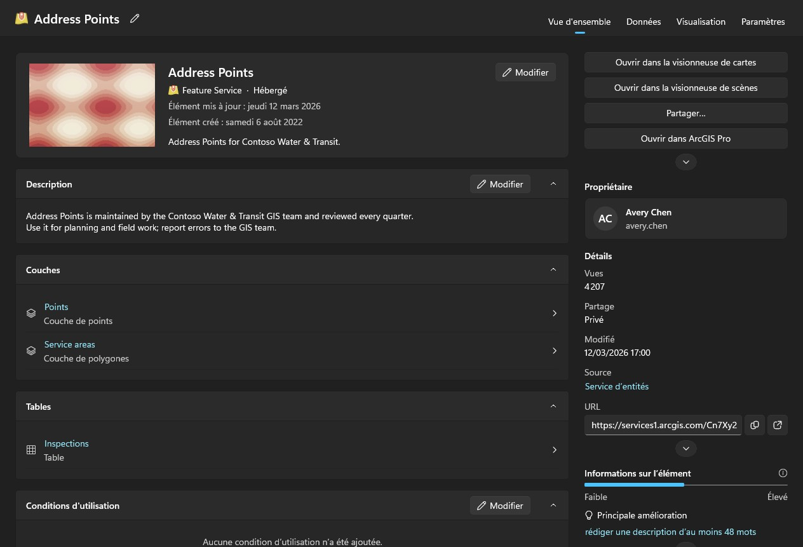

Analyser le contenu des autres est le travail d'un administrateur. Un compte autorisé à lire ce que possèdent les autres membres (portal:admin:viewItems) dispose de l'onglet **Analyse administrateur** sur cette page et d'une analyse dans les pages Constats et Sauvegarde — un membre, un groupe ou toute l'organisation — et de l'onglet **Transfert** de la page **Organisation** ; les autres comptes ne les voient pas. Le parcours de l'organisation demande son contenu à chaque membre plutôt que de chercher, car la recherche ne renvoie que ce qui est partagé et un audit ne doit pas manquer les éléments privés. Il prend du temps et peut être annulé.

Constats, Sauvegarde et les visionneuses lisent eux-mêmes votre propre contenu la première fois qu'ils en ont besoin, sans qu'il faille passer par une autre page ; l'analyse d'un administrateur le remplace par ce qui a été analysé. Chaque tableau indique quand sa liste a été lue. Un portail continue de changer après avoir été lu.

Chaque ligne porte aussi un bouton de suppression, et c'est la seule chose dans cette application qui ne peut pas être annulée : ArcGIS n'a pas de corbeille. La confirmation nomme l'élément, son type et son propriétaire, et indique si le dossier de sauvegarde mémorisé pour cette connexion en contient une copie et de quand elle date. Elle ne refuse pas en son absence, mais cette ligne est la seule chose qui pourrait répondre de la suppression ensuite. Un élément protégé contre la suppression dans le portail est refusé ici plutôt que déprotégé en silence. Pour modifier la protection elle-même, utilisez le cadenas en fin de ligne ou le menu de la ligne : c'est une étape à part, la retirer demande d'abord confirmation, et chaque changement est relu depuis le portail et consigné dans le journal. Cochez la case en début de ligne — ou celle de l'en-tête, pour toutes les lignes affichées par les filtres sur toutes les pages — pour agir sur plusieurs éléments à la fois. **Partager** définit leur niveau de partage et leurs groupes ; **Balises** ajoute et retire des balises en gardant les autres ; **Déplacer** range les éléments d'un propriétaire dans l'un de ses dossiers ; **Changer de propriétaire** les transfère à un autre membre, comme l'onglet **Transfert** de la page **Organisation**, et la page **Modifications** les rétablit ; **Supprimer** les retire après une confirmation qui indique combien, à qui, et combien la sauvegarde en contient, et demande de cocher que vous avez compris. Les éléments que ce compte ne peut pas modifier, et ceux protégés contre la suppression, restent intacts et sont comptés. Les éléments sont traités un par un et consignés ; **Annuler** s'arrête entre deux, et le résumé indique ce qui a échoué et pourquoi. Depuis le menu contextuel d'une ligne, **Partager…** modifie le niveau et les groupes de cet élément, et **Modifier les détails…** son titre, son résumé, sa description, ses balises, ses crédits et ses conditions d'utilisation. Les deux s'ouvrent sur l'élément tel que le portail le détient, n'envoient que vos modifications, vérifient le résultat et sont consignés.

## Constats

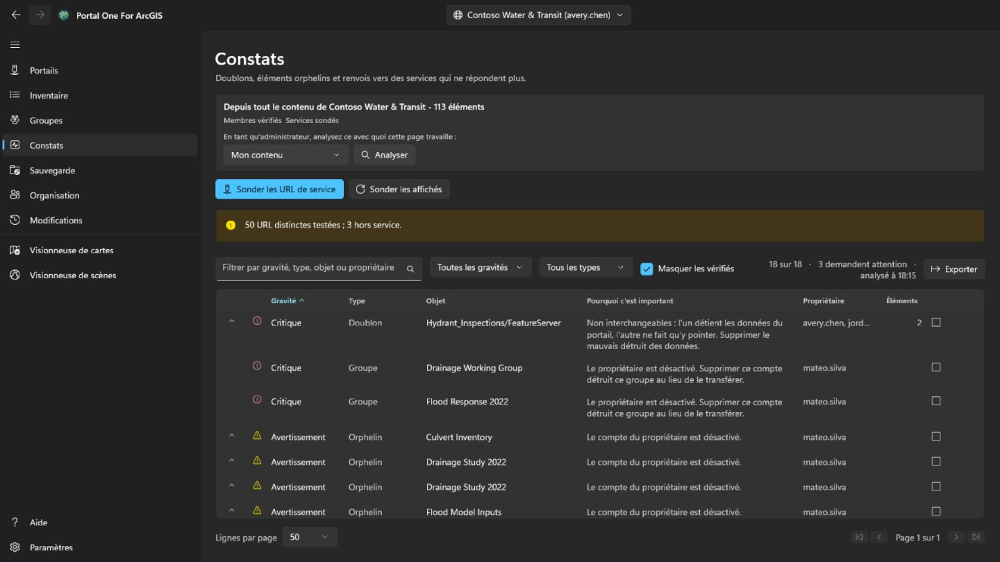

Contenu redondant et mort, trié selon l'attention qu'il mérite et non selon la
gravité apparente.

- **Critique** signifie qu'agir sans précaution ici détruit quelque chose qui
  n'existe nulle part ailleurs : deux éléments pointant vers le même service, où
  supprimer le mauvais est irrattrapable.
- **Avertissement** est un problème réel et sans danger à traiter : un élément
  dont le propriétaire est parti, un service qui ne répond plus.
- **Information** mérite d'être su et peut s'avérer sans conséquence.
- **Non concluant** signifie que cela n'a pas pu être déterminé. **Un service en
  délai dépassé n'est pas un service disparu**, et cet outil ne le dira pas.

Ouvrez une ligne pour voir les éléments qu'elle représente. Marquez-la comme
examinée quand vous avez décidé qu'elle ne pose pas de problème ; la décision
est mémorisée par connexion et la ligne reste visible au lieu de disparaître.

Cette page rapporte. **Elle ne vous dit pas lequel de deux éléments semblables
conserver**, car cela dépend de qui les utilise et de ce qui pointe vers eux.

## Sauvegarde

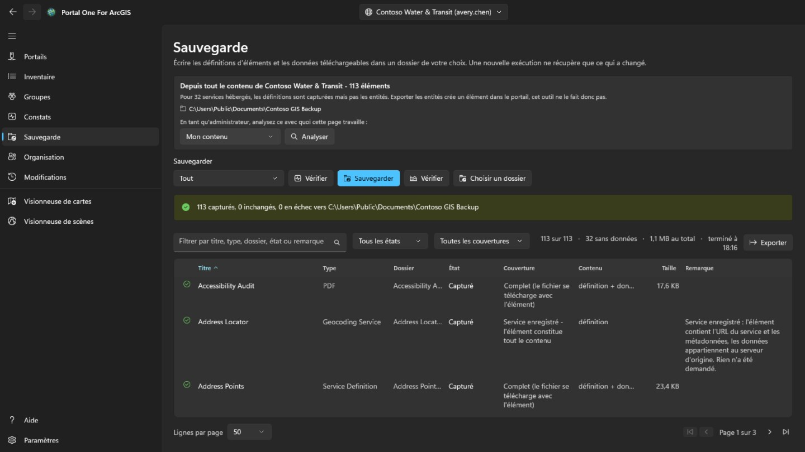

Écrit les définitions d'éléments, les ressources et les données téléchargeables
dans un dossier de votre choix. Relancer vers le même dossier ne récupère que ce
qui a changé : **reprendre une sauvegarde interrompue et faire une sauvegarde
incrémentielle sont la même chose**.

- **Vérifier l'état** compare le dossier au portail et indique ce qu'il *ferait*,
  sans rien écrire. C'est la façon de répondre à « ma sauvegarde est-elle à
  jour ? » sans y passer des heures.
- **Contrôler** compare le dossier à son propre relevé, sans aucun portail.
  **C'est la question qui reste quand le portail a disparu — et c'est
  généralement à ce moment-là qu'on lit une sauvegarde pour de bon.**

Le dossier est mémorisé par connexion, et un dossier contenant la sauvegarde
d'une autre organisation est refusé plutôt qu'écrasé.

**Ce qu'une sauvegarde ne contient pas.** Les entités d'un service hébergé
résident dans l'entrepôt de données du portail, pas dans l'élément, et les en
sortir exige un export qui crée un nouvel élément dans le portail — une
écriture. Cet outil ne le fait pas : ces lignes sont donc capturées comme
définition sans données, et la page en donne le nombre. Les services enregistrés
depuis un autre serveur sont des pointeurs par nature et n'ont rien de plus.

## Départ d'un membre

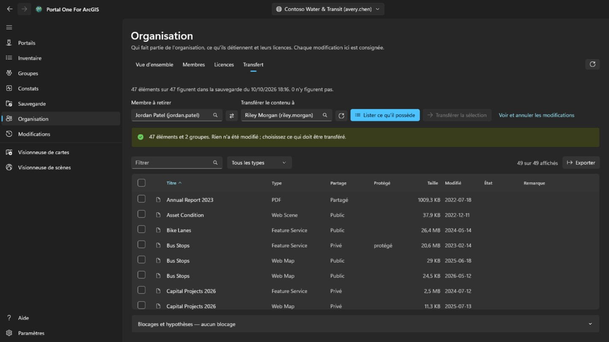

Il s'agit de l'onglet **Transfert** de la page **Organisation**, affiché seulement pour les comptes qui administrent le contenu (portal:admin:viewItems). Il détermine ce qu'implique le retrait d'un membre et déplace son contenu, un élément à la fois et de façon réversible.

Choisissez dans les listes le membre et le destinataire de son contenu ; les
deux proviennent de l'annuaire de l'organisation, **un nom ne peut donc pas être
mal tapé et tomber sur un autre qui existe**. **Lister ce qu'il possède** ne
change rien : cela montre chaque élément et chaque groupe, et vous cochez ce qui
doit partir.

Rien n'est coché pour vous. Déplacer un compte entier tient en un clic sur la
case de l'en-tête, et **ce clic est une décision, pas un réglage par défaut**.

- Les groupes figurent volontairement dans le même tableau que les éléments.
  En supprimant un membre, le portail **détruit** les groupes qu'il possède
  encore au lieu de les transférer : un groupe non coché est donc **la seule
  chose silencieusement destructrice de cette page**, et la ligne de comptage le
  dit.
- La confirmation liste les dossiers du destinataire et permet d'en ajouter un ; les éléments arrivent dans celui que vous choisissez. Chaque transfert est écrit dans le relevé avant que le suivant ne commence, et la page **Modifications** remet chacun dans le dossier d'où il venait, en recréant un dossier disparu, un par un ou tous ceux qui restent à la fois.
- Déplacer un élément peut en déplacer d'autres avec lui. Transférer un shapefile emporte le service hébergé qui en est issu ; une ligne peut donc signaler qu'il est arrivé sans que ce transfert l'ait envoyé. Rétablir cette seule ligne dans la page **Modifications** ne le ramènera pas ; il revient avec ce qui l'a porté.
- Après chaque déplacement, l'élément est relu depuis le portail. **Une requête
  qui renvoie un succès est une affirmation sur la requête, pas sur l'endroit où
  se trouve désormais l'élément.**

Le compte du membre lui-même se supprime sur la page **Organisation**, et seulement une fois qu'il ne possède plus rien. **C'est la seule étape qui ne peut pas être annulée.**

## Organisation

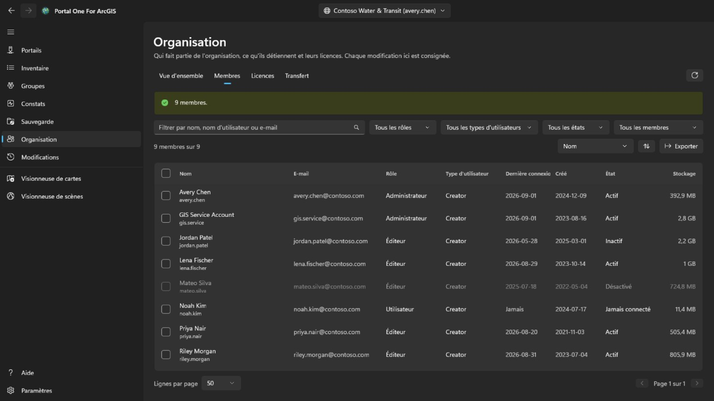

Chaque membre voit cette page, comme dans le portail. **Vue d'ensemble**, qui nomme aussi les contacts administratifs de l'organisation, est pour tous, et avec le privilège de voir les membres, un onglet **Membres** en lecture seule, sans e-mail, connexions, statut ni stockage. Cocher des membres, **Exporter**, **Licences** et toute modification sont réservés aux comptes qui administrent les membres (portal:admin:viewUsers). **Vue d'ensemble** résume l'organisation : sur ArcGIS Online, son abonnement, ses places et ses crédits ; les membres par statut, rôle et type d'utilisateur ; et le contenu et le stockage qu'elle occupe.

**Membres** liste toute l'organisation, filtrée par nom, rôle, type d'utilisateur, statut ou groupe, triée selon n'importe quelle colonne et enregistrée dans un fichier CSV avec **Exporter**. Cochez des membres pour les désactiver ou les activer, changer leur rôle ou leur type d'utilisateur, les retirer de groupes ou les supprimer ; avec un seul coché, **Faire partir** ouvre l'onglet **Transfert** de cette page. Votre propre compte n'est jamais modifié, et le propriétaire d'un groupe y reste.

Un clic droit sur un membre ouvre son menu. **Afficher** montre son **Profil**, ses **Éléments** et, pour un administrateur, ses **Groupes**, ici dans l'application plutôt que dans le portail ; un simple membre ne voit que les éléments partagés avec lui. **Gérer** est réservé aux administrateurs, chaque entrée seulement avec le privilège qu'elle demande : **Licences complémentaires** fixe les droits que détient le membre, **Modifier l'adresse e-mail** la change pour un compte qui se connecte avec ArcGIS, **Transférer le contenu** ouvre l'onglet **Transfert** sur lui, et **Transférer le membre** donne à un autre membre son type d'utilisateur, son rôle et ses licences complémentaires, puis continue dans l'onglet **Transfert** avec son contenu et ses groupes. Le même menu change le type d'utilisateur, le rôle, les groupes, le statut ou le compte d'un membre, comme la barre le fait pour plusieurs.

**Supprimer** ne retire que les membres qui ne possèdent ni éléments ni groupes. ArcGIS ne les transmet pas lorsqu'un compte est supprimé : déplacez-les d'abord dans l'onglet **Transfert**. Avant toute action, vous tapez le nom d'utilisateur ou, pour plusieurs membres, leur nombre. La suppression ne peut pas être annulée.

**Licences** indique combien de chaque type d'utilisateur sont attribués et, sur ArcGIS Online, combien l'abonnement en compte ; **Afficher les membres** liste ceux qui ont ce type. Choisissez une licence complémentaire pour voir qui la détient, et retirez-la aux membres cochés.

Chaque modification est relue sur le portail et enregistrée avec l'état précédent, puis listée sur la page **Modifications**. Ces modifications de membres ne s'annulent pas depuis cette page : pour en inverser une, faites la modification contraire.

## Modifications

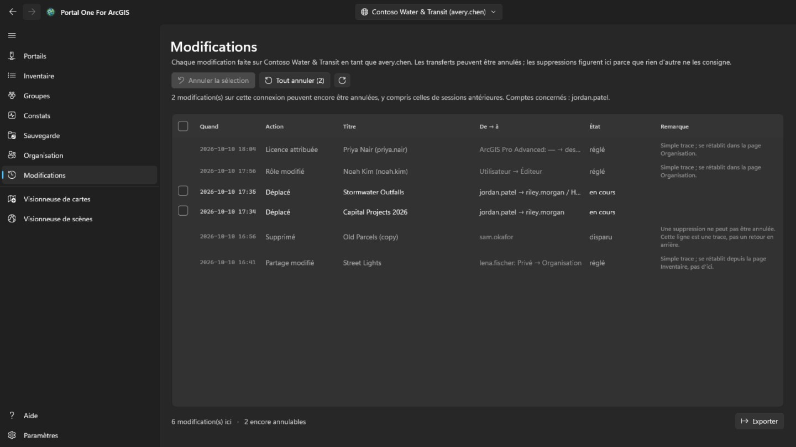

La page **Modifications** s'affiche pour tout compte connecté. Elle liste, de la plus récente à la plus ancienne, tout ce que cet outil a changé sur le portail actuellement sélectionné : transferts, suppressions, partages, balises, dossiers, détails, protection et modifications de membres. Les changements faits sur d'autres portails sont comptés, pas listés. La liste peut être exportée en CSV.

Les transferts qui peuvent être rétablis ont une case à cocher. **Annuler la sélection** rétablit les transferts cochés, et **Tout annuler** rétablit tout ce qui reste sur cette connexion après une confirmation nommant le propriétaire du contenu. Les éléments reviennent dans les dossiers d'où ils venaient, en recréant un dossier disparu. Les suppressions et les modifications de membres ne sont qu'un relevé : une suppression ne peut pas être annulée, et une modification de membre se rétablit en faisant la modification contraire. Annuler un transfert est lui-même un transfert et demande le même privilège (portal:admin:reassignItems, ou reassignGroups pour un groupe) ; un compte qui ne l'a pas ne voit que le journal.

Une carte web enregistrée par-dessus depuis la visionneuse de cartes, et une entité ajoutée, modifiée ou supprimée là, s'annulent depuis le menu de leur ligne. Une modification d'entité n'est annulée que tant que l'entité est restée telle que la modification l'a laissée : une entité ajoutée est supprimée, une entité modifiée retrouve ses valeurs et sa forme précédentes, et une entité supprimée est ajoutée à nouveau sous un nouvel identifiant d'objet. L'annulation est elle aussi enregistrée, et peut être annulée à son tour. Avant de rétablir une carte web, **Comparer avec la carte actuelle** dans le même menu liste ce qui distingue la copie conservée avant cet enregistrement de la carte telle que le portail la détient maintenant : le fond de carte, les couches ajoutées, retirées, renommées ou déplacées, et pour chaque couche la visibilité, l'opacité, le style, les étiquettes, le filtre, la plage d'échelle, la fenêtre contextuelle et l'actualisation, les tables, les géosignets et l'endroit où la carte s'ouvre.

## Visionneuse de cartes et visionneuse de scènes

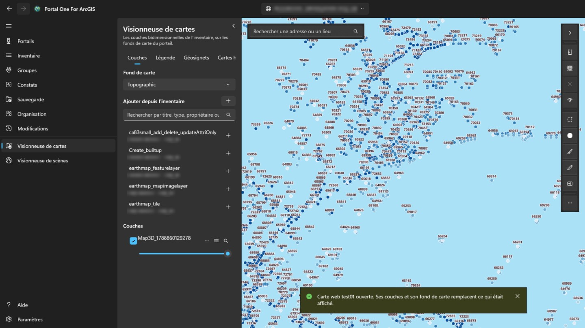

La **visionneuse de cartes** affiche les couches bidimensionnelles sur les fonds de carte du portail ; la **visionneuse de scènes** affiche celles-ci et les couches tridimensionnelles — couches de scène, maillages, nuages de points, 3D Tiles — sur un globe avec relief. Le volet de gauche recherche dans ce qui a été lu pour ce portail — votre propre contenu, lu automatiquement, ce qu'un administrateur a analysé et ce que les onglets de la page Inventaire ont lu — et ne liste que ce que la visionneuse peut dessiner. Choisissez un élément pour l'ajouter. Une carte web s'ouvre dans la visionneuse de cartes, une scène web dans la visionneuse de scènes, en entier, avec ses propres couches et son fond de carte. Dans la page Inventaire, le bouton de visionneuse à côté d'un titre (aussi dans le menu contextuel de la ligne) ouvre l'élément dans la visionneuse qui peut l'afficher.

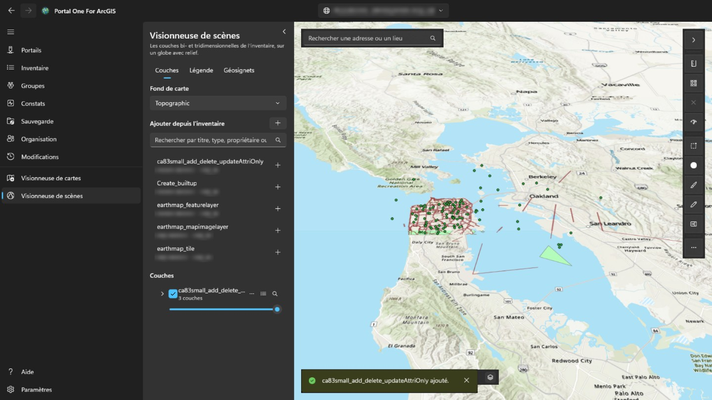

Le bouton en haut à droite du volet le replie, pour laisser toute la largeur à la carte ou à la scène, et le rouvre ; il est toujours ouvert quand vous arrivez dans la visionneuse. Chaque couche peut être affichée ou masquée, rendue plus transparente, montée ou descendue, zoomée ou retirée. Un clic sur une entité de la carte affiche ses champs : si la couche a une fenêtre contextuelle configurée dans le portail, ceux qu'elle a choisis, avec ses libellés et formats ; sinon, tous. L'onglet **Légende**, à côté de **Couches**, indique ce que représentent les symboles de chaque couche visible. **Géosignets** liste les lieux enregistrés avec une carte web ou une scène web ; nommez-y la vue actuelle pour ajouter les vôtres, et choisissez-en un pour y revenir. Un géosignet de scène conserve le cap et l'inclinaison de la caméra. Le bouton de table d'une couche d'entités ouvre sa **table attributaire** sous la carte, deux cents lignes à la fois, filtrée comme la couche est dessinée ; choisir une ligne met l'entité en surbrillance et zoome dessus. **Exporter** écrit toutes les lignes que la table contient avec ses filtres et son tri, jusqu’à 50 000, et pas seulement celles chargées : en CSV tel que la table les affiche, en GeoJSON en latitude et longitude, ou en shapefile zippé dans le système de coordonnées de la couche (noms de champs tronqués à dix caractères). L’en-tête d’une colonne trie la table par elle, la filtre (comme le filtre de couche, une condition par colonne, toutes appliquées) ou affiche ses statistiques : combien de lignes ont une valeur, la plus petite et la plus grande, pour les nombres le total, la moyenne et l’écart type, et les valeurs les plus fréquentes, sur toutes les lignes qui passent les filtres et pas seulement celles chargées. **Sélection seulement** réduit la table aux lignes sélectionnées. Dans la visionneuse de cartes, **Distance** et **Surface**, au-dessus de la carte, mesurent ce que vous tracez en cliquant des points : le long de la surface terrestre, pas sur la carte plane, en unités métriques ou impériales selon votre région Windows. Dans la visionneuse de scènes, **Distance** mesure entre deux clics sur le terrain ou un modèle (directe, le long du sol et verticale), et **Surface** suit des coins drapés sur le terrain. **Enregistrer comme carte web** crée un nouvel élément carte web dans votre propre contenu, dans le dossier de votre choix, avec le fond de carte, les couches et les géosignets affichés ; il s'ouvre là où se trouve la carte et a une image de celle-ci comme miniature. **Enregistrer** écrase une carte web ouverte depuis le portail lorsque vous en êtes propriétaire ou pouvez modifier le contenu d'autrui, après en avoir gardé une copie sur cet ordinateur ; la visionneuse de scènes ne peut pas enregistrer. La recherche trouve aussi adresses et lieux via le géocodeur du portail. **Exporter** enregistre un PNG de la vue et, si le portail propose un service d'impression, **Imprimer** l'exécute. Les couches temporelles ouvrent une barre **Temps** pour parcourir ou lire leur intervalle. Les couches restent en place pendant que vous travaillez sur d'autres pages et repartent de zéro quand vous passez à un autre portail. La connexion au portail sert à ses propres couches et n'est jamais envoyée au serveur d'une autre organisation : une couche enregistrée ailleurs qui demande une connexion ne se chargera pas. Pendant une mesure sur la carte, double-cliquez, appuyez sur Entrée ou choisissez **Terminer** pour finir le croquis : il reste sur la carte avec son résultat jusqu'à la mesure suivante ou jusqu'au ✕ à côté des outils. Échap annule le croquis, et Ctrl+Z ou Retour arrière retire le dernier point. Le bouton de style d'une couche d'entités change sa représentation : un symbole de la couleur et de la taille de votre choix, une couleur par valeur d'un champ (**Catégories**) ou des classes d'un champ numérique le long d'un dégradé (**Classes**, par seuils naturels, intervalles égaux ou quantiles). La carte suit chaque modification ; **Appliquer** la conserve, **Annuler** rétablit ce qui était dessiné et **Rétablir l'original** le style d'origine de la couche. La légende suit aussi, et enregistrer la carte comme carte web conserve le style. Le bouton **…** de la même ligne ouvre aussi **Étiquettes…**, pour afficher la valeur d'un champ sur chaque entité dans la taille et la couleur de votre choix, avec un halo et à partir d'une échelle, et **Filtre…**, pour n'afficher que les entités qui remplissent des conditions faites d'un champ, d'une comparaison et d'une valeur, toutes ou l'une d'elles ; le nombre de correspondances est compté au fur et à mesure, le filtre venu de la carte web de la couche est conservé et la table attributaire le suit. En bas à gauche de la carte, une boussole tourne avec la carte (sélectionnez-la pour revenir au nord) ; à côté, une barre d'échelle mesurée au sol, l'échelle et les coordonnées sous le pointeur (sélectionnez-les pour les copier ou passer des degrés décimaux aux degrés, minutes, secondes), et un bouton affiche une carte de situation où un clic déplace la carte. **Sélectionner** choisit les entités de toutes les couches visibles dans un rectangle, une forme à main levée ou un polygone : un panneau indique leur nombre par couche, et le total, la moyenne, le minimum et le maximum d'un champ numérique, et les affiche dans la table, zoome dessus ou les enregistre en CSV. **Zone tampon** dessine la zone à une distance des entités sélectionnées, ou d'un point, d'une ligne ou d'une zone que vous tracez, la mesure sur la surface terrestre sur cet ordinateur (sans service d'analyse ni crédits) et peut sélectionner ce qu'elle couvre. **Balayer** montre une couche à gauche d'un séparateur que vous faites glisser, et la carte sans elle à droite. **Vérifier la carte** examine chaque couche et indique ce qui échouerait ou tromperait ceux avec qui la carte est partagée : couches qui ne se chargent pas, éléments disparus ou partagés plus étroitement que la carte, services en http ou hors du portail, éléments obsolètes ou d'une autre organisation, grandes couches sans plage d'échelle, et aucune fenêtre contextuelle ; le rapport peut être copié. Elle cite aussi les champs auxquels renvoient la fenêtre contextuelle, la symbologie ou les étiquettes d’une couche et que la couche n’a pas, et chronomètre le comptage des entités de chaque couche de service : au-delà de 3 secondes c’est noté, au-delà de 10 ou sans réponse en 30, c’est un avertissement. Dans le menu **…** d'une couche, **Utilisé par…** lit les cartes et applications de l'inventaire et liste celles qui utilisent la couche, directement ou via une carte, et **Propriétés…** montre sa provenance, son propriétaire, son rendu et, pour des entités, leur nombre et leurs champs. La zone de recherche accepte aussi des coordonnées — deux nombres décimaux dans un ordre ou l'autre, degrés/minutes/secondes, UTM ou MGRS — et s'y rend sans géocodeur. **Exporter** peut copier un lien qui ouvre la carte web dans la visionneuse du portail à cet endroit, ou les coordonnées du centre. Enregistrer sur une carte web conserve sa définition précédente, et la page **Modifications** peut la rétablir depuis le menu de cet enregistrement. Les paramètres de couche, dans le menu d’une couche, règlent la plage d’échelle visible, les fenêtres contextuelles des couches d’entités (espaces réservés de titre, libellés, visibilité et ordre des champs) et les intervalles d’actualisation pris en charge ; l’aperçu est immédiat et l’enregistrement de la carte web les conserve. La boîte de dialogue de style peut maintenant dessiner les couches de points en cartes de chaleur, dimensionner les symboles ponctuels ou les largeurs de lignes à partir d’un champ numérique et activer l’agrégation de points avec des étiquettes de total; les couches de polygones gardent les styles de couleur existants. Le menu Ajouter de l'onglet Couches peut aussi ajouter une URL de service ou un fichier local : CSV et GeoJSON deviennent des collections d'entités incorporées à l'enregistrement, tandis que les shapefiles et les fichiers KML ou KMZ restent locaux et sont signalés avant l'enregistrement. Croquis ajoute une couche d'annotations enregistrée avec des points, des lignes, des surfaces, des rectangles, des cercles ou ellipses, des formes à main levée et du texte ; sélectionnez une entité de croquis pour la remodeler, changer son style, la supprimer, annuler la dernière marque ou vider la couche, et la collection d'entités de croquis est enregistrée avec la carte web. L'outil **Modifier** du visualiseur de cartes liste les couches d'entités de service modifiables, explique les couches en lecture seule, permet de dessiner une nouvelle entité depuis un modèle ou d'en sélectionner une sur la carte, valide les champs modifiables et applique les changements confirmés au service d'entités actif. Dans la table attributaire d'une couche modifiable, sélectionnez des lignes avec Ctrl ou Maj (Ctrl+A pour toutes celles chargées) : **Modifier** ouvre l'une d'elles dans le formulaire de modification, et **Changer un champ** donne une valeur à un champ sur toutes, après l'avoir vérifiée selon les règles de chaque entité.  **Changer un champ** peut aussi utiliser une expression — noms de champ entre crochets, texte entre apostrophes, + - * / et quelques fonctions — afin que chaque ligne sélectionnée reçoive sa propre valeur à partir d'autres champs.  Dans le volet Modifier, **Outils de géométrie** permet **Sélectionner sur la carte**, **Fusionner** des formes, **Scinder** des lignes ou polygones avec une ligne de coupe, **Découper** à une zone tracée ou **Copier vers une couche** vers une autre couche modifiable du même type de forme ; chaque action est enregistrée sur la page **Modifications**. Chaque changement est enregistré sur la page **Modifications**, un changement de champ en une seule entrée, et s'y annule. Pour une entité sélectionnée, le formulaire de modification liste aussi ses pièces jointes, si la couche en conserve, pour les ouvrir, en ajouter ou en retirer (un fichier retiré est d'abord copié sur cet ordinateur, et chaque changement est enregistré sur la page **Modifications**), et montre les enregistrements qui lui sont associés, en lecture seule. Pendant le tracé ou le remodelage d'une entité, ses sommets s'accrochent aux entités des couches cochées sous **Accrochage** dans le volet de modification, et les guides géométriques proposent angles droits et parallèles ; les deux se désactivent, et la distance d'accrochage se règle. La mesure, Croquis et les autres outils n'accrochent pas. **Partager**, à côté de **Enregistrer comme carte web**, partage la carte web ou la scène web affichée comme la page Inventaire partage un élément, quand ce compte en est propriétaire ou peut partager le contenu des autres : une fois le niveau et les groupes choisis, la carte est vérifiée telle qu'elle serait partagée, et ce qui échouerait ou tromperait à ce niveau est listé avant que le partage n'ait lieu. **Détails** modifie le titre, le résumé, la description, les balises, les crédits et les conditions d'utilisation de l'élément comme la page Inventaire, et peut aussi utiliser une image de la vue comme miniature et régler l'étendue de l'élément, qu'utilise la recherche du portail, sur la vue ; l'endroit où la carte s'ouvre se règle en l'enregistrant par-dessus. La fenêtre contextuelle d'une entité montre aussi, dans l'ordre fixé par son auteur, les images, graphiques et pièces jointes de la fenêtre configurée dans le portail, ainsi que ses enregistrements associés ; les expressions Arcade sont évaluées d'abord. Les graphiques suivent le thème de l'application, les images ne se chargent que depuis des adresses https, et une pièce jointe s'ouvre d'un clic. Quand un service déménage ou est remplacé, **Remplacer dans les cartes web…** du menu **…** d'une couche fait pointer vers la nouvelle adresse chaque carte web et scène web de l'inventaire qui l'utilise (les couches d'un service entier gardent leur numéro), après avoir listé ce qui changerait dans chacune ; chaque carte est conservée avant d'être écrite et enregistrée sur la page **Modifications**, où elle peut être comparée et rétablie. La liste des couches affiche les couches de groupe sous forme d'arborescence : développez un groupe pour gérer ses couches, renommez n'importe quelle couche, créez un groupe à partir de couches de premier niveau choisies, déplacez une couche dans un groupe ou hors de celui-ci, ou dissociez-le. La visionneuse de carte peut tracer un profil d’altitude à partir d’une ligne, avec un terrain tuilé plutôt que des services d’analyse consommant des crédits, et permet de copier ou d’exporter les distances et altitudes échantillonnées. Une couche d’entités de service peut aussi ouvrir un diagramme en lecture seule sous la carte ; il utilise les statistiques du service au lieu de télécharger toutes les entités, peut être limité à la vue ou à la sélection, exporte en PNG ou CSV et n’est pas enregistré dans la carte web.  Un fichier CSV, GeoJSON ou shapefile ajouté depuis l’ordinateur peut être publié depuis le menu de la couche comme couche d’entités hébergée ; le fichier source est téléversé, le service est créé dans votre contenu et la couche locale est remplacée. KML et KMZ ne sont pas proposés, car le portail ne les publie pas en services d’entités.  La boîte de dialogue de style propose aussi des types avec un champ de taille et des cartes de relation à deux champs ; les dégradés de couleur continus, la densité de points et le binning ne sont pas affichés, car ArcGIS Maps SDK for .NET 300.1 ne les prend pas en charge de façon sûre ici. Les étiquettes et les champs contextuels peuvent aussi utiliser des expressions Arcade, avec insertion de champs, extraits courants et test sur une entité réelle avant l’application.  Les couches d'entités modifiables peuvent aussi porter un formulaire enregistré dans la carte web : le volet de modification suit ses groupes, ses règles obligatoires et ses valeurs calculées, et la commande **Formulaire…** du menu de couche modifie ce formulaire. Les cartes web du portail peuvent être mises hors connexion depuis la visionneuse de carte : l’application vérifie les capacités hors connexion, télécharge une zone préplanifiée ou la vue actuelle sous LocalState, l’ouvre depuis l’onglet Cartes hors connexion, valide les modifications localement et les synchronise comme une seule entrée Changes lorsque le compte dispose d’une licence Runtime Basic ou supérieure.  L’analyse réseau de la carte ajoute itinéraires, zones de desserte et ressources proches depuis les services du portail; ArcGIS Online consomme des crédits.  Les sections d’enregistrements associés lisent aussi les relations au moyen des tables de relation dans une carte SDK masquée, si bien que les relations plusieurs-à-plusieurs et attributées fonctionnent lorsque les tables associées ne sont pas dans la carte web.  Dans les scènes, les couches d’entités peuvent aussi être sélectionnées par clic, par rectangle au sol ou par polygone cliqué, mises en zone tampon depuis les entités sélectionnées ou depuis un point, une ligne ou une zone cliqués, analysées dans des diagrammes et modifiées : attributs via le formulaire de la couche, nouvelles entités et redessin de la forme entière à partir de clics, ainsi que fusion, copie, division et découpage ; seule la modification sommet par sommet reste réservée à la carte, car le SDK n’expose l’éditeur de géométrie que sur MapView. Les croquis de scène (points, lignes, polygones, rectangles, ellipses et textes placés par clic) ne durent que la session, car les scènes web ne peuvent pas être enregistrées ici ; le dessin à main levée est réservé à la carte. **Exporter le croquis en GeoJSON** dans le panneau Croquis conserve dans un fichier les marques de l’une ou l’autre visionneuse. Les scènes tracent aussi un **Profil d’altitude** le long d’une ligne cliquée, lu sur le relief propre de la scène quand elle en a un, sinon sur la même source que la visionneuse de cartes, et le panneau **Réseau** y fonctionne aussi : les clics au sol placent arrêts, ressources et incidents, les résultats sont drapés sur la scène, et un itinéraire ajouté comme couche ne dure que la session.  Les actions des scènes partagent aussi, modifient les détails, copient les liens ou centres, exportent des images, vérifient les couches, affichent les usages et remplacent les sources ; les widgets de scène montrent le cap, les coordonnées du pointeur, l’aperçu et l’altitude de la caméra, et les paquetages de scène mobile locaux s’ouvrent en lecture seule. Le **Balayage** de scène utilise une copie synchronisée et découpée de la scène entière ; la navigation reste dans la scène principale tandis que le séparateur la compare avec et sans la couche choisie.  Le champ court de recherche de lieux reste en haut à gauche ; la flèche de la barre d’outils droite masque ou rétablit les deux avec une animation, et Autres commandes regroupe les commandes moins utilisées d’élément, de vérification, de temps et d’export.

## En arrière-plan

Fermer la fenêtre place l'application dans la zone de notification au lieu de la
quitter, **pour qu'une analyse ou une sauvegarde de plusieurs heures ne meure pas
du geste par lequel on écarte une fenêtre**. L'icône indique ce qui tourne, et
**Quitter** y est la sortie. Son menu permet aussi d'ajouter un portail, et de rechercher une mise à jour dans le Microsoft Store ou d'installer celle qui a été trouvée.

Désactivez l'icône de la zone de notification et fermer la fenêtre quitte
l'application : sans icône, rien ne pourrait la rappeler.

**Démarrer avec Windows** lance l'application dans la zone de notification à
l'ouverture de session, de sorte que la connexion que vous utilisez soit déjà
active quand vous l'ouvrez.

## Paramètres

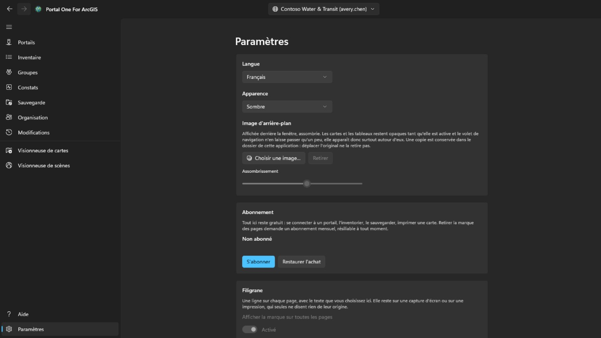

Clair, sombre, ou selon Windows ; le thème change au moment du choix. Quand le Microsoft Store propose une version plus récente, un bouton **Mettre à jour** apparaît à côté de Paramètres dans le volet de navigation ; l'application se ferme pendant l'installation, redémarre sur la nouvelle version, et le bouton disparaît. Une **image d'arrière-plan** peut être placée sous la fenêtre ; tant qu'elle est affichée, les cartes et les tableaux restent opaques et le volet de navigation n'en laisse passer qu'un peu, elle apparaît donc surtout autour d'eux, et **Assombrissement** règle à quel point elle est foncée.

L'interface existe en quatorze langues et suit Windows sauf si vous en fixez
une. **Un changement de langue prend effet au prochain démarrage**, proposé là
par un bouton, car le framework lit le texte de chaque écran une seule fois à sa
construction : l'appliquer immédiatement ne changerait que ce qui est ouvert
ensuite.

**Abonnement** est ce qui retire la marque des pages, et rien d'autre ici n'est derrière lui : se connecter à un portail, l'inventorier, le sauvegarder et imprimer une carte restent gratuits, que vous ayez payé ou non. C'est un abonnement mensuel acheté par le Microsoft Store, résiliable à tout moment ; la carte dit ce qu'il coûte et quand il se renouvelle une fois qu'il existe. *Restaurer l'achat* est là pour le cas où vous avez payé et où la marque est encore là : l'abonnement a pu être acheté dans la fenêtre du Store elle-même, dont cette application n'est pas informée.

**Filigrane** place une ligne à vous dans le coin inférieur droit de chaque page : vingt-quatre caractères au plus, dans la police, la taille, la graisse, la couleur et l'intensité choisies derrière **Autres réglages** — la carte elle-même ne montre que l'interrupteur qui l'active. Elle commence à trente pixels, en rouge vif à pleine intensité, et elle se déplace sur la page une minute sur six : cinq minutes dans le coin, une minute à travers la page, puis retour au coin. Elle se déplace parce que celui qui prend l'image décide où en sont les bords, et un coin est la partie la plus facile à laisser de côté ; elle se repose parce qu'une page sur laquelle on travaille ne devrait pas avoir une ligne qui traverse ses lignes — c'est l'interrupteur derrière **Autres réglages** qui l'arrête tout à fait. Il est actif à la première visite et lit *Non abonné* — ce qui sort de l'application est regardé quelque part qui ne dit rien d'où cela a été fait. **Intensité** est la part de la couleur employée : au plus bas, toute couleur devient le même voile pâle, si bien que la couleur seule ne peut pas dire à quel point cela se voit. Laissé vide, le texte reprend sa valeur par défaut. Jusqu'à ce que vous vous abonniez, rien sur cette carte ne peut être modifié — ni l'interrupteur ni le texte : il lit *Non abonné* et le presser ouvre la carte plus haut ; l'abonnement est ce qui permet de le désactiver et de choisir ce qu'il dit ; sans rien choisir, il reprend le nom de l'application. Ce qui est marqué, c'est l'écran : les images que l'application enregistre viennent du service d'impression du portail et sortent telles que le portail les a envoyées.

## Clavier

Sur n'importe lequel des tableaux :

- **Ctrl+F** place le curseur dans la zone de filtre.
- **Ctrl+E** exporte les lignes affichées, avec les colonnes et le tri que vous avez sous les yeux.

## Où sont rangées les choses

- Les sauvegardes vont dans le dossier que vous avez choisi, un dossier
  ordinaire que vous pouvez ouvrir, copier et déplacer.
- Connexions, préférences et journal des modifications restent dans le stockage propre
  à l'application, chiffrés lorsqu'il s'agit d'identifiants.
- Les fichiers CSV exportés restent là où vous les enregistrez.

Rien n'est téléversé nulle part. **Il n'y a pas de compte chez les auteurs de
cet outil, ni de télémétrie.**

## Nous écrire

Quelque chose ne fonctionne pas, ou ne fait pas ce que vous attendiez : **gaqo@outlook.com**.

Ce qui aide le plus : ce que vous faisiez, ce qui s'est produit à la place, si le portail est ArcGIS Online ou ArcGIS Enterprise et dans quelle version — la page Connexions indique les deux — et la langue de l'interface.

Merci de ne joindre ni mots de passe, ni jetons, ni fichiers du dossier de stockage de l'application. Une session connectée y est conservée, et rien de tout cela n'est nécessaire pour répondre à une question.
