# Guida

**Portal One For ArcGIS** verifica e mantiene un'organizzazione ArcGIS dal tuo computer. Funziona allo stesso modo con **ArcGIS Online** e con **ArcGIS Enterprise**.

Perché questo nome: ArcGIS Online e ArcGIS Enterprise sono entrambi, in sostanza, un portale; quindi la parola **Portal** li copre entrambi, ed è anche così che questa app li chiama nella pagina **Portali**, dove li aggiungi. **One** è l'app: un solo posto per ogni portale con cui lavori, anche più portali con accesso attivo contemporaneamente. **For ArcGIS** indica la piattaforma per cui è stata creata.

Questa app comunica con i portali a cui accedi, con i servizi mappa, le mappe di base e i dati di elevazione a cui puntano i loro contenuti, e con il suo sito della guida, da cui questa pagina legge la guida più recente; quando il sito non è raggiungibile, mostra la guida installata con l'app, oltre che con Microsoft Store per aggiornamenti e abbonamento. Le tue credenziali sono cifrate per il tuo account Windows e vengono inviate solo al portale a cui appartengono.

## L'ordine delle pagine è l'ordine del lavoro

Leggere, fare il backup, simulare, eseguire. Ogni pagina rende sicura la
successiva, e la navigazione è disposta in modo che scenderla sia la via sicura.

## Connessioni

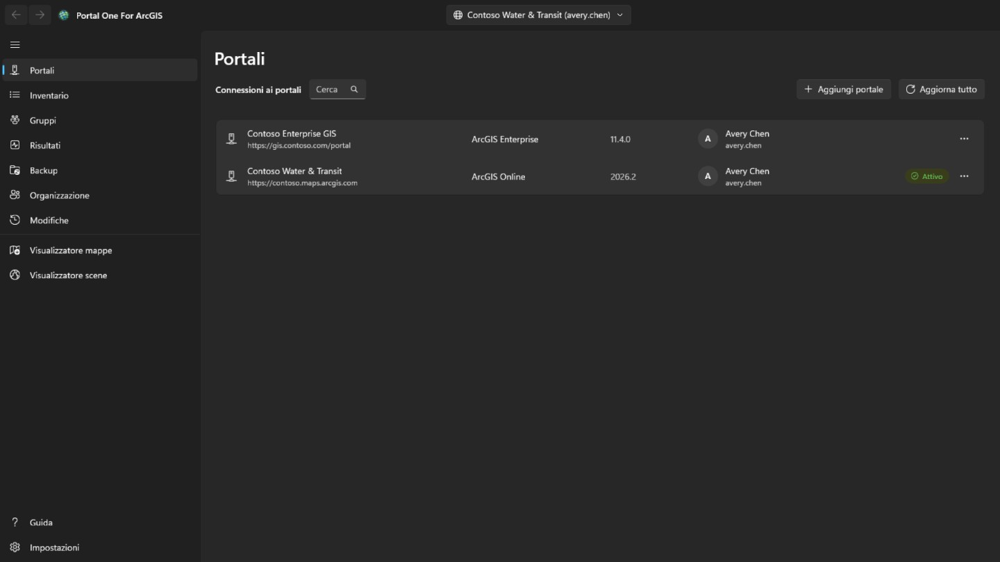

Aggiungi una connessione con l'indirizzo del portale: per ArcGIS Online
`https://tuaorg.maps.arcgis.com`; per ArcGIS Enterprise l'indirizzo completo con
il percorso di contesto, ad esempio `https://portal.example.com/portal`. Non
serve registrare nulla nel portale in anticipo. Se il portale si trova dietro un proxy basato sull'identità come il proxy dell'applicazione Microsoft Entra o Google Cloud IAP, seleziona **Il portale richiede l'autenticazione proxy basata sull'identità**: si apre una finestra per accedere al proxy prima di leggere il portale, si chiude da sola quando il portale risponde e si riapre ogni volta che la sessione del proxy scade; ciò che era in corso prosegue.

Accedi con nome utente e password, oppure tramite la pagina di accesso del
portale mostrata dentro l'app. **Usa la seconda se la tua organizzazione adotta
il single sign-on o l'autenticazione a più fattori**: così in questa app non
viene digitata alcuna password.

Più connessioni possono essere attive insieme, compresi due account dello stesso
portale. **Resta connesso** conserva la credenziale cifrata per il tuo account
Windows, così la connessione sopravvive a un riavvio.

Viene rinnovata solo la connessione selezionata. Le altre escono alla scadenza
del token e tornano in silenzio quando ci passi sopra.

Una connessione con accesso eseguito mostra l’immagine del profilo dell’account, o le sue iniziali se non ne ha una. Selezionala per **Il mio profilo**, **Le mie impostazioni** o **Guida**. **Guida** apre questa guida sul sito della guida, nel tuo browser e nella lingua mostrata dall'app; senza rete, apre invece la pagina **Guida** dell'app. Accanto all’immagine del profilo, il pulsante **Avvio applicazioni** apre le applicazioni ArcGIS che questo account può usare su quel portale, come le elenca l’avvio applicazioni del portale e nell’ordine in cui l’account le ha disposte lì; un’applicazione si apre in una finestra propria, con accesso già eseguito. **Il mio profilo** mostra l’account come fa la pagina del profilo del portale: foto, nome, biografia, gruppi e gli elementi che condivide con l’organizzazione o con tutti; **Modifica profilo** cambia nomi, biografia, visibilità del profilo e foto. **Le mie impostazioni** contiene le sezioni del portale: **Generale** (indirizzo e-mail, pagina iniziale, lingua, formato numerico e data, unità), **Sicurezza** (password e domanda di sicurezza, per un accesso ArcGIS), **Licenze**, **Crediti** assegnati dall’organizzazione, e i **Webhooks** posseduti dall’account. Ogni modifica indica cosa scriverà, viene riletta dal portale ed è registrata nella pagina **Modifiche**, che può ripristinare modifiche a profilo, impostazioni, pagina iniziale, foto e webhooks; una nuova password, una domanda di sicurezza e un webhook eliminato sono solo registrati. Autenticazione multifattore, chiavi di sicurezza, codici di recupero, account collegati e preferenze e-mail Esri sono solo mostrati o spiegati: sono gestiti sul sito web ArcGIS. Dopo una modifica della password, o ogni volta che il portale smette di accettare la connessione, si apre la pagina **Portali** con il relativo accesso, così puoi accedere di nuovo con la nuova password.

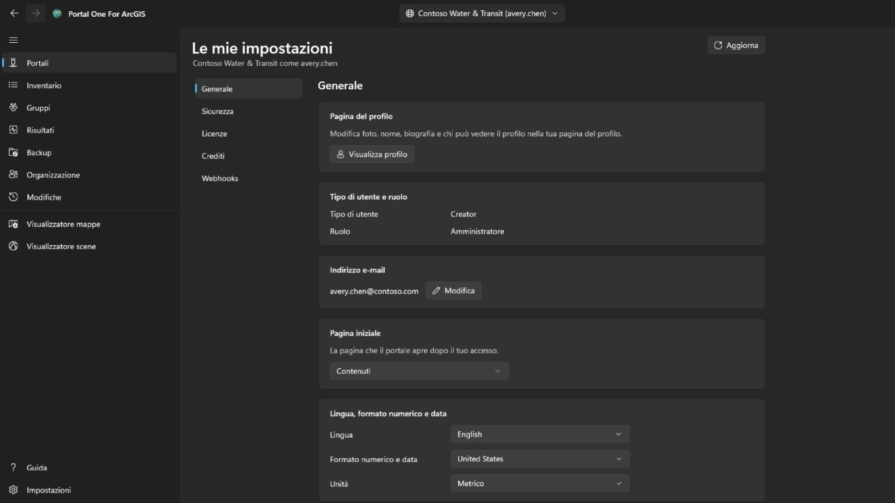

## Inventario

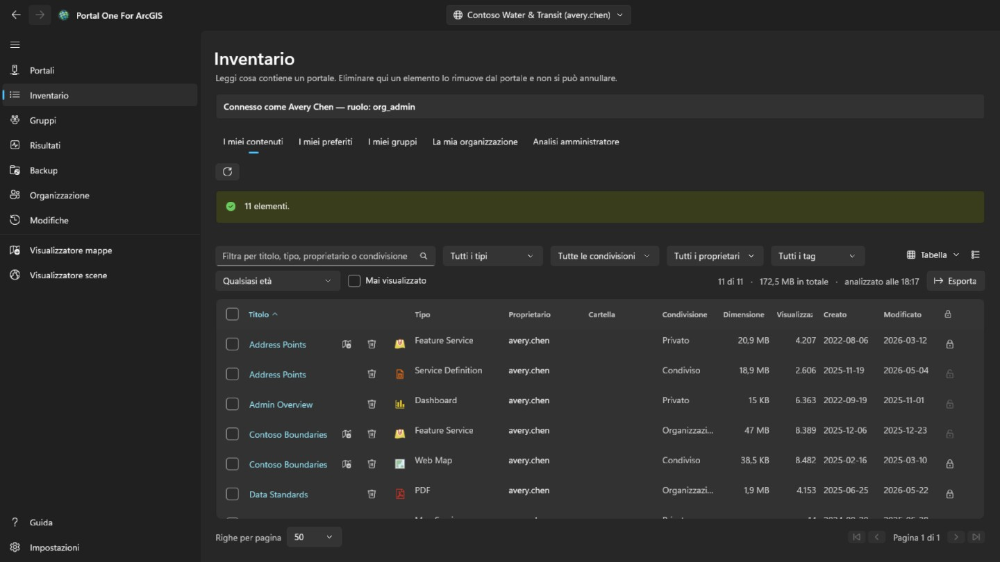

Mostra ciò che il tuo account può vedere, in quattro schede come nella pagina dei contenuti del portale: **I miei contenuti**, **I miei preferiti**, **I miei gruppi** (tutti insieme o uno, compresi i gruppi che vedi senza farne parte) e **La mia organizzazione** (ciò che l'organizzazione condivide). Vengono lette all'apertura della pagina e conservate; il pulsante accanto rilegge la scheda mostrata. Il menu contestuale di una riga dipende dal tipo di elemento: una web map si può aprire anche in Map Viewer del portale, in Field Maps Designer o in ArcGIS Pro, una dashboard in Dashboards, una storia in ArcGIS StoryMaps; un file si può scaricare; e ogni elemento si può aggiungere ai preferiti o rimuovere da essi. **Confronta con un’altra mappa…** su una web map o web scene legge questa e una mappa scelta dello stesso tipo così come sono ora nel portale ed elenca le differenze: layer aggiunti, rimossi, spostati o rinominati, filtri, simbologia, etichette e popup modificati, mappa di base, segnalibri e vista iniziale; l’elenco si può copiare. **Crea una copia…** la copia nei tuoi contenuti su questo portale o su un altro a cui hai effettuato l’accesso, con un nuovo titolo, in una cartella o assegnata a un altro membro; la copia è privata e, su un altro portale, l’elemento di ogni layer viene prima cercato lì, e un layer il cui elemento manca viene caricato dal suo indirizzo, cosa mostrata prima di scrivere qualsiasi cosa. Il menu di visualizzazione in alto a destra mostra le righe come **Tabella**, come **Elenco** con miniatura e riepilogo di ogni elemento o come **Griglia** di schede, come la pagina dei contenuti del portale, e le ordina; filtri, pagine e righe spuntate restano gli stessi in tutte e tre. In **I miei preferiti**, **I miei gruppi** e **La mia organizzazione** cartella, dimensione e protezione compaiono poco dopo la pagina: una ricerca non li restituisce, quindi ogni elemento viene letto, prima la pagina visibile. La cartella è mostrata solo per i tuoi elementi, o per quelli di tutti se sei amministratore. Il titolo di un elemento, nella tabella, nell'elenco e nella griglia, apre la pagina dell'elemento in una finestra propria, impostata come quella del portale: in **Panoramica**, la scheda dell'elemento con miniatura, tipo, date e riepilogo, poi la sua **Descrizione**, ciò che contiene per il suo tipo (i **Layer** e le tabelle di un servizio, i layer di una mappa, le attività di un servizio di geoprocessing), le **Condizioni d'uso** e i **Commenti**, dove si può lasciare un commento; accanto, **Apri nel visualizzatore mappe**, **Apri nel visualizzatore scene**, **Condividi…** e **Apri in ArcGIS Pro** con il resto dietro un chevron, il **Proprietario**, i **Dettagli** con l'origine dell'elemento e l'URL da copiare o aprire, una barra che mostra quanto sono complete le sue informazioni con la modifica che aiuterebbe di più, e i suoi **Tag**, **Condivisione**, **Cartella** e **Riconoscimenti**, ciascuno con l'azione che lo modifica; quindi le schede **Dati**, **Visualizzazione** e **Impostazioni** disponibili per il suo tipo. **Impostazioni** segue il portale: **Generale** per ogni elemento (stato contenuto, protezione da eliminazione ed eliminazione dell’elemento, l’estensione usata dalle ricerche), la sezione propria dell’elemento — per un feature layer ospitato, modifica, monitoraggio editor, sincronizzazione, esportazione e curve vere, salvati insieme con **Salva**; per una mappa web o una scena web, la modalità offline; per altri layer, le impostazioni del servizio come le riporta — e i webhook di un feature layer ospitato; ogni modifica viene confermata quando toglie qualcosa, riletta dal portale e registrata nella pagina **Modifiche**, che può ripristinarla.

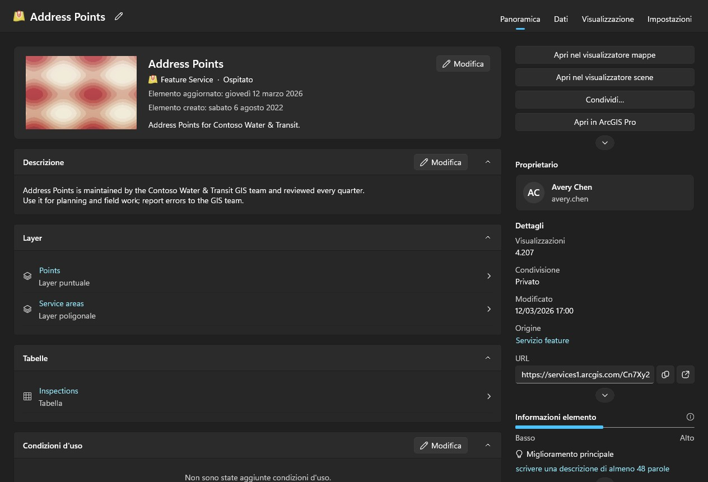

Analizzare i contenuti degli altri è compito degli amministratori. Un account che può leggere ciò che possiedono gli altri membri (portal:admin:viewItems) ha la scheda **Analisi amministratore** in questa pagina e un'analisi nelle pagine Risultati e Backup — un membro, un gruppo o l'intera organizzazione — e la scheda **Trasferimento** della pagina **Organizzazione**; gli altri account non le vedono. L'esame dell'organizzazione chiede a ogni membro i suoi contenuti invece di cercare, perché la ricerca restituisce solo ciò che è condiviso e un controllo non deve perdere gli elementi privati. Richiede tempo e si può annullare.

Risultati, Backup e i visualizzatori leggono da soli i tuoi contenuti la prima volta che servono, senza dover passare prima da un'altra pagina; l'analisi di un amministratore li sostituisce con ciò che è stato analizzato. Ogni tabella dice quando è stato letto il suo elenco. Un portale continua a cambiare dopo essere stato letto.

Ogni riga porta anche un pulsante di eliminazione, ed è l'unica cosa in questa app che non si può annullare: ArcGIS non ha un cestino. La conferma nomina l'elemento, il suo tipo e il suo proprietario, e dice se la cartella di backup ricordata per questa connessione ne contiene una copia e di quando è. Non rifiuta in sua assenza, ma quella riga è l'unica cosa che potrebbe rispondere dell'eliminazione in seguito. Un elemento protetto dall'eliminazione nel portale viene rifiutato qui invece che sprotetto in silenzio. Per cambiare la protezione stessa, usa il lucchetto in fondo alla riga o il menu della riga: è un passaggio a sé, toglierla chiede prima conferma, e ogni modifica viene riletta dal portale e scritta nel registro. Spunta la casella all'inizio di una riga — o quella nell'intestazione, per tutte le righe mostrate dai filtri su tutte le pagine — per agire su molti elementi insieme. **Condividi** imposta livello di condivisione e gruppi; **Tag** aggiunge e rimuove tag mantenendo gli altri; **Sposta** mette gli elementi di un proprietario in una delle sue cartelle; **Cambia proprietario** li trasferisce a un altro membro, come la scheda **Trasferimento** della pagina **Organizzazione**, e la pagina **Modifiche** li riporta indietro; **Elimina** li rimuove dopo una conferma che dice quanti, di chi e quanti sono nel backup, e chiede di spuntare che hai capito. Gli elementi che questo account non può modificare e quelli protetti dall'eliminazione restano invariati e vengono contati. Gli elementi sono trattati uno alla volta e registrati; **Annulla** si ferma tra uno e l'altro, e il riepilogo indica cosa non è riuscito e perché. Dal menu contestuale di una riga, **Condividi…** modifica livello e gruppi di quell'elemento, e **Modifica dettagli…** titolo, riepilogo, descrizione, tag, riconoscimenti e condizioni d'uso. Entrambi si aprono sull'elemento com'è ora nel portale, inviano solo ciò che hai modificato, verificano il risultato e vengono registrati.

## Riscontri

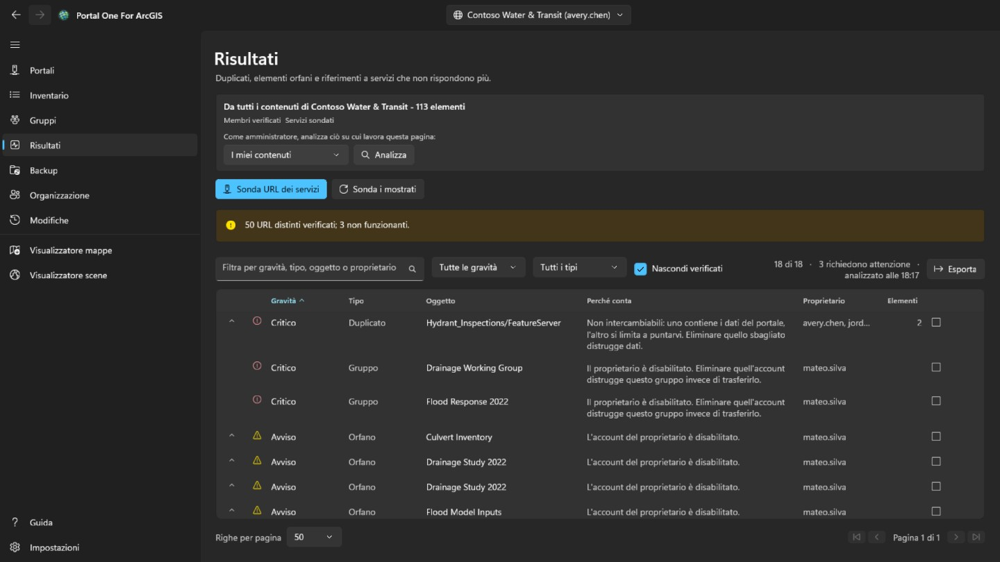

Contenuti ridondanti e morti, ordinati per l'attenzione che meritano e non per
quanto suonano gravi.

- **Critico** significa che agire con leggerezza qui distrugge qualcosa che non
  esiste altrove: due elementi che puntano allo stesso servizio, dove eliminare
  quello sbagliato è irrecuperabile.
- **Avviso** è un problema reale e sicuro da affrontare: un elemento il cui
  proprietario se n'è andato, un servizio che non risponde più.
- **Informativo** vale la pena saperlo e può rivelarsi del tutto normale.
- **Non concludente** significa che non è stato possibile stabilirlo. **Un
  servizio andato in timeout non è un servizio scomparso**, e questo strumento
  non lo dirà.

Apri una riga per vedere gli elementi che rappresenta. Segnala come esaminata
quando hai deciso che va bene; la decisione è ricordata per connessione e la
riga resta visibile invece di sparire.

Questa pagina riferisce. **Non ti dice quale di due elementi simili tenere**,
perché dipende da chi li usa e da cosa punta a loro.

## Backup

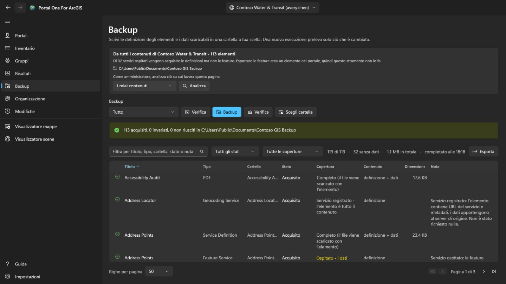

Scrive definizioni degli elementi, risorse e dati scaricabili in una cartella
che scegli tu. Rieseguirlo sulla stessa cartella preleva solo ciò che è
cambiato, quindi **riprendere un backup interrotto e farne uno incrementale sono
la stessa cosa**.

- **Controlla** confronta la cartella con il portale e riferisce cosa *farebbe*,
  senza scrivere nulla. È il modo di rispondere a «il mio backup è aggiornato?»
  senza dedicarci ore.
- **Verifica** confronta la cartella con il proprio registro, senza alcun
  portale. **È la domanda che resta quando il portale non c'è più, che di solito
  è proprio quando qualcuno apre un backup sul serio.**

La cartella è ricordata per connessione, e una cartella che contiene il backup
di un'altra organizzazione viene rifiutata anziché sovrascritta.

**Cosa un backup non contiene.** Le feature dentro un servizio ospitato
risiedono nel data store del portale, non nell'elemento, e tirarle fuori richiede
un'esportazione che crea un nuovo elemento nel portale: una scrittura. Questo
strumento non lo fa, quindi quelle righe vengono catturate come definizione senza
dati, e la pagina dice quante sono. I servizi registrati da un altro server sono
puntatori per natura e non hanno altro da catturare.

## Uscita di un membro

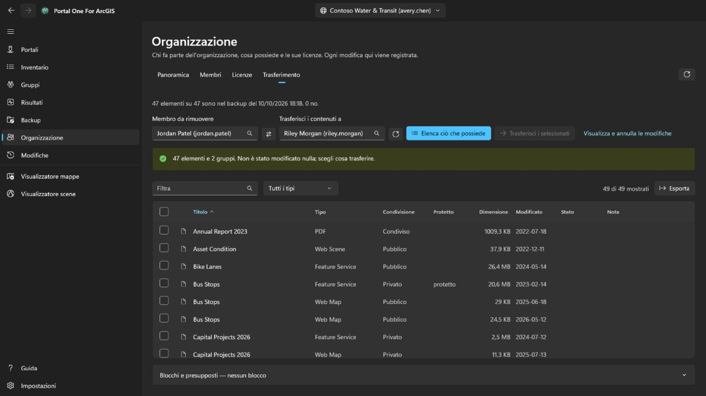

Questa è la scheda **Trasferimento** della pagina **Organizzazione**, visibile solo agli account che amministrano contenuti (portal:admin:viewItems). Stabilisce che cosa comporta rimuovere un membro e ne sposta i contenuti, uno alla volta e in modo reversibile.

Scegli dagli elenchi il membro e chi riceve i suoi contenuti: entrambi vengono
dalla rubrica dell'organizzazione, quindi **un nome non può essere digitato male
e finire su un altro che esiste davvero**. **Elenca ciò che possiede** non
cambia nulla: mostra ogni elemento e ogni gruppo, e sei tu a spuntare ciò che
deve spostarsi.

Non c'è nulla di spuntato in anticipo. Spostare un intero account è un clic sulla
casella dell'intestazione, e **quel clic è una decisione, non un valore
predefinito**.

- I gruppi stanno di proposito nella stessa tabella degli elementi. Eliminando un
  membro, il portale **distrugge** i gruppi che ancora possiede invece di
  trasferirli, quindi un gruppo non spuntato è **l'unica cosa silenziosamente
  distruttiva di questa pagina**, e la riga dei conteggi lo dice.
- La conferma elenca le cartelle del destinatario e permette di aggiungerne una; gli elementi finiscono in quella scelta. Ogni trasferimento viene scritto nel registro prima che inizi il successivo, e la pagina **Modifiche** rimette ciascuno nella cartella da cui proveniva, ricreando una cartella scomparsa, uno alla volta o tutti quelli ancora aperti insieme.
- Spostare un elemento può spostarne altri con sé. Trasferire uno shapefile porta con sé il servizio ospitato pubblicato da esso, quindi una riga può indicare che è arrivato senza che sia stato questo trasferimento a inviarlo. Annullare solo quella riga nella pagina **Modifiche** non lo riporterà indietro; torna con ciò che lo ha portato.
- Dopo ogni spostamento l'elemento viene riletto dal portale. **Una richiesta che
  restituisce successo è un'affermazione sulla richiesta, non su dove si trovi
  ora l'elemento.**

L'account del membro si elimina nella pagina **Organizzazione**, e solo quando non possiede più nulla. **È l'unico passo che non si può annullare.**

## Organizzazione

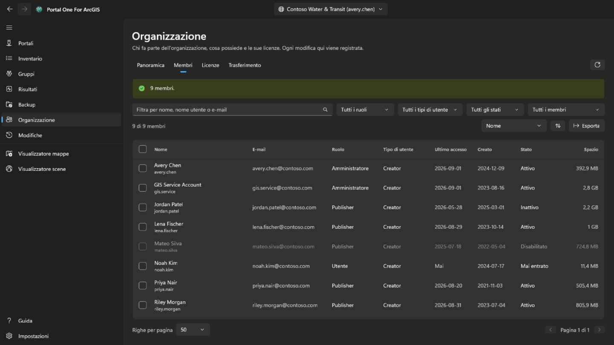

Ogni membro vede questa pagina, come nel portale. **Panoramica**, che indica anche i contatti amministrativi dell'organizzazione, è per tutti, e con il privilegio di vedere i membri anche una scheda **Membri** di sola lettura, senza email, accessi, stato né spazio di archiviazione. Selezionare membri, **Esporta**, **Licenze** e ogni modifica sono solo per gli account che amministrano i membri (portal:admin:viewUsers). **Panoramica** riassume l'organizzazione: su ArcGIS Online abbonamento, posti e crediti; i membri per stato, ruolo e tipo di utente; e quanto contenuto e spazio di archiviazione occupa.

**Membri** elenca tutti i membri dell'organizzazione, filtrati per nome, ruolo, tipo di utente, stato o gruppo, ordinabili per qualsiasi colonna e salvabili in un file CSV con **Esporta**. Seleziona i membri per disabilitarli o abilitarli, cambiarne il ruolo o il tipo di utente, rimuoverli dai gruppi o eliminarli; con uno solo selezionato, **Uscita** apre la scheda **Trasferimento** di questa pagina. Il tuo account non viene mai toccato, e il proprietario di un gruppo resta nel gruppo.

Fai clic destro su un membro per aprire il suo menu. **Visualizza** mostra il suo **Profilo**, i suoi **Elementi** e, per un amministratore, i suoi **Gruppi**, qui nell'app anziché nel portale; un membro semplice vede solo gli elementi condivisi con lui. **Gestisci** è per gli amministratori, ogni voce solo con il privilegio che richiede: **Licenze aggiuntive** stabilisce quali diritti ha il membro, **Modifica indirizzo email** lo cambia per un account che accede con ArcGIS, **Trasferisci contenuti** apre la scheda **Trasferimento** su di lui, e **Trasferisci membro** dà a un altro membro il suo tipo di utente, ruolo e licenze aggiuntive, poi prosegue nella scheda **Trasferimento** con contenuti e gruppi. Lo stesso menu cambia tipo di utente, ruolo, gruppi, stato o account di un membro, come la barra fa per più membri.

**Elimina** rimuove solo i membri che non possiedono elementi né gruppi. ArcGIS non li trasferisce quando un account viene eliminato, quindi spostali prima nella scheda **Trasferimento**. Prima che accada qualcosa, digiti il nome utente o, per più membri, quanti sono. L'eliminazione non si può annullare.

**Licenze** mostra quanti di ogni tipo di utente sono assegnati e, su ArcGIS Online, quanti ne prevede l'abbonamento; **Mostra membri** elenca chi ha quel tipo. Scegli una licenza aggiuntiva per vedere chi la possiede e revocala ai membri selezionati.

Ogni modifica viene riletta dal portale e registrata con ciò che c’era prima, ed è elencata nella pagina **Modifiche**. Queste modifiche ai membri non si annullano da lì: per invertirne una, fai la modifica opposta.

## Modifiche

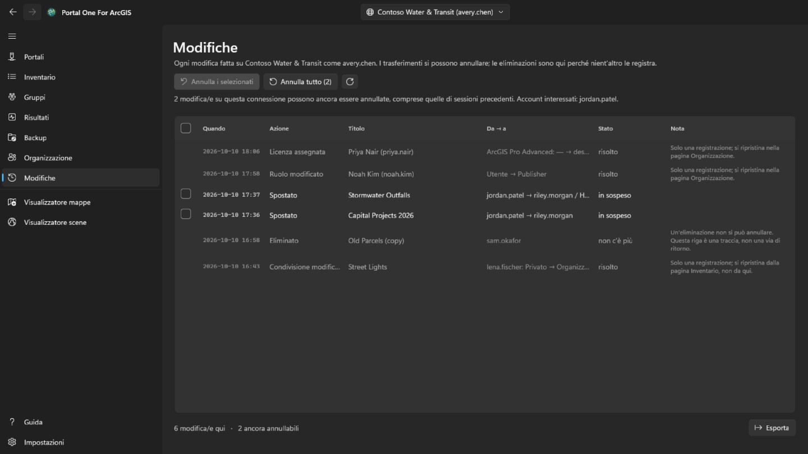

La pagina **Modifiche** è mostrata a ogni account connesso. Elenca, dalla più recente, tutto ciò che questo strumento ha cambiato nel portale ora selezionato: trasferimenti, eliminazioni, condivisione, tag, cartelle, dettagli, protezione e modifiche ai membri. Le modifiche fatte su altri portali sono conteggiate, non elencate. L’elenco può essere esportato in CSV.

I trasferimenti che possono essere riportati indietro hanno una casella. **Annulla i selezionati** riporta indietro i trasferimenti spuntati, e **Annulla tutto** riporta indietro tutto ciò che è ancora aperto su questa connessione dopo una conferma che nomina di chi sono i contenuti. Gli elementi tornano nelle cartelle da cui provenivano, ricreando una cartella scomparsa. Eliminazioni e modifiche ai membri sono solo una registrazione: un’eliminazione non può essere annullata, e una modifica a un membro si inverte facendo la modifica opposta. Annullare un trasferimento è a sua volta un trasferimento e richiede lo stesso privilegio (portal:admin:reassignItems, o reassignGroups per un gruppo); un account senza di esso vede solo il registro.

Una web map salvata sopra dal visualizzatore mappe, e una feature aggiunta, modificata o eliminata lì, si ripristinano dal menu della loro riga. Una modifica di feature si annulla solo finché la feature è ancora come la modifica l'ha lasciata: una feature aggiunta viene eliminata, una modificata riprende i valori e la forma precedenti, e una eliminata viene aggiunta di nuovo con un nuovo ID oggetto. Anche l'annullamento viene registrato, e si può annullare a sua volta. Prima di ripristinare una web map, **Confronta con la mappa attuale** nello stesso menu elenca in cosa la copia conservata prima di quel salvataggio differisce dalla mappa come la tiene ora il portale: la mappa di base, i layer aggiunti, rimossi, rinominati o spostati, e per ogni layer visibilità, opacità, stile, etichette, filtro, intervallo di scala, pop-up e aggiornamento, le tabelle, i segnalibri e dove si apre la mappa.

## Visualizzatore mappe e visualizzatore scene

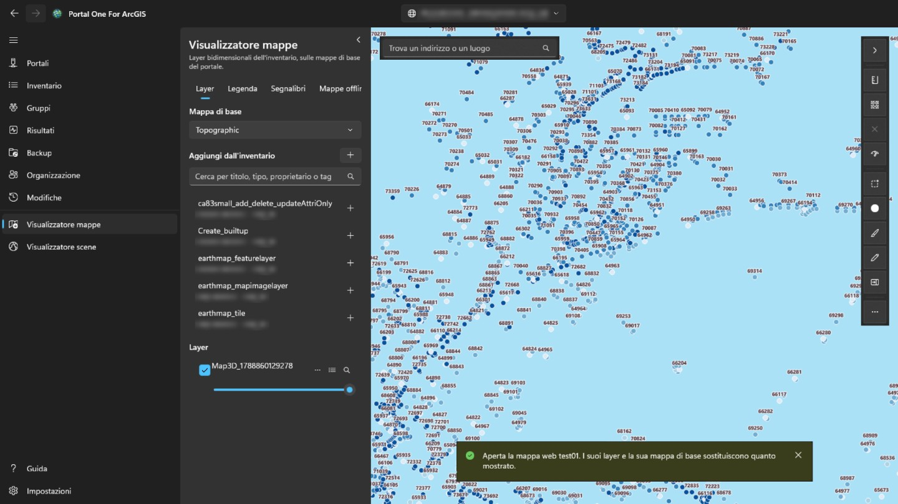

Il **visualizzatore mappe** mostra i layer bidimensionali sulle mappe di base del portale; il **visualizzatore scene** mostra questi e quelli tridimensionali — layer di scena, mesh, nuvole di punti, 3D Tiles — su un globo con il rilievo. Il riquadro a sinistra cerca in ciò che è stato letto per questo portale — i tuoi contenuti, letti automaticamente, ciò che un amministratore ha analizzato e ciò che hanno letto le schede della pagina Inventario — ed elenca solo ciò che quel visualizzatore può disegnare. Scegli un elemento per aggiungerlo. Una mappa web si apre nel visualizzatore mappe e una scena web nel visualizzatore scene, per intero, con i propri layer e la propria mappa di base. Nella pagina Inventario, il pulsante del visualizzatore accanto a un titolo (anche nel menu contestuale della riga) apre l'elemento nel visualizzatore che può mostrarlo.

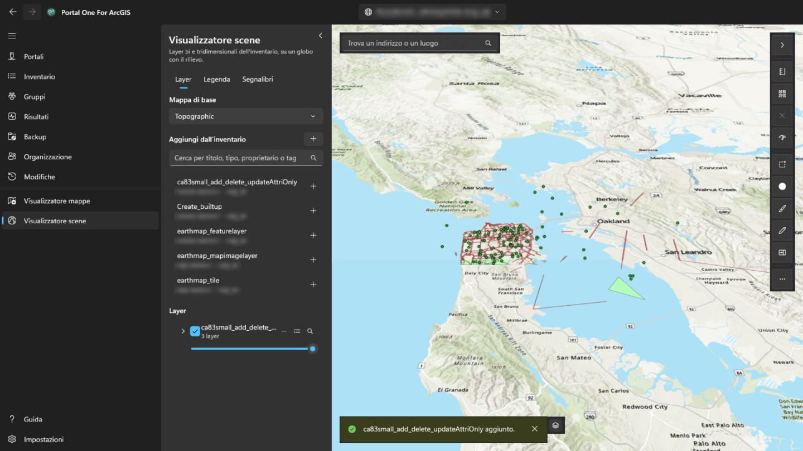

Il pulsante nell'angolo in alto a destra del pannello lo nasconde, lasciando tutta la larghezza alla mappa o alla scena, e lo riapre; entrando nel visualizzatore è sempre aperto. Ogni layer si può mostrare o nascondere, rendere più trasparente, spostare su o giù, usare per lo zoom o rimuovere. Facendo clic su un elemento della mappa se ne vedono i campi: se il layer ha un pop-up configurato nel portale, quelli che ha scelto, con le sue etichette e i suoi formati; altrimenti tutti. La scheda **Legenda**, accanto a **Layer**, mostra cosa rappresentano i simboli di ogni layer visibile. **Segnalibri** elenca i luoghi salvati con una web map o una web scene; lì puoi dare un nome alla vista corrente per aggiungerne di tuoi, e sceglierne uno per tornarci. Un segnalibro di scena conserva direzione e inclinazione della fotocamera. Il pulsante tabella di un layer con elementi apre la sua **tabella attributi** sotto la mappa, duecento righe alla volta e filtrata come il layer viene disegnato; scegliendo una riga l'elemento viene evidenziato e inquadrato. **Esporta** scrive tutte le righe che la tabella contiene con filtri e ordinamento, fino a 50.000, non solo quelle caricate: in CSV come le mostra la tabella, in GeoJSON in latitudine e longitudine, o come shapefile compresso nel sistema di coordinate del layer (nomi dei campi ridotti a dieci caratteri). L’intestazione di una colonna ordina la tabella per essa, la filtra (come il filtro del layer, una condizione per colonna, tutte applicate) o ne mostra le statistiche: quante righe hanno un valore, il minimo e il massimo, per i numeri totale, media e deviazione standard, e i valori più frequenti, su tutte le righe che passano i filtri e non solo quelle caricate. **Solo selezionati** riduce la tabella alle righe selezionate. Nel visualizzatore mappe, **Distanza** e **Area**, sopra la mappa, misurano ciò che disegni facendo clic sui punti: lungo la superficie terrestre, non sulla mappa piana, in unità metriche o imperiali secondo la tua area geografica di Windows. Nel visualizzatore scene, **Distanza** misura tra due clic su terreno o modello (diretta, lungo il suolo e verticale) e **Area** segue angoli adattati al terreno. **Salva come web map** crea un nuovo elemento web map nel tuo contenuto, nella cartella che scegli, con la mappa di base, i layer e i segnalibri mostrati ora; si apre dove si trova ora la mappa e ha una sua immagine come miniatura. **Salva** sovrascrive una web map aperta dal portale quando ne sei proprietario o puoi aggiornare contenuti altrui, dopo averne tenuto una copia su questo computer; il visualizzatore scene non può salvare. La ricerca trova anche indirizzi e luoghi con il geocoder del portale. **Esporta** salva un PNG della vista e, se il portale elenca un servizio di stampa, **Stampa** lo esegue. I layer temporali aprono una barra **Tempo** per scorrere o riprodurre l'intervallo. I layer restano mentre lavori su altre pagine e ripartono da capo quando passi a un altro portale. L'accesso al portale è usato per i suoi layer e mai inviato al server di un'altra organizzazione, quindi un layer registrato altrove che chiede di accedere non viene caricato. Durante una misurazione sulla mappa, fai doppio clic, premi Invio o scegli **Fine** per concludere lo schizzo: resta sulla mappa con il suo risultato fino alla misurazione successiva o alla ✕ accanto agli strumenti. Esc annulla lo schizzo, e Ctrl+Z o Backspace toglie l'ultimo punto. Il pulsante di stile di un layer con feature cambia come viene disegnato: un simbolo del colore e della dimensione che scegli, un colore per ogni valore di un campo (**Categorie**) o classi di un campo numerico lungo una scala di colori (**Classi**, per interruzioni naturali, intervallo uguale o quantile). La mappa segue ogni modifica; **Applica** la mantiene, **Annulla** ripristina ciò che era disegnato e **Ripristina originale** lo stile con cui è arrivato il layer. Anche la legenda si aggiorna, e salvare la mappa come web map mantiene lo stile. Il pulsante **…** della stessa riga apre anche **Etichette…**, per mostrare il valore di un campo su ogni feature con dimensione e colore a scelta, con alone e da una certa scala, e **Filtro…**, per mostrare solo le feature che soddisfano condizioni fatte di campo, confronto e valore, tutte o almeno una; conta le corrispondenze man mano, mantiene il filtro che il layer porta dalla sua web map e la tabella attributi lo segue. In basso a sinistra sulla mappa, una bussola ruota con la mappa (selezionala per tornare a nord); accanto, una barra di scala misurata sul terreno, la scala e le coordinate sotto il puntatore (selezionale per copiarle o passare da gradi decimali a gradi, minuti, secondi), e un pulsante che mostra una mappa d'insieme in cui un clic sposta la mappa. **Seleziona** sceglie le feature di tutti i layer visibili in un rettangolo, una forma a mano libera o un poligono: un pannello indica quante per layer e totale, media, minimo e massimo di un campo numerico, e le mostra in tabella, esegue lo zoom o le salva come CSV. **Buffer** disegna l'area entro una distanza dalle feature selezionate, o da un punto, una linea o un'area che disegni, la misura sulla superficie terrestre su questo computer (nessun servizio di analisi, nessun credito) e può selezionare ciò che copre. **Scorri** mostra un layer a sinistra di un divisore trascinabile e la mappa senza di esso a destra. **Controlla mappa** esamina ogni layer e indica cosa non funzionerebbe o trarrebbe in inganno chi ha accesso alla mappa: layer che non si caricano, elementi scomparsi o condivisi meno della mappa, servizi in http o fuori dal portale, elementi deprecati o di un'altra organizzazione, layer grandi senza intervallo di scala, e nessun pop-up; il rapporto si può copiare. Indica anche i campi a cui rimandano popup, simbologia o etichette di un layer e che il layer non ha, e cronometra il conteggio delle feature di ogni layer di servizio: oltre 3 secondi lo segnala, oltre 10 o senza risposta in 30 è un avviso. Nel menu **…** di un layer, **Usato da…** legge le mappe e le app dell'inventario ed elenca quelle che usano il layer, direttamente o tramite una mappa, e **Proprietà…** mostra origine, proprietario, rappresentazione e, per le feature, numero e campi. La casella di ricerca accetta anche coordinate — due numeri decimali in qualsiasi ordine, gradi/minuti/secondi, UTM o MGRS — e ci va senza geocodificatore. **Esporta** può copiare un link che apre la web map nel visualizzatore del portale in questo punto, o le coordinate del centro. Salvando sopra una web map se ne conserva la definizione precedente, e la pagina **Modifiche** può ripristinarla dal menu di quel salvataggio. Le impostazioni layer nel menu di un layer definiscono l’intervallo di scala visibile, i popup dei feature layer (segnaposto del titolo, etichette dei campi, visibilità e ordine) e gli intervalli di aggiornamento supportati; l’anteprima è in tempo reale e il salvataggio della web map li conserva. La finestra di stile ora può disegnare i layer puntuali come mappe di calore, dimensionare simboli puntuali o spessori di linea da un campo numerico e attivare il clustering dei punti con etichette di conteggio; i layer poligonali mantengono gli stili di colore esistenti. Il menu Aggiungi nella scheda Layer può aggiungere anche un URL di servizio o un file locale: CSV e GeoJSON diventano raccolte di feature incorporate al salvataggio, mentre shapefile e file KML o KMZ restano locali e vengono segnalati prima del salvataggio. Schizzo aggiunge un layer di annotazioni salvato con punti, linee, aree, rettangoli, cerchi o ellissi, forme a mano libera e testo; seleziona una feature di schizzo per rimodellarla, cambiarne lo stile, eliminarla, annullare l'ultimo segno o svuotare il layer, e la feature collection dello schizzo viene salvata con la mappa web. Lo strumento **Modifica** del visualizzatore mappa elenca i feature layer di servizio modificabili, spiega i layer di sola lettura, consente di disegnare una nuova feature da un modello o selezionarne una sulla mappa, convalida i campi modificabili e applica le modifiche confermate al servizio feature live. Nella tabella attributi di un layer modificabile, seleziona le righe con Ctrl o Maiusc (Ctrl+A per tutte quelle caricate): **Modifica** ne apre una nel modulo di modifica, e **Cambia un campo** imposta un campo a un valore su tutte, dopo averlo controllato con le regole di ogni feature.  **Cambia un campo** può anche usare un'espressione — nomi di campo tra parentesi quadre, testo tra apici, + - * / e alcune funzioni — così ogni riga selezionata ottiene il proprio valore dagli altri campi.  Nel pannello Modifica, **Strumenti geometria** consente **Seleziona sulla mappa**, **Unisci** forme, **Dividi** linee o poligoni con una linea di taglio, **Ritaglia** su un'area disegnata o **Copia su layer** in un altro layer modificabile dello stesso tipo di forma; ogni modifica è registrata nella pagina **Modifiche**. Ogni modifica viene registrata nella pagina **Modifiche**, un cambio di campo come una sola voce, e si annulla da lì. Per una feature selezionata, il modulo di modifica elenca anche i suoi allegati, se il layer li conserva, per aprirli, aggiungerli o rimuoverli (un file rimosso viene prima copiato su questo computer, e ogni modifica viene registrata nella pagina **Modifiche**), e mostra i record correlati, in sola lettura. Mentre si disegna o si rimodella una feature, i suoi vertici si agganciano alle feature dei layer spuntati sotto **Snap** nel pannello di modifica, e le guide geometriche propongono angoli retti e parallele; entrambi si possono disattivare e la distanza di snap si può impostare. Misura, Schizzo e gli altri strumenti non eseguono lo snap. **Condividi**, accanto a **Salva come web map**, condivide la web map o la web scene sullo schermo come la pagina Inventario condivide un elemento, quando questo account ne è proprietario o può condividere il contenuto altrui: scelti livello e gruppi, la mappa viene controllata così come verrebbe condivisa, e ciò che a quel livello non funzionerebbe o trarrebbe in inganno viene elencato prima della condivisione. **Dettagli** modifica titolo, riepilogo, descrizione, tag, riconoscimenti e condizioni d'uso dell'elemento come la pagina Inventario, e può anche usare un'immagine della vista come miniatura e impostare l'estensione dell'elemento, usata dalla ricerca del portale, sulla vista; dove si apre la mappa si stabilisce salvandoci sopra. Il pop-up di una feature mostra anche, nell'ordine scelto dal suo autore, le immagini, i grafici e gli allegati del pop-up configurato nel portale, e i suoi record correlati; le espressioni Arcade vengono valutate prima. I grafici seguono il tema dell'app, le immagini si caricano solo da indirizzi https e un allegato si apre con un clic. Quando un servizio si sposta o viene sostituito, **Sostituisci nelle web map…** nel menu **…** di un layer fa puntare al nuovo indirizzo ogni web map e web scene dell'inventario che lo usa (i layer di un intero servizio mantengono i loro numeri), dopo aver elencato cosa cambierebbe in ciascuna; ogni mappa viene conservata prima di essere scritta e registrata nella pagina **Modifiche**, dove si può confrontare e ripristinare. L'elenco dei layer mostra i layer di gruppo come un albero: espandi un gruppo per gestirne i layer, rinomina qualsiasi layer, crea un nuovo gruppo dai layer di primo livello scelti, sposta un layer dentro o fuori da un gruppo, oppure separa di nuovo il gruppo. Il visualizzatore mappa può disegnare un profilo altimetrico da una linea, usando il terreno tile invece di servizi di analisi che consumano crediti, e permette di copiare o esportare distanze e quote campionate. Un feature layer di servizio può anche aprire un grafico di sola lettura sotto la mappa; usa le statistiche del servizio invece di scaricare tutte le feature, può essere limitato alla vista o alla selezione, esporta PNG o CSV e non viene salvato nella mappa Web.  Un CSV, GeoJSON o shapefile aggiunto dal computer può essere pubblicato dal menu del layer come feature layer ospitato: il file di origine viene caricato, il servizio viene creato nei tuoi contenuti e il layer locale viene sostituito. KML e KMZ non sono offerti perché il portale non li pubblica come feature service.  La finestra degli stili offre anche tipi con un campo dimensione e mappe di relazione a due campi; rampe di colore continue, densità di punti e binning non sono mostrati perché ArcGIS Maps SDK for .NET 300.1 non li supporta in modo sicuro qui. Le etichette e i campi dei popup possono usare anche espressioni Arcade, con inserimento di campi, frammenti comuni e una prova su una feature reale prima dell’applicazione.  I feature layer modificabili possono anche avere un modulo salvato nella mappa Web: il pannello Modifica segue gruppi, regole obbligatorie e valori calcolati, e il comando **Modulo…** nel menu del layer modifica quel modulo. Le mappe Web del portale possono essere portate offline dal visualizzatore mappe: l'app controlla le capacità offline, scarica un'area pre-pianificata o la vista corrente in LocalState, la apre dalla scheda Mappe offline, conferma le modifiche localmente e le sincronizza come una voce Changes quando l'account ha una licenza Runtime Basic o superiore.  L’analisi di rete della mappa aggiunge rotte, aree di servizio e strutture vicine dai servizi del portale; ArcGIS Online consuma crediti.  Le sezioni dei record correlati leggono anche le relazioni tramite tabelle di relazione in una mappa SDK nascosta, quindi le relazioni molti-a-molti e con attributi funzionano quando le tabelle correlate non sono nella mappa web.  Nelle scene, i layer di feature possono anche essere selezionati con un clic, un rettangolo sul terreno o un poligono cliccato, usati per buffer dalle feature selezionate o da un punto, una linea o un’area cliccati, rappresentati in grafici e modificati: attributi tramite il modulo del layer, nuove feature e ridisegno dell’intera forma da punti cliccati, oltre a unione, copia, divisione e ritaglio; solo la modifica vertice per vertice resta nella mappa perché l’SDK espone l’editor di geometria solo su MapView. Gli schizzi nelle scene (punti, linee, poligoni, rettangoli, ellissi e testo inseriti con un clic) durano solo per la sessione, perché qui le web scene non si possono salvare; il disegno a mano libera è solo nella mappa. **Esporta schizzo come GeoJSON** nel pannello Schizzo salva in un file i segni di entrambi i visualizzatori. Le scene disegnano anche un **Profilo altimetrico** lungo una linea cliccata, letto dal terreno proprio della scena se presente, altrimenti dalla stessa fonte del visualizzatore mappe, e anche il pannello **Rete** funziona: i clic sul terreno inseriscono fermate, strutture e incidenti, i risultati vengono drappeggiati sulla scena e un percorso aggiunto come layer dura solo per la sessione.  Le azioni delle scene condividono, modificano dettagli, copiano link o centri, esportano immagini, controllano layer, mostrano gli usi e sostituiscono origini; i widget di scena mostrano direzione, coordinate del puntatore, panoramica e quota della camera, e i pacchetti scena mobile locali si aprono in sola lettura. **Confronta** nelle scene usa una copia sincronizzata e ritagliata dell'intera scena; la navigazione resta nella scena principale mentre il divisore la confronta con e senza il layer scelto.  La casella breve di ricerca dei luoghi resta in alto a sinistra; la freccia nella barra degli strumenti a destra nasconde o ripristina entrambi con un’animazione, mentre Altri comandi raccoglie i comandi meno usati per elemento, controllo, tempo ed esportazione.

## In secondo piano

Chiudere la finestra mette l'app nell'area di notifica invece di terminarla,
**così una scansione o un backup di ore non muore per il gesto con cui si sposta
una finestra**. L'icona dice cosa è in esecuzione, e **Esci** lì è l'uscita. Il suo menu consente anche di aggiungere un portale e di cercare un aggiornamento nel Microsoft Store o installare quello trovato.

Se disattivi l'icona nell'area di notifica, chiudere la finestra termina l'app:
senza icona non ci sarebbe nulla che la richiami.

**Avvia con Windows** lancia l'app nell'area di notifica all'accesso, così la
connessione che usi è già attiva quando la apri.

## Impostazioni

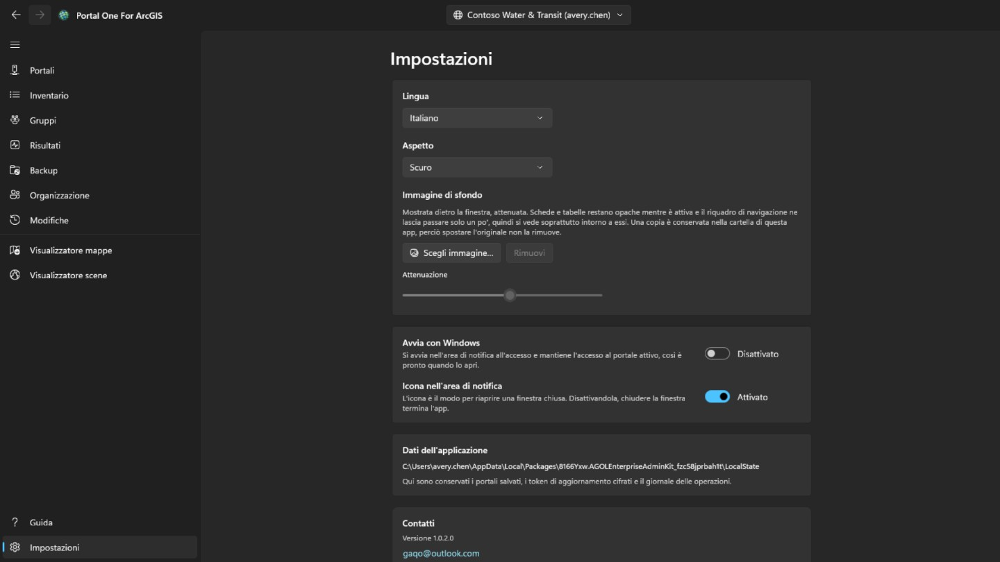

Chiaro, scuro o come Windows; il tema cambia nel momento in cui lo scegli. Quando il Microsoft Store ha una versione più recente, accanto a Impostazioni nel riquadro di navigazione compare un pulsante **Aggiorna**; l'app si chiude durante l'installazione, si riavvia con la nuova versione e il pulsante scompare. Sotto la finestra si può impostare un'**immagine di sfondo**; finché è visibile, schede e tabelle restano opache e il riquadro di navigazione ne lascia passare solo un po', quindi appare soprattutto intorno a essi, e **Attenuazione** stabilisce quanto viene scurita.

L'interfaccia esiste in quattordici lingue e segue Windows se non ne fissi una.
**Un cambio di lingua ha effetto al prossimo avvio**, offerto lì come pulsante,
perché il framework legge il testo di ogni schermata una volta sola quando la
costruisce: applicarlo subito cambierebbe solo ciò che viene aperto dopo.

**Abbonamento** è ciò che toglie il marchio dalle pagine, e nient'altro qui ci sta dietro: accedere a un portale, inventariarlo, farne una copia e stampare una mappa restano gratuiti, che tu abbia pagato o no. È un abbonamento mensile acquistato tramite Microsoft Store, annullabile in qualsiasi momento; la scheda dice quanto costa e quando si rinnova, una volta che esiste. *Ripristina l'acquisto* serve al caso in cui hai pagato e il marchio c'è ancora: l'abbonamento può essere stato comprato nella finestra dello Store, di cui questa app non sa nulla.

**Filigrana** mette una riga vostra nell'angolo in basso a destra di ogni pagina: fino a ventiquattro caratteri, nel carattere, nella dimensione, nello spessore, nel colore e nell'intensità scelti dietro **Altre impostazioni** — la scheda stessa non mostra altro che l'interruttore che la accende. Parte da trenta pixel, in un rosso deciso a piena intensità, e cammina per la pagina un minuto ogni sei: cinque minuti nell'angolo, un minuto attraverso la pagina, poi di nuovo nell'angolo. Cammina perché chi fa l'immagine decide dove ne sono i bordi, e un angolo è la parte più facile da tagliare fuori; riposa perché una pagina su cui si lavora non dovrebbe avere una riga che ne attraversa le righe — l'interruttore, dietro **Altre impostazioni**, è ciò che la ferma del tutto. È attiva quando arrivate qui la prima volta e dice *Non abbonato* — ciò che esce dall'app viene visto in un posto che non dice nulla su come è stato fatto. **Intensità** è quanto di quel colore si usa: al minimo ogni colore diventa la stessa velatura pallida, quindi il colore da solo non può dire quanto si vede. Lasciata vuota, la riga torna al valore predefinito. Finché non ti abboni non si può cambiare nulla su questa scheda — né l'interruttore né il testo: dice *Non abbonato* e premerla apre la scheda più sopra; l'abbonamento è ciò che permette di disattivarla e scegliere cosa dice; senza una scelta, dice il nome dell'app. A essere marcato è lo schermo: le immagini che l'app salva vengono dal servizio di stampa del portale ed escono come il portale le ha mandate.

## Tastiera

Su una qualsiasi delle tabelle:

- **Ctrl+F** porta il cursore nella casella del filtro.
- **Ctrl+E** esporta le righe mostrate, con le colonne e l'ordine che hai davanti.

## Dove finiscono le cose

- I backup vanno nella cartella che hai scelto, una cartella normale che puoi
  aprire, copiare e spostare.
- Connessioni, preferenze e giornale delle uscite restano nell'archivio proprio
  dell'app, cifrati dove sono credenziali.
- I CSV esportati restano dove li salvi.

Nulla viene caricato da nessuna parte. **Non esiste un account presso gli autori
di questo strumento, né telemetria.**

## Contatti

Se qualcosa non funziona o non fa quello che ti aspettavi: **gaqo@outlook.com**.

Quello che aiuta di più è cosa stavi facendo, cosa è successo invece, se il portale è ArcGIS Online o ArcGIS Enterprise e con quale versione — la pagina Connessioni mostra entrambe — e in che lingua era l'interfaccia.

Per favore non allegare password, token o file dalla cartella di archiviazione dell'app. Lì viene tenuta una sessione connessa, e niente di tutto ciò serve per rispondere a una domanda.
