# ヘルプ

**Portal One For ArcGIS** は、お使いのコンピューターから ArcGIS 組織を点検し、整備します。**ArcGIS Online** と **ArcGIS Enterprise** のどちらに対しても同じように動作します。

名前の理由: ArcGIS Online と ArcGIS Enterprise は、どちらも本質的にはポータルです。そのため、**Portal** という 1 つの語が両方を表します。接続を追加する **ポータル** ページでも、このアプリはそれらをそう呼んでいます。**One** はアプリを表します。扱うすべてのポータルを 1 か所にまとめ、複数に同時にサインインできます。**For ArcGIS** は、このアプリがどのプラットフォーム向けに作られているかを示します。

このアプリは、サインインしたポータル、そのコンテンツが指すマップ サービス、ベースマップ、標高データ、そしてこのページが最新のヘルプを読み込むヘルプ Web サイト、さらに更新とサブスクリプションのための Microsoft Store と通信します。Web サイトに接続できない場合は、アプリにインストールされているヘルプを表示します。資格情報は Windows アカウント向けに暗号化され、それが属するポータルにだけ送信されます。

## ページの並び順が、そのまま作業の順序です

読む、バックアップする、ドライランする、実行する。各ページは次のページを
安全にするためにあり、ナビゲーションを上から下へたどる道が安全な道です。

## 接続

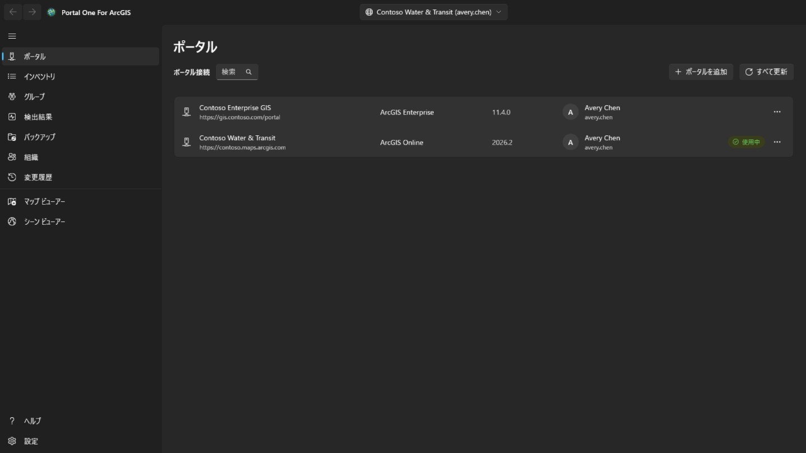

ポータルのアドレスで接続を追加します。ArcGIS Online なら
`https://yourorg.maps.arcgis.com`、ArcGIS Enterprise ならコンテキスト パスを
含む完全なアドレス（例: `https://portal.example.com/portal`）です。ポータル側
に事前登録は必要ありません。ポータルが Microsoft Entra アプリケーション プロキシや Google Cloud IAP などの ID 認識型プロキシの背後にある場合は、**ポータルが ID 認識型プロキシ認証を必要とする** をオンにします。ポータルを読み込む前にプロキシにサインインするウィンドウが開き、ポータルが応答すると自動的に閉じます。プロキシのセッションが切れるたびに再び開き、実行中の処理はそのまま続行されます。

ユーザー名とパスワードでサインインするか、アプリ内に表示されるポータル自身の
サインイン ページを使います。**組織がシングル サインオンや多要素認証を使って
いる場合は後者を**。その場合、このアプリにパスワードは一切入力されません。

同じポータルの 2 つのアカウントを含め、複数の接続に同時にサインインできます。
**サインインを維持する**を選ぶと、資格情報が Windows アカウント向けに暗号化
されて保存され、再起動後も接続が生きています。

更新され続けるのは、現在選んでいる接続だけです。ほかはトークンの期限切れで
サインアウトし、切り替えたときに静かに戻ります。

サインイン済みの接続には、アカウントのプロフィール写真、写真がない場合はイニシャルが表示されます。選択すると、**マイ プロフィール**、**マイ設定**、または **ヘルプ** を開けます。**ヘルプ** は、ヘルプ Web サイト上のこのヘルプを、アプリが表示している言語でブラウザーに開きます。ネットワークがない場合は、代わりにアプリの **ヘルプ** ページを開きます。プロフィール写真の横にある **アプリ ランチャー** ボタンは、このアカウントがそのポータルで使用できる ArcGIS アプリの一覧を、ポータル自身のアプリ ランチャーと同じ内容、そこでアカウントが並べた順序で開き、アプリはサインイン済みの専用ウィンドウで開きます。**マイ プロフィール** には、ポータルのプロフィール ページと同じように、写真、名前、自己紹介、グループ、組織またはすべての人と共有しているアイテムが表示されます。**プロフィールの編集** では、名前、自己紹介、プロフィールの表示設定、写真を変更できます。**マイ設定** にはポータルのセクションがあります。**一般**（メール アドレス、開始ページ、言語、数値と日付の形式、単位）、**セキュリティ**（ArcGIS ログイン用のパスワードとセキュリティの質問）、**ライセンス**（ユーザー タイプとロール、およびポータル自身のページが表示するライセンス製品を、その画像付きで表示します。アプリまで開くアプリ バンドル、その後のその他すべての製品、各アドオン ライセンスの点、検索ボックスがあります）、組織が割り当てる **クレジット**、およびアカウントが所有する **Webhook（ウェブフック）** です。各変更では書き込む内容を示し、ポータルから読み直して、**変更履歴** ページに記録します。このページからプロフィール、設定、開始ページ、写真、Webhook の変更を元に戻せます。新しいパスワード、セキュリティの質問、削除した Webhook は記録のみです。多要素認証、セキュリティ キー、リカバリ コード、リンク済みアカウント、Esri メール設定は表示または説明のみです。これらは ArcGIS Web サイトで管理されます。パスワードの変更後、またはポータルが接続を受け付けなくなった場合は、**ポータル** ページがその接続のサイン インを表示して開くので、新しいパスワードでもう一度サイン インできます。

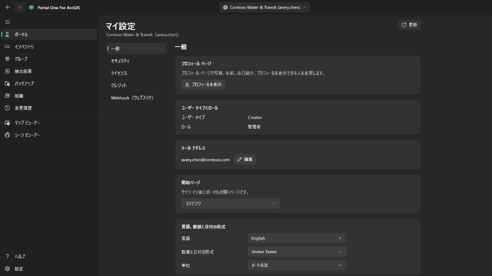

## インベントリ

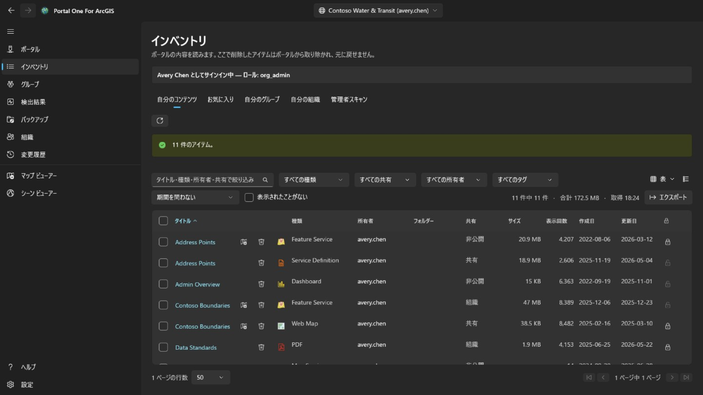

自分のアカウントから見えるものを、ポータル自身のコンテンツ ページと同じ 4 つのタブで表示します。**自分のコンテンツ**、**お気に入り**、**自分のグループ** (すべてまとめて、または 1 つのグループ。メンバーでなくても見えるグループを含む)、**自分の組織** (組織が共有しているもの) です。ページを開くとすぐに読み込まれ、保持されます。横のボタンで表示中のタブを読み込み直せます。行の右クリック メニューはアイテムの種類によって変わります。Web マップはポータルの Map Viewer、Field Maps Designer、ArcGIS Pro でも開け、ダッシュボードは Dashboards、ストーリーは ArcGIS StoryMaps で開けます。ファイルはダウンロードでき、どのアイテムもお気に入りへの追加・削除ができます。Web マップや Web シーンの **別のマップと比較…** は、それと選んだ同じ種類のマップを現在のポータルの状態で読み込み、違いを一覧にします。追加・削除・移動・名前変更されたレイヤー、フィルター、シンボル、ラベル、ポップアップの変更、ベースマップ、ブックマーク、初期表示範囲が対象で、一覧はコピーできます。**コピーを作成…** は、それをこのポータルまたはサインイン中の別のポータルの自分のコンテンツへ、新しいタイトルで、フォルダーに入れて、または別のメンバーに譲渡してコピーします。コピーは非公開で、別のポータルでは先に各レイヤーのアイテムを検索し、アイテムがないレイヤーはアドレスから読み込まれることを、書き込む前に表示します。右上の表示メニューでは、ポータルのコンテンツ ページと同じく、行を **表**、各アイテムのサムネイルと概要付きの **リスト**、カードの **グリッド** で表示し、並べ替えもできます。絞り込み、ページ、チェックした行は 3 つの表示で共通です。**お気に入り**、**自分のグループ**、**自分の組織** では、フォルダー、サイズ、保護がページ表示の少し後に表示されます。検索ではこれらが返されないため、表示中のページから順に各アイテムを読み込みます。フォルダーは自分のアイテムの場合のみ、管理者はすべてのアイテムで表示されます。表、リスト、グリッドのアイテム タイトルを開くと、ポータルと同じ構成のアイテム ページが別ウィンドウで表示されます。**概要** には、サムネイル、タイプ、日付、サマリーを含むアイテムのカード、続いて **説明**、タイプに応じた内容 (サービスの **レイヤー** とテーブル、マップのレイヤー、ジオプロセシング サービスのタスク)、**利用規約**、コメントを残せる **コメント** が表示されます。その横には **マップ ビューアーで開く**、**シーン ビューアーで開く**、**共有...**、**ArcGIS Pro で開く** が並び、残りはシェブロンの中にあります。ホスト フィーチャ レイヤーでは、ポータルが提示するものとして **公開**（タイル、ベクター タイル、WFS、OGC フィーチャ、または 3D レイヤーとして）、**ビュー レイヤーの作成**（ポータル自身のビュー デザイナーを、このアプリのウィンドウで）、**データのエクスポート**（シェープファイル、CSV、Excel、ファイル ジオデータベース、GeoJSON、KML、フィーチャ コレクション、GeoPackage アイテムへ）、**データの更新**（ファイルからフィールドごとにフィーチャを追加または更新するか、前に並ぶ処理をすべて実行してからファイルでレイヤー全体を上書き）もあります。ファイル、パッケージ、サービス定義では **公開**（そこからホスト レイヤーを作成し、1 つ公開されるまで表示されます。CSV または Excel ファイルは緯度フィールドと経度フィールドで配置するか、テーブルとして保持します）と **データの更新**（同じ名前のファイルがその場所を引き継ぎ、現在のファイルは先にこのコンピューターに保存されます）があります。ベクター タイル レイヤーでは **スタイルの表示**、**スタイルのダウンロード**、ポータルがホストしていないものでは **スタイルの更新** があります。ホスト タイル、ベクター タイル、シーン レイヤーでは **レイヤーの置換**、Web マップまたは Web シーンでは **アプリの作成** があります。ダッシュボード、ストーリー、エクスペリエンス、Web アプリ、サイト、フォーム、ノートブックでは、それを開くアプリと、変更できる場合は編集するアプリがあります。どのタイプも、ポータル自身のアイテム ページが出すボタンを同じ順序で持ちます。さらにすべてのアイテムで **メタデータの編集** または **メタデータの表示** と **お気に入りへの追加** があり、それぞれ **変更履歴** ページに記録されます。さらに **所有者**、アイテムのソースとコピーまたは開くための URL を含む **詳細**、情報の完成度と最も効果のある改善点を示すバー、**タグ**、**共有**、**フォルダー**、**謝辞** が表示され、それぞれに変更するための操作があります。最後に、そのタイプにある **データ**、**視覚化**、**設定** タブが続きます。**データ** はレイヤーまたはテーブルの行を表示します。スクロールに合わせてページ単位で読み取られ、検索、条件または SQL where 句によるフィルター、任意の列での並べ替え、選択行への絞り込み、表示列の削減、CSV へのエクスポートができます。セルはダブルクリックでその場で編集され、行は追加、複製、編集、削除でき、フィールドは 1 つの値、サービスが計算する SQL 式、またはアプリで計算する式で計算され、行の添付ファイルと関連レコードはテーブルの横に開きます。すべての変更はこのコンピューターに保持され、**変更履歴** ページに記録され、そこから元に戻せます。**フィールド** 表示ではフィールドを一覧表示し、それぞれの表示名、タイプ、説明、値タイプ、値リストまたは範囲、統計を、ヒストグラムまたは最も多い値とともに表示します。棒を選ぶとテーブルがその値でフィルターされます。ホスト レイヤーの所有者または管理者は、フィールドを追加または削除できます。削除したフィールドの値は保持され、フィールドと一緒に戻ります。また、フィールドの表示名、説明、値タイプ、値リストまたは範囲を変更し、インデックスを追加または削除できます。**設定** はポータルと同じ構成です。すべてのアイテムに **一般**（コンテンツ ステータス、削除保護とアイテムの削除、検索に使われる範囲）があり、アイテム固有のセクションでは、ホスト フィーチャ レイヤーの場合は編集、編集情報の記録、同期、エクスポート、トゥルー カーブをまとめて **保存** で保存します。Web マップまたはシーンの場合はオフライン モード、その他のレイヤーの場合はサービスが報告する設定が表示されます。さらにホスト フィーチャ レイヤーの Webhook も表示されます。何かを取り除く変更は確認され、ポータルから読み直され、**変更履歴** ページに記録され、そこから元に戻せます。

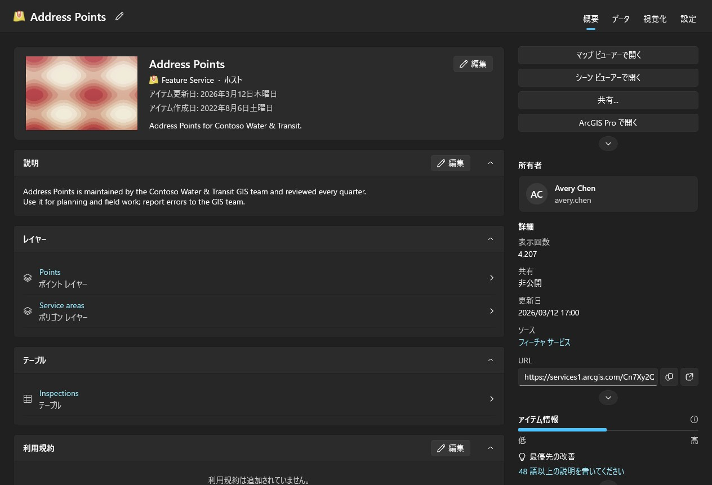

他の人のコンテンツをスキャンするのは管理者の仕事です。ほかのメンバーが所有するものを読めるアカウント (portal:admin:viewItems) には、このページの **管理者スキャン** タブ、[検出結果] と [バックアップ] ページのスキャン (1 人のメンバー、1 つのグループ、または組織全体) と **組織** ページの **移行** タブが表示されます。それ以外のアカウントには表示されません。組織全体のスキャンは、検索ではなく各メンバーにコンテンツを問い合わせます。検索では共有されたものしか返らず、監査で非公開のアイテムを見落としてはならないためです。時間がかかり、キャンセルできます。

[検出結果]、[バックアップ]、各ビューアーは、初めて必要になったときに自分のコンテンツを自動で読み込むため、先に別のページを開く必要はありません。管理者のスキャンは、それをスキャンした内容に置き換えます。各表には、その一覧をいつ読み込んだかが表示されます。ポータルは読み込んだ後も変化し続けます。

各行には削除ボタンもあります。これはこのアプリで唯一、元に戻せない操作です。ArcGIS に「元に戻す」はありません。確認画面はアイテム名、種類、所有者を示し、この接続に記憶されたバックアップ フォルダーに控えがあるか、それがいつのものかを伝えます。控えがなくても拒否はしませんが、その一行だけが後になって削除の説明になり得るものです。ポータルで削除保護されたアイテムは、黙って保護を外すのではなく、ここで拒否されます。保護そのものを変えるには、行末の鍵ボタンか行のメニューを使います。これは独立した操作で、解除の前には確認があり、変更はすべてポータルから読み直して確かめ、記録に書き込まれます。行の先頭のチェック ボックス、または見出しのチェック ボックス (絞り込みで表示される全ページのすべての行) をオンにすると、多数のアイテムをまとめて操作できます。**共有** は共有レベルとグループを設定し、**タグ** はほかのタグを残したままタグを追加・削除します。**移動** は 1 人の所有者のアイテムをその所有者のフォルダーの 1 つに入れます。**所有者の変更** は **組織** ページの **移行** タブと同じくアイテムを別のメンバーに移管し、**変更履歴** ページで元に戻せます。**削除** は、件数、所有者、バックアップにある件数を示し、理解したことのチェックを求める確認の後で削除します。このアカウントで変更できないアイテムと削除保護されたアイテムは変更せず、件数に含めます。アイテムは 1 件ずつ処理して記録され、**キャンセル** は 2 件の間で停止し、概要には何がなぜ失敗したかが示されます。行の右クリック メニューの **共有...** ではそのアイテムの共有レベルと共有先グループを、**詳細の編集...** ではタイトル、概要、説明、タグ、クレジット、利用規約を変更できます。どちらもポータル上の現在の状態で開き、変更した部分だけを送信し、結果を確認して記録します。

## 検出事項

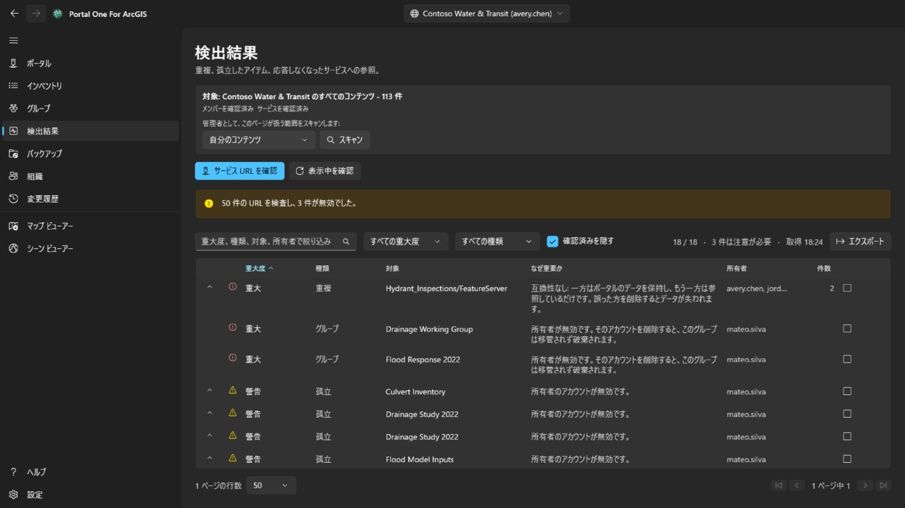

重複したコンテンツや死んだコンテンツを、深刻に聞こえる順ではなく、**どれだけ
注意を払うべきか**の順に並べます。

- **重大**は、ここで不用意に動くと他のどこにも存在しないものを壊す、という
  意味です。同じサービスを指す 2 つのアイテムで、間違ったほうを削除すると
  取り返しがつきません。
- **警告**は実在する問題で、対処しても安全です。所有者が去ったアイテム、
  もう応答しないサービスなど。
- **参考**は知っておく価値があり、結果的に問題ない場合もあります。
- **判定不能**は、確かめられなかったという意味です。**タイムアウトした
  サービスは、消えたサービスではありません。** このツールはそう言いません。

行を開くと、その行が代表するアイテムが見えます。問題ないと判断したら
「確認済み」を付けてください。判断は接続ごとに記憶され、行は消えずに残ります。

このページは報告します。**似た 2 つのアイテムのどちらを残すべきかは言いません。**
それは誰が使っていて、何がそれを指しているかで決まるからです。

## バックアップ

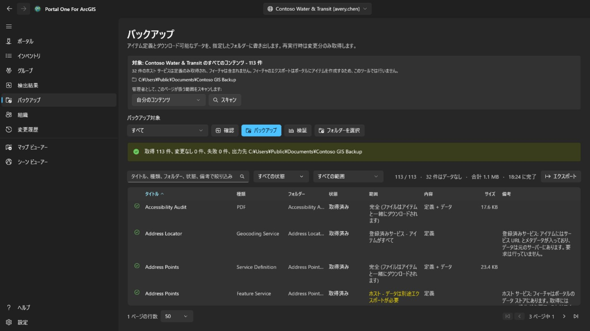

アイテムの定義、リソース、ダウンロード可能なデータを、指定したフォルダーへ
書き出します。同じフォルダーへ再実行すると変更のあったものだけを取得するので、
**中断したバックアップの再開と増分バックアップは同じ操作です**。

- **確認**はフォルダーとポータルを比較し、何を*するはずか*だけを報告して何も
  書きません。「バックアップは最新か」に、何時間もかけずに答える方法です。
- **検証**はフォルダーをそれ自身の記録と突き合わせます。ポータルは使いません。
  **ポータルが失われたときに残るのがこの問いであり、人がバックアップを本気で
  開くのは、たいていそのときです。**

フォルダーは接続ごとに記憶されます。別の組織のバックアップが入っている
フォルダーは、上書きせずに拒否します。

**バックアップに入らないもの。** ホスト フィーチャ サービスのフィーチャは
アイテムではなくポータルのデータ ストアにあり、取り出すにはポータルに新しい
アイテムを作るエクスポート、つまり書き込みが必要です。このツールはそれを
行わないため、該当する行は定義のみを取得し、その件数をページが示します。
別サーバーから登録されたサービスは本質的にポインターであり、ほかに取得する
ものがありません。

## 退任処理

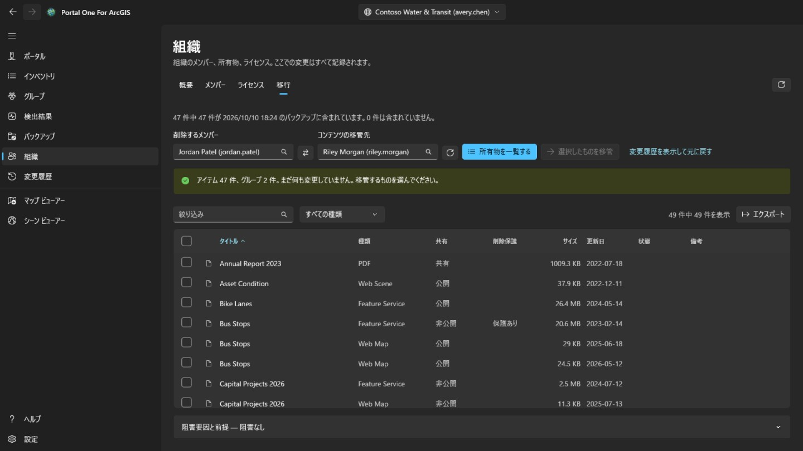

これは **組織** ページの **移行** タブで、コンテンツを管理するアカウント (portal:admin:viewItems) にだけ表示されます。メンバーを削除するために必要なことを調べ、そのコンテンツを 1 つずつ、元に戻せる形で移管します。

外すメンバーと受け取り手は一覧から選びます。どちらも組織自身のディレクトリ
から来るので、**名前を打ち間違えて実在する別人になってしまうことがありません**。
**所有物を一覧する**は何も変更しません。すべてのアイテムとグループを表示し、
移すべきものにチェックを入れるのはあなたです。

こちらで先にチェックを入れることはありません。アカウント全体を移すのは
ヘッダーのチェックボックス 1 回で済みますが、**その 1 回は既定値ではなく
「判断」です**。

- グループは意図的にアイテムと同じ表にあります。メンバーを削除すると、
  ポータルは所有していたグループを移管せず**破棄**します。つまりチェックの
  入っていないグループは、**このページで唯一、静かに破壊的なもの**であり、
  件数の行がそれを伝えます。
- 確認画面には受け取り側のフォルダーが並び、新しいフォルダーも追加できます。アイテムは選んだフォルダーに入ります。移管は次に進む前に必ず記録され、**変更履歴** ページでは各アイテムを元のフォルダーに戻します。なくなったフォルダーは作り直し、1 件ずつでも未処理分をまとめてでも戻せます。
- 1 つのアイテムを移すと、ほかのアイテムも一緒に移ることがあります。シェープファイルを移管すると、そこから公開されたホスト サービスも移ります。そのため、行には、この移管が送ったわけではないのに到着したと表示されることがあります。**変更履歴** ページでその行だけを元に戻しても戻りません。それを運んだものと一緒に戻ります。
- 移動のたびに、アイテムをポータルから読み直します。**成功を返した要求は、
  その要求についての言明であって、アイテムが今どこにあるかについての言明では
  ありません。**

メンバー アカウント自体の削除は **組織** ページで行い、所有するものが何もなくなってからに限られます。**元に戻せない唯一の手順です。**

## 組織

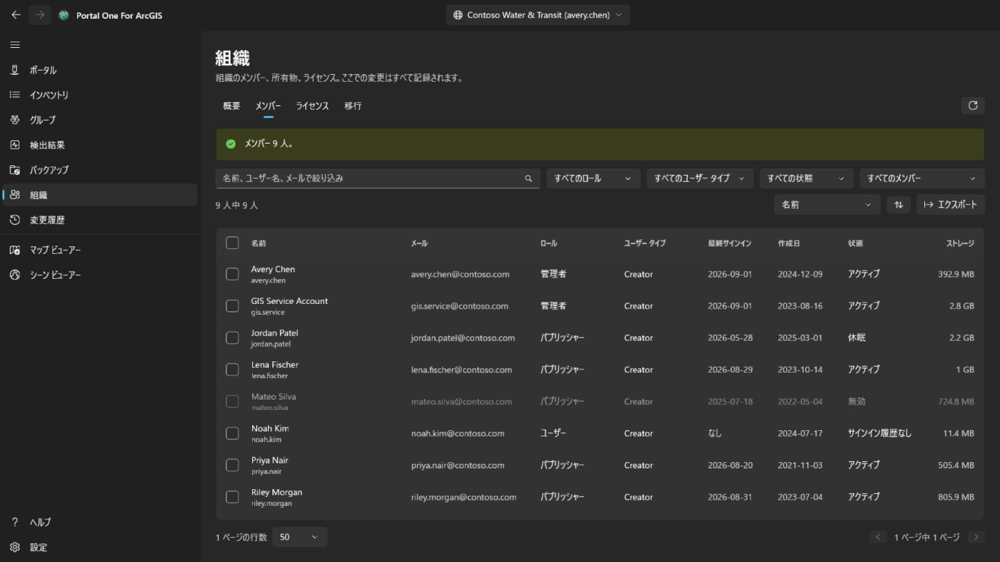

ポータルと同じく、このページはすべてのメンバーに表示されます。組織の管理者の連絡先も示す **概要** は全員が見られ、メンバーを表示する権限があれば読み取り専用の **メンバー** タブも見られます (メール、サインイン、ステータス、ストレージは表示されません)。メンバーのチェック、**エクスポート**、**ライセンス**、すべての変更は、メンバーを管理するアカウント (portal:admin:viewUsers) だけのものです。**概要** は組織をまとめて示します。ArcGIS Online ではサブスクリプション、ユーザー数の上限、クレジット、さらにステータス・ロール・ユーザー タイプ別のメンバー数、コンテンツとストレージの使用量です。

**メンバー** は組織の全員を一覧にし、名前・ロール・ユーザー タイプ・ステータス・グループで絞り込み、任意の列で並べ替え、**エクスポート** で CSV ファイルに保存できます。メンバーにチェックを付けると、無効化・有効化、ロールやユーザー タイプの変更、グループからの削除、削除ができます。1 人だけチェックしたときは **メンバー退去** でこのページの **移行** タブを開きます。自分のアカウントは常に対象外で、グループの所有者はそのグループに残ります。

メンバーを右クリックすると、そのメンバーのメニューが開きます。**表示** では **プロフィール**、**アイテム**、管理者なら **グループ** を、ポータルではなくこのアプリ内で表示します。一般のメンバーには自分と共有されたアイテムだけが表示されます。**管理** は管理者向けで、各項目は必要な権限があるときだけ表示されます。**アドオン ライセンス** でメンバーの権限を設定し、**メール アドレスの編集** で ArcGIS でサインインするアカウントのアドレスを変更し、**コンテンツの移行** でそのメンバーの **移行** タブを開きます。**メンバーの移行** は、ユーザー タイプ、ロール、アドオン ライセンスを別のメンバーに渡し、続けて **移行** タブでコンテンツとグループを移します。同じメニューで、バーが複数のメンバーに行うように、1 人のユーザー タイプ、ロール、グループ、ステータス、アカウントを変更できます。

**削除** は、アイテムもグループも所有していないメンバーだけを削除します。アカウントを削除しても ArcGIS はそれらを誰にも引き継がないため、先に **移行** タブで移してください。実行の前に、ユーザー名を、複数のメンバーなら人数を入力します。削除は元に戻せません。

**ライセンス** は、ユーザー タイプごとの割り当て数と、ArcGIS Online ではサブスクリプションの上限を示します。**メンバーを表示** でそのタイプを持つメンバーを一覧にできます。アドオン ライセンスを選ぶと保有者が表示され、チェックしたメンバーから取り消せます。

変更はすべてポータルから読み戻して確認し、変更前の状態とともに記録され、**変更履歴** ページに表示されます。ただし、これらのメンバー変更はそこから元に戻しません。戻すには逆の変更を行ってください。

## 変更履歴

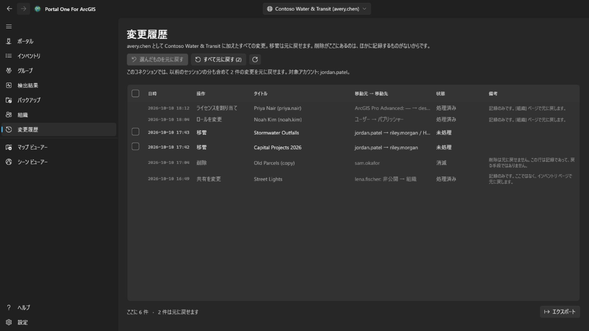

**変更履歴** ページは、サインインしているすべてのアカウントに表示されます。現在選択しているポータルでこのツールが変更したすべてのことを、新しい順に表示します。移管、削除、共有、タグ、フォルダー、詳細、保護、メンバー変更が対象です。ほかのポータルで行った変更は件数だけを数え、一覧には出しません。一覧は CSV にエクスポートできます。

元に戻せる移管にはチェック ボックスがあります。**選んだものを元に戻す** はチェックした移管を戻し、**すべて元に戻す** は、誰のコンテンツかを示す確認の後、この接続でまだ残っているものをすべて戻します。アイテムは元のフォルダーに戻り、なくなったフォルダーは作り直されます。削除とメンバー変更は記録だけです。削除は元に戻せず、メンバー変更は逆の変更を行って戻します。移行を元に戻すこと自体も移行であり、同じ権限 (portal:admin:reassignItems、グループの場合は reassignGroups) が必要です。権限のないアカウントには記録だけが表示されます。

マップ ビューアーから上書き保存した Web マップと、そこで追加・編集・削除したフィーチャは、その行のメニューから元に戻せます。フィーチャの編集は、フィーチャが編集直後のままである場合に限り元に戻ります。追加したフィーチャは削除され、編集したフィーチャは以前の値と形状に戻り、削除したフィーチャは新しいオブジェクト ID で追加し直されます。元に戻した操作も記録されるので、同じ方法でさらに元に戻せます。Web マップを元に戻す前に、同じメニューの **[現在のマップと比較]** で、その保存の前に保持したコピーと、ポータルが現在保持しているマップとの違いを一覧できます。ベースマップ、追加・削除・名前変更・移動したレイヤー、各レイヤーの表示、不透明度、スタイル、ラベル、フィルター、縮尺範囲、ポップアップ、更新間隔、テーブル、ブックマーク、マップを開く位置が対象です。

## マップ ビューアーとシーン ビューアー

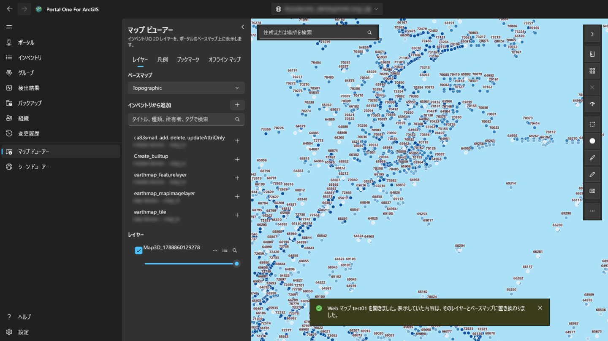

**マップ ビューアー**は、ポータル自身のベースマップ上に 2D レイヤーを表示します。**シーン ビューアー**は、それに加えてシーン レイヤー、メッシュ、点群、3D Tiles などの 3D レイヤーを、地形付きの地球上に表示します。左のパネルは、このポータルについて読み込んだもの (自動で読み込まれる自分のコンテンツ、管理者がスキャンしたもの、インベントリ ページのタブが読み込んだもの) を検索し、そのビューアーで描画できるものだけを一覧します。アイテムを選ぶと追加されます。Web マップはマップ ビューアーで、Web シーンはシーン ビューアーで、それ自身のレイヤーとベースマップごと開きます。インベントリ ページでは、タイトル横のビューアー ボタン (行の右クリック メニューにもあります) で、そのアイテムを表示できるビューアーで開けます。

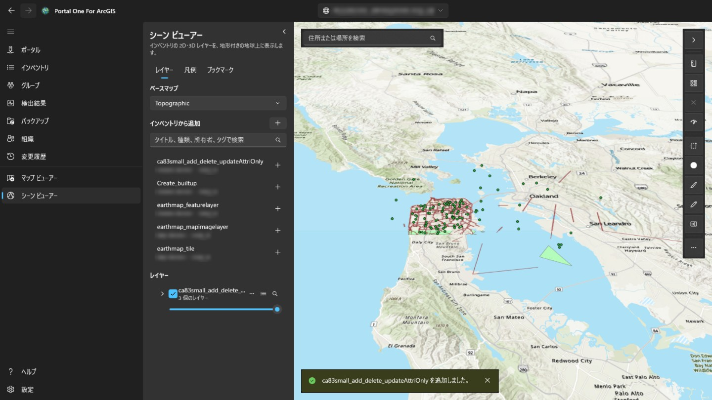

パネル右上のボタンでパネルを折りたたむと、マップやシーンが全幅を使えます。もう一度押すと開きます。ビューアーを開くたびにパネルは開いた状態になります。各レイヤーは、表示・非表示の切り替え、透明度の変更、上下の移動、レイヤーへのズーム、削除ができます。マップ上のフィーチャをクリックすると、そのフィールドが表示されます。レイヤーにポータルでポップアップが設定されていれば、そこで選ばれたフィールドが、そのラベルと書式で表示され、設定がなければすべてのフィールドが表示されます。**[レイヤー]** の隣の **[凡例]** タブには、表示中の各レイヤーのシンボルが何を表すかが示されます。**[ブックマーク]** には、Web マップや Web シーンに保存された場所が一覧表示されます。そこで現在のビューに名前を付けると独自のブックマークを追加でき、選ぶとその場所に戻ります。シーンのブックマークはカメラの方位と傾きも保持します。フィーチャを持つレイヤーのテーブル ボタンを押すと、マップの下に**属性テーブル**が開きます。行は 200 件ずつ読み込まれ、レイヤーの描画と同じフィルターがかかります。行を選ぶと、そのフィーチャが強調表示され、ズームします。**エクスポート** は、読み込んだ行だけでなく、フィルターと並べ替えを適用したテーブルの全行 (最大 50,000) を書き出します。形式は、テーブルの表示どおりの CSV、緯度経度の GeoJSON、レイヤーの座標系のままの zip 形式シェープファイル (フィールド名は 10 文字に短縮) です。列見出しからは、その列での並べ替え、フィルター (レイヤー フィルターと同じ方式で列ごとに 1 条件、すべて適用)、統計の表示ができます。統計は値のある行数、最小値と最大値、数値なら合計・平均・標準偏差、よく出現する値で、読み込んだ行だけでなくフィルターを通るすべての行が対象です。**選択のみ** で、選択した行だけに絞り込めます。マップ ビューアーでは、マップ上の **[距離]** と **[面積]** で、クリックして描いた図形を計測できます。平面のマップ上ではなく地表に沿った値で、Windows の地域設定に合わせてメートル法またはヤード・ポンド法で表示されます。シーン ビューアーでは、**[距離]** が地形やモデル上の 2 点間 (直線、地表に沿った距離、垂直) を、**[面積]** が地形に沿った角の頂点で計測します。**[Web マップとして保存]** は、自分のコンテンツの選んだフォルダーに、現在表示中のベースマップ、レイヤー、ブックマークを含む新しい Web マップ アイテムを作成します。現在のマップの位置で開き、その画像がサムネイルになります。**[保存]** は、所有している、または他人のコンテンツを更新できる場合、この PC にコピーを残してからポータルから開いた Web マップを上書きします。シーン ビューアーでは保存できません。検索ボックスはポータルのジオコーダーで住所や地名を探します。**[エクスポート]** は表示の PNG を保存し、ポータルに印刷サービスがあれば **[印刷]** を実行します。時間対応レイヤーは **[時間]** バーで範囲をステップまたは再生できます。レイヤーは他のページで作業している間も残り、別のポータルに切り替えると最初からになります。ポータルのサインインはそのポータル自身のレイヤーにだけ使われ、他の組織のサーバーには送られません。そのため、他所から登録されサインインを求めるレイヤーは読み込まれません。マップで計測中は、ダブルクリック、Enter キー、または **完了** でスケッチを終了します。スケッチは結果とともに、次の計測か、ツール横の ✕ を押すまでマップに残ります。Esc でスケッチを取り消し、Ctrl+Z または Backspace で最後の点を戻します。フィーチャを持つレイヤーのスタイル ボタンで描画方法を変更できます。好きな色とサイズの単一シンボル、フィールドの値ごとの色 (**カテゴリ**)、数値フィールドをカラー ランプで塗り分ける階級 (**階級**: 自然分類、等間隔、等量) から選べます。変更はその場でマップに反映され、**適用** で確定、**キャンセル** で元の描画に、**元に戻す** でレイヤー本来のスタイルに戻ります。凡例も連動し、マップを Web マップとして保存するとスタイルも保存されます。同じ行の **…** ボタンからは **ラベル…** と **フィルター…** も開けます。ラベルでは、フィールドの値を好きなサイズと色で、ハロー付き・指定縮尺以上で各フィーチャに表示できます。フィルターでは、フィールド・比較・値で作った条件 (すべて一致またはいずれか一致) に合うフィーチャだけを表示し、一致数をその場で数えます。レイヤーが Web マップから持ってきたフィルターはそのまま残り、属性テーブルもフィルターに従います。マップ左下には、マップと一緒に回転するコンパス (選択すると北が上に戻ります)、地上距離で測った縮尺バーと縮尺、ポインター位置の座標 (選択するとコピー、または 10 進数の度と度分秒の切り替え)、そしてクリックでマップを移動できる概観図のボタンがあります。**選択** は、四角形・フリーハンド・ポリゴンの範囲内にある表示中の全レイヤーのフィーチャを選択します。パネルにはレイヤーごとの件数と、数値フィールドの合計・平均・最小・最大が表示され、テーブル表示、ズーム、CSV 保存ができます。**バッファー** は、選択したフィーチャ、または描いた点・線・範囲から指定距離内の範囲を描き、このコンピューター上で地表面に沿って面積を測ります (分析サービスもクレジットも使いません)。範囲内のフィーチャを選択することもできます。**スワイプ** は、ドラッグできる境界線の左側にレイヤーあり、右側にレイヤーなしのマップを表示します。**マップを点検** は、マップ上の各レイヤーを調べ、共有相手にとって動かないものや誤解を招くものを示します。読み込めないレイヤー、削除済みやマップより狭く共有されたアイテム、http やポータル外で提供されるサービス、非推奨や他組織のアイテム、縮尺範囲のない大きなレイヤー、ポップアップがまったくないことなどです。レポートはコピーできます。また、レイヤーのポップアップ、シンボル、ラベルが参照しているのにレイヤーにないフィールドを示し、各サービス レイヤーのフィーチャ数の取得時間を測ります。3 秒を超えると注記、10 秒を超えるか 30 秒以内に応答がなければ警告になります。レイヤーの **…** メニューの **使用先…** は、インベントリにあるマップとアプリを読み取り、そのレイヤーを直接またはマップ経由で使っているものを一覧にします。**プロパティ…** では、ソース、所有者、描画方法、フィーチャの件数とフィールドを確認できます。検索ボックスは座標 (任意の順の 10 進数 2 つ、度分秒、UTM、MGRS) も受け付け、ジオコーダーなしで移動します。**エクスポート** からは、ポータルのビューアーで Web マップを現在の位置で開くリンク、または中心の座標をコピーできます。Web マップを上書き保存すると以前の定義が保存され、**変更履歴** ページのその保存のメニューから元に戻せます。 レイヤー メニューのレイヤー設定では、表示縮尺範囲、フィーチャ レイヤーのポップアップ（タイトルのプレースホルダー、フィールド ラベル、表示、順序）、対応する更新間隔を設定できます。変更はすぐにプレビューされ、Web マップを保存すると保持されます。スタイル ダイアログでは、ポイント レイヤーをヒート マップとして描画し、数値フィールドでポイント シンボルやライン幅を変化させ、件数ラベル付きのポイント クラスタリングを有効にできるようになりました。ポリゴン レイヤーは既存の色スタイルを使います。[レイヤー] タブの [追加] メニューでは、サービスの URL やローカル ファイルも追加できます。CSV と GeoJSON は保存時に埋め込みのフィーチャ コレクションになり、シェープファイルと KML または KMZ ファイルはローカルのままで、保存前にその旨が示されます。スケッチは、ポイント、ライン、エリア、四角形、円または楕円、フリーハンド図形、テキストを含む保存済みの注記レイヤーを追加します。スケッチ フィーチャを選択すると、形状変更、スタイル変更、削除、最後のマークの取り消し、レイヤーのクリアができ、スケッチ フィーチャ コレクションは Web マップと一緒に保存されます。マップ ビューアーの **[編集]** ツールは、編集を許可するサービス フィーチャ レイヤーを一覧表示し、読み取り専用のレイヤーについてはその理由を示します。テンプレートから新しいフィーチャを描画するか、マップ上の既存のフィーチャを選択でき、編集可能なフィールドを検証してから、確認済みの変更をライブ フィーチャ サービスに適用します。編集可能なレイヤーの属性テーブルでは、Ctrl キーまたは Shift キーで行を選択できます (読み込み済みの行すべては Ctrl+A)。**[編集]** はそのうち 1 行を編集フォームで開き、**[フィールドを変更]** は各フィーチャのルールで値を確認したうえで、選択したすべての行の 1 つのフィールドを 1 つの値に設定します。 **[フィールドを変更]** では式も使えます。角括弧のフィールド名、引用符の文字列、+ - * / と一部の関数により、選択した各行が他のフィールドから独自の値を得ます。 **[編集]** パネルの **[ジオメトリ ツール]** では **[マップで選択]**、形状の **[結合]**、切断線によるラインまたはポリゴンの **[分割]**、描いた領域への **[クリップ]**、同じ形状種類の別の編集可能レイヤーへの **[レイヤーにコピー]** ができ、いずれも **[変更履歴]** ページに記録されます。どちらも **[変更履歴]** ページに記録され (フィールドの変更は 1 件として)、そこから元に戻せます。選択したフィーチャについては、レイヤーが添付ファイルを保持していれば編集フォームに添付ファイルも一覧表示され、開く・追加・削除ができます (削除するファイルは先にこのコンピューターにコピーされ、変更はそれぞれ **[変更履歴]** ページに記録されます)。関連レコードも読み取り専用で表示されます。フィーチャを描画または形状変更している間は、編集パネルの **[スナップ]** でチェックしたレイヤーのフィーチャに頂点がスナップし、ジオメトリ ガイドが直角や平行を示します。どちらもオフにでき、スナップ距離も設定できます。計測、スケッチ、その他のツールではスナップしません。**[Web マップとして保存]** の横の **[共有]** は、このアカウントが所有しているか他のユーザーのコンテンツを共有できる場合に、表示中の Web マップまたは Web シーンを、インベントリ ページでアイテムを共有するのと同じ方法で共有します。レベルとグループを選ぶと、共有した場合のマップが点検され、そのレベルで動かないものや誤解を招くものが、共有する前に一覧表示されます。**[詳細]** では、インベントリ ページと同じようにアイテムのタイトル、概要、説明、タグ、クレジット、利用規約を編集できるほか、ビューの画像をサムネイルに使い、ポータルの検索で使われるアイテムの範囲をビューに設定することもできます。マップを開く位置は上書き保存で設定します。フィーチャのポップアップには、作成者が設定した順序で、ポータルで構成したポップアップの画像、チャート、添付ファイルと関連レコードも表示されます。Arcade 式は先に評価されます。チャートはアプリのテーマで描画され、画像は https のアドレスからのみ読み込まれ、添付ファイルはクリックで開きます。サービスが移動または置き換えられたときは、レイヤーの **…** メニューの **[Web マップ内で置き換え…]** で、そのサービスを使うインベントリ内のすべての Web マップと Web シーンを、各マップで何が変わるかを一覧表示したうえで新しいアドレスに向けられます (サービス全体のレイヤーは番号を保ちます)。各マップは書き込み前に保持され、**[変更履歴]** ページに記録されるので、そこで比較や復元ができます。レイヤー一覧では、グループ レイヤーがツリーとして表示されます。グループを展開して中のレイヤーを管理したり、任意のレイヤーの名前を変更したり、選んだ最上位のレイヤーから新しいグループを作成したり、レイヤーをグループに入れたり出したり、グループを解除したりできます。マップ ビューアーはラインから標高断面を描画でき、クレジットを消費する解析サービスではなくタイル地形を使い、サンプリングした距離と標高をコピーまたはエクスポートできます。サービス フィーチャ レイヤーでは、マップの下に読み取り専用チャートも開けます。すべてのフィーチャをダウンロードせずサービス統計を使い、表示範囲や選択に限定でき、PNG または CSV にエクスポートでき、Web マップには保存されません。 コンピューターから追加した CSV、GeoJSON、またはシェープファイルは、レイヤー メニューからホスト フィーチャ レイヤーとして公開できます。ソース ファイルがアップロードされ、コンテンツにサービスが作成され、ローカル レイヤーが置き換えられます。ポータルは KML と KMZ をフィーチャ サービスとして公開しないため、これらは対象外です。 スタイル ダイアログでは、サイズ フィールド付きタイプと 2 フィールドのリレーションシップ マップも使えます。連続カラー ランプ、ドット密度、ビニングは ArcGIS Maps SDK for .NET 300.1 がここでは安全に対応しないため表示しません。ラベルとポップアップ フィールドでも Arcade 条件式を使用でき、フィールド挿入、一般的なスニペット、適用前の実フィーチャでのテストを利用できます。 編集可能なフィーチャ レイヤーには Web マップに保存されたフォームも含められます。編集パネルはそのグループ、必須ルール、計算値に従い、レイヤー メニューの **フォーム…** コマンドでそのフォームを編集できます。ポータル Web マップはマップ ビューアーからオフライン化できます。アプリはオフライン機能を確認し、事前計画済みエリアまたは現在の表示を LocalState にダウンロードし、オフライン マップ タブから開き、編集をローカルに保存し、アカウントに Basic Runtime 以上のライセンスがある場合に 1 つの Changes エントリとして同期します。 マップのネットワーク解析はポータルサービスからルート、到達圏、最寄り施設を追加します。ArcGIS Online はクレジットを消費します。 関連レコードのセクションは、非表示の SDK マップ内のリレーションシップ テーブル経由でもリレーションシップを読み取るため、関連テーブルが Web マップに含まれていない場合でも、多対多リレーションシップや属性付きリレーションシップが機能します。 シーンでは、フィーチャ レイヤーをクリック、地表に投影した矩形、またはクリックで描いたポリゴンで選択し、選択フィーチャやクリックした点・線・エリアからバッファーを作成し、チャート化し、編集することもできます。編集では、レイヤーのフォームによる属性、クリックした点からの新規フィーチャと形状全体の描き直し、マージ・コピー・分割・クリップが使えます。頂点単位の形状変更だけは、SDK がジオメトリ エディターを MapView にのみ公開しているため、マップ専用のままです。シーンのスケッチ (クリックで配置する点、線、ポリゴン、矩形、楕円、テキスト) は、ここでは Web シーンを保存できないためセッション内だけで、フリーハンド描画はマップ専用です。スケッチ パネルの **スケッチを GeoJSON としてエクスポート** で、どちらのビューアーのマークもファイルとして残せます。 シーンでも、クリックで描いた線に沿って **標高断面** を表示できます。シーン自身の地表があればそこから、なければマップ ビューアーと同じソースから読み取ります。**ネットワーク** パネルもシーンで使えます。地表のクリックで停留点、施設、インシデントを置き、結果はシーンにドレープ表示され、レイヤーとして追加したルートはセッション内だけ残ります。 シーンの操作でも共有、詳細編集、リンクや中心のコピー、画像エクスポート、レイヤー チェック、使用箇所表示、ソース置換ができます。シーン ウィジェットは方位、ポインター座標、概要、カメラ高度を表示し、ローカルのモバイル シーン パッケージは読み取り専用で開きます。 シーンの **スワイプ** は、シーン全体の同期されたクリップ済みコピーを使います。操作はメイン シーンで続けながら、分割線の左右で選択したレイヤーの有無を比較できます。 短い場所検索ボックスは左上に固定され、右側のツール レールの矢印で検索とツールをアニメーション付きで隠したり戻したりできます。その他のコマンドには、使用頻度の低いアイテム、チェック、時間、エクスポートの操作があります。

## バックグラウンドでの動作

ウィンドウを閉じるとアプリは終了せず通知領域に入ります。**何時間もかかる
スキャンやバックアップが、「ウィンドウをどかす」仕草で殺されないため**です。
タスク トレイのアイコンが実行中の内容を示し、そこの**終了**が本当の出口です。そのメニューからは、ポータルの追加や、Microsoft Store での更新プログラムの確認、見つかった更新のインストールもできます。

通知領域のアイコンをオフにすると、ウィンドウを閉じた時点でアプリが終了します。
アイコンがなければ、ウィンドウを呼び戻すものが何もないからです。

**Windows と一緒に起動**すると、サインイン時にアプリが通知領域へ直接起動し、
開いたときには使っている接続がすでにサインイン済みになっています。

## 設定

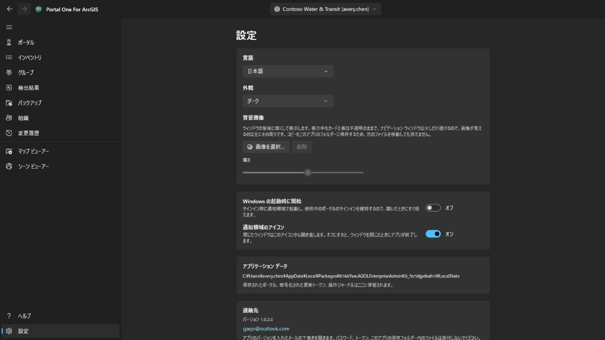

ライト、ダーク、または Windows に合わせる。テーマは選んだその場で変わります。Microsoft Store に新しいバージョンがあると、ナビゲーション ウィンドウの「設定」の横に **更新** ボタンが表示されます。インストール中はアプリが閉じ、新しいバージョンで再起動すると、ボタンは消えます。ウィンドウの下に**背景画像**を設定できます。表示中もカードと表は不透明のままで、ナビゲーション ウィンドウは少しだけ透けるので画像は主にその周りに見え、**暗さ**でどの程度暗くするかを決められます。

インターフェイスは 14 言語で提供され、固定しない限り Windows に従います。
**言語の変更は次回の起動で有効になり**、その場にボタンが表示されます。
フレームワークは各画面のテキストを構築時に一度だけ読むため、即座に適用しても
その後に開いた部分しか切り替わらないからです。

**サブスクリプション**は、ページから透かしを外すものです。ここにある他のことはその向こうにはありません。ポータルへのサインイン、棚卸し、バックアップ、地図の印刷は、支払っていてもいなくても無料のままです。Microsoft Store で購入する月額のサブスクリプションで、いつでも解約できます。登録されると、カードに料金と次回の更新日が表示されます。*購入の復元*は、支払ったのに透かしが残っている場合のためのものです。サブスクリプションはストア自身のウィンドウで購入されていることがあり、このアプリにはそれが知らされません。

**透かし**は、各ページの右下にあなたが決めた一行を置きます。最長二十四文字、フォント・サイズ・太さ・色・濃さは**詳細設定**の中で選び、そこにある帯にページ上と同じ姿で表示されます。カードそのものに出ているのは、透かしを入れるスイッチだけです。最初は三十ピクセル、濃さは最大の赤で、六分のうち一分だけページの中を動き回ります。五分は隅で待ち、一分動いて、また隅へ戻ります。動き回るのは、画面を撮る人が枠をどこで切るかを決めるからで、隅はいちばん切り落とされやすい場所だからです。動かないでいるのは、作業中のページを一行の線が横切るべきではないからで、動きをやめさせるスイッチは**詳細設定**の中にあります。ここに初めて来たときはオンで、*未購読*と読めます。アプリから出たものは、それがどこで作られたかを示すもののない場所で見られるからです。**濃さ**はその色をどれだけ使うかです。一番低くするとどの色も同じ薄いにじみになり、色だけでは見やすさを決められません。空にすれば既定の文字に戻ります。サブスクリプションに登録するまでは、このカードの項目はどれも変更できません。*未購読*と表示され、押すと上のカードが開きます。登録すると、透かしをオフにして、表示する文字も選べるようになります。何も書かなければ、アプリ名のままです。印が付くのは画面です。アプリが保存する画像はポータル自身の印刷サービスから来るもので、ポータルが送ったままの姿で出ていきます。

## キーボード

いずれの表でも:

- **Ctrl+F** でカーソルが絞り込み欄に移ります。
- **Ctrl+E** で表示中の行を、いま見えている列と並び順のままエクスポートします。

## どこに何が置かれるか

- バックアップは選んだフォルダーに入ります。開いて、コピーして、移動できる
  普通のフォルダーです。
- 接続、設定、退任処理の履歴はこのアプリ自身の保存領域にあり、資格情報に
  あたるものは暗号化されています。
- エクスポートした CSV は、保存した場所にあります。

どこにもアップロードされません。**このツールの作り手側にアカウントはなく、
テレメトリもありません。**

## 連絡先

うまく動かない、思ったとおりにならない場合は **gaqo@outlook.com** までご連絡ください。

最も助かるのは、何をしていたか、代わりに何が起きたか、ポータルが ArcGIS Online か ArcGIS Enterprise か、そのバージョン（「接続」ページに両方表示されます）、そしてインターフェイスの言語です。

パスワード、トークン、アプリの保存フォルダー内のファイルは添付しないでください。そこにはサインイン済みのセッションが保持されており、質問に答えるのにそれらは必要ありません。
