# 도움말

**Portal One For ArcGIS**는 사용자의 컴퓨터에서 ArcGIS 조직을 점검하고 관리합니다. **ArcGIS Online**과 **ArcGIS Enterprise**에 대해 동일하게 동작합니다.

이 이름을 쓰는 이유: ArcGIS Online과 ArcGIS Enterprise는 본질적으로 둘 다 포털이므로, **Portal**이라는 한 단어가 둘을 모두 포괄합니다. 이 앱도 포털을 추가하는 **포털** 페이지에서 이들을 그렇게 부릅니다. **One**은 앱을 뜻합니다. 작업하는 모든 포털을 한곳에서 다루고, 여러 포털에 동시에 로그인할 수 있습니다. **For ArcGIS**는 이 앱이 어떤 플랫폼을 위해 만들어졌는지를 말합니다.

이 앱은 로그인한 포털, 해당 콘텐츠가 가리키는 지도 서비스, 베이스맵 및 고도 데이터, 그리고 이 페이지가 최신 도움말을 읽는 도움말 웹사이트, 업데이트와 구독을 위한 Microsoft Store와 통신합니다. 웹사이트에 연결할 수 없으면 앱과 함께 설치된 도움말을 표시합니다. 자격 증명은 Windows 계정용으로 암호화되며 해당 자격 증명이 속한 포털에만 전송됩니다.

## 페이지 순서가 곧 작업 순서입니다

읽기, 백업, 모의 실행, 실행. 각 페이지는 다음 페이지를 안전하게 만들며,
탐색 목록을 위에서 아래로 따라가는 길이 안전한 길입니다.

## 연결

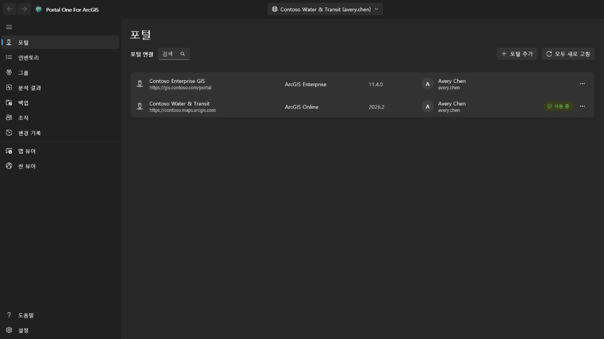

포털 주소로 연결을 추가합니다. ArcGIS Online 은
`https://yourorg.maps.arcgis.com`, ArcGIS Enterprise 는 컨텍스트 경로를 포함한
전체 주소(예: `https://portal.example.com/portal`)입니다. 포털에 미리 등록할
것은 없습니다. 포털이 Microsoft Entra 애플리케이션 프록시나 Google Cloud IAP 같은 ID 인식 프록시 뒤에 있다면 **포털에 ID 인식 프록시 인증이 필요함**을 선택하세요. 포털을 읽기 전에 프록시에 로그인하는 창이 열리고, 포털이 응답하면 자동으로 닫히며, 프록시 세션이 끝날 때마다 다시 열립니다. 진행 중이던 작업은 계속됩니다.

사용자 이름과 비밀번호로 로그인하거나, 앱 안에 표시되는 포털 자체의 로그인
페이지를 사용합니다. **조직이 통합 인증(SSO)이나 다중 인증을 쓴다면 후자를**
사용하세요. 그 경우 이 앱에는 비밀번호가 전혀 입력되지 않습니다.

같은 포털의 두 계정을 포함해 여러 연결에 동시에 로그인할 수 있습니다.
**로그인 유지**를 선택하면 자격 증명이 Windows 계정용으로 암호화되어 저장되므로
다시 시작한 뒤에도 연결이 살아 있습니다.

갱신이 유지되는 것은 현재 가리키고 있는 연결뿐입니다. 나머지는 토큰이 만료되면
로그아웃되고, 전환할 때 조용히 돌아옵니다.

로그인한 연결에는 계정의 프로필 사진이 표시되고, 사진이 없으면 이니셜이 표시됩니다. 이를 선택하면 **내 프로필**, **내 설정** 또는 **도움말**을 열 수 있습니다. **도움말**은 도움말 웹사이트의 이 도움말을 앱이 표시하는 언어로 브라우저에서 엽니다. 네트워크가 없으면 대신 앱의 **도움말** 페이지를 엽니다. 프로필 사진 옆의 **앱 실행기** 버튼은 이 계정이 해당 포털에서 사용할 수 있는 ArcGIS 앱 목록을 포털 자체 앱 실행기가 나열하는 것과 같이, 계정이 그곳에서 정한 순서대로 열며, 앱은 로그인된 상태로 별도 창에서 열립니다. **내 프로필**은 포털의 프로필 페이지처럼 계정의 사진, 이름, 소개, 그룹, 그리고 조직 또는 모든 사용자와 공유한 항목을 보여 줍니다. **프로필 편집**에서는 이름, 소개, 프로필 공개 범위, 사진을 변경합니다. **내 설정**에는 포털의 섹션인 **일반**(이메일 주소, 시작 페이지, 언어, 숫자 및 날짜 형식, 단위), **보안**(ArcGIS 로그인용 비밀번호와 보안 질문), **라이선스**(사용자 유형 및 역할, 포털 자체 페이지가 나열하는 방식의 라이선스가 있는 제품과 그 그림: 앱까지 펼쳐지는 앱 번들, 그 뒤의 기타 모든 제품, 각 애드온 라이선스의 점, 검색 상자), 조직이 할당하는 **크레딧**, 계정이 소유한 **웹후크**가 있습니다. 각 변경은 무엇을 쓸지 알려 주고, 포털에서 다시 읽어 확인되며, **변경 기록** 페이지에 기록됩니다. 이 페이지에서는 프로필, 설정, 시작 페이지, 사진, 웹후크 변경을 되돌릴 수 있습니다. 새 비밀번호, 보안 질문, 삭제된 웹후크는 기록만 됩니다. 다단계 인증, 보안 키, 복구 코드, 연결된 계정, Esri 이메일 기본 설정은 표시되거나 설명만 됩니다. 이러한 항목은 ArcGIS 웹사이트에서 관리됩니다. 비밀번호를 변경한 뒤 또는 포털이 연결을 더 이상 받아들이지 않을 때는 **포털** 페이지가 해당 연결의 로그인 창과 함께 열리므로 새 비밀번호로 다시 로그인할 수 있습니다.

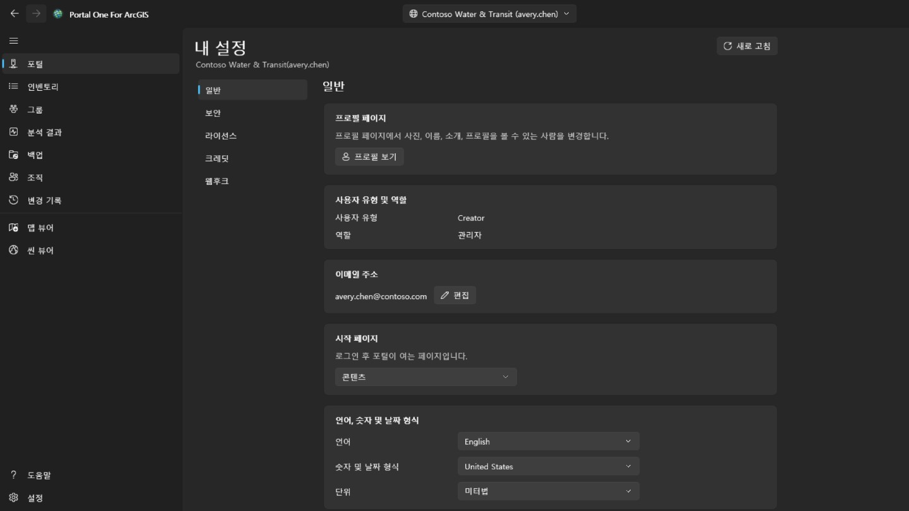

## 인벤토리

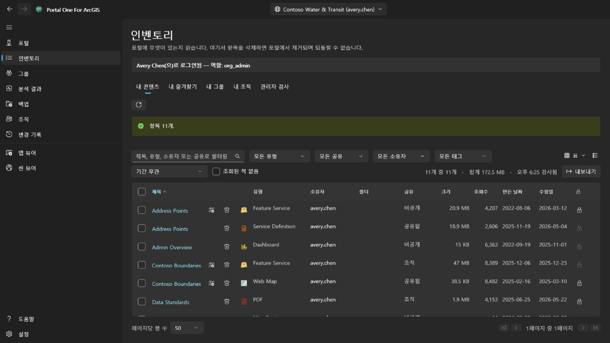

내 계정이 볼 수 있는 것을 포털의 콘텐츠 페이지처럼 네 개의 탭으로 보여 줍니다. **내 콘텐츠**, **내 즐겨찾기**, **내 그룹**(전체 또는 한 그룹, 구성원이 아니어도 볼 수 있는 그룹 포함), **내 조직**(조직이 공유한 것)입니다. 페이지를 열면 바로 읽어 두며, 옆의 단추로 표시된 탭을 다시 읽을 수 있습니다. 행의 오른쪽 클릭 메뉴는 항목 유형에 따라 달라집니다. 웹 맵은 포털의 Map Viewer, Field Maps Designer, ArcGIS Pro에서도 열 수 있고, 대시보드는 Dashboards, 스토리는 ArcGIS StoryMaps에서 엽니다. 파일은 다운로드할 수 있고, 모든 항목을 즐겨찾기에 추가하거나 제거할 수 있습니다. 웹 맵이나 웹 씬의 **다른 맵과 비교…**는 그 맵과 고른 같은 유형의 맵을 포털에 현재 있는 그대로 읽어 다른 점을 나열합니다. 추가, 제거, 이동되거나 이름이 바뀐 레이어, 바뀐 필터, 심볼, 레이블, 팝업, 베이스맵, 책갈피와 초기 보기가 대상이며 목록은 복사할 수 있습니다. **복사본 만들기…**는 그 맵을 이 포털이나 로그인한 다른 포털의 내 콘텐츠로, 새 제목으로, 폴더에 넣거나 다른 구성원에게 넘겨 복사합니다. 복사본은 비공개이며, 다른 포털에서는 먼저 각 레이어의 항목을 찾고, 항목이 없는 레이어는 주소로 불러온다는 것을 무엇이든 쓰기 전에 보여 줍니다. 오른쪽 위의 보기 메뉴는 포털의 콘텐츠 페이지처럼 행을 **표**, 각 항목의 미리 보기와 요약이 있는 **목록**, 카드 **격자**로 보여 주고 정렬합니다. 필터, 페이지, 선택한 행은 세 보기 모두에서 같습니다. **내 즐겨찾기**, **내 그룹**, **내 조직**에서는 폴더, 크기, 보호 여부가 페이지가 표시된 뒤 잠시 후에 채워집니다. 검색 결과에는 이 정보가 없어 보이는 페이지부터 각 항목을 읽기 때문입니다. 폴더는 내 항목에만, 관리자에게는 모든 항목에 표시됩니다. 표, 목록, 격자에서 항목 제목을 열면 포털과 같은 구성의 항목 페이지가 별도 창에 표시됩니다. **개요**에는 썸네일, 유형, 날짜, 요약이 있는 항목 카드와 이어지는 **설명**, 유형별 내용(서비스의 **레이어**와 테이블, 맵의 레이어, 지오프로세싱 서비스의 작업), **사용 약관**, 댓글을 남길 수 있는 **댓글**이 표시됩니다. 옆에는 **맵 뷰어에서 열기**, **씬 뷰어에서 열기**, **공유...**, **ArcGIS Pro에서 열기**가 있고 나머지는 펼침 기호 뒤에 있으며, 호스팅 피처 레이어에서는 포털이 제공하는 대로 **발행**(타일, 벡터 타일, WFS, OGC 피처 또는 3D 레이어로), **뷰 레이어 생성**(포털 자체 뷰 디자이너를 앱의 창에서), **데이터 내보내기**(쉐이프파일, CSV, Excel, 파일 지오데이터베이스, GeoJSON, KML, 피처 컬렉션 또는 GeoPackage 항목으로), **데이터 업데이트**(파일에서 필드별로 피처를 추가하거나 업데이트하거나, 앞에 나열된 모든 작업이 실행된 뒤 파일에서 전체 레이어를 덮어쓰기)가 있고, 파일, 패키지 또는 서비스 정의에는 **발행**(여기서 호스팅 레이어를 만들며, 하나가 발행되기 전까지 제공됩니다. CSV 또는 Excel 파일은 위도와 경도 필드로 배치하거나 테이블로 유지합니다)과 **데이터 업데이트**(같은 이름의 파일이 그 자리를 차지하고, 현재 파일은 먼저 이 컴퓨터에 저장됩니다)가 있으며, 벡터 타일 레이어에는 **스타일 보기**, **스타일 다운로드**와 포털이 호스팅하지 않는 경우 **스타일 업데이트**가 있고, 호스팅 타일, 벡터 타일 또는 씬 레이어에는 **레이어 바꾸기**가 있으며, 웹 맵 또는 웹 씬에는 **앱 생성**이 있습니다. 대시보드, 스토리, 경험, 웹 앱, 사이트, 양식 또는 노트북에는 이를 여는 앱과, 변경할 수 있다면 편집하는 앱이 있습니다. 모든 유형은 포털 자체 항목 페이지가 주는 버튼을 같은 순서로 갖고, 이어서 모든 항목에 **메타데이터 편집** 또는 **메타데이터 보기**와 **즐겨찾기에 추가**가 있으며, 각각은 **변경 기록** 페이지에 기록되고, **소유자**, 항목의 원본과 복사하거나 열 URL이 있는 **세부 정보**, 정보 완성도와 가장 도움이 되는 개선 사항을 보여 주는 막대, **태그**, **공유**, **폴더**, **감사의 말**도 표시되고 각각에는 변경하는 동작이 있습니다. 그다음에는 해당 유형에 있는 **데이터**, **시각화**, **설정** 탭이 이어집니다. **설정**은 포털과 같은 구성을 따릅니다. 모든 항목에는 **일반**(콘텐츠 상태, 삭제 보호와 항목 삭제, 검색에서 사용하는 범위)이 있고, 항목 자체 섹션에는 호스팅 피처 레이어의 경우 편집, 편집자 추적, 동기화, 내보내기, 트루 커브가 있으며 **저장**으로 함께 저장됩니다. 웹 맵 또는 씬의 경우 오프라인 모드가 있고, 다른 레이어의 경우 서비스가 보고하는 설정이 표시됩니다. 또한 호스팅 피처 레이어의 웹후크도 표시됩니다. 무언가를 제거하는 변경은 확인을 거치고, 포털에서 다시 읽어 오며, **변경 기록** 페이지에 기록되어 되돌릴 수 있습니다.

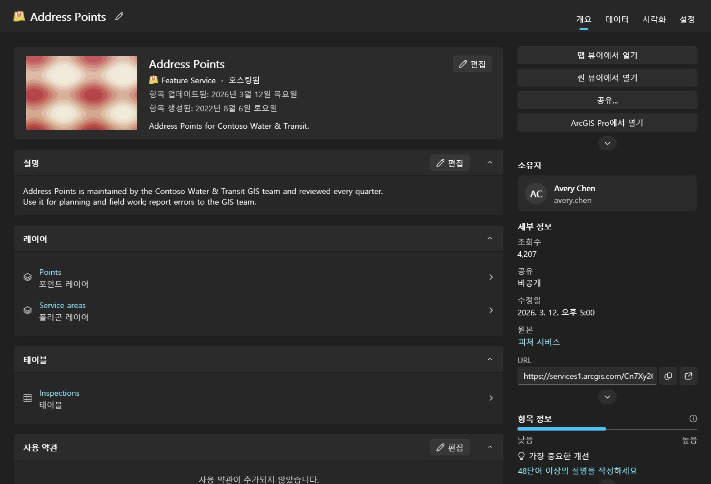

다른 사람의 콘텐츠를 검사하는 것은 관리자의 일입니다. 다른 구성원이 소유한 것을 읽을 수 있는 계정(portal:admin:viewItems)에는 이 페이지의 **관리자 검사** 탭, 분석 결과와 백업 페이지의 검사(한 구성원, 한 그룹 또는 조직 전체)와 **조직** 페이지의 **이전** 탭이 표시되며, 다른 계정에는 표시되지 않습니다. 조직 전체 검사는 검색하지 않고 각 구성원에게 콘텐츠를 요청합니다. 검색은 공유된 것만 돌려주는데 감사에서 비공개 항목을 놓치면 안 되기 때문입니다. 시간이 걸리며 취소할 수 있습니다.

분석 결과, 백업, 뷰어는 처음 필요할 때 내 콘텐츠를 스스로 읽으므로 다른 페이지를 먼저 방문할 필요가 없습니다. 관리자의 검사는 이를 검사한 내용으로 바꿉니다. 모든 표에는 목록을 언제 읽었는지 표시됩니다. 포털은 읽은 뒤에도 계속 바뀝니다.

각 행에는 삭제 버튼도 있습니다. 이 앱에서 되돌릴 수 없는 유일한 동작이며, ArcGIS에는 복원 기능이 없습니다. 확인 창은 항목과 유형, 소유자를 밝히고, 이 연결에 기억된 백업 폴더에 사본이 있는지와 그 백업이 언제 것인지 알려 줍니다. 사본이 없어도 막지는 않지만, 그 한 줄만이 나중에 그 삭제를 설명해 줄 수 있습니다. 포털에서 삭제 보호된 항목은 조용히 보호가 풀리는 대신 여기서 거부됩니다. 보호 자체를 바꾸려면 행 끝의 자물쇠나 행의 메뉴를 사용하세요. 별도의 단계이며, 보호 해제는 먼저 확인을 받고, 모든 변경은 포털에서 다시 읽어 확인한 뒤 기록에 남습니다. 행 앞의 확인란, 또는 머리글의 확인란(필터가 표시하는 모든 페이지의 모든 행)을 선택하면 여러 항목을 한꺼번에 처리할 수 있습니다. **공유**는 공유 수준과 그룹을 설정하고, **태그**는 다른 태그는 유지한 채 태그를 추가하고 제거합니다. **이동**은 한 소유자의 항목을 그 소유자의 폴더 하나로 옮기고, **소유자 변경**은 **조직** 페이지의 **이전** 탭처럼 항목을 다른 구성원에게 이전하며 **변경 기록** 페이지에서 되돌릴 수 있습니다. **삭제**는 개수, 소유자, 백업에 있는 개수를 알려 주고 이해했다는 확인을 요구하는 확인 창을 거친 뒤 제거합니다. 이 계정이 변경할 수 없는 항목과 삭제 보호된 항목은 그대로 두고 개수로 알려 줍니다. 항목은 하나씩 처리되어 기록되며, **취소**는 두 항목 사이에서 멈추고 요약에 무엇이 왜 실패했는지 나옵니다. 행의 오른쪽 클릭 메뉴에서 **공유...**는 그 항목의 공유 수준과 그룹을, **세부 정보 편집...**은 제목, 요약, 설명, 태그, 크레딧, 사용 약관을 변경합니다. 둘 다 포털의 현재 상태로 열리고, 변경한 내용만 보내며, 결과를 확인하고 기록합니다.

## 발견 사항

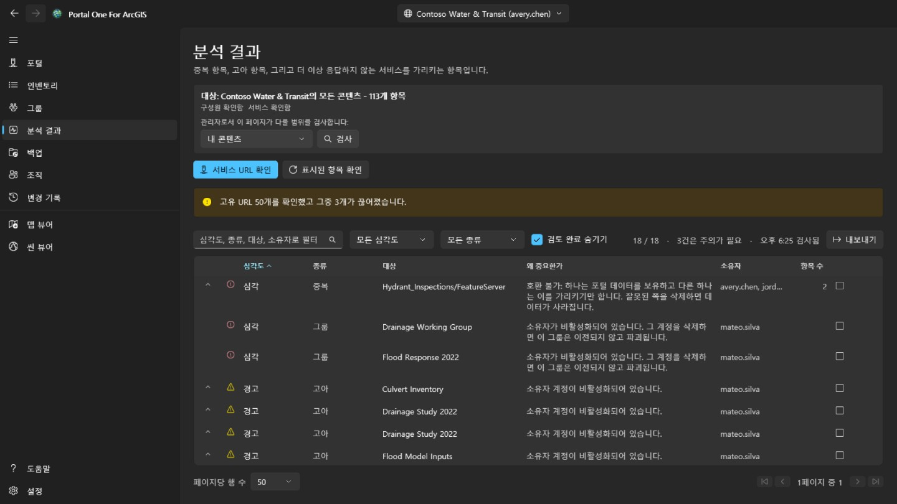

중복되거나 죽은 콘텐츠를, 심각하게 들리는 순서가 아니라 **얼마나 주의를
기울여야 하는지**의 순서로 정렬합니다.

- **치명적**은 여기서 부주의하게 움직이면 다른 어디에도 없는 것을 파괴한다는
  뜻입니다. 같은 서비스를 가리키는 두 항목에서 잘못된 쪽을 삭제하면 되돌릴 수
  없습니다.
- **경고**는 실재하는 문제이고 다루어도 안전합니다. 소유자가 떠난 항목, 더는
  응답하지 않는 서비스 등입니다.
- **참고**는 알아둘 가치가 있으며 결과적으로 문제가 없을 수도 있습니다.
- **판정 불가**는 확인하지 못했다는 뜻입니다. **시간이 초과된 서비스가 사라진
  서비스인 것은 아니며**, 이 도구는 그렇게 말하지 않습니다.

행을 펼치면 그 행이 대표하는 항목이 보입니다. 문제가 없다고 판단했으면 검토됨으로
표시하세요. 그 판단은 연결별로 기억되며, 행은 사라지지 않고 남습니다.

이 페이지는 보고합니다. **비슷한 두 항목 중 무엇을 남길지는 말하지 않습니다.**
그것은 누가 쓰는지, 무엇이 그것을 가리키는지에 달려 있기 때문입니다.

## 백업

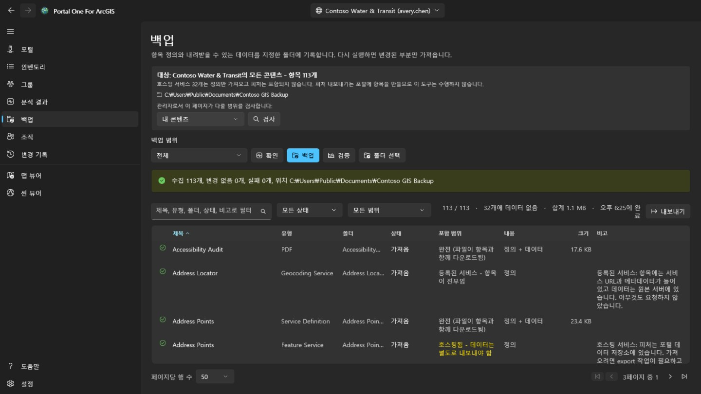

항목 정의, 리소스, 내려받을 수 있는 데이터를 선택한 폴더에 씁니다. 같은 폴더에
다시 실행하면 변경된 것만 가져오므로, **중단된 백업을 이어서 하는 것과 증분
백업은 같은 일입니다**.

- **확인**은 폴더와 포털을 비교해 무엇을 *하게 될지*만 보고하고 아무것도 쓰지
  않습니다. "내 백업이 최신인가"를 몇 시간 들이지 않고 답하는 방법입니다.
- **검증**은 폴더를 그 자신의 기록과 대조합니다. 포털은 필요 없습니다.
  **포털이 사라졌을 때 남는 질문이 바로 이것이고, 사람들이 백업을 진짜로
  열어보는 순간은 대개 그때입니다.**

폴더는 연결별로 기억되며, 다른 조직의 백업이 들어 있는 폴더는 덮어쓰지 않고
거부합니다.

**백업에 들어가지 않는 것.** 호스팅 피처 서비스의 피처는 항목이 아니라 포털의
데이터 저장소에 있고, 꺼내려면 포털에 새 항목을 만드는 내보내기, 즉 쓰기가
필요합니다. 이 도구는 그렇게 하지 않으므로 해당 행은 정의만 담기며, 페이지가
그 개수를 알려줍니다. 다른 서버에서 등록된 서비스는 본질적으로 포인터라 더
담을 것이 없습니다.

## 오프보딩

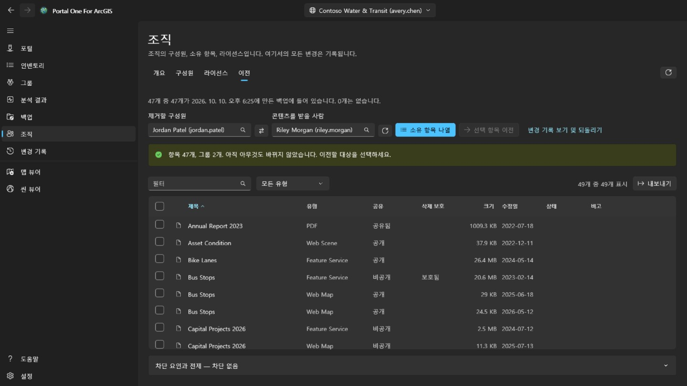

이곳은 **조직** 페이지의 **이전** 탭이며, 콘텐츠를 관리하는 계정(portal:admin:viewItems)에만 표시됩니다. 구성원을 제거할 때 필요한 일을 계산하고, 그 콘텐츠를 하나씩 되돌릴 수 있게 이전합니다.

제거할 구성원과 콘텐츠를 받을 사람은 목록에서 고릅니다. 둘 다 조직 자체의
디렉터리에서 오므로 **이름을 잘못 입력해 실제로 존재하는 다른 사람이 되는 일이
없습니다**. **소유 항목 나열**은 아무것도 바꾸지 않습니다. 모든 항목과 모든
그룹을 보여주고, 옮길 것을 고르는 쪽은 사용자입니다.

미리 선택되는 것은 없습니다. 계정 전체를 옮기는 일은 머리글 체크박스 한 번이면
되지만, **그 한 번은 기본값이 아니라 결정입니다**.

- 그룹은 의도적으로 항목과 같은 표에 있습니다. 구성원을 삭제하면 포털은 그가
  아직 소유한 그룹을 이전하지 않고 **파괴**합니다. 따라서 선택되지 않은 그룹은
  **이 페이지에서 유일하게 조용히 파괴적인 것**이며, 개수 줄이 그것을 알려줍니다.
- 확인 창은 받는 사람의 폴더를 나열하고 새 폴더를 추가할 수 있게 합니다. 항목은 선택한 폴더에 들어갑니다. 모든 이전은 다음 이전이 시작되기 전에 기록에 쓰이며, **변경 기록** 페이지는 각 항목을 원래 폴더로 되돌리고, 사라진 폴더는 다시 만들며, 하나씩 또는 아직 남은 것을 한꺼번에 되돌립니다.
- 항목 하나를 옮기면 다른 항목도 함께 옮겨질 수 있습니다. shapefile을 이전하면 그것에서 게시된 호스팅 서비스도 따라가므로, 어떤 행은 이 이전이 보낸 것이 아닌데도 도착했다고 보고할 수 있습니다. **변경 기록** 페이지에서 그 행만 되돌려도 돌아오지 않으며, 그것을 데려간 항목과 함께 돌아옵니다.
- 옮길 때마다 항목을 포털에서 다시 읽습니다. **성공을 반환한 요청은 그 요청에
  대한 진술이지, 항목이 지금 어디에 있는지에 대한 진술이 아닙니다.**

구성원 계정 자체는 **조직** 페이지에서, 소유한 것이 하나도 남지 않았을 때만 삭제합니다. **되돌릴 수 없는 유일한 단계입니다.**

## 조직

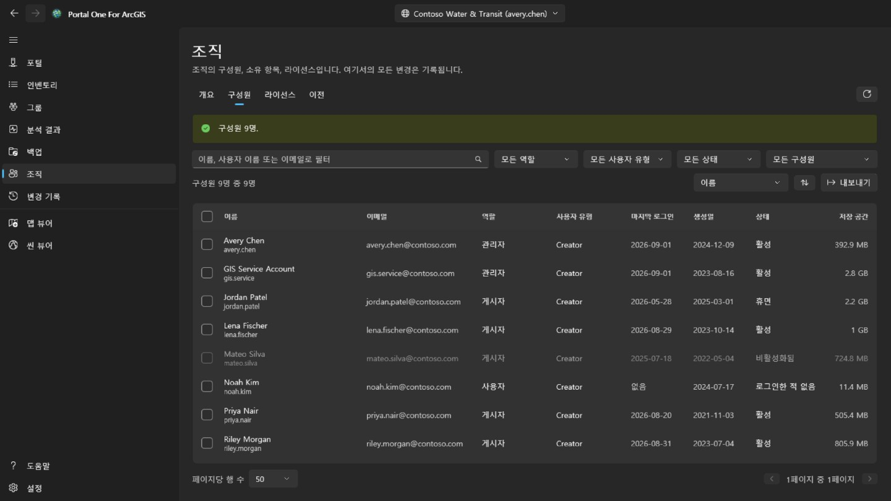

포털과 마찬가지로 이 페이지는 모든 구성원에게 표시됩니다. 조직의 관리 담당자도 알려 주는 **개요**는 누구나 볼 수 있고, 구성원 보기 권한이 있으면 이메일, 로그인, 상태, 저장소 없이 읽기 전용 **구성원** 탭도 볼 수 있습니다. 구성원 선택, **내보내기**, **라이선스**와 모든 변경은 구성원을 관리하는 계정(portal:admin:viewUsers)만 할 수 있습니다. **개요**는 조직을 요약합니다. ArcGIS Online에서는 구독, 사용자 수, 크레딧을, 그리고 상태·역할·사용자 유형별 구성원 수와 콘텐츠 및 저장소 사용량을 보여 줍니다.

**구성원**은 조직의 모든 사람을 이름, 역할, 사용자 유형, 상태 또는 그룹으로 필터링하고 원하는 열로 정렬하여 보여 주며, **내보내기**로 CSV 파일에 저장합니다. 구성원을 선택하면 비활성화하거나 활성화하고, 역할이나 사용자 유형을 바꾸고, 그룹에서 제거하거나 삭제할 수 있습니다. 한 명만 선택했을 때는 **구성원 정리**로 이 페이지의 **이전** 탭을 엽니다. 본인 계정은 항상 제외되며, 그룹 소유자는 그룹에 남습니다.

구성원을 마우스 오른쪽 단추로 클릭하면 그 구성원의 메뉴가 열립니다. **보기**는 **프로필**, **항목**, 관리자에게는 **그룹**까지 포털이 아닌 이 앱에서 보여 줍니다. 일반 구성원은 자신과 공유된 항목만 봅니다. **관리**는 관리자용이며 각 항목은 필요한 권한이 있을 때만 나타납니다. **추가 기능 라이선스**는 구성원이 가질 권한을 정하고, **이메일 주소 편집**은 ArcGIS로 로그인하는 계정의 주소를 바꾸며, **콘텐츠 이전**은 그 구성원으로 **이전** 탭을 엽니다. **구성원 이전**은 사용자 유형, 역할, 추가 기능 라이선스를 다른 구성원에게 넘긴 뒤 **이전** 탭에서 콘텐츠와 그룹을 이어서 옮깁니다. 같은 메뉴로 막대가 여러 명에게 하듯 한 구성원의 사용자 유형, 역할, 그룹, 상태, 계정을 바꿀 수 있습니다.

**삭제**는 항목도 그룹도 소유하지 않은 구성원만 제거합니다. 계정을 삭제해도 ArcGIS는 그것들을 넘겨주지 않으므로 먼저 **이전** 탭에서 옮기세요. 실행하기 전에 사용자 이름을, 여러 명이면 인원수를 입력합니다. 삭제는 되돌릴 수 없습니다.

**라이선스**는 사용자 유형별로 할당된 수와, ArcGIS Online에서는 구독에 포함된 수를 보여 줍니다. **구성원 표시**는 그 유형을 가진 사람을 나열합니다. 추가 기능 라이선스를 고르면 보유자가 표시되고, 선택한 구성원에게서 회수할 수 있습니다.

모든 변경은 포털에서 다시 읽어 이전 상태와 함께 기록되고 **변경 기록** 페이지에 나열됩니다. 이러한 구성원 변경은 거기서 되돌리지 않습니다. 되돌리려면 반대 변경을 하세요.

## 변경 기록

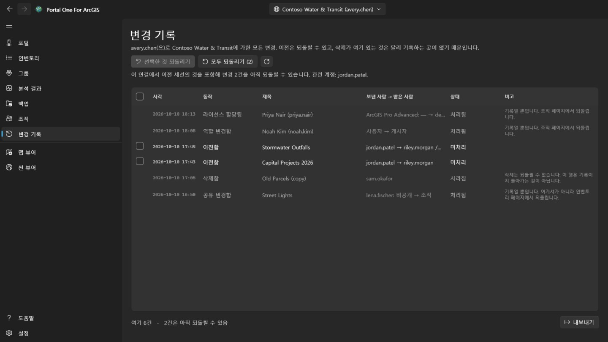

**변경 기록** 페이지는 로그인한 모든 계정에 표시됩니다. 현재 선택된 포털에서 이 도구가 바꾼 모든 것을 최신순으로 나열합니다. 이전, 삭제, 공유, 태그, 폴더, 세부 정보, 보호, 구성원 변경이 포함됩니다. 다른 포털에서 이루어진 변경은 개수만 세고 목록에는 표시하지 않습니다. 목록은 CSV로 내보낼 수 있습니다.

되돌릴 수 있는 이전에는 확인란이 있습니다. **선택한 것 되돌리기**는 선택한 이전을 되돌리고, **전체 되돌리기**는 누구의 콘텐츠인지 확인한 뒤 이 연결에 아직 남은 것을 모두 되돌립니다. 항목은 원래 있던 폴더로 돌아가며, 사라진 폴더는 다시 만들어집니다. 삭제와 구성원 변경은 기록일 뿐입니다. 삭제는 되돌릴 수 없고, 구성원 변경은 반대 변경을 하여 되돌립니다. 이전을 되돌리는 것도 이전이므로 같은 권한(portal:admin:reassignItems, 그룹은 reassignGroups)이 필요합니다. 권한이 없는 계정에는 기록만 표시됩니다.

맵 뷰어에서 덮어 저장한 웹 맵과 그곳에서 추가, 편집 또는 삭제한 피처는 해당 행의 메뉴에서 되돌립니다. 피처 편집은 피처가 편집 직후 그대로일 때만 되돌려집니다. 추가한 피처는 삭제되고, 편집한 피처는 이전 값과 모양을 되찾으며, 삭제한 피처는 새 개체 ID로 다시 추가됩니다. 되돌린 작업도 기록되므로 같은 방법으로 다시 되돌릴 수 있습니다. 웹 맵을 되돌리기 전에 같은 메뉴의 **현재 지도와 비교**로, 그 저장 전에 보관한 사본과 포털이 지금 가진 지도의 차이를 볼 수 있습니다. 베이스맵, 추가·제거·이름 변경·이동한 레이어, 각 레이어의 표시 여부, 불투명도, 스타일, 레이블, 필터, 축척 범위, 팝업, 새로 고침, 테이블, 책갈피, 지도가 열리는 위치를 비교합니다.

## 맵 뷰어와 씬 뷰어

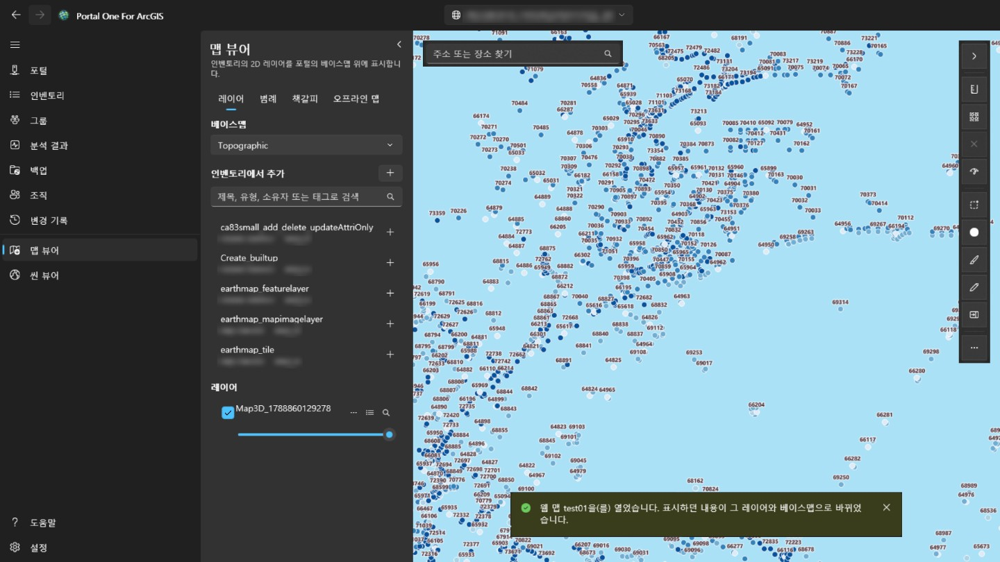

**맵 뷰어**는 포털 자체의 베이스맵 위에 2D 레이어를 표시하고, **씬 뷰어**는 여기에 씬 레이어, 메시, 포인트 클라우드, 3D Tiles 같은 3D 레이어를 더해 지형이 있는 지구 위에 표시합니다. 왼쪽 패널은 이 포털에서 읽은 것(자동으로 읽는 내 콘텐츠, 관리자가 검사한 것, 인벤토리 페이지의 탭이 읽은 것)을 검색하고, 해당 뷰어가 그릴 수 있는 항목만 보여 줍니다. 항목을 고르면 추가됩니다. 웹 맵은 맵 뷰어에서, 웹 씬은 씬 뷰어에서 자체 레이어와 베이스맵을 포함해 통째로 열립니다. 인벤토리 페이지에서는 제목 옆의 뷰어 단추(행의 오른쪽 클릭 메뉴에도 있음)로 해당 항목을 표시할 수 있는 뷰어에서 열 수 있습니다.

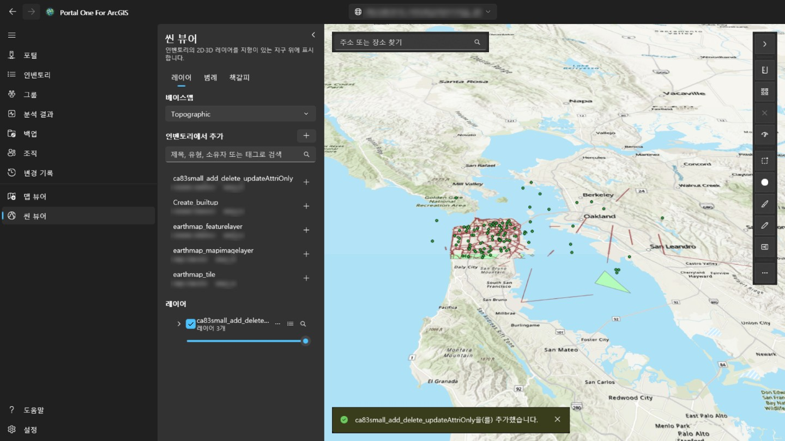

패널 오른쪽 위의 단추를 누르면 패널이 접혀 맵이나 장면이 전체 너비를 사용하고, 다시 누르면 열립니다. 뷰어에 들어올 때마다 패널은 열려 있습니다. 각 레이어는 표시하거나 숨기고, 더 투명하게 하고, 위아래로 옮기고, 레이어로 확대하거나 제거할 수 있습니다. 지도에서 피처를 클릭하면 그 필드가 표시됩니다. 포털에서 레이어에 팝업이 설정되어 있으면 팝업이 고른 필드를 그 레이블과 서식으로 보여 주고, 없으면 모든 필드를 보여 줍니다. **레이어** 옆의 **범례** 탭은 표시된 각 레이어의 기호가 무엇을 뜻하는지 보여 줍니다. **책갈피**에는 웹 맵이나 웹 씬과 함께 저장된 장소가 나열됩니다. 거기서 현재 보기에 이름을 붙여 직접 추가하고, 하나를 골라 그 장소로 돌아갈 수 있습니다. 씬 책갈피는 카메라의 방향과 기울기도 유지합니다. 피처가 있는 레이어의 테이블 단추를 누르면 지도 아래에 **속성 테이블**이 열립니다. 행은 200개씩 불러오며 레이어가 그려지는 것과 같은 필터가 적용됩니다. 행을 고르면 해당 피처가 강조 표시되고 그 위치로 확대됩니다. **내보내기**는 불러온 행만이 아니라 필터와 정렬을 적용한 테이블의 모든 행(최대 50,000개)을 씁니다. 테이블에 보이는 그대로의 CSV, 위도·경도의 GeoJSON, 레이어 좌표계 그대로의 압축 셰이프파일(필드 이름은 10자로 줄임) 중에서 고릅니다. 열 머리글에서 그 열로 정렬하거나, 필터를 걸거나(레이어 필터와 같은 방식으로 열마다 조건 하나, 모두 적용), 통계를 볼 수 있습니다. 통계는 값이 있는 행 수, 최솟값과 최댓값, 숫자라면 합계·평균·표준 편차, 가장 흔한 값이며, 불러온 행만이 아니라 필터를 통과하는 모든 행이 대상입니다. **선택 항목만**은 테이블을 선택한 행으로 좁힙니다. 맵 뷰어에서는 지도 위의 **거리**와 **면적**으로 점을 클릭해 그린 도형을 측정합니다. 평면 지도가 아니라 지표면을 따라 측정하며, Windows 지역 설정에 따라 미터법 또는 야드파운드법 단위로 표시합니다. 씬 뷰어에서 **거리**는 지형이나 모델 위 두 번의 클릭 사이(직선, 지면 따라, 수직)를 측정하고, **면적**은 지형에 맞춘 꼭짓점을 따라 측정합니다. **웹 맵으로 저장**은 내 콘텐츠의 원하는 폴더에, 지금 표시된 베이스맵, 레이어, 책갈피를 담은 새 웹 맵 항목을 만듭니다. 현재 지도 위치에서 열리며 지도 이미지가 썸네일이 됩니다. **저장**은 소유하거나 다른 사람의 콘텐츠를 수정할 수 있을 때, 이 PC에 사본을 남긴 뒤 포털에서 연 웹 맵을 덮어씁니다. 씬 뷰어에서는 저장할 수 없습니다. 검색 상자는 포털 지오코더로 주소나 지명을 찾습니다. **내보내기**는 보기의 PNG를 저장하고, 포털에 인쇄 서비스가 있으면 **인쇄**를 실행합니다. 시간 정보가 있는 레이어는 **시간** 막대로 범위를 단계별로 보거나 재생합니다. 다른 페이지에서 작업하는 동안에도 레이어는 그대로 남고, 다른 포털로 전환하면 처음부터 다시 시작합니다. 포털의 로그인은 그 포털 자체의 레이어에만 쓰이며 다른 조직의 서버로는 절대 보내지 않으므로, 다른 곳에서 등록되어 로그인을 요구하는 레이어는 불러오지 않습니다. 지도에서 측정하는 중에는 두 번 클릭하거나 Enter를 누르거나 **완료**를 선택하면 스케치가 끝납니다. 스케치는 다음 측정이나 도구 옆 ✕를 누를 때까지 결과와 함께 지도에 남습니다. Esc는 스케치를 취소하고, Ctrl+Z나 Backspace는 마지막 점을 되돌립니다. 피처가 있는 레이어의 스타일 단추로 그리는 방식을 바꿀 수 있습니다. 원하는 색과 크기의 단일 기호, 필드 값마다 다른 색(**범주**), 숫자 필드를 색상 램프로 나눈 등급(**등급**: 자연 구분, 등간격, 분위수) 중에서 고를 수 있습니다. 변경 사항은 바로 지도에 반영되며, **적용**하면 유지되고 **취소**하면 이전 모습으로, **원래대로**를 누르면 레이어 본래 스타일로 돌아갑니다. 범례도 함께 바뀌고, 지도를 웹 맵으로 저장하면 스타일도 저장됩니다. 같은 행의 **…** 단추로 **레이블…** 과 **필터…** 도 열 수 있습니다. 레이블은 필드 값을 원하는 크기와 색으로, 후광을 넣어 특정 축척부터 각 피처에 표시합니다. 필터는 필드·비교·값으로 만든 조건(모두 충족 또는 하나 이상 충족)에 맞는 피처만 표시하고 일치하는 수를 바로 셉니다. 웹 맵에서 온 레이어 자체 필터는 유지되며, 속성 테이블도 필터를 따릅니다. 지도 왼쪽 아래에는 지도와 함께 도는 나침반(선택하면 다시 북쪽으로 맞춤), 지표면 기준으로 잰 축척 막대와 축척, 포인터 아래 좌표(선택하면 복사하거나 십진 도와 도분초 사이를 전환), 클릭하면 지도를 옮기는 개요 지도 단추가 있습니다. **선택**은 사각형, 자유형, 다각형 안에 있는 모든 표시 레이어의 피처를 선택합니다. 패널에 레이어별 개수와 숫자 필드의 합계, 평균, 최소, 최대가 표시되며, 테이블에 표시하거나 확대하거나 CSV로 저장할 수 있습니다. **버퍼**는 선택한 피처나 직접 그린 점, 선, 영역에서 지정한 거리 안의 영역을 그리고, 이 컴퓨터에서 지표면을 따라 면적을 잽니다(분석 서비스나 크레딧을 쓰지 않음). 범위 안의 피처를 선택할 수도 있습니다. **스와이프**는 끌어서 옮기는 구분선 왼쪽에 레이어가 있는 지도, 오른쪽에 레이어가 없는 지도를 보여 줍니다. **지도 점검**은 지도의 모든 레이어를 살펴 공유 대상에게 동작하지 않거나 오해를 줄 부분을 알려 줍니다. 로드되지 않는 레이어, 없어졌거나 지도보다 좁게 공유된 항목, http 또는 포털 밖에서 제공되는 서비스, 사용 중단되었거나 다른 조직의 항목, 축척 범위가 없는 큰 레이어, 팝업이 전혀 없는 경우 등입니다. 보고서는 복사할 수 있습니다. 또한 레이어의 팝업, 심볼, 레이블이 가리키지만 레이어에 없는 필드를 알려 주고, 각 서비스 레이어의 피처 수를 세는 시간을 잽니다. 3초를 넘으면 알림, 10초를 넘거나 30초 안에 응답이 없으면 경고입니다. 레이어의 **…** 메뉴에서 **사용처…**는 인벤토리의 지도와 앱을 읽어 그 레이어를 직접 또는 지도를 통해 쓰는 것을 나열하고, **속성…**은 원본, 소유자, 그리기 방식, 피처 수와 필드를 보여 줍니다. 검색 상자는 좌표(순서 무관 십진수 두 개, 도분초, UTM, MGRS)도 받아 지오코더 없이 이동합니다. **내보내기**에서 포털 뷰어로 웹 맵을 현재 위치에서 여는 링크나 중심 좌표를 복사할 수 있습니다. 웹 맵에 덮어 저장하면 이전 정의가 보관되며, **변경 기록** 페이지의 해당 저장 메뉴에서 되돌릴 수 있습니다. 레이어 메뉴의 레이어 설정에서는 표시 축척 범위, 피처 레이어 팝업(제목 자리 표시자, 필드 레이블, 표시 여부와 순서), 지원되는 새로 고침 간격을 설정합니다. 미리 보기는 즉시 반영되며 웹 맵을 저장하면 유지됩니다. 스타일 대화 상자에서 이제 포인트 레이어를 히트 맵으로 그리거나 숫자 필드로 포인트 심볼 크기와 라인 너비를 조절하고 개수 레이블이 있는 포인트 클러스터링을 켤 수 있습니다. 폴리곤 레이어는 기존 색상 스타일을 유지합니다. 레이어 탭의 추가 메뉴로 서비스 URL이나 로컬 파일도 추가할 수 있습니다. CSV와 GeoJSON은 저장할 때 포함된 피처 컬렉션이 되고, 셰이프파일과 KML 또는 KMZ 파일은 로컬에 남으며 저장 전에 따로 안내됩니다. 스케치는 포인트, 선, 영역, 사각형, 원 또는 타원, 자유형 도형과 텍스트가 포함된 저장 가능한 마크업 레이어를 추가합니다. 스케치 피처를 선택해 모양을 바꾸거나 스타일을 변경하거나 삭제하고, 마지막 표시를 실행 취소하거나 레이어를 지울 수 있으며 스케치 피처 컬렉션은 웹 맵과 함께 저장됩니다. 맵 뷰어의 **편집** 도구는 편집을 허용하는 서비스 피처 레이어를 나열하고, 읽기 전용 레이어는 그 이유를 설명합니다. 템플릿에서 새 피처를 그리거나 지도에 있는 피처를 선택할 수 있으며, 편집 가능한 필드를 검증한 뒤 확인한 변경 사항을 라이브 피처 서비스에 적용합니다. 편집 가능한 레이어의 속성 테이블에서 Ctrl 또는 Shift로 행을 선택합니다(불러온 행 전체는 Ctrl+A). **편집**은 그중 하나를 편집 양식으로 열고, **필드 변경**은 각 피처의 규칙으로 값을 확인한 뒤 선택한 모든 행의 한 필드를 한 값으로 설정합니다.  **필드 변경** 에서는 식도 사용할 수 있습니다. 대괄호 필드 이름, 따옴표 텍스트, + - * / 및 일부 함수로 선택한 각 행이 다른 필드에서 고유한 값을 얻습니다.  **[편집]** 패널의 **지오메트리 도구**로 **맵에서 선택**, 모양 **병합**, 절단선으로 선 또는 폴리곤 **분할**, 그린 영역으로 **클립**, 같은 형상 종류의 다른 편집 가능 레이어로 **레이어로 복사**를 할 수 있으며, 각 작업은 **변경 내역** 페이지에 기록됩니다. 각각 **변경 기록** 페이지에 기록되며(필드 변경은 한 항목으로) 거기서 되돌립니다. 선택한 피처의 경우 레이어가 첨부 파일을 보관하면 편집 양식에 첨부 파일도 나열되어 열기, 추가, 제거할 수 있으며(제거하는 파일은 먼저 이 컴퓨터에 복사되고 각 변경은 **변경 기록** 페이지에 기록됨), 관련 레코드도 읽기 전용으로 표시됩니다. 피처를 그리거나 모양을 바꾸는 동안 꼭짓점이 편집 패널의 **스냅**에서 선택한 레이어의 피처에 스냅되고, 지오메트리 가이드가 직각과 평행을 제시합니다. 둘 다 끌 수 있으며 스냅 거리도 설정할 수 있습니다. 측정, 스케치 및 다른 도구는 스냅하지 않습니다. **웹 맵으로 저장** 옆의 **공유**는 이 계정이 소유하거나 다른 사용자의 콘텐츠를 공유할 수 있을 때 화면의 웹 맵이나 웹 씬을 인벤토리 페이지에서 항목을 공유하는 것과 같은 방식으로 공유합니다. 수준과 그룹을 고르면 공유했을 때의 지도를 점검하고, 그 수준에서 동작하지 않거나 오해를 줄 부분을 공유하기 전에 나열합니다. **세부 정보**는 인벤토리 페이지처럼 항목의 제목, 요약, 설명, 태그, 크레딧, 사용 약관을 편집하며, 보기 이미지를 썸네일로 쓰고 포털 검색에 쓰이는 항목 범위를 보기로 설정할 수도 있습니다. 지도가 열리는 위치는 덮어 저장으로 정합니다. 피처의 팝업에는 작성자가 정한 순서대로 포털에서 구성한 팝업의 이미지, 차트, 첨부 파일과 관련 레코드도 표시되며, Arcade 식은 먼저 평가됩니다. 차트는 앱의 테마로 그려지고, 이미지는 https 주소에서만 불러오며, 첨부 파일은 클릭하면 열립니다. 서비스가 옮겨지거나 바뀌면 레이어의 **…** 메뉴에 있는 **웹 맵에서 바꾸기…**로, 그 서비스를 쓰는 인벤토리의 모든 웹 맵과 웹 씬을 각 지도에서 바뀔 내용을 먼저 보여 준 뒤 새 주소로 연결할 수 있습니다(서비스 전체의 레이어는 번호를 유지). 각 지도는 쓰기 전에 보관되고 **변경 기록** 페이지에 기록되어 거기서 비교하고 복원할 수 있습니다. 레이어 목록은 그룹 레이어를 트리로 표시합니다. 그룹을 펼쳐 그 안의 레이어를 관리하고, 레이어 이름을 바꾸고, 선택한 최상위 레이어로 새 그룹을 만들고, 레이어를 그룹 안팎으로 옮기거나 그룹을 다시 해제할 수 있습니다. 맵 뷰어는 선에서 고도 프로파일을 그릴 수 있으며, 크레딧을 소비하는 분석 서비스 대신 타일 지형을 사용하고, 샘플링한 거리와 고도를 복사하거나 내보낼 수 있습니다. 서비스 피처 레이어는 맵 아래에 읽기 전용 차트도 열 수 있습니다. 모든 피처를 다운로드하지 않고 서비스 통계를 사용하며, 보기 범위나 선택 항목으로 제한하고 PNG 또는 CSV로 내보낼 수 있으며 웹 맵에는 저장되지 않습니다.  컴퓨터에서 추가한 CSV, GeoJSON 또는 shapefile은 레이어 메뉴에서 호스팅 피처 레이어로 발행할 수 있습니다. 원본 파일이 업로드되고 내 콘텐츠에 서비스가 만들어지며 로컬 레이어가 대체됩니다. 포털은 KML 및 KMZ를 피처 서비스로 발행하지 않으므로 제공되지 않습니다.  스타일 대화 상자에서는 크기 필드가 있는 유형과 두 필드 관계 지도도 제공합니다. 연속 색상 램프, 점 밀도, 비닝은 ArcGIS Maps SDK for .NET 300.1에서 여기서 안전하게 지원하지 않으므로 표시하지 않습니다. 레이블과 팝업 필드도 Arcade 식을 사용할 수 있으며, 필드 삽입, 일반 스니펫, 적용 전 실제 피처 테스트를 제공합니다.  편집 가능한 피처 레이어에는 웹 맵에 저장된 양식도 포함될 수 있습니다. 편집 패널은 해당 그룹, 필수 규칙, 계산 값을 따르며 레이어 메뉴의 **양식…** 명령으로 그 양식을 편집합니다. 포털 웹 맵은 맵 뷰어에서 오프라인으로 전환할 수 있습니다. 앱은 오프라인 기능을 확인하고 사전 계획된 영역이나 현재 보기를 LocalState 아래에 다운로드하며, 오프라인 맵 탭에서 열고, 편집 내용을 로컬로 커밋한 뒤 계정에 Basic Runtime 이상 라이선스가 있으면 하나의 Changes 항목으로 다시 동기화합니다.  맵 네트워크 분석은 포털 서비스에서 경로, 서비스 영역, 가까운 시설을 추가합니다. ArcGIS Online은 크레딧을 소비합니다.  관련 레코드 섹션은 숨겨진 SDK 맵의 릴레이션십 테이블을 통해서도 릴레이션십을 읽으므로, 관련 테이블이 웹 맵에 없어도 다대다 및 속성 포함 릴레이션십이 작동합니다.  씬에서는 피처 레이어를 클릭, 지표면에 투영한 사각형 또는 클릭으로 그린 폴리곤으로 선택하고, 선택한 피처나 클릭한 점·선·영역에서 버퍼를 만들며, 차트로 보고, 편집할 수도 있습니다. 편집에는 레이어 양식을 통한 속성, 클릭한 점으로 만드는 새 피처와 전체 모양 다시 그리기, 병합·복사·분할·자르기가 포함됩니다. SDK가 지오메트리 편집기를 MapView에만 제공하므로 버텍스 단위 모양 변경만 맵 전용으로 남습니다. 씬 스케치(클릭으로 배치하는 점, 선, 폴리곤, 사각형, 타원, 텍스트)는 여기서 웹 씬을 저장할 수 없으므로 세션 동안만 유지되며, 자유곡선 그리기는 맵 전용입니다. 스케치 패널의 **스케치를 GeoJSON으로 내보내기**로 두 뷰어의 표시를 파일로 보관할 수 있습니다. 씬에서도 클릭한 선을 따라 **고도 프로파일**을 그릴 수 있으며, 씬 자체의 지표가 있으면 그것에서, 없으면 맵 뷰어와 같은 소스에서 읽습니다. **네트워크** 패널도 씬에서 작동합니다. 지표를 클릭해 정류장, 시설, 사고 지점을 놓고, 결과는 씬 위에 드레이프되며, 레이어로 추가한 경로는 세션 동안만 유지됩니다.  씬 작업도 공유, 세부 정보 편집, 링크나 중심 복사, 이미지 내보내기, 레이어 검사, 사용 위치 표시, 원본 교체를 할 수 있습니다. 씬 위젯은 방향, 포인터 좌표, 개요, 카메라 고도를 보여 주며 로컬 모바일 씬 패키지는 읽기 전용으로 열립니다. 씬 **스와이프**는 전체 씬의 동기화되고 잘린 복사본을 사용합니다. 탐색은 기본 씬에서 계속하며 구분선으로 선택한 레이어가 있는 경우와 없는 경우를 비교합니다.  짧은 장소 검색 상자는 왼쪽 위에 유지되며, 오른쪽 도구 레일의 화살표로 검색과 도구를 애니메이션과 함께 숨기거나 다시 표시할 수 있습니다. 기타 명령에는 자주 사용하지 않는 항목, 검사, 시간, 내보내기 명령이 있습니다.

## 백그라운드 실행

창을 닫으면 앱이 종료되지 않고 알림 영역으로 들어갑니다. **몇 시간 걸리는 검사나
백업이 "창을 치우는" 동작 때문에 죽지 않도록** 하기 위해서입니다. 트레이 아이콘이
무엇이 실행 중인지 알려주며, 거기의 **종료**가 진짜 출구입니다. 메뉴에서 포털을 추가하고, Microsoft Store에서 업데이트를 확인하거나 찾은 업데이트를 설치할 수도 있습니다.

알림 영역 아이콘을 끄면 창을 닫는 순간 앱이 종료됩니다. 아이콘이 없으면 창을
다시 불러올 것이 없기 때문입니다.

**Windows 시작 시 실행**은 로그인할 때 앱을 알림 영역으로 바로 띄우므로, 열었을
때 쓰던 연결이 이미 로그인된 상태입니다.

## 설정

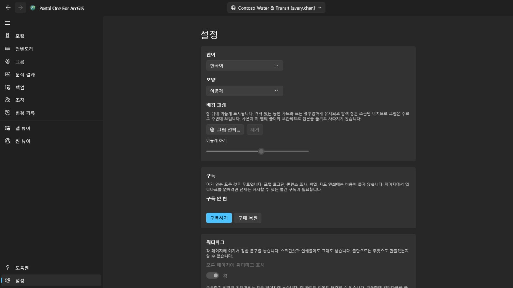

밝게, 어둡게, 또는 Windows 설정에 따라. 테마는 고르는 즉시 바뀝니다. Microsoft Store에 새 버전이 있으면 탐색 창의 설정 옆에 **업데이트** 버튼이 나타납니다. 설치하는 동안 앱이 닫히고 새 버전으로 다시 시작되면 버튼은 사라집니다. 창 아래에 **배경 그림**을 설정할 수 있습니다. 표시되는 동안 카드와 표는 불투명하게 유지되고 탐색 창은 조금만 비치므로 그림은 주로 그 주변에 보이며, **어둡게 하기**로 얼마나 어둡게 할지 정합니다.

인터페이스는 14개 언어로 제공되며, 고정하지 않으면 Windows를 따릅니다. **언어
변경은 다음 시작 때 적용되고**, 그 자리에 버튼이 표시됩니다. 프레임워크는 각
화면의 텍스트를 화면이 만들어질 때 한 번만 읽기 때문에, 즉시 적용해도 그 뒤에
열린 부분만 바뀝니다.

**구독**은 페이지에서 워터마크를 없애는 것이며, 그 밖의 것은 그 뒤에 있지 않습니다. 포털 로그인, 콘텐츠 조사, 백업, 지도 인쇄는 비용을 냈는지와 관계없이 무료입니다. Microsoft Store에서 구매하는 월간 구독이며 언제든 해지할 수 있습니다. 구독이 생기면 카드에 요금과 다음 갱신일이 표시됩니다. *구매 복원*은 비용을 냈는데 워터마크가 그대로 있는 경우를 위한 것입니다. 구독은 스토어 자체 창에서 구매되었을 수 있고, 이 앱은 그 사실을 알지 못합니다.

**워터마크**는 모든 페이지 오른쪽 아래에 사용자가 정한 한 줄을 놓습니다. 최대 스물네 자, 글꼴·크기·두께·색·진하기는 **추가 설정** 안에서 고르며, 그 아래 띠에 페이지에 놓일 모습 그대로 보입니다. 카드 자체에는 워터마크를 켜는 스위치만 나오고, 나머지는 모두 접혀 있습니다. 처음에는 서른 픽셀, 진하기 최대의 붉은 글자이며, 육 분마다 일 분 동안만 페이지 안을 걸어 다닙니다. 오 분은 구석에서 기다리고, 일 분은 움직이고, 다시 구석으로 돌아옵니다. 걸어 다니는 것은 화면을 찍는 사람이 테두리를 어디에서 자를지 정하기 때문이고, 모서리는 가장 잘려 나가기 쉬운 자리이기 때문입니다. 쉬는 것은 작업 중인 페이지를 한 줄이 가로질러서는 안 되기 때문이며, 움직임을 아예 멈추는 스위치는 **추가 설정** 안에 있습니다. 처음 이곳에 왔을 때 켜져 있고 *구독 안 함*이라고 적힙니다. 앱에서 나간 것은 어디서 만들어졌는지 아무것도 알려 주지 않는 곳에서 보이기 때문입니다. **진하기**는 그 색을 얼마나 쓰는지입니다. 가장 낮추면 어떤 색도 같은 옅은 자국이 되어, 색만으로는 눈에 띄는 정도를 정할 수 없습니다. 비워 두면 기본 문구로 돌아갑니다. 구독하기 전까지는 이 카드의 어떤 항목도 바꿀 수 없습니다. *구독 안 함*이라고 적히고, 누르면 위의 카드가 열립니다. 구독하면 워터마크를 끄고 표시할 문구를 정할 수 있습니다. 정한 문구가 없으면 앱 이름을 씁니다. 표시가 붙는 것은 화면입니다. 앱이 저장하는 그림은 포털 자체의 인쇄 서비스에서 오는 것으로, 포털이 보낸 그대로 나갑니다.

## 키보드

어느 표에서나:

- **Ctrl+F** 는 커서를 필터 상자로 옮깁니다.
- **Ctrl+E** 는 표가 보여 주는 행을, 지금 보고 있는 열과 정렬 그대로 내보냅니다.

## 무엇이 어디에 저장되는가

- 백업은 선택한 폴더에 들어갑니다. 열고, 복사하고, 옮길 수 있는 평범한
  폴더입니다.
- 연결, 기본 설정, 변경 기록은 이 앱 자체 저장소에 있으며, 자격 증명에
  해당하는 것은 암호화되어 있습니다.
- 내보낸 CSV 파일은 저장한 위치에 있습니다.

어디로도 업로드되지 않습니다. **이 도구를 만든 쪽에 계정도 없고 원격 측정도
없습니다.**

## 연락처

무언가 동작하지 않거나 기대한 대로 되지 않으면 **gaqo@outlook.com** 으로 알려 주세요.

가장 도움이 되는 것은 무엇을 하고 있었는지, 대신 무슨 일이 일어났는지, 포털이 ArcGIS Online인지 ArcGIS Enterprise인지와 그 버전(연결 페이지에 둘 다 표시됩니다), 그리고 인터페이스의 언어입니다.

비밀번호, 토큰, 앱 저장 폴더의 파일은 첨부하지 마세요. 그곳에는 로그인된 세션이 보관되어 있으며, 질문에 답하는 데 그중 어느 것도 필요하지 않습니다.
