# Pomoc

**Portal One For ArcGIS** sprawdza i utrzymuje organizację ArcGIS z twojego własnego komputera. Działa tak samo z **ArcGIS Online** i z **ArcGIS Enterprise**.

Skąd nazwa: ArcGIS Online i ArcGIS Enterprise są w istocie portalami, więc jedno słowo **Portal** obejmuje oba — i tak też nazywa je ta aplikacja na stronie **Portale**, na której je dodajesz. **One** to aplikacja: jedno miejsce dla każdego portalu, z którym pracujesz, także z kilkoma zalogowanymi naraz. **For ArcGIS** mówi, dla której platformy ją zbudowano.

Ta aplikacja komunikuje się z portalami, do których się logujesz, z usługami map, mapami bazowymi i danymi wysokościowymi, na które wskazuje ich zawartość, ze swoją witryną pomocy, z której ta strona czyta najnowszą pomoc — gdy witryna jest niedostępna, pokazuje pomoc zainstalowaną z aplikacją — oraz z Microsoft Store, w sprawie aktualizacji i subskrypcji. Twoje poświadczenia są szyfrowane dla twojego konta Windows i wysyłane tylko do portalu, do którego należą.

## Kolejność stron to kolejność pracy

Odczytać, zrobić kopię, wykonać próbę, wykonać. Każda strona zabezpiecza
następną, a nawigacja jest ułożona tak, że schodzenie nią w dół jest bezpieczną
drogą.

## Połączenia

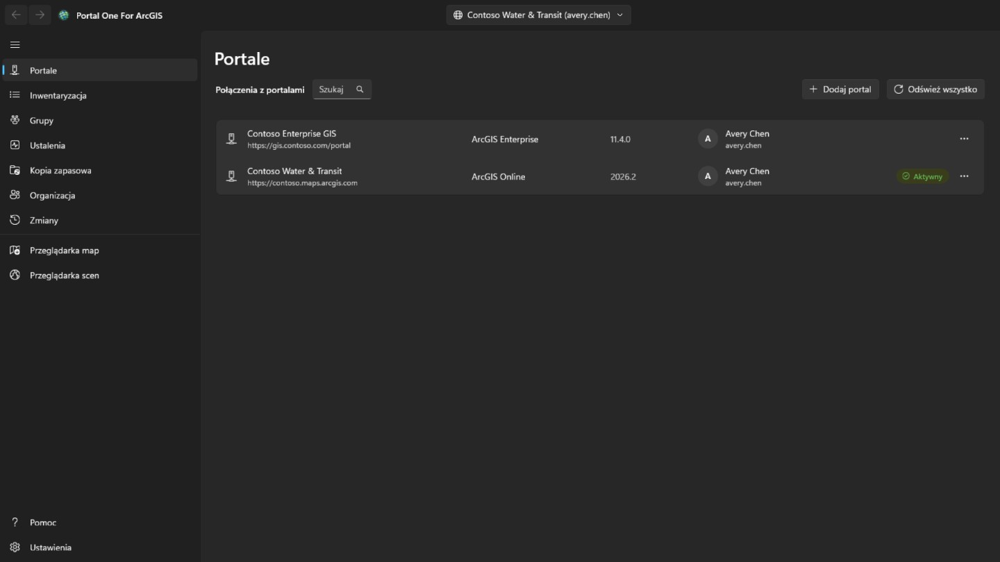

Dodaj połączenie, podając adres portalu: dla ArcGIS Online
`https://twojaorg.maps.arcgis.com`, dla ArcGIS Enterprise pełny adres razem ze
ścieżką kontekstu, na przykład `https://portal.example.com/portal`. Niczego nie
trzeba wcześniej rejestrować w portalu. Jeśli portal znajduje się za serwerem proxy z tożsamością, takim jak serwer proxy aplikacji Microsoft Entra lub Google Cloud IAP, zaznacz **Portal wymaga uwierzytelniania proxy z tożsamością**: przed odczytem portalu otwiera się okno logowania do proxy, które zamyka się samo, gdy portal odpowie, i otwiera ponownie za każdym razem, gdy sesja proxy wygaśnie — to, co było w toku, jest kontynuowane.

Zaloguj się nazwą użytkownika i hasłem albo przez własną stronę logowania
portalu wyświetlaną w aplikacji. **Użyj tej drugiej, jeśli twoja organizacja
stosuje logowanie jednokrotne lub uwierzytelnianie wieloskładnikowe**: wtedy w
tej aplikacji nie wpisuje się żadnego hasła.

Jednocześnie może być zalogowanych kilka połączeń, w tym dwa konta tego samego
portalu. **Pozostań zalogowany** przechowuje poświadczenie zaszyfrowane dla
twojego konta Windows, więc połączenie przeżywa ponowne uruchomienie.

Odnawiane jest tylko to połączenie, na które wskazujesz. Pozostałe są wylogowane
po wygaśnięciu tokenu i wracają po cichu, gdy się na nie przełączysz.

Zalogowane połączenie pokazuje zdjęcie profilowe konta, a gdy go nie ma — inicjały. Wybierz je, aby przejść do **Mój profil**, **Moje ustawienia** albo **Pomoc**. **Pomoc** otwiera tę pomoc w witrynie pomocy, w przeglądarce i w języku, który pokazuje aplikacja; bez sieci otwiera zamiast tego stronę **Pomoc** w aplikacji. Obok zdjęcia profilowego przycisk **Program uruchamiający aplikacje** otwiera aplikacje ArcGIS, których to konto może używać w tym portalu, tak jak wymienia je własny program uruchamiający aplikacje portalu i w kolejności, którą konto tam ustawiło; aplikacja otwiera się w osobnym oknie, z zalogowaniem. **Mój profil** pokazuje konto tak jak strona profilu w portalu: zdjęcie, nazwę, biogram, grupy i elementy udostępnione organizacji lub wszystkim; **Edytuj profil** zmienia imiona i nazwiska, biogram, widoczność profilu oraz zdjęcie. **Moje ustawienia** zawierają sekcje portalu: **Ogólne** (adres e-mail, strona startowa, język, format liczb i dat, jednostki), **Bezpieczeństwo** (hasło i pytanie zabezpieczające dla loginu ArcGIS), **Licencje** (typ użytkownika i rola oraz produkty licencjonowane tak, jak wymienia je własna strona portalu, z jej obrazami: pakiety aplikacji otwierane do swoich aplikacji, po nich wszystkie pozostałe produkty, kropka przy każdej licencji aplikacji dodatkowej i pole wyszukiwania), **Kredyty**, w której organizacja je przydziela, oraz **Webhooki** należące do konta. Każda zmiana informuje, co zapisze, jest ponownie odczytywana z portalu i trafia na stronę **Zmiany**, która może przywracać zmiany profilu, ustawień, strony startowej, zdjęcia i webhooków; nowe hasło, pytanie zabezpieczające i usunięty webhook są tylko odnotowywane. Uwierzytelnianie wieloskładnikowe, klucze zabezpieczeń, kody odzyskiwania, połączone konta i preferencje e-mail Esri są tylko pokazywane lub objaśniane: zarządza się nimi w witrynie ArcGIS. Po zmianie hasła albo zawsze wtedy, gdy portal przestanie przyjmować połączenie, strona **Portale** otwiera się z jego oknem logowania, aby można było zalogować się ponownie nowym hasłem.

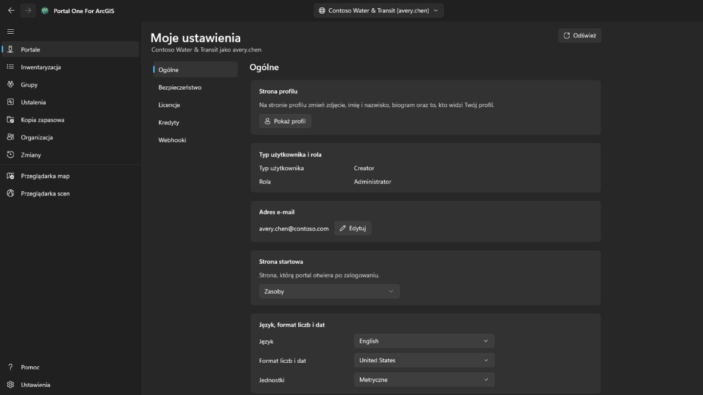

## Inwentarz

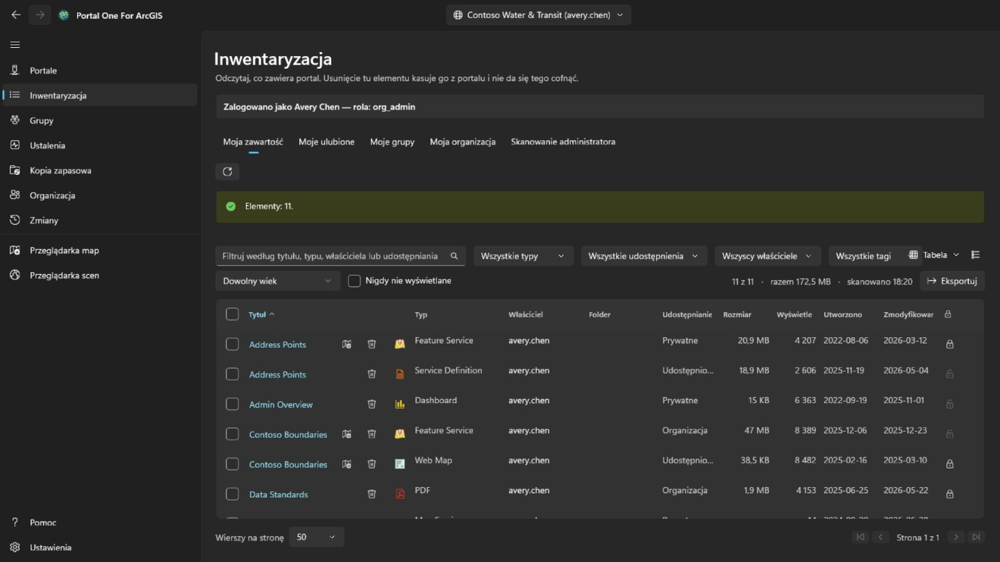

Pokazuje to, co widzi Twoje konto, w czterech kartach jak na stronie zawartości portalu: **Moja zawartość**, **Moje ulubione**, **Moje grupy** (wszystkie razem lub jedna, także grupy widoczne bez członkostwa) i **Moja organizacja** (to, co organizacja udostępnia). Są odczytywane zaraz po otwarciu strony i zachowywane; przycisk obok odczytuje pokazaną kartę ponownie. Menu kontekstowe wiersza zależy od typu elementu: mapę internetową można też otworzyć w Map Viewer portalu, w Field Maps Designer lub w ArcGIS Pro, pulpit w Dashboards, historię w ArcGIS StoryMaps; plik można pobrać; a każdy element można dodać do ulubionych lub z nich usunąć. **Porównaj z inną mapą…** na mapie lub scenie internetowej odczytuje ją i wybraną mapę tego samego typu z portalu w obecnej postaci i wypisuje różnice: warstwy dodane, usunięte, przesunięte lub przemianowane, zmienione filtry, symbolizację, etykiety i okna podręczne, mapę bazową, zakładki i widok początkowy; listę można skopiować. **Utwórz kopię…** kopiuje ją do Twoich zasobów na tym lub innym zalogowanym portalu, pod nowym tytułem, do folderu lub z przekazaniem innemu członkowi; kopia jest prywatna, a na innym portalu najpierw wyszukiwany jest element każdej warstwy, i warstwa, której elementu tam nie ma, wczytuje się z adresu, co jest pokazywane, zanim cokolwiek zostanie zapisane. Menu widoku w prawym górnym rogu pokazuje wiersze jako **Tabelę**, **Listę** z miniaturą i opisem każdego elementu lub **Siatkę** kart, jak strona zawartości portalu, i je sortuje; filtry, stronicowanie i zaznaczone wiersze są takie same we wszystkich trzech. Na kartach **Moje ulubione**, **Moje grupy** i **Moja organizacja** folder, rozmiar i ochrona pojawiają się chwilę po wyświetleniu strony: wyszukiwanie ich nie zwraca, więc każdy element jest odczytywany, najpierw widoczna strona. Folder widać tylko przy własnych elementach, a administrator przy wszystkich. Tytuł elementu w tabeli, na liście i w siatce otwiera stronę elementu w osobnym oknie, ułożoną jak w portalu: na karcie **Przegląd** karta elementu z miniaturą, typem, datami i podsumowaniem, potem jego **Opis**, zawartość zależna od typu (dla usługi **Warstwy** i tabele, dla mapy warstwy, dla usługi geoprzetwarzania zadania), jego **Warunki użytkowania** i **Komentarze**, gdzie można zostawić komentarz; obok: **Otwórz w przeglądarce map**, **Otwórz w przeglądarce scen**, **Udostępnij…** i **Otwórz w ArcGIS Pro** z resztą za znakiem rozwinięcia — dla hostowanej warstwy obiektowej, tak jak portal je oferuje, **Publikuj** (jako kafle, kafle wektorowe, WFS, obiekty OGC lub warstwę 3D), **Utwórz warstwę widoku** (we własnym projektancie widoku portalu, w oknie aplikacji), **Eksportuj dane** (do shapefile, CSV, Excel, geobazy plikowej, GeoJSON, KML, kolekcji obiektów lub elementu GeoPackage) i **Aktualizuj dane** (dodaj lub zaktualizuj obiekty z pliku, pole po polu, albo zastąp całą warstwę z pliku, z listą wszystkiego przed wykonaniem); dla pliku, pakietu lub definicji usługi **Publikuj** (warstwa hostowana z niego, oferowana do czasu opublikowania jednej; plik CSV lub Excel umieszczony według pola szerokości i długości geograficznej albo zachowany jako tabela) i **Aktualizuj dane** (plik o tej samej nazwie zajmuje jego miejsce, a bieżący jest najpierw zapisywany na tym komputerze); dla warstwy kafli wektorowych **Wyświetl styl**, **Pobierz styl** i, dla takiej, której portal nie hostuje, **Aktualizuj styl**; dla hostowanej warstwy kafli, kafli wektorowych lub sceny **Zastąp warstwę**; dla mapy internetowej lub sceny internetowej **Utwórz aplikację**; dla pulpitu, historii, doświadczenia, aplikacji internetowej, witryny, formularza lub notatnika aplikacja, która go otwiera, i jeśli możesz go zmienić, ta, która go edytuje — każdy typ z przyciskami, które daje mu własna strona elementu portalu, w tej samej kolejności; potem dla każdego elementu **Edytuj metadane** albo **Wyświetl metadane** i **Dodaj do ulubionych**; każda akcja jest zapisywana na stronie **Zmiany** — **Właściciel**, **Szczegóły** ze źródłem elementu i adresem URL do skopiowania lub otwarcia, pasek kompletności informacji z najważniejszą zmianą, która najbardziej pomoże, oraz **Tagi**, **Udostępnianie**, **Folder** i **Podziękowania**, każde z czynnością, która je zmienia; następnie karty **Dane**, **Wizualizacja** i **Ustawienia**, jeśli jego typ je ma. **Ustawienia** działają jak w portalu: **Ogólne** dla każdego elementu (status zasobów, ochrona przed usunięciem i usuwanie elementu, zasięg używany przez wyszukiwanie), własna sekcja elementu — dla hostowanej warstwy obiektowej edycja, śledzenie edytora, synchronizacja, eksport i krzywe rzeczywiste, zapisywane razem przyciskiem **Zapisz**; dla mapy lub sceny internetowej jej tryb offline; dla innych warstw ustawienia usługi zgłaszane przez nią samą — oraz webhooki hostowanej warstwy obiektowej; każda zmiana jest potwierdzana, gdy coś odbiera, ponownie odczytywana z portalu i zapisywana na stronie **Zmiany**, która może ją przywrócić.

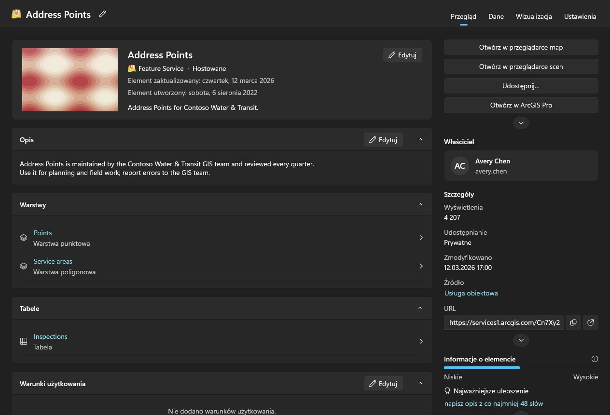

Skanowanie cudzej zawartości to zadanie administratora. Konto, które może czytać to, co posiadają inni członkowie (portal:admin:viewItems), ma kartę **Skanowanie administratora** na tej stronie i skanowanie na stronach Ustalenia i Kopia zapasowa — jeden członek, jedna grupa lub cała organizacja — oraz kartę **Przeniesienie** strony **Organizacja**; inne konta ich nie widzą. Przejście organizacji pyta każdego członka o jego zawartość zamiast wyszukiwać, bo wyszukiwanie zwraca tylko to, co udostępniono, a audyt nie może pominąć elementów prywatnych. Trwa to chwilę i można to anulować.

Ustalenia, Kopia zapasowa i przeglądarki same odczytują Twoją zawartość, gdy pierwszy raz jej potrzebują, więc nie trzeba najpierw odwiedzać innej strony; skan administratora zastępuje ją tym, co przeskanował. Każda tabela podaje, kiedy odczytano jej listę. Portal zmienia się dalej po odczytaniu.

Każdy wiersz ma też przycisk usuwania i jest to jedyna rzecz w tej aplikacji, której nie da się cofnąć: ArcGIS nie ma kosza. Potwierdzenie podaje element, jego typ i właściciela oraz mówi, czy zapamiętany dla tego połączenia folder kopii zapasowej zawiera kopię i z kiedy ona jest. Nie odmawia, gdy jej nie ma, ale ta linia jest jedyną rzeczą, która mogłaby potem odpowiedzieć za usunięcie. Element chroniony przed usunięciem w portalu jest tutaj odrzucany, a nie po cichu odbezpieczany. Samą ochronę zmienisz kłódką na końcu wiersza albo z menu wiersza: to osobny krok, zdjęcie ochrony najpierw pyta o potwierdzenie, a każda zmiana jest odczytywana z portalu i zapisywana w dzienniku. Zaznacz pole na początku wiersza — lub to w nagłówku, dla wszystkich wierszy widocznych po filtrowaniu na wszystkich stronach — aby działać na wielu elementach naraz. **Udostępnij** ustawia poziom udostępniania i grupy; **Tagi** dodaje i usuwa tagi, zachowując pozostałe; **Przenieś** umieszcza elementy jednego właściciela w jednym z jego folderów; **Zmień właściciela** przekazuje je innemu członkowi, jak karta **Przeniesienie** strony **Organizacja**, a strona **Zmiany** je przywraca; **Usuń** usuwa je po potwierdzeniu, które podaje liczbę, właścicieli i stan kopii zapasowej oraz wymaga zaznaczenia, że rozumiesz. Elementy, których to konto nie może zmienić, i chronione przed usunięciem pozostają bez zmian i są liczone. Elementy są przetwarzane po kolei i zapisywane w dzienniku; **Anuluj** zatrzymuje między dwoma, a podsumowanie podaje, co się nie udało i dlaczego. Z menu kontekstowego wiersza **Udostępnij…** zmienia poziom i grupy tego elementu, a **Edytuj szczegóły…** jego tytuł, podsumowanie, opis, tagi, autorstwo i warunki użytkowania. Oba otwierają element w stanie, w jakim portal go teraz przechowuje, wysyłają tylko to, co zmieniono, sprawdzają wynik i trafiają do dziennika.

## Ustalenia

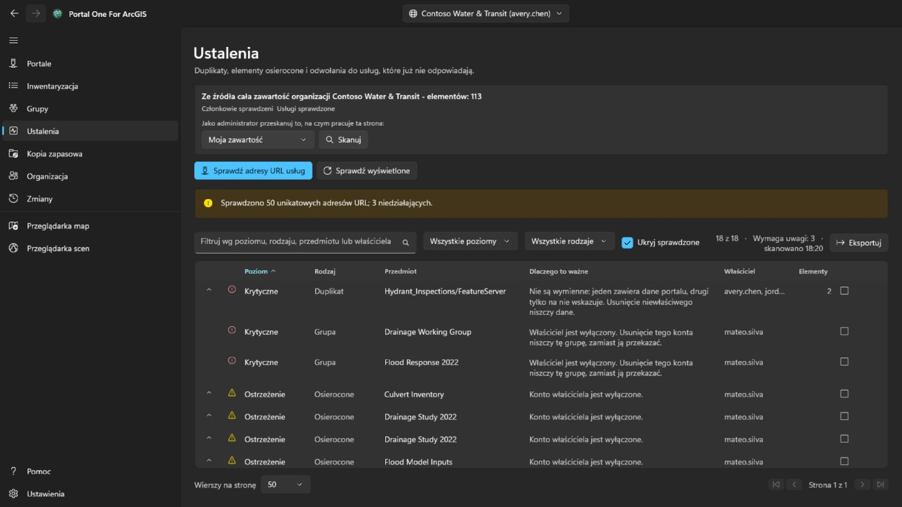

Nadmiarowa i martwa zawartość, uporządkowana według tego, na ile zasługuje na
uwagę, a nie według tego, jak groźnie brzmi.

- **Krytyczne** znaczy, że nieostrożne działanie tutaj zniszczy coś, czego nie
  ma nigdzie indziej: dwa elementy wskazujące tę samą usługę, gdzie usunięcie
  niewłaściwego jest nie do odzyskania.
- **Ostrzeżenie** to prawdziwy problem, z którym można bezpiecznie coś zrobić:
  element, którego właściciel odszedł, usługa, która już nie odpowiada.
- **Informacja** warto wiedzieć i może się okazać, że wszystko jest w porządku.
- **Nierozstrzygnięte** znaczy, że nie dało się ustalić. **Usługa, której upłynął
  limit czasu, to nie usługa, która zniknęła**, i to narzędzie tego nie powie.

Rozwiń wiersz, aby zobaczyć elementy, które reprezentuje. Oznacz go jako
sprawdzony, gdy uznasz, że jest w porządku; decyzja jest pamiętana dla każdego
połączenia, a wiersz pozostaje widoczny, zamiast znikać.

Ta strona informuje. **Nie powie ci, który z dwóch podobnych elementów
zachować**, bo to zależy od tego, kto ich używa i co na nie wskazuje.

## Kopia zapasowa

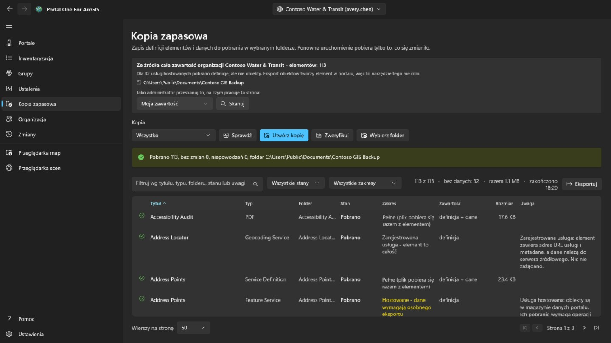

Zapisuje definicje elementów, zasoby i dane do pobrania w wybranym przez ciebie
folderze. Ponowne uruchomienie na tym samym folderze pobiera tylko to, co się
zmieniło, więc **wznowienie przerwanej kopii i wykonanie kopii przyrostowej to
to samo**.

- **Sprawdź stan** porównuje folder z portalem i podaje, co *by zrobiło*, nic
  nie zapisując. Tak odpowiada się na pytanie „czy moja kopia jest aktualna",
  nie poświęcając na to godzin.
- **Zweryfikuj** porównuje folder z jego własnym zapisem, zupełnie bez portalu.
  **To pytanie, które zostaje, gdy portalu już nie ma — a naprawdę do kopii
  zagląda się zwykle właśnie wtedy.**

Folder jest pamiętany dla każdego połączenia, a folder zawierający kopię innej
organizacji zostaje odrzucony, a nie nadpisany.

**Czego kopia nie zawiera.** Obiekty wewnątrz usługi hostowanej znajdują się w
magazynie danych portalu, a nie w elemencie, i wydobycie ich wymaga eksportu,
który tworzy w portalu nowy element — czyli zapisu. To narzędzie tego nie robi,
więc takie wiersze są pobierane jako definicja bez danych, a strona podaje, ile
ich jest. Usługi zarejestrowane z innego serwera są z natury wskaźnikami i nie
mają nic więcej do pobrania.

## Odejście członka

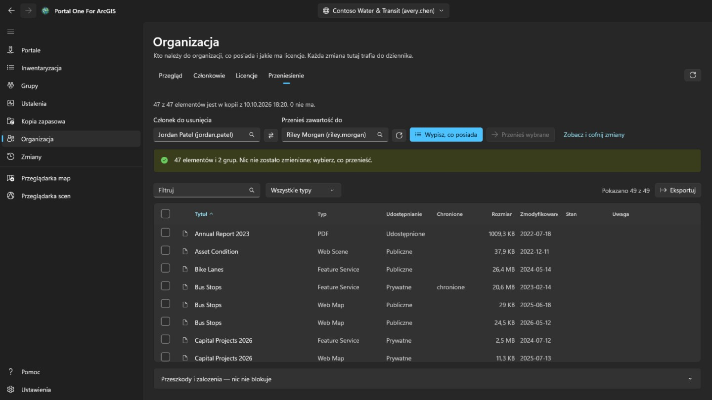

To karta **Przeniesienie** strony **Organizacja**, widoczna tylko dla kont administrujących zawartością (portal:admin:viewItems). Ustala, co oznacza usunięcie członka, i przenosi jego zawartość, po jednym elemencie i odwracalnie.

Wybierz z list członka oraz odbiorcę jego zawartości; oba pochodzą z katalogu
samej organizacji, więc **nazwy nie da się przekręcić tak, by trafić w inną,
która istnieje**. **Wypisz, co posiada** niczego nie zmienia: pokazuje każdy
element i każdą grupę, a zaznaczasz to, co ma się przenieść, ty.

Nic nie jest zaznaczone z góry. Przeniesienie całego konta to jedno kliknięcie
pola w nagłówku, a **to kliknięcie jest decyzją, nie ustawieniem domyślnym**.

- Grupy celowo są w tej samej tabeli co elementy. Przy usuwaniu członka portal
  **niszczy** grupy, które nadal posiada, zamiast je przekazać, więc
  niezaznaczona grupa jest **jedyną rzeczą na tej stronie, która niszczy po
  cichu**, i wiersz z licznikami o tym mówi.
- Potwierdzenie wyświetla foldery odbiorcy i pozwala dodać nowy; elementy trafiają do wybranego folderu. Każde przeniesienie jest zapisywane w rejestrze przed rozpoczęciem następnego, a strona **Zmiany** odkłada każde z powrotem do folderu, z którego pochodziło, odtwarzając folder, który zniknął, pojedynczo albo wszystkie zaległe naraz.
- Przeniesienie jednego elementu może zabrać ze sobą inne. Przekazanie pliku shapefile przenosi usługę hostowaną opublikowaną z niego, więc wiersz może zgłosić, że dotarł, choć to przeniesienie go nie wysłało. Cofnięcie samego tego wiersza na stronie **Zmiany** go nie sprowadzi; wróci z tym, co go zabrało.
- Po każdym przeniesieniu element jest odczytywany z portalu ponownie. **Żądanie,
  które zwraca powodzenie, jest stwierdzeniem o żądaniu, a nie o tym, gdzie
  element jest teraz.**

Samo konto członka usuwa się na stronie **Organizacja**, i to dopiero wtedy, gdy nic już do niego nie należy. **To jedyny krok, którego nie da się cofnąć.**

## Organizacja

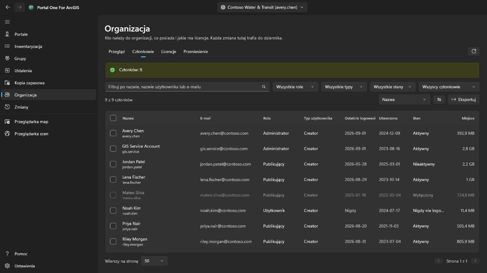

Każdy członek widzi tę stronę, tak jak w portalu. **Przegląd**, który podaje też kontakty administracyjne organizacji, jest dla wszystkich, a z uprawnieniem do przeglądania członków także karta **Członkowie** tylko do odczytu, bez adresów e-mail, logowań, statusu i miejsca. Zaznaczanie członków, **Eksportuj**, **Licencje** i każda zmiana są tylko dla kont, które administrują członkami (portal:admin:viewUsers). **Przegląd** podsumowuje organizację: w ArcGIS Online subskrypcję, miejsca i kredyty; członków według statusu, roli i typu użytkownika; oraz ile zajmuje treści i miejsca.

**Członkowie** wymienia wszystkich w organizacji, z filtrowaniem po nazwie, roli, typie użytkownika, statusie lub grupie, sortowaniem po dowolnej kolumnie i zapisem do pliku CSV przyciskiem **Eksportuj**. Zaznacz członków, aby ich wyłączyć lub włączyć, zmienić ich rolę lub typ użytkownika, usunąć z grup albo usunąć; gdy zaznaczony jest jeden, **Odejście** otwiera kartę **Przeniesienie** tej strony. Twoje własne konto nigdy nie jest zmieniane, a właściciel grupy w niej pozostaje.

Kliknij członka prawym przyciskiem, aby otworzyć jego menu. **Wyświetl** pokazuje jego **Profil**, **Elementy** i, administratorowi, **Grupy** — tutaj w aplikacji, a nie w portalu; zwykły członek widzi tylko elementy, które mu udostępniono. **Zarządzaj** jest dla administratorów, każda pozycja tylko z potrzebnym uprawnieniem: **Licencje dodatkowe** ustala, jakie uprawnienia ma członek, **Edytuj adres e-mail** zmienia go dla konta logującego się przez ArcGIS, **Przenieś zasoby** otwiera dla niego kartę **Przeniesienie**, a **Przenieś członka** daje innemu członkowi jego typ użytkownika, rolę i licencje dodatkowe, po czym kontynuuje na karcie **Przeniesienie** z zasobami i grupami. To samo menu zmienia typ użytkownika, rolę, grupy, status lub konto jednego członka, tak jak pasek robi to dla kilku.

**Usuń** usuwa tylko członków, do których nie należą żadne elementy ani grupy. ArcGIS nie przekazuje ich dalej przy usuwaniu konta, więc najpierw przenieś je na karcie **Przeniesienie**. Zanim cokolwiek się stanie, wpisujesz nazwę użytkownika, a przy kilku członkach ich liczbę. Usunięcia nie da się cofnąć.

**Licencje** pokazuje, ile przypisano każdego typu użytkownika i, w ArcGIS Online, ile obejmuje subskrypcja; **Pokaż członków** wymienia, kto ma ten typ. Wybierz licencję dodatkową, aby zobaczyć, kto ją ma, i odbierz ją zaznaczonym członkom.

Każda zmiana jest odczytywana z portalu i zapisywana z tym, co było wcześniej, oraz widnieje na stronie **Zmiany**. Tych zmian członków nie cofa się stamtąd: aby którąś odwrócić, wprowadź zmianę przeciwną.

## Zmiany

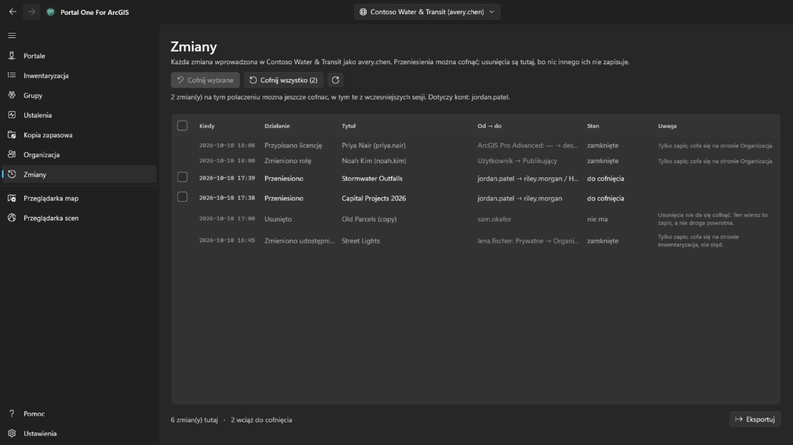

Strona **Zmiany** jest widoczna dla każdego zalogowanego konta. Pokazuje od najnowszych wszystko, co to narzędzie zmieniło w aktualnie wybranym portalu: przeniesienia, usunięcia, udostępnianie, tagi, foldery, szczegóły, ochronę i zmiany członków. Zmiany wykonane w innych portalach są liczone, ale nie są wyświetlane. Listę można wyeksportować do CSV.

Przeniesienia, które da się odłożyć z powrotem, mają pole wyboru. **Cofnij wybrane** odkłada zaznaczone przeniesienia, a **Cofnij wszystko** odkłada wszystko, co jeszcze pozostaje w tym połączeniu, po potwierdzeniu wskazującym, czyjej zawartości dotyczy. Elementy wracają do folderów, z których pochodziły, a zniknięty folder jest odtwarzany. Usunięcia i zmiany członków są tam tylko zapisem: usunięcia nie da się cofnąć, a zmianę członka odwraca się zmianą przeciwną. Cofnięcie przeniesienia samo jest przeniesieniem i wymaga tego samego uprawnienia (portal:admin:reassignItems, a dla grupy reassignGroups); konto bez niego widzi tylko zapis.

Mapę internetową zapisaną w miejsce poprzedniej z przeglądarki map oraz obiekt dodany, edytowany lub usunięty w niej cofa się z menu jej wiersza. Edycja obiektu cofa się tylko wtedy, gdy obiekt jest nadal taki, jakim zostawiła go edycja: dodany obiekt zostanie usunięty, edytowany odzyska wcześniejsze wartości i kształt, a usunięty zostanie ponownie dodany z nowym identyfikatorem obiektu. Cofnięcie też jest zapisywane, więc można je w ten sam sposób cofnąć. Przed przywróceniem mapy internetowej **Porównaj z bieżącą mapą** w tym samym menu wymienia, czym kopia zachowana przed tym zapisem różni się od mapy, jaką portal ma teraz: mapa bazowa, warstwy dodane, usunięte, przemianowane lub przesunięte, a dla każdej warstwy widoczność, krycie, styl, etykiety, filtr, zakres skali, okno podręczne i odświeżanie, tabele, zakładki i miejsce, w którym mapa się otwiera.

## Przeglądarka map i przeglądarka scen

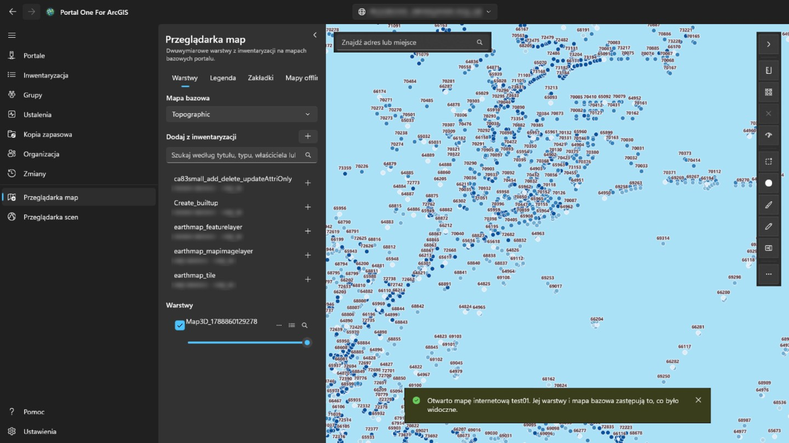

**Przeglądarka map** pokazuje dwuwymiarowe warstwy na mapach bazowych portalu; **przeglądarka scen** pokazuje je oraz trójwymiarowe — warstwy scen, siatki, chmury punktów, 3D Tiles — na globie z ukształtowaniem terenu. Panel po lewej przeszukuje to, co odczytano dla tego portalu — Twoją zawartość, odczytywaną automatycznie, to, co przeskanował administrator, i to, co odczytały karty strony Inwentaryzacja — i wymienia tylko to, co dana przeglądarka potrafi narysować. Wybierz element, aby go dodać. Mapa internetowa otwiera się w przeglądarce map, a scena internetowa w przeglądarce scen, w całości, z własnymi warstwami i mapą bazową. Na stronie Inwentaryzacja przycisk przeglądarki obok tytułu (również w menu kontekstowym wiersza) otwiera element w przeglądarce, która może go pokazać.

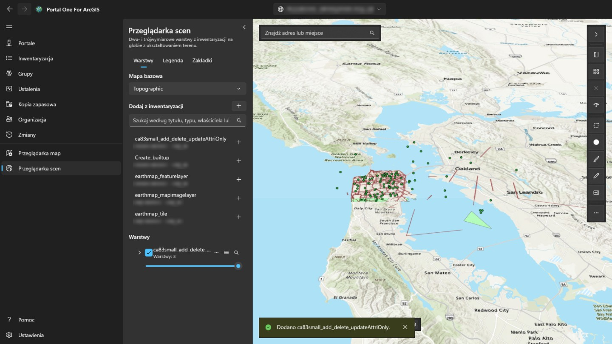

Przycisk w prawym górnym rogu panelu zwija go, oddając mapie lub scenie całą szerokość, i rozwija ponownie; po wejściu do przeglądarki panel jest zawsze rozwinięty. Każdą warstwę można pokazać lub ukryć, uczynić bardziej przezroczystą, przesunąć wyżej lub niżej, przybliżyć do niej albo usunąć. Kliknięcie obiektu na mapie pokazuje jego pola: jeśli warstwa ma w portalu skonfigurowane okno podręczne, to te, które ono wybrało, z jego etykietami i formatami; w przeciwnym razie wszystkie. Karta **Legenda**, obok karty **Warstwy**, pokazuje, co oznaczają symbole każdej widocznej warstwy. **Zakładki** pokazują miejsca zapisane z mapą internetową lub sceną internetową; nazwij tam bieżący widok, aby dodać własną, i wybierz zakładkę, aby do niej wrócić. Zakładka sceny zachowuje kierunek i nachylenie kamery. Przycisk tabeli przy warstwie z obiektami otwiera pod mapą jej **tabelę atrybutów**, po dwieście wierszy naraz, przefiltrowaną tak, jak warstwa jest rysowana; wybranie wiersza podświetla obiekt i przybliża do niego. **Eksportuj** zapisuje wszystkie wiersze tabeli z jej filtrami i sortowaniem, do 50 000, nie tylko wczytane: jako CSV tak, jak pokazuje je tabela, jako GeoJSON w szerokości i długości geograficznej albo jako spakowany shapefile w układzie współrzędnych warstwy (nazwy pól skrócone do dziesięciu znaków). Nagłówek kolumny sortuje według niej tabelę, filtruje ją (jak filtr warstwy, jeden warunek na kolumnę, wszystkie naraz) lub pokazuje jej statystyki: ile wierszy ma wartość, najmniejszą i największą, dla liczb sumę, średnią i odchylenie standardowe oraz najczęstsze wartości — ze wszystkich wierszy przechodzących przez filtry, nie tylko z wczytanych. **Tylko zaznaczone** zawęża tabelę do zaznaczonych wierszy. W przeglądarce map przyciski **Odległość** i **Powierzchnia** nad mapą mierzą to, co szkicujesz, klikając punkty: wzdłuż powierzchni Ziemi, a nie na płaskiej mapie, w jednostkach metrycznych lub imperialnych zgodnie z regionem Windows. W przeglądarce scen **Odległość** mierzy między dwoma kliknięciami na terenie lub modelu (w linii prostej, wzdłuż gruntu i pionowo), a **Powierzchnia** podąża za narożnikami na terenie. **Zapisz jako mapę internetową** tworzy nowy element mapy internetowej w Twojej zawartości, w wybranym folderze, z obecnie wyświetlaną mapą bazową, warstwami i zakładkami; otwiera się w bieżącym widoku mapy, a jej obraz służy za miniaturę. **Zapisz** nadpisuje mapę internetową otwartą z portalu, gdy jest Twoja lub możesz aktualizować cudze zasoby, po zachowaniu kopii na tym komputerze; przeglądarka scen nie może zapisywać. Pole wyszukiwania znajduje też adresy i miejsca przez geokoder portalu. **Eksportuj** zapisuje PNG widoku, a gdy portal ma usługę druku, **Drukuj** ją uruchamia. Warstwy czasowe otwierają pasek **Czas**, by przechodzić lub odtwarzać zakres. Warstwy zostają, gdy pracujesz na innych stronach, i zaczynają od nowa po przełączeniu na inny portal. Logowanie do portalu służy jego własnym warstwom i nigdy nie jest wysyłane na serwer innej organizacji, więc warstwa zarejestrowana gdzie indziej, która wymaga logowania, nie zostanie wczytana. Podczas pomiaru na mapie dwuklik, Enter lub **Zakończ** kończy szkic: zostaje on na mapie z wynikiem do następnego pomiaru albo do ✕ obok narzędzi. Esc anuluje szkic, a Ctrl+Z lub Backspace cofa ostatni punkt. Przycisk stylu przy warstwie z obiektami zmienia sposób jej rysowania: jeden symbol w wybranym kolorze i rozmiarze, kolor dla każdej wartości pola (**Kategorie**) albo klasy pola liczbowego wzdłuż gradientu kolorów (**Klasy**, według naturalnych przerw, równych przedziałów lub kwantyli). Mapa na bieżąco pokazuje zmiany; **Zastosuj** je zachowuje, **Anuluj** przywraca poprzedni wygląd, a **Przywróć oryginał** styl, z którym warstwa przyszła. Legenda też się aktualizuje, a zapisanie mapy jako mapy internetowej zachowuje styl. Przycisk **…** w tym samym wierszu otwiera też **Etykiety…**, aby pokazać wartość pola przy każdym obiekcie w wybranym rozmiarze i kolorze, z obwódką i od określonej skali, oraz **Filtr…**, aby pokazać tylko obiekty spełniające warunki złożone z pola, porównania i wartości, wszystkie lub dowolny; liczba pasujących jest liczona na bieżąco, filtr z mapy internetowej warstwy zostaje zachowany, a tabela atrybutów się do niego stosuje. W lewym dolnym rogu mapy kompas obraca się razem z mapą (wybierz go, aby wrócić na północ); obok podziałka mierzona w terenie, skala i współrzędne pod wskaźnikiem (wybierz je, aby skopiować lub przełączyć stopnie dziesiętne na stopnie, minuty, sekundy) oraz przycisk mapy przeglądowej, w której kliknięcie przesuwa mapę. **Zaznacz** wybiera obiekty wszystkich widocznych warstw w prostokącie, kształcie odręcznym lub wielokącie: panel podaje ich liczbę w każdej warstwie oraz sumę, średnią, minimum i maksimum pola liczbowego, a także pokazuje je w tabeli, przybliża do nich lub zapisuje jako CSV. **Bufor** rysuje obszar w zadanej odległości od zaznaczonych obiektów albo od punktu, linii lub obszaru, który narysujesz, mierzy go na powierzchni Ziemi na tym komputerze (bez usługi analiz i kredytów) i może zaznaczyć to, co obejmuje. **Przesuń** pokazuje warstwę po lewej stronie przeciąganego separatora, a mapę bez niej po prawej. **Sprawdź mapę** przegląda każdą warstwę i wskazuje, co zawiedzie lub wprowadzi w błąd osoby, którym mapę udostępniono: warstwy, które się nie wczytują, elementy usunięte lub udostępnione węziej niż mapa, usługi przez http lub spoza portalu, elementy przestarzałe lub innej organizacji, duże warstwy bez zakresu skali i brak okien podręcznych; raport można skopiować. Wskazuje też pola, do których odwołują się okno podręczne, symbolizacja lub etykiety warstwy, a których warstwa nie ma, i mierzy czas liczenia obiektów każdej warstwy usługi: powyżej 3 sekund to odnotowuje, powyżej 10 lub bez odpowiedzi w ciągu 30 jest to ostrzeżenie. W menu **…** warstwy **Używane przez…** odczytuje mapy i aplikacje z inwentarza i wymienia te, które jej używają, bezpośrednio lub przez mapę, a **Właściwości…** pokazuje jej źródło, właściciela, sposób rysowania oraz liczbę obiektów i pola. Pole wyszukiwania przyjmuje też współrzędne — dwie liczby dziesiętne w dowolnej kolejności, stopnie/minuty/sekundy, UTM lub MGRS — i przechodzi tam bez geokodera. **Eksportuj** może skopiować link otwierający mapę w przeglądarce portalu w tym miejscu albo współrzędne środka. Zapis w miejsce mapy internetowej zachowuje jej poprzednią definicję, a strona **Zmiany** może ją przywrócić z menu tego zapisu. Ustawienia warstwy w jej menu określają widoczny zakres skali, okna podręczne warstw obiektowych (symbole zastępcze tytułu, etykiety pól, widoczność i kolejność) oraz obsługiwane interwały odświeżania; podgląd jest na żywo, a zapis mapy internetowej zachowuje te ustawienia. Okno stylu może teraz rysować warstwy punktowe jako mapy cieplne, skalować symbole punktów lub szerokości linii według pola liczbowego oraz włączać klastry punktów z etykietami liczby; warstwy poligonowe zachowują dotychczasowe style kolorów. Menu Dodaj na karcie Warstwy może też dodać adres URL usługi albo plik lokalny: CSV i GeoJSON stają się osadzonymi kolekcjami obiektów przy zapisie, a shapefile oraz pliki KML lub KMZ pozostają lokalne i są wskazywane przed zapisem. Szkic dodaje zapisaną warstwę znaczników z punktami, liniami, obszarami, prostokątami, okręgami lub elipsami, kształtami odręcznymi i tekstem; wybierz obiekt szkicu, aby zmienić jego kształt, styl, usunąć go, cofnąć ostatni znak albo wyczyścić warstwę, a kolekcja obiektów szkicu jest zapisywana z mapą internetową. Narzędzie **Edytuj** w przeglądarce map pokazuje warstwy obiektowe usług dopuszczające edycję, wyjaśnia warstwy tylko do odczytu, pozwala narysować nowy obiekt z szablonu albo wybrać istniejący na mapie, sprawdza pola edytowalne i stosuje potwierdzone zmiany w usłudze obiektowej na żywo. W tabeli atrybutów edytowalnej warstwy zaznacz wiersze z klawiszem Ctrl lub Shift (Ctrl+A dla wszystkich wczytanych): **Edytuj** otwiera jeden z nich w formularzu edycji, a **Zmień pole** ustawia jedno pole na jedną wartość we wszystkich, po sprawdzeniu jej według reguł każdego obiektu.  **Zmień pole** może też użyć wyrażenia — nazwy pól w nawiasach kwadratowych, tekst w apostrofach, + - * / i kilku funkcji — tak aby każdy wybrany wiersz otrzymał własną wartość z innych pól.  W panelu Edycja **Narzędzia geometrii** umożliwiają **Wybierz na mapie**, **Scal** kształty, **Podziel** linie lub poligony linią cięcia, **Przytnij** do narysowanego obszaru lub **Kopiuj do warstwy** do innej edytowalnej warstwy tego samego rodzaju kształtu; każda operacja trafia na stronę **Zmiany**. Każda zmiana jest zapisywana na stronie **Zmiany**, zmiana pola jako jeden wpis, i stamtąd się ją cofa. Dla wybranego obiektu formularz edycji wymienia też jego załączniki, jeśli warstwa je przechowuje, do otwarcia, dodania lub usunięcia (usuwany plik jest najpierw kopiowany na ten komputer, a każda zmiana jest zapisywana na stronie **Zmiany**), i pokazuje powiązane z nim rekordy tylko do odczytu. Podczas rysowania lub zmiany kształtu obiektu jego wierzchołki przyciągają się do obiektów warstw zaznaczonych w sekcji **Przyciąganie** panelu edycji, a prowadnice geometrii podpowiadają kąty proste i równoległe; obie funkcje można wyłączyć i ustawić odległość przyciągania. Pomiar, szkic i pozostałe narzędzia nie przyciągają. **Udostępnij** obok **Zapisz jako mapę internetową** udostępnia wyświetlaną mapę lub scenę internetową tak, jak strona Inwentaryzacja udostępnia element, gdy to konto jest jej właścicielem lub może udostępniać cudzą zawartość: po wybraniu poziomu i grup mapa jest sprawdzana tak, jak zostałaby udostępniona, a to, co na tym poziomie zawiedzie lub wprowadzi w błąd, jest wymieniane, zanim udostępnienie nastąpi. **Szczegóły** edytują tytuł, podsumowanie, opis, tagi, podziękowania i warunki użytkowania elementu tak jak strona Inwentaryzacja, a także mogą użyć obrazu widoku jako miniatury i ustawić zasięg elementu, używany przez wyszukiwanie portalu, na widok; miejsce, w którym mapa się otwiera, ustala zapis w jej miejsce. Okno podręczne obiektu pokazuje też, w kolejności ustalonej przez autora, obrazy, wykresy i załączniki okna skonfigurowanego w portalu oraz powiązane rekordy; wyrażenia Arcade są obliczane wcześniej. Wykresy są rysowane w motywie aplikacji, obrazy wczytywane tylko z adresów https, a załącznik otwiera się kliknięciem. Gdy usługa zostanie przeniesiona lub zastąpiona, **Zastąp w mapach internetowych…** w menu **…** warstwy kieruje na nowy adres każdą mapę i scenę internetową z inwentarza, która jej używa (warstwy całej usługi zachowują swoje numery), po wymienieniu, co zmieni się w każdej; każda mapa jest przed zapisem zachowywana i zapisywana na stronie **Zmiany**, gdzie można ją porównać i przywrócić. Lista warstw pokazuje warstwy grupowe jako drzewo: rozwiń grupę, aby zarządzać jej warstwami, zmień nazwę dowolnej warstwy, utwórz nową grupę z wybranych warstw najwyższego poziomu, przenieś warstwę do grupy lub poza nią albo ponownie ją rozgrupuj. Przeglądarka map może narysować profil wysokości z linii, używając kafelkowego terenu zamiast usług analiz zużywających kredyty, oraz pozwala skopiować albo wyeksportować próbkowane odległości i wysokości. Warstwa obiektowa usługi może też otworzyć pod mapą wykres tylko do odczytu; używa statystyk usługi zamiast pobierać wszystkie obiekty, można go ograniczyć do widoku lub wyboru, eksportuje PNG albo CSV i nie jest zapisywany w mapie internetowej.  Plik CSV, GeoJSON lub shapefile dodany z komputera można opublikować z menu warstwy jako hostowaną warstwę obiektową: plik źródłowy zostanie przesłany, usługa utworzona w Twoich zasobach, a warstwa lokalna zastąpiona. KML i KMZ nie są oferowane, ponieważ portal nie publikuje ich jako usług obiektowych.  Okno stylu oferuje też typy z polem rozmiaru i mapy relacji z dwóch pól; ciągłe rampy kolorów, gęstość punktów i binning nie są pokazywane, bo ArcGIS Maps SDK for .NET 300.1 nie obsługuje ich tutaj bezpiecznie. Etykiety i pola okien podręcznych mogą też używać wyrażeń Arcade, z wstawianiem pól, typowymi fragmentami i testem na prawdziwym obiekcie przed zastosowaniem.  Edytowalne warstwy obiektowe mogą też mieć formularz zapisany w mapie internetowej: panel edycji respektuje jego grupy, reguły wymaganych pól i wartości obliczane, a polecenie **Formularz…** w menu warstwy edytuje ten formularz. Mapy internetowe portalu można przenieść offline z przeglądarki map: aplikacja sprawdza możliwości offline, pobiera wstępnie zaplanowany obszar albo bieżący widok do LocalState, otwiera go z karty Mapy offline, zapisuje edycje lokalnie i synchronizuje je jako jeden wpis Changes, gdy konto ma licencję Runtime Basic lub wyższą.  Analiza sieci w przeglądarce map dodaje trasy, obszary obsługi i najbliższe obiekty z usług portalu; ArcGIS Online zużywa kredyty.  Sekcje rekordów powiązanych odczytują także relacje przez tabele relacji w ukrytej mapie SDK, więc relacje wiele-do-wielu i relacje z atrybutami działają, gdy powiązanych tabel nie ma na mapie internetowej.  W scenach warstwy obiektowe można też wybierać kliknięciem, prostokątem rzutowanym na podłoże lub wyklikanym poligonem, buforować z wybranych obiektów albo z wyklikanego punktu, linii lub obszaru, przedstawiać na wykresach i edytować: atrybuty przez formularz warstwy, nowe obiekty i ponowne narysowanie całego kształtu z kliknięć, a także scalanie, kopiowanie, dzielenie i przycinanie; tylko zmiana kształtu wierzchołek po wierzchołku pozostaje w mapie, ponieważ SDK udostępnia edytor geometrii wyłącznie w MapView. Szkice w scenach (punkty, linie, poligony, prostokąty, elipsy i tekst stawiane kliknięciem) trwają tylko do końca sesji, bo scen internetowych nie można tu zapisać; rysowanie odręczne jest tylko w mapie. **Eksportuj szkic jako GeoJSON** w panelu Szkic zapisuje do pliku oznaczenia z obu przeglądarek. Sceny rysują też **Profil wysokości** wzdłuż wyklikanej linii, odczytany z własnego terenu sceny, jeśli go ma, a w przeciwnym razie z tego samego źródła co przeglądarka map; działa tam również panel **Sieć**: kliknięcia na podłożu stawiają przystanki, obiekty i incydenty, wyniki są nakładane na scenę, a trasa dodana jako warstwa trwa tylko do końca sesji.  Akcje scen także udostępniają, edytują szczegóły, kopiują linki lub środki, eksportują obrazy, sprawdzają warstwy, pokazują użycie i zastępują źródła; widżety sceny pokazują kierunek, współrzędne wskaźnika, przegląd i wysokość kamery, a lokalne mobilne pakiety scen otwierają się tylko do odczytu. **Porównanie** w scenie używa zsynchronizowanej, przyciętej kopii całej sceny; nawigacja pozostaje w scenie głównej, a separator porównuje ją z wybraną warstwą i bez niej.  Krótkie pole wyszukiwania miejsc pozostaje u góry po lewej; strzałka na prawym pasku narzędzi ukrywa lub przywraca oba elementy z animacją, a Więcej poleceń zawiera rzadziej używane polecenia elementu, kontroli, czasu i eksportu.

## Praca w tle

Zamknięcie okna chowa aplikację do obszaru powiadomień zamiast ją kończyć,
**żeby wielogodzinne skanowanie lub kopia nie ginęły od gestu, którym odsuwa się
okno**. Ikona mówi, co jest uruchomione, a **Zakończ** tam jest prawdziwym
wyjściem. Jego menu pozwala też dodać portal oraz sprawdzić aktualizację w Microsoft Store lub zainstalować znalezioną.

Po wyłączeniu ikony w obszarze powiadomień zamknięcie okna kończy aplikację —
bez ikony nie byłoby niczego, co by ją przywołało.

**Uruchamiaj z systemem Windows** startuje aplikację prosto do obszaru
powiadomień przy logowaniu, więc używane połączenie jest już zalogowane, gdy ją
otwierasz.

## Ustawienia

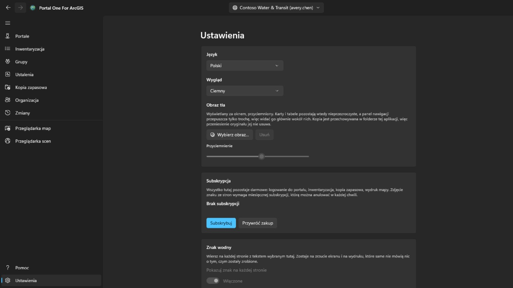

Jasny, ciemny albo taki jak w Windows; motyw zmienia się w chwili wyboru. Gdy w Microsoft Store jest nowsza wersja, w panelu nawigacji obok Ustawień pojawia się przycisk **Aktualizuj**; aplikacja zamyka się na czas instalacji, uruchamia ponownie w nowej wersji, a przycisk znika. Pod oknem można ustawić **obraz tła**; dopóki jest widoczny, karty i tabele pozostają nieprzezroczyste, a panel nawigacji przepuszcza tylko trochę, więc widać go głównie wokół nich, a **Przyciemnienie** określa, jak bardzo jest przyciemniony.

Interfejs jest dostępny w czternastu językach i podąża za Windows, o ile nie
przypniesz jednego. **Zmiana języka działa od następnego uruchomienia**,
proponowana tam przyciskiem, ponieważ platforma czyta tekst każdego ekranu raz,
gdy ten ekran powstaje: natychmiastowe zastosowanie zmieniłoby tylko to, co
otworzy się później.

**Subskrypcja** to właśnie to, co zdejmuje znak ze stron, i nic więcej się za nią nie kryje: logowanie do portalu, inwentaryzacja, kopia zapasowa i wydruk mapy pozostają darmowe, niezależnie od tego, czy zapłacono. To miesięczna subskrypcja kupowana przez Microsoft Store, którą można anulować w każdej chwili; gdy już istnieje, karta mówi, ile kosztuje i kiedy się odnawia. *Przywróć zakup* jest na wypadek, gdy zapłaciłeś, a znak wciąż jest: subskrypcja mogła zostać kupiona w oknie samego sklepu, o czym ta aplikacja nie wie.

**Znak wodny** kładzie własny wiersz w prawym dolnym rogu każdej strony: do dwudziestu czterech znaków, w czcionce, rozmiarze, grubości, kolorze i mocy wybranych pod **Więcej ustawień** — sama karta nie pokazuje niczego poza przełącznikiem, który go włącza. Zaczyna jako trzydzieści pikseli mocnej czerwieni w pełnej mocy i co sześć minut przez minutę chodzi po stronie: pięć minut w rogu, minuta w drodze, potem z powrotem w róg. Chodzi, bo kto robi zdjęcie okna, ten decyduje, gdzie będą jego krawędzie, a róg najłatwiej zostawić poza kadrem; odpoczywa, bo na stronie, nad którą się pracuje, nie powinien biec wiersz w poprzek jej wierszy — przełącznik, który zatrzymuje go całkiem, jest pod **Więcej ustawień**. Jest włączony, gdy trafisz tu pierwszy raz, i czyta się *Brak subskrypcji* — to, co opuszcza aplikację, ogląda się gdzieś, gdzie nic nie mówi, czym zostało zrobione. **Moc** to, ile z tego koloru zostaje użyte: na samym dole każdy kolor wychodzi taką samą bladą mgiełką, więc sam kolor nie odpowiada na pytanie, jak bardzo to widać. Pusty wraca do wartości domyślnej. Dopóki nie wykupisz subskrypcji, na tej karcie nie da się nic zmienić — ani przełącznika, ani treści: czyta się *Brak subskrypcji*, a naciśnięcie otwiera kartę wyżej; to subskrypcja pozwala go wyłączyć i wybrać, co mówi; bez wyboru pisze nazwę aplikacji. Oznaczany jest ekran: obrazy, które aplikacja zapisuje, przychodzą z serwisu drukowania portalu i wychodzą tak, jak portal je przysłał.

## Klawiatura

W dowolnej z tabel:

- **Ctrl+F** ustawia kursor w polu filtra.
- **Ctrl+E** eksportuje pokazywane wiersze, z kolumnami i porządkiem, które masz przed sobą.

## Gdzie co leży

- Kopie trafiają do wybranego przez ciebie folderu — zwykłego folderu, który
  można otworzyć, skopiować i przenieść.
- Połączenia, preferencje i rejestr zmian są w magazynie samej aplikacji,
  zaszyfrowane tam, gdzie są poświadczeniami.
- Wyeksportowane pliki CSV leżą tam, gdzie je zapiszesz.

Nic nie jest nigdzie wysyłane. **Nie ma konta u twórców tego narzędzia ani
telemetrii.**

## Kontakt

Coś nie działa albo nie robi tego, czego się spodziewałeś: **gaqo@outlook.com**.

Najbardziej pomaga: co robiłeś, co się zamiast tego stało, czy portal to ArcGIS Online czy ArcGIS Enterprise i w jakiej wersji — strona Połączenia pokazuje jedno i drugie — oraz w jakim języku był interfejs.

Proszę nie załączać haseł, tokenów ani plików z folderu danych aplikacji. Trzymana jest tam zalogowana sesja, a nic z tego nie jest potrzebne, żeby odpowiedzieć na pytanie.
