# Ajuda

O **Portal One For ArcGIS** audita e mantém uma organização do ArcGIS a partir do seu próprio computador. Funciona da mesma forma com o **ArcGIS Online** e com o **ArcGIS Enterprise**.

Por que o nome: o ArcGIS Online e o ArcGIS Enterprise são, no fundo, portais; por isso, a palavra **Portal** cobre ambos — e é também como este app os chama na página **Portais**, onde você os adiciona. **One** é o app: um só lugar para cada portal com que você trabalha, vários deles com sessão aberta ao mesmo tempo. **For ArcGIS** diz para qual plataforma ele foi criado.

Este app conversa com os portais em que você entra, com os serviços de mapas, mapas base e dados de elevação para os quais o conteúdo deles aponta, com seu site de ajuda, de onde esta página lê a ajuda mais recente — quando o site não pode ser acessado, ela mostra a ajuda instalada com o app — e com a Microsoft Store, para atualizações e a assinatura. Suas credenciais são criptografadas para a sua conta do Windows e enviadas somente ao portal ao qual pertencem.

## A ordem das páginas é a ordem do trabalho

Ler, fazer backup, simular, executar. Cada página torna a seguinte segura, e a
navegação está disposta de modo que descê-la seja o caminho seguro.

## Conexões

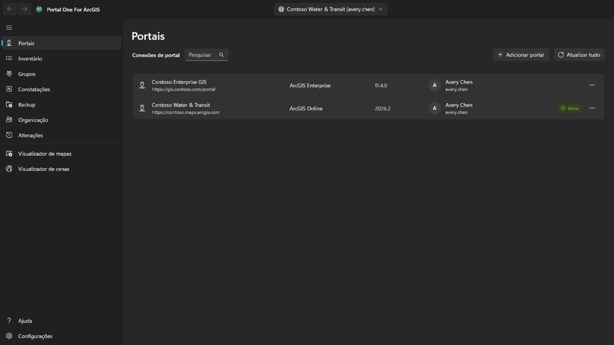

Adicione uma conexão com o endereço do portal: para o ArcGIS Online,
`https://suaorg.maps.arcgis.com`; para o ArcGIS Enterprise, o endereço completo
incluindo o caminho de contexto, como `https://portal.example.com/portal`. Nada
precisa ser registrado no portal antes. Se o portal estiver atrás de um proxy com identidade, como o proxy de aplicativo do Microsoft Entra ou o Google Cloud IAP, marque **O portal exige autenticação de proxy com identidade**: uma janela se abre para entrar no proxy antes de o portal ser lido, fecha-se sozinha quando o portal responde e abre de novo sempre que a sessão do proxy termina; o que estava em andamento continua.

Entre com usuário e senha, ou pela própria página de entrada do portal exibida
dentro do aplicativo. **Use a segunda se a sua organização usa logon único ou
autenticação multifator**: assim nenhuma senha é digitada neste aplicativo.

Várias conexões podem estar ativas ao mesmo tempo, inclusive duas contas do
mesmo portal. **Manter conectado** guarda a credencial criptografada para a sua
conta do Windows, de modo que a conexão sobrevive a um reinício.

Só a conexão para a qual você está apontando é renovada. As demais são
desconectadas quando o token expira e voltam em silêncio quando você troca.

Uma conexão em que você entrou mostra a foto de perfil da conta, ou as iniciais quando não há foto. Selecione-a para **Meu perfil**, **Minhas configurações** ou **Ajuda**. **Ajuda** abre esta ajuda no site de ajuda, no seu navegador e no idioma que o app está mostrando; sem rede, abre a página **Ajuda** do app. **Meu perfil** mostra a conta como a página de perfil do portal mostra: foto, nome, biografia, grupos e os itens que ela compartilha com a organização ou com todos; **Editar perfil** altera os nomes, a biografia, a visibilidade do perfil e a foto. **Minhas configurações** tem as seções do portal: **Geral** (endereço de e-mail, página inicial, idioma, formato de número e data, unidades), **Segurança** (senha e pergunta de segurança, para um login do ArcGIS), **Licenças**, **Créditos**, onde a organização os aloca, e os **Webhooks** pertencentes à conta. Cada alteração informa o que será gravado, é relida do portal e é registrada na página **Alterações**, que pode restaurar alterações de perfil, configurações, página inicial, foto e webhooks; uma nova senha, uma pergunta de segurança e um webhook excluído são apenas registrados. Autenticação multifator, chaves de segurança, códigos de recuperação, contas vinculadas e preferências de e-mail da Esri são apenas mostrados ou explicados: eles são gerenciados no site do ArcGIS. Depois de uma alteração de senha, ou sempre que o portal deixa de aceitar a conexão, a página **Portais** abre com a entrada dela para que você possa entrar novamente com a nova senha.

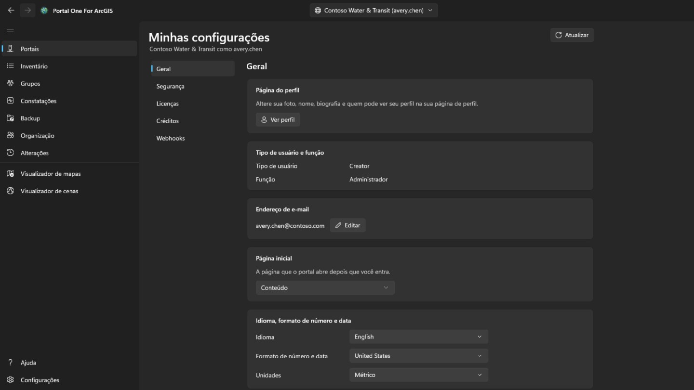

## Inventário

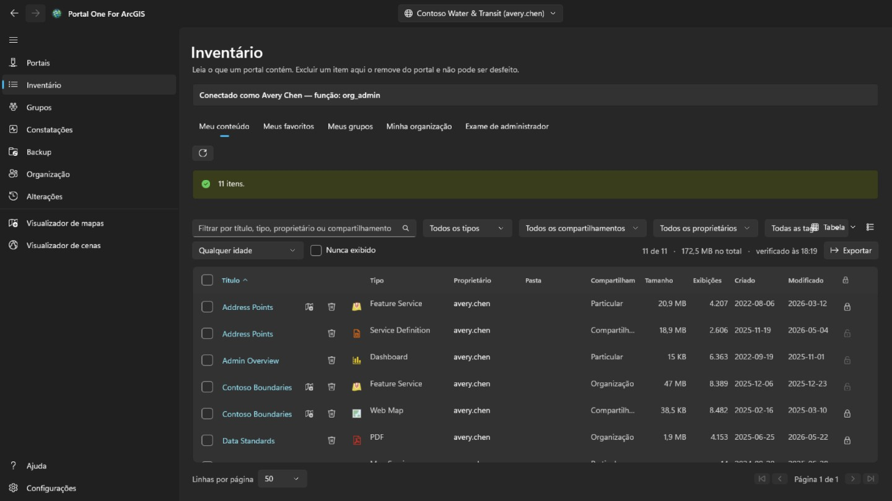

Mostra o que sua conta pode ver, em quatro guias como na página de conteúdo do portal: **Meu conteúdo**, **Meus favoritos**, **Meus grupos** (todos juntos ou um só, incluindo grupos que você vê sem ser membro) e **Minha organização** (o que a organização compartilha). São lidas assim que a página abre e mantidas; o botão ao lado lê de novo a guia mostrada. O menu de contexto de uma linha segue o tipo do item: um mapa da Web também pode abrir no Map Viewer do portal, no Field Maps Designer ou no ArcGIS Pro, um painel no Dashboards, uma história no ArcGIS StoryMaps; um arquivo pode ser baixado; e qualquer item pode ser adicionado aos favoritos ou removido deles. **Comparar com outro mapa…** em um mapa da web ou cena da web lê esse mapa e outro escolhido do mesmo tipo como estão agora no portal e lista o que difere: camadas adicionadas, removidas, movidas ou renomeadas, filtros, simbologia, rótulos e pop-ups alterados, o mapa base, os marcadores e a exibição inicial; a lista pode ser copiada. **Fazer uma cópia…** copia o mapa para o seu conteúdo neste portal ou em outro conectado, com um novo título, em uma pasta ou entregue a outro membro; a cópia é privada e, em outro portal, o item de cada camada é procurado primeiro, e uma camada cujo item não está lá é carregada pelo endereço, o que é mostrado antes de qualquer gravação. O menu de exibição, no canto superior direito, mostra as linhas como **Tabela**, como **Lista** com a miniatura e o resumo de cada item ou como **Grade** de cartões, como a página de conteúdo do portal, e as classifica; filtros, paginação e linhas marcadas continuam os mesmos nas três. Em **Meus favoritos**, **Meus grupos** e **Minha organização**, a pasta, o tamanho e a proteção aparecem logo após a página: uma pesquisa não os retorna, então cada item é lido, primeiro a página visível. A pasta só aparece para os seus próprios itens, ou para os de todos se você for administrador. O título de um item, na tabela, na lista e na grade, abre a página do item em uma janela própria, organizada como a do portal: em **Visão geral**, o cartão do item com miniatura, tipo, datas e resumo, depois sua **Descrição**, o que ele contém conforme seu tipo (as **Camadas** e tabelas de um serviço, as camadas de um mapa, as tarefas de um serviço de geoprocessamento), seus **Termos de uso** e seus **Comentários**, onde um comentário pode ser deixado; ao lado, **Abrir no visualizador de mapas**, **Abrir no visualizador de cenas**, **Compartilhar…** e **Abrir no ArcGIS Pro**, com o restante atrás de um chevron, o **Proprietário**, os **Detalhes** com a origem do item e a URL para copiar ou abrir, uma barra que mostra quanto suas informações estão completas com a mudança que mais ajudaria, e suas **Tags**, **Compartilhamento**, **Pasta** e **Agradecimentos**, cada um com a ação que o altera; depois as guias **Dados**, **Visualização** e **Configurações** que seu tipo tiver. **Configurações** segue o portal: **Geral** para todo item (status do conteúdo, proteção contra exclusão e exclusão do item, a extensão usada por pesquisas), a seção própria do item — para uma camada de feição hospedada, edição, rastreamento do editor, sincronização, exportação e curvas verdadeiras, salvos juntos com **Salvar**; para um mapa ou cena da web, seu modo offline; para outras camadas, as configurações do serviço como ele as informa — e os webhooks de uma camada de feição hospedada; cada alteração é confirmada quando remove algo, relida do portal e registrada na página **Alterações**, que pode restaurá-la.

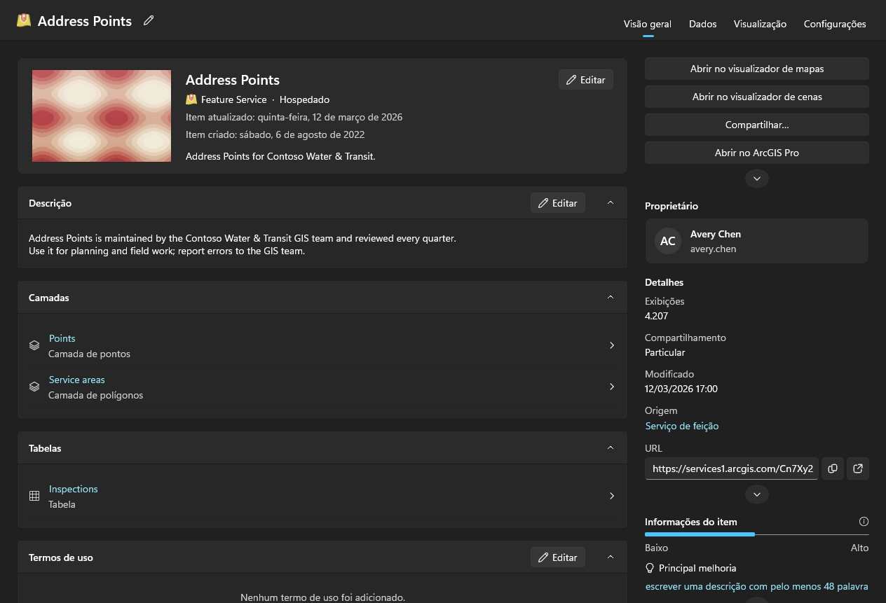

Examinar o conteúdo de outras pessoas é trabalho de administrador. Uma conta que pode ler o que outros membros possuem (portal:admin:viewItems) tem a guia **Exame de administrador** nesta página e um exame nas páginas Constatações e Backup — um membro, um grupo ou a organização inteira — e a guia **Transferência** da página **Organização**; as demais contas não os veem. O percurso da organização pede a cada membro o seu conteúdo em vez de pesquisar, porque a pesquisa só devolve o que foi compartilhado e uma auditoria não pode perder itens privados. Leva um tempo e pode ser cancelado.

Constatações, Backup e os visualizadores leem seu próprio conteúdo sozinhos na primeira vez que precisam, sem que seja preciso visitar outra página antes; o exame de um administrador o substitui pelo que foi examinado. Cada tabela diz quando sua lista foi lida. Um portal continua mudando depois de lido.

Cada linha também traz um botão de excluir, e é a única coisa neste aplicativo que não pode ser desfeita: o ArcGIS não tem lixeira. A confirmação nomeia o item, seu tipo e seu dono, e diz se a pasta de backup lembrada para esta conexão tem uma cópia e de quando ela é. Ela não recusa sem uma, mas essa linha é a única coisa que poderia responder pela exclusão depois. Um item protegido contra exclusão no portal é recusado aqui em vez de ter a proteção removida em silêncio. Para mudar a própria proteção, use o cadeado no fim da linha ou o menu da linha: é uma etapa à parte, removê-la pede confirmação antes, e cada mudança é lida de volta do portal e gravada no registro. Marque a caixa no início de uma linha — ou a do cabeçalho, para todas as linhas que os filtros mostram em todas as páginas — para agir sobre vários itens de uma vez. **Compartilhar** define o nível de compartilhamento e os grupos; **Tags** adiciona e remove tags e mantém as demais; **Mover** coloca os itens de um proprietário em uma das pastas dele; **Alterar proprietário** os transfere para outro membro, como a guia **Transferência** da página **Organização**, e a página **Alterações** os devolve; **Excluir** os remove após uma confirmação que diz quantos, de quem e quantos estão no backup, e pede que você marque que entendeu. Itens que esta conta não pode alterar e os protegidos contra exclusão ficam intocados e são contados. Os itens são processados um de cada vez e registrados; **Cancelar** para entre dois deles, e o resumo diz o que falhou e por quê. No menu de contexto de uma linha, **Compartilhar…** altera o nível e os grupos desse item, e **Editar detalhes…** o título, resumo, descrição, tags, créditos e termos de uso. Ambos abrem o item como o portal o tem agora, enviam só o que você mudou, conferem o resultado e são registrados.

## Constatações

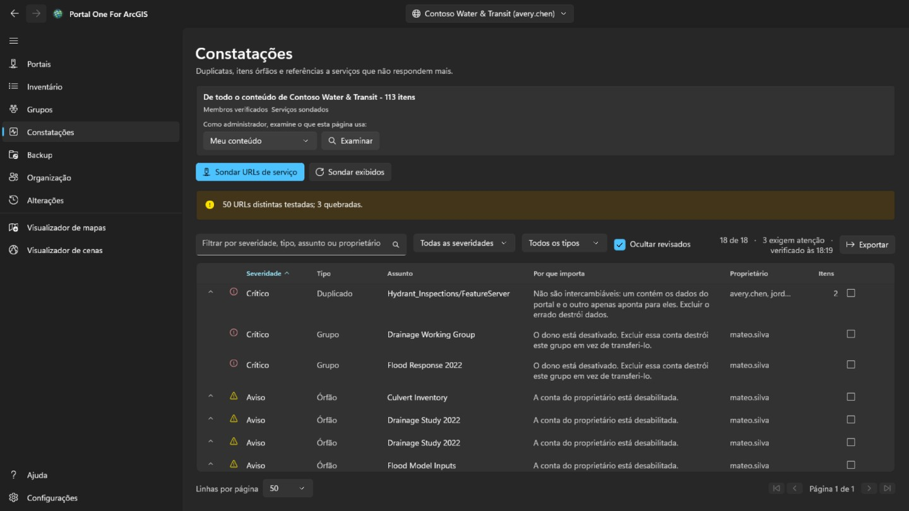

Conteúdo redundante e morto, ordenado pela atenção que merece e não pelo quanto
soa grave.

- **Crítico** significa que agir sem cuidado aqui destrói algo que não existe em
  nenhum outro lugar: dois itens apontando para o mesmo serviço, em que excluir
  o errado não tem volta.
- **Aviso** é um problema real e seguro de tratar: um item cujo dono saiu, um
  serviço que não responde mais.
- **Informativo** vale saber e pode acabar não sendo nada.
- **Inconclusivo** significa que não foi possível determinar. **Um serviço que
  estourou o tempo não é um serviço que sumiu**, e esta ferramenta não dirá que
  é.

Abra uma linha para ver os itens que ela representa. Marque como revisada quando
tiver decidido que está tudo bem; a decisão é lembrada por conexão e a linha
continua visível em vez de sumir.

Esta página relata. **Ela não diz qual de dois itens parecidos manter**, porque
isso depende de quem os usa e do que aponta para eles.

## Backup

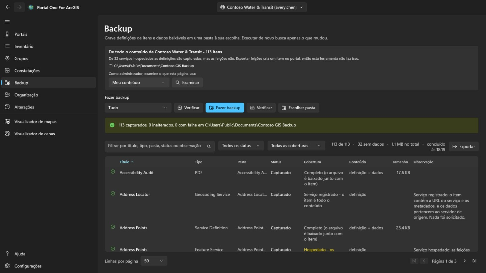

Grava definições de itens, recursos e dados baixáveis em uma pasta que você
escolhe. Executar de novo sobre a mesma pasta só busca o que mudou, então
**retomar um backup interrompido e fazer um backup incremental são a mesma
coisa**.

- **Verificar estado** compara a pasta com o portal e informa o que *faria*, sem
  gravar nada. É como responder "meu backup está em dia?" sem gastar horas.
- **Conferir** compara a pasta com o próprio registro dela, sem portal nenhum.
  **Essa é a pergunta que sobra quando o portal já não existe, que costuma ser
  justamente quando alguém abre um backup para valer.**

A pasta é lembrada por conexão, e uma pasta que contém o backup de outra
organização é recusada em vez de sobrescrita.

**O que um backup não contém.** As feições dentro de um serviço hospedado ficam
no armazenamento de dados do portal, não no item, e tirá-las de lá exige uma
exportação que cria um item novo no portal — uma escrita. Esta ferramenta não
faz isso, então essas linhas são capturadas como definição sem dados, e a página
diz quantas são. Serviços registrados de outro servidor são ponteiros por
natureza e não têm mais nada a capturar.

## Desligamento

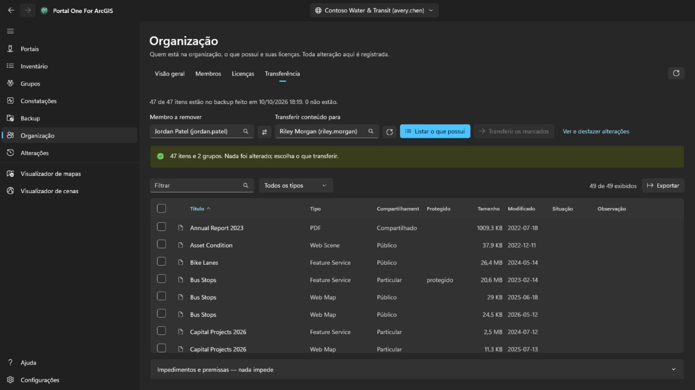

Esta é a guia **Transferência** da página **Organização**, mostrada apenas a contas que administram conteúdo (portal:admin:viewItems). Ela calcula o que remover um membro envolve e move o conteúdo dele, uma coisa de cada vez e de modo reversível.

Escolha nas listas o membro e quem recebe o conteúdo dele: ambos vêm do próprio
diretório da organização, então **um nome não pode ser digitado errado e cair em
outro que existe de verdade**. **Listar o que possui** não muda nada: mostra
cada item e cada grupo, e você marca o que deve ir.

Nada vem marcado. Mover uma conta inteira é um clique na caixa do cabeçalho, e
**esse clique é uma decisão, não um padrão**.

- Grupos ficam de propósito na mesma tabela que os itens. Ao excluir um membro,
  o portal **destrói** os grupos que ele ainda possui em vez de transferi-los,
  então um grupo não marcado é **a única coisa silenciosamente destrutiva desta
  página**, e a linha de contagem diz isso.
- A confirmação lista as pastas do destinatário e permite adicionar uma nova; os itens caem na escolhida. Cada transferência é escrita no registro antes que a próxima comece, e a página **Alterações** coloca cada item de volta na pasta de onde veio, recriando uma pasta que desapareceu, um por vez ou todos os pendentes de uma vez.
- Mover um item pode levar outros com ele. Transferir um shapefile leva o serviço hospedado publicado a partir dele, então uma linha pode informar que ele chegou sem que esta transferência o tenha enviado. Reverter só essa linha na página **Alterações** não o trará de volta; ele volta com aquilo que o carregou.
- Depois de cada movimento o item é lido de volta do portal. **Uma requisição
  que retorna sucesso é uma afirmação sobre a requisição, não sobre onde o item
  está agora.**

A própria conta do membro é excluída na página **Organização**, e só depois que ele não possui mais nada. **É o único passo que não pode ser desfeito.**

## Organização

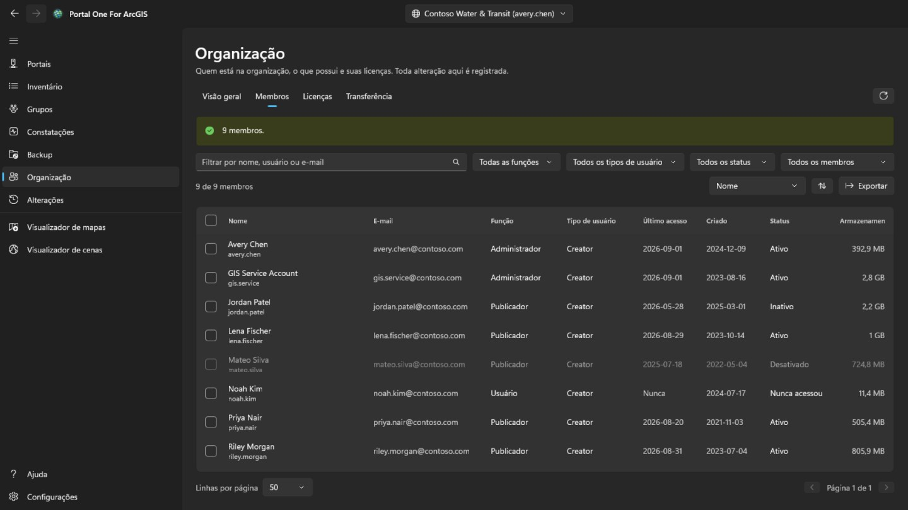

Todo membro vê esta página, como no portal. **Visão geral**, que também informa os contatos administrativos da organização, é para todos, e com o privilégio de ver membros também uma guia **Membros** somente leitura, sem e-mail, entradas, status nem armazenamento. Marcar membros, **Exportar**, **Licenças** e qualquer alteração são só para contas que administram membros (portal:admin:viewUsers). **Visão geral** resume a organização: no ArcGIS Online, a assinatura, as vagas e os créditos; os membros por status, função e tipo de usuário; e quanto conteúdo e armazenamento ela ocupa.

**Membros** lista todos da organização, filtrados por nome, função, tipo de usuário, status ou grupo, ordenados por qualquer coluna e salvos em um arquivo CSV com **Exportar**. Marque membros para desativá-los ou ativá-los, alterar a função ou o tipo de usuário, removê-los dos grupos ou excluí-los; com um só marcado, **Saída** abre a guia **Transferência** desta página. Sua própria conta nunca é alterada, e o proprietário de um grupo continua nele.

Clique com o botão direito em um membro para abrir o menu dele. **Visualizar** mostra o **Perfil**, os **Itens** e, para um administrador, os **Grupos**, aqui no aplicativo e não no portal; um membro comum vê só os itens compartilhados com ele. **Gerenciar** é para administradores, cada opção só com o privilégio que exige: **Licenças complementares** define quais direitos o membro tem, **Editar endereço de e-mail** o altera para contas que entram com ArcGIS, **Transferir conteúdo** abre a guia **Transferência** com ele, e **Transferir membro** dá a outro membro o tipo de usuário, a função e as licenças complementares dele e depois continua na guia **Transferência** com o conteúdo e os grupos. O mesmo menu altera o tipo de usuário, a função, os grupos, o status ou a conta de um membro, como a barra faz para vários.

**Excluir** só remove membros que não possuem itens nem grupos. O ArcGIS não os repassa quando uma conta é excluída, então mova-os antes na guia **Transferência**. Antes de qualquer coisa, você digita o nome de usuário ou, para vários membros, quantos são. A exclusão não pode ser desfeita.

**Licenças** mostra quantos de cada tipo de usuário estão atribuídos e, no ArcGIS Online, quantos a assinatura tem; **Mostrar membros** lista quem tem esse tipo. Escolha uma licença complementar para ver quem a possui e revogue-a dos membros marcados.

Cada alteração é lida de volta do portal e registrada com o que havia antes, e aparece na página **Alterações**. Essas alterações de membros não são desfeitas dali: para reverter uma, faça a alteração oposta.

## Alterações

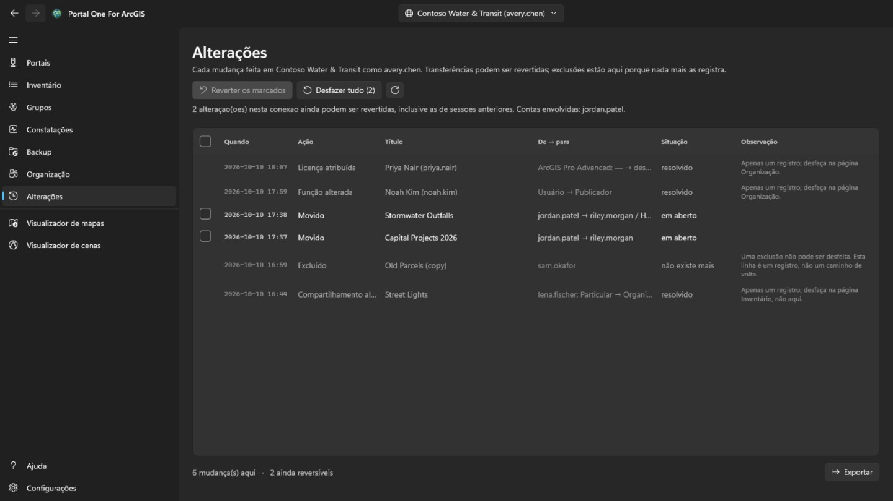

A página **Alterações** é mostrada a toda conta conectada. Ela lista, da mais recente para trás, tudo que esta ferramenta alterou no portal selecionado agora: transferências, exclusões, compartilhamento, tags, pastas, detalhes, proteção e alterações de membros. Alterações feitas em outros portais são contadas, não listadas. A lista pode ser exportada para CSV.

As transferências que podem ser devolvidas têm uma caixa. **Reverter os marcados** devolve as transferências marcadas, e **Desfazer tudo** devolve tudo que ainda está pendente nesta conexão depois de uma confirmação que diz de quem é o conteúdo. Os itens voltam às pastas de onde vieram, recriando uma pasta que desapareceu. Exclusões e alterações de membros são apenas um registro: uma exclusão não pode ser desfeita, e uma alteração de membro é revertida fazendo a alteração oposta. Desfazer uma transferência é também uma transferência e exige o mesmo privilégio (portal:admin:reassignItems, ou reassignGroups para um grupo); uma conta sem ele vê apenas o registro.

Um mapa da web salvo por cima a partir do visualizador de mapas, e uma feição adicionada, editada ou excluída ali, são desfeitos pelo menu da sua linha. Uma edição de feição só é desfeita enquanto a feição continua como a edição a deixou: uma feição adicionada é excluída, uma editada volta aos valores e à forma anteriores, e uma excluída é adicionada de novo com um novo ID de objeto. Desfazer também fica registrado, e pode ser desfeito da mesma forma. Antes de restaurar um mapa da web, **Comparar com o mapa atual** no mesmo menu lista o que difere entre a cópia guardada antes daquele salvamento e o mapa como o portal o tem agora: o mapa base, camadas adicionadas, removidas, renomeadas ou movidas, e de cada camada a visibilidade, a opacidade, o estilo, os rótulos, o filtro, o intervalo de escala, o pop-up e a atualização, as tabelas, os favoritos e onde o mapa abre.

## Visualizador de mapas e visualizador de cenas

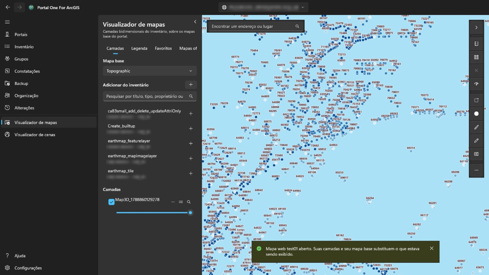

O **visualizador de mapas** mostra camadas bidimensionais sobre os mapas base do portal; o **visualizador de cenas** mostra essas e as tridimensionais — camadas de cena, malhas, nuvens de pontos, 3D Tiles — sobre um globo com relevo. O painel à esquerda pesquisa no que foi lido deste portal — seu próprio conteúdo, lido automaticamente, o que um administrador examinou e o que as guias da página Inventário leram — e só lista o que aquele visualizador pode desenhar. Escolha um item para adicioná-lo. Um mapa web abre no visualizador de mapas e uma cena web no visualizador de cenas, inteiros, com suas próprias camadas e mapa base. Na página Inventário, o botão de visualizador ao lado de um título (também no menu de contexto da linha) abre o item no visualizador que pode mostrá-lo.

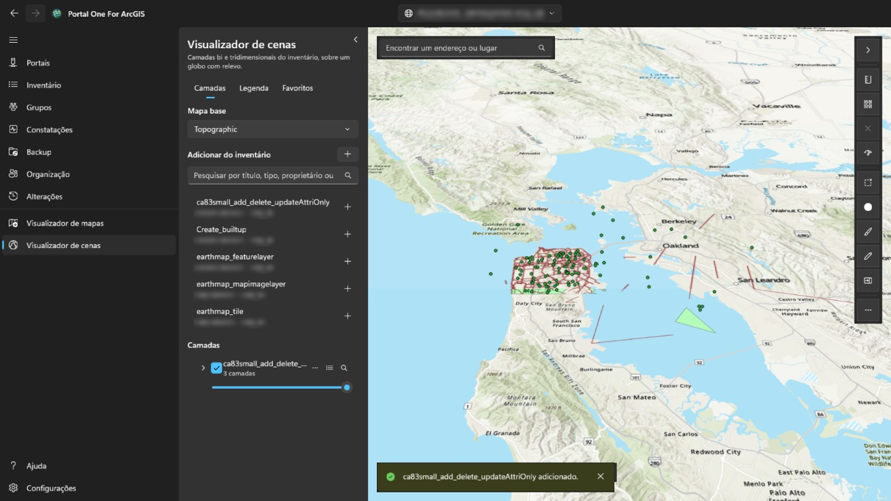

O botão no canto superior direito do painel o recolhe, deixando toda a largura para o mapa ou a cena, e o abre de novo; ao entrar no visualizador, ele está sempre aberto. Cada camada pode ser mostrada ou ocultada, ficar mais transparente, subir ou descer, receber zoom ou ser removida. Clicar em uma feição do mapa mostra seus campos: se a camada tiver um pop-up configurado no portal, os que ele escolheu, com os rótulos e formatos dele; senão, todos. A guia **Legenda**, ao lado de **Camadas**, mostra o que significam os símbolos de cada camada visível. **Favoritos** lista os lugares salvos com um mapa da Web ou uma cena da Web; dê um nome à vista atual ali para adicionar os seus e escolha um para voltar a ele. Um favorito de cena mantém a direção e a inclinação da câmera. O botão de tabela de uma camada com feições abre sua **tabela de atributos** abaixo do mapa, duzentas linhas por vez, filtrada como a camada é desenhada; escolher uma linha destaca a feição e aplica zoom nela. **Exportar** grava todas as linhas que a tabela tem com seus filtros e sua ordem, até 50.000, não só as carregadas: como CSV do jeito que a tabela mostra, como GeoJSON em latitude e longitude ou como shapefile compactado no sistema de coordenadas da camada (nomes de campo cortados em dez caracteres). O cabeçalho de uma coluna ordena a tabela por ela, filtra-a (como o filtro da camada, uma condição por coluna, todas aplicadas) ou mostra suas estatísticas: quantas linhas têm valor, o menor e o maior, para números o total, a média e o desvio padrão, e os valores mais frequentes, sobre todas as linhas que passam pelos filtros e não só as carregadas. **Somente selecionados** restringe a tabela às linhas selecionadas. No visualizador de mapas, **Distância** e **Área**, sobre o mapa, medem o que você desenha clicando em pontos: ao longo da superfície da Terra, não no mapa plano, em unidades métricas ou imperiais conforme a região do Windows. No visualizador de cenas, **Distância** mede entre dois cliques no terreno ou em um modelo (direta, ao longo do solo e vertical) e **Área** segue cantos sobre o terreno. **Salvar como mapa da Web** cria um novo item de mapa da Web no seu próprio conteúdo, na pasta que você escolher, com o mapa base, as camadas e os favoritos mostrados agora; abre onde o mapa está agora e tem uma imagem dele como miniatura. **Salvar** substitui um mapa da Web aberto no portal quando é seu ou você pode atualizar conteúdo de outros, após guardar uma cópia neste computador; o visualizador de cenas não pode salvar. A caixa de pesquisa também encontra endereços e lugares com o geocodificador do portal. **Exportar** salva um PNG da vista e, quando o portal lista um serviço de impressão, **Imprimir** o executa. Camadas temporais abrem uma barra **Tempo** para percorrer ou reproduzir o intervalo. As camadas continuam ali enquanto você trabalha em outras páginas e recomeçam ao trocar de portal. O login do portal é usado para as camadas dele e nunca enviado ao servidor de outra organização, então uma camada registrada em outro lugar que peça login não será carregada. Ao medir no mapa, clique duas vezes, pressione Enter ou escolha **Concluir** para terminar o esboço: ele fica no mapa com o resultado até a próxima medição ou até o ✕ ao lado das ferramentas. Esc cancela o esboço, e Ctrl+Z ou Backspace desfaz o último ponto. O botão de estilo de uma camada com feições muda como ela é desenhada: um símbolo na cor e no tamanho que você escolher, uma cor para cada valor de um campo (**Categorias**) ou classes de um campo numérico ao longo de uma rampa de cores (**Classes**, por quebras naturais, intervalo igual ou quantil). O mapa acompanha cada alteração; **Aplicar** a mantém, **Cancelar** devolve o que era desenhado e **Restaurar original** o estilo com que a camada veio. A legenda também acompanha, e salvar o mapa como mapa da web mantém o estilo. O botão **…** da mesma linha também abre **Rótulos…**, para mostrar o valor de um campo em cada feição no tamanho e na cor que você escolher, com halo e a partir de uma escala, e **Filtro…**, para mostrar só as feições que atendem a condições feitas de um campo, uma comparação e um valor, todas ou qualquer uma; conta as correspondências enquanto você edita, mantém o filtro que a camada traz do mapa da web e a tabela de atributos o acompanha. No canto inferior esquerdo do mapa, uma bússola gira com o mapa (selecione-a para voltar ao norte); ao lado, uma barra de escala medida no terreno, a escala e as coordenadas sob o ponteiro (selecione-as para copiar ou alternar entre graus decimais e graus, minutos e segundos), e um botão que mostra um mapa de visão geral onde um clique move o mapa. **Selecionar** escolhe as feições de todas as camadas visíveis dentro de um retângulo, uma forma à mão livre ou um polígono: um painel mostra quantas há em cada camada e o total, a média, o mínimo e o máximo de um campo numérico, e as mostra na tabela, aproxima delas ou as salva como CSV. **Buffer** desenha a área a uma distância das feições selecionadas ou de um ponto, linha ou área que você desenhar, mede-a sobre a superfície terrestre neste computador (sem serviço de análise nem créditos) e pode selecionar o que ela cobre. **Deslizar** mostra uma camada à esquerda de um divisor que você arrasta e o mapa sem ela à direita. **Verificar mapa** examina cada camada e aponta o que falharia ou enganaria quem tem acesso ao mapa: camadas que não carregam, itens que sumiram ou estão compartilhados com menos gente que o mapa, serviços em http ou fora do portal, itens obsoletos ou de outra organização, camadas grandes sem intervalo de escala e nenhum pop-up; o relatório pode ser copiado. Também aponta os campos citados pelo pop-up, pela simbologia ou pelos rótulos de uma camada que a camada não tem, e cronometra a contagem das feições de cada camada de serviço: acima de 3 segundos isso é anotado; acima de 10, ou sem resposta em 30, é um aviso. No menu **…** de uma camada, **Usado por…** lê os mapas e aplicativos do inventário e lista os que usam a camada, diretamente ou por um mapa, e **Propriedades…** mostra origem, proprietário, desenho e, para feições, quantidade e campos. A caixa de pesquisa também aceita coordenadas — dois números decimais em qualquer ordem, graus/minutos/segundos, UTM ou MGRS — e vai até lá sem geocodificador. **Exportar** pode copiar um link que abre o mapa da web no visualizador do portal neste local, ou as coordenadas do centro. Salvar sobre um mapa da web guarda a definição anterior, e a página **Alterações** pode restaurá-la pelo menu daquele salvamento. As configurações da camada no menu da camada definem o intervalo de escala visível, os pop-ups da camada de feição (espaços reservados do título, rótulos, visibilidade e ordem dos campos) e os intervalos de atualização compatíveis; a prévia é ao vivo e salvar o mapa da web preserva tudo. A caixa de diálogo de estilo agora pode desenhar camadas de pontos como mapas de calor, dimensionar símbolos de ponto ou larguras de linha por um campo numérico e ativar clusters de pontos com rótulos de contagem; camadas de polígonos mantêm os estilos de cor existentes. O menu Adicionar na guia Camadas também pode adicionar uma URL de serviço ou um arquivo local: CSV e GeoJSON viram coleções de feições incorporadas ao salvar, enquanto shapefiles e arquivos KML ou KMZ permanecem locais e são destacados antes de salvar. Esboço adiciona uma camada de marcação salva com pontos, linhas, áreas, retângulos, círculos ou elipses, formas à mão livre e texto; selecione uma feição de esboço para remodelar, alterar o estilo, excluir, desfazer a última marca ou limpar a camada, e a coleção de feições de esboço é salva com o mapa web. A ferramenta **Editar** do visualizador de mapas lista camadas de feição de serviço que permitem edição, explica camadas somente leitura, permite desenhar uma nova feição a partir de um modelo ou selecionar uma existente no mapa, valida os campos editáveis e aplica alterações confirmadas ao serviço de feição ativo. Na tabela de atributos de uma camada editável, selecione linhas com Ctrl ou Shift (Ctrl+A para todas as carregadas): **Editar** abre uma delas no formulário de edição, e **Alterar um campo** define um campo com um valor em todas, depois de verificá-lo pelas regras de cada feição.  **Alterar um campo** também pode usar uma expressão — nomes de campo entre colchetes, texto entre aspas, + - * / e algumas funções — para que cada linha selecionada receba seu próprio valor a partir de outros campos.  No painel Editar, **Ferramentas de geometria** permite **Selecionar no mapa**, **Mesclar** formas, **Dividir** linhas ou polígonos com uma linha de corte, **Recortar** a uma área desenhada ou **Copiar para camada** em outra camada editável do mesmo tipo de forma; cada alteração fica na página **Alterações**. Cada alteração fica registrada na página **Alterações**, uma alteração de campo como uma única entrada, e é desfeita por lá. Para uma feição selecionada, o formulário de edição também lista seus anexos, quando a camada os guarda, para abrir, adicionar ou remover (um arquivo removido é antes copiado para este computador, e cada alteração fica registrada na página **Alterações**), e mostra os registros relacionados a ela, somente leitura. Enquanto uma feição é desenhada ou remodelada, seus vértices se ajustam às feições das camadas marcadas em **Ajuste** no painel de edição, e as guias de geometria oferecem ângulos retos e paralelas; ambos podem ser desligados, e a distância de ajuste, definida. Medição, Esboço e as demais ferramentas não fazem ajuste. **Compartilhar**, ao lado de **Salvar como mapa da Web**, compartilha o mapa ou a cena da Web na tela como a página Inventário compartilha um item, quando esta conta é a proprietária ou pode compartilhar conteúdo de outros: escolhidos o nível e os grupos, o mapa é verificado como seria compartilhado, e o que falharia ou enganaria nesse nível é listado antes de compartilhar. **Detalhes** edita o título, o resumo, a descrição, as tags, os créditos e os termos de uso do item como a página Inventário, e também pode usar uma imagem da vista como miniatura e definir a extensão do item, usada pela pesquisa do portal, como a vista; onde o mapa abre é definido ao salvá-lo por cima. O pop-up de uma feição também mostra, na ordem definida pelo autor, as imagens, os gráficos e os anexos do pop-up configurado no portal, e seus registros relacionados; as expressões Arcade são avaliadas antes. Os gráficos seguem o tema do aplicativo, as imagens só carregam de endereços https e um anexo abre com um clique. Quando um serviço muda de lugar ou é substituído, **Substituir em mapas da Web…** no menu **…** de uma camada aponta para o novo endereço cada mapa e cena da Web do inventário que o usa (as camadas de um serviço inteiro mantêm seus números), depois de listar o que mudaria em cada um; cada mapa é guardado antes de ser gravado e fica registrado na página **Alterações**, onde pode ser comparado e restaurado. A lista de camadas mostra as camadas de grupo como uma árvore: expanda um grupo para gerenciar suas camadas, renomeie qualquer camada, crie um novo grupo com camadas de nível superior escolhidas, mova uma camada para dentro ou para fora de um grupo ou desagrupe-o novamente. O visualizador de mapas pode desenhar um perfil de elevação a partir de uma linha, usando terreno em mosaicos em vez de serviços de análise que consomem créditos, e permite copiar ou exportar as distâncias e elevações amostradas. Uma camada de feições de serviço também pode abrir um gráfico somente leitura abaixo do mapa; ele usa estatísticas do serviço em vez de baixar todas as feições, pode ser limitado à vista ou à seleção, exporta PNG ou CSV e não é salvo no mapa da web.  Um CSV, GeoJSON ou shapefile adicionado do computador pode ser publicado no menu da camada como camada de feição hospedada; o arquivo de origem é carregado, o serviço é criado no seu conteúdo e a camada local é substituída. KML e KMZ não são oferecidos porque o portal não os publica como serviços de feição.  A caixa de diálogo de estilo também oferece tipos com um campo de tamanho e mapas de relação de dois campos; rampas de cor contínuas, densidade de pontos e binning não aparecem porque o ArcGIS Maps SDK for .NET 300.1 não oferece suporte seguro a eles aqui. Rótulos e campos de pop-up também podem usar expressões Arcade, com inserção de campos, trechos comuns e um teste em uma feição real antes de aplicar.  Camadas de feição editáveis também podem carregar um formulário salvo no mapa da web: o painel de edição segue seus grupos, regras obrigatórias e valores calculados, e o comando **Formulário…** no menu da camada edita esse formulário. Mapas da web do portal podem ser levados offline no visualizador de mapas: o aplicativo verifica as capacidades offline, baixa uma área pré-planejada ou a visualização atual em LocalState, abre pela guia Mapas offline, confirma edições localmente e sincroniza de volta como uma entrada em Changes quando a conta tem uma licença Runtime Basic ou superior.  A análise de rede do mapa adiciona rotas, áreas de serviço e instalações próximas dos serviços do portal; ArcGIS Online consome créditos.  As seções de registros relacionados também leem relacionamentos por tabelas de relacionamento em um mapa oculto do SDK, então relacionamentos muitos-para-muitos e com atributos funcionam quando as tabelas relacionadas não estão no mapa da web.  Nas cenas, as camadas de feição também podem ser selecionadas por clique, por um retângulo no solo ou por um polígono clicado, receber buffer a partir das feições selecionadas ou de um ponto, linha ou área clicados, gerar gráficos e ser editadas: atributos pelo formulário da camada, novas feições e o redesenho da forma inteira a partir de cliques, além de mesclar, copiar, dividir e recortar; só a remodelagem vértice a vértice continua restrita ao mapa porque o SDK expõe o editor de geometria apenas no MapView. Os esboços de cena (pontos, linhas, polígonos, retângulos, elipses e textos colocados com cliques) duram só a sessão, pois cenas da web não podem ser salvas aqui; o desenho à mão livre é só do mapa. **Exportar esboço como GeoJSON** no painel Esboço guarda em arquivo as marcas de qualquer um dos visualizadores. As cenas também desenham um **Perfil de elevação** ao longo de uma linha clicada, lido do terreno da própria cena quando ela tem um e, caso contrário, da mesma fonte do visualizador de mapas, e o painel **Rede** também funciona nelas: cliques no solo colocam paradas, instalações e incidentes, os resultados são drapeados sobre a cena e uma rota adicionada como camada dura só a sessão.  As ações de cena também compartilham, editam detalhes, copiam links ou centros, exportam imagens, verificam camadas, mostram usos e substituem fontes; widgets de cena mostram rumo, coordenadas do ponteiro, visão geral e altitude da câmera, e pacotes de cena móvel locais abrem como somente leitura. **Comparar** em cenas usa uma cópia sincronizada e recortada da cena completa; a navegação permanece na cena principal enquanto o divisor a compara com e sem a camada escolhida.  A caixa curta de busca de locais fica no canto superior esquerdo; a seta na barra de ferramentas direita oculta ou restaura ambos com animação, e Mais comandos reúne os comandos menos usados de item, verificação, tempo e exportação.

## Em segundo plano

Fechar a janela coloca o aplicativo na área de notificação em vez de encerrá-lo,
**para que uma varredura ou um backup de horas não morra pelo gesto com que se
tira uma janela da frente**. O ícone diz o que está rodando, e **Sair** ali é a
saída de verdade. O menu dele também permite adicionar um portal e procurar uma atualização na Microsoft Store ou instalar a que foi encontrada.

Se desligar o ícone da área de notificação, fechar a janela encerra o
aplicativo: sem ícone não haveria nada que o trouxesse de volta.

**Iniciar com o Windows** abre o aplicativo direto na área de notificação ao
fazer logon, então a conexão que você usa já está conectada quando você o abre.

## Configurações

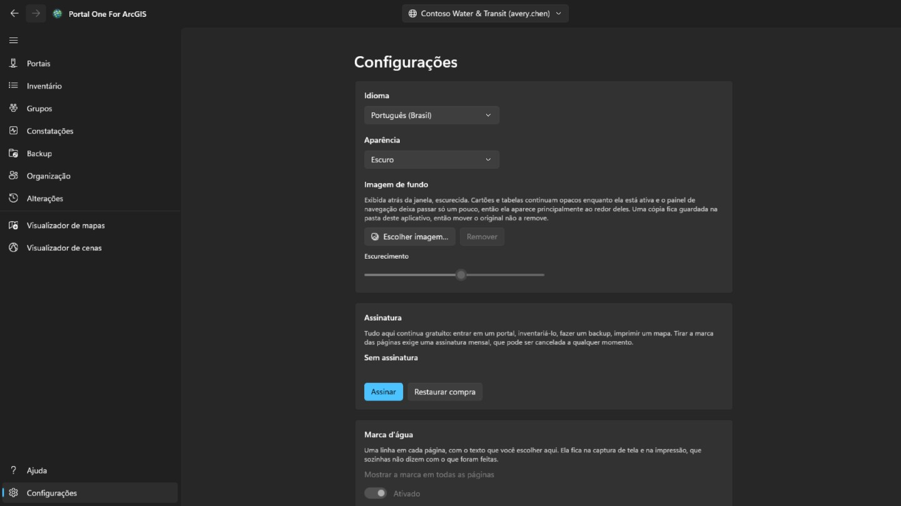

Claro, escuro ou o que o Windows estiver usando; o tema muda no momento da
escolha. Quando a Microsoft Store tem uma versão mais nova, aparece um botão **Atualizar** ao lado de Configurações no painel de navegação; o aplicativo fecha durante a instalação, abre de novo na nova versão e o botão some. Dá para pôr uma **imagem de fundo** sob a janela; enquanto ela aparece, cartões e tabelas continuam opacos e o painel de navegação deixa passar só um pouco, então ela surge principalmente ao redor deles, e **Escurecimento** define o quanto ela é escurecida.

A interface vem em catorze idiomas e segue o Windows a menos que você fixe um.
**Uma troca de idioma vale a partir do próximo início**, oferecida ali como um
botão, porque o framework lê o texto de cada tela uma vez, quando a tela é
construída: aplicar na hora mudaria só o que fosse aberto depois.

**Assinatura** é o que tira a marca das páginas, e nada mais aqui depende dela: entrar em um portal, inventariá-lo, fazer um backup e imprimir um mapa continuam gratuitos, tenha você pago ou não. É uma assinatura mensal comprada pela Microsoft Store, cancelável a qualquer momento; o cartão diz quanto custa e quando renova, quando ela existe. *Restaurar compra* existe para o caso de você ter pago e a marca continuar lá: a assinatura pode ter sido comprada na janela da própria Store, da qual este app não fica sabendo.

**Marca d'água** põe uma linha sua no canto inferior direito de cada página: até vinte e quatro caracteres, na fonte, no tamanho, na espessura, na cor e na intensidade escolhidas atrás de **Mais configurações** — o cartão em si não mostra nada além do botão que a liga. Ela começa com trinta pixels, em vermelho forte e na intensidade máxima, e caminha pela página um minuto a cada seis: cinco minutos no canto, um atravessando a página e de volta ao canto. Caminha porque quem tira a imagem decide onde ficam as bordas, e um canto é a parte mais fácil de ficar de fora; descansa porque uma página em que se está trabalhando não deveria ter uma linha atravessando as suas linhas — o botão, atrás de **Mais configurações**, é o que a impede de andar de vez. Ela vem ativada na primeira vez que você chega aqui e diz *Sem assinatura* — o que sai do app é visto em algum lugar que não diz nada sobre como foi feito. **Intensidade** é quanto da cor é usado: no mínimo, qualquer cor vira o mesmo véu pálido, então a cor sozinha não responde o quanto aparece. Em branco, a linha volta ao padrão. Até você assinar, nada neste cartão pode ser alterado — nem o botão nem o texto: ela diz *Sem assinatura* e pressioná-la abre o cartão mais acima; assinar é o que permite desativá-la e escolher o que ela diz; sem escolha, ela diz o nome do app. O que é marcado é a tela: as imagens que o app salva vêm do serviço de impressão do portal e saem como o portal as mandou.

## Teclado

Em qualquer uma das tabelas:

- **Ctrl+F** põe o cursor na caixa de filtro.
- **Ctrl+E** exporta as linhas que a tabela está exibindo, com as colunas e a ordem que você está vendo.

## Onde as coisas ficam

- Os backups vão para a pasta que você escolheu, uma pasta comum que você pode
  abrir, copiar e mover.
- Conexões, preferências e o diário de desligamentos ficam no armazenamento do
  próprio aplicativo, criptografados onde são credenciais.
- Os CSVs exportados ficam onde você os salvar.

Nada é enviado para lugar nenhum. **Não existe conta com os autores desta
ferramenta nem telemetria.**

## Fale conosco

Se algo não funciona ou não faz o que você esperava: **gaqo@outlook.com**.

O que mais ajuda é o que você estava fazendo, o que aconteceu no lugar, se o portal é ArcGIS Online ou ArcGIS Enterprise e qual versão — a página Conexões mostra as duas coisas — e em que idioma a interface estava.

Por favor, não anexe senhas, tokens ou arquivos da pasta de armazenamento do aplicativo. Uma sessão conectada fica guardada ali, e nada disso é necessário para responder a uma pergunta.
