# Справка

**Portal One For ArcGIS** проверяет и обслуживает организацию ArcGIS с вашего собственного компьютера. С **ArcGIS Online** и **ArcGIS Enterprise** он работает одинаково.

Почему такое название: ArcGIS Online и ArcGIS Enterprise по сути оба являются порталами, поэтому одно слово **Portal** — «портал» — охватывает их оба, и именно так это приложение называет их на странице **Порталы**, где вы их добавляете. **One** — это приложение: одно место для каждого портала, с которым вы работаете, и в нескольких из них можно быть в системе одновременно. **For ArcGIS** указывает, для какой платформы оно создано.

Приложение обращается к порталам, в которые вы входите, к картографическим сервисам, базовым картам и данным рельефа, на которые указывает их содержимое, к своему сайту справки, откуда эта страница читает последнюю справку, и к Microsoft Store для обновлений и подписки; если сайт недоступен, показывается справка, установленная вместе с приложением. Учётные данные шифруются для вашей учётной записи Windows и отправляются только тому порталу, которому они принадлежат.

## Порядок страниц — это порядок работы

Прочитать, сделать резервную копию, прогнать вхолостую, выполнить. Каждая
страница делает безопасной следующую, и навигация выстроена так, что движение
сверху вниз — это и есть безопасный путь.

## Подключения

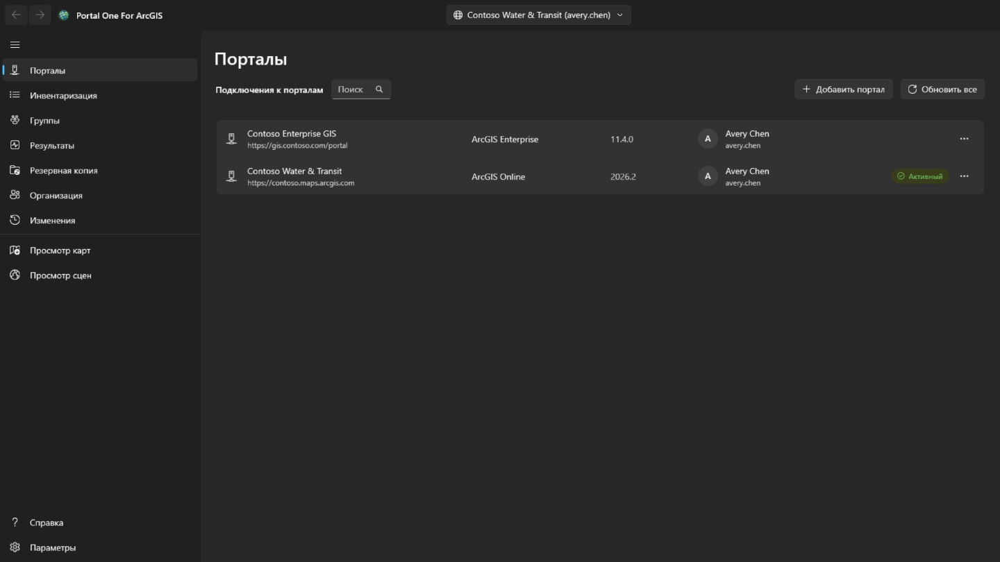

Добавьте подключение по адресу портала: для ArcGIS Online —
`https://ваша-орг.maps.arcgis.com`; для ArcGIS Enterprise — полный адрес вместе
с контекстным путём, например `https://portal.example.com/portal`. Ничего
регистрировать в портале заранее не нужно. Если портал находится за прокси с учётом удостоверения, например прокси приложений Microsoft Entra или Google Cloud IAP, отметьте **Порталу требуется прокси-аутентификация с учётом удостоверения**: перед чтением портала открывается окно входа на прокси, оно закрывается само, как только портал ответит, и открывается снова всякий раз, когда сеанс прокси истекает, — начатая работа продолжается.

Войдите по имени пользователя и паролю либо через собственную страницу входа
портала, показанную внутри приложения. **Используйте второй способ, если в
вашей организации применяется единый вход или многофакторная аутентификация**:
тогда в это приложение вообще не вводится пароль.

Одновременно может быть выполнен вход в несколько подключений, в том числе под
двумя учётными записями одного портала. **Оставаться в системе** сохраняет
учётные данные в зашифрованном виде для вашей учётной записи Windows, поэтому
подключение переживает перезапуск.

Продлевается только то подключение, на которое вы указываете. Остальные выходят
по истечении токена и молча возвращаются при переключении.

У подключения, в которое выполнен вход, показывается фотография профиля учётной записи, а если её нет — инициалы. Выберите её, чтобы открыть **Мой профиль**, **Мои параметры** или **Справка**. **Справка** открывает эту справку на сайте справки, в браузере и на языке, который показывает приложение; без сети вместо этого открывается страница **Справка** приложения. Рядом с фотографией профиля кнопка **Средство запуска приложений** открывает список приложений ArcGIS, которыми эта учётная запись может пользоваться на этом портале, как их перечисляет собственное средство запуска приложений портала и в том порядке, который учётная запись задала там; приложение открывается в отдельном окне, с выполненным входом. **Мой профиль** показывает учётную запись так же, как страница профиля портала: фотографию, имя, биографию, группы и элементы, которыми она поделилась с организацией или со всеми; **Редактировать профиль** меняет имена, биографию, видимость профиля и фотографию. **Мои параметры** содержит разделы портала: **Общие** (адрес эл. почты, стартовая страница, язык, числовой формат и формат даты, единицы измерения), **Безопасность** (пароль и контрольный вопрос для входа ArcGIS), **Лицензии** (тип пользователя и роль, а также лицензированные продукты в том виде, как их перечисляет собственная страница портала, с её картинками: наборы приложений, раскрывающиеся до своих приложений, затем все остальные продукты, точка у каждой дополнительной лицензии и поле поиска), **Кредиты**, которые выделяет организация, и **Вебхуки**, принадлежащие учётной записи. Каждое изменение сообщает, что будет записано, перечитывается с портала и фиксируется на странице **Изменения**, откуда можно вернуть изменения профиля, параметров, стартовой страницы, фотографии и вебхуков; новый пароль, контрольный вопрос и удалённый вебхук только записываются. Многофакторная аутентификация, ключи безопасности, коды восстановления, связанные учётные записи и настройки почтовых рассылок Esri только показываются или поясняются: ими управляют на веб-сайте ArcGIS. После изменения пароля или когда портал перестаёт принимать подключение открывается страница **Порталы** с окном входа для этого подключения, чтобы вы могли снова войти с новым паролем.

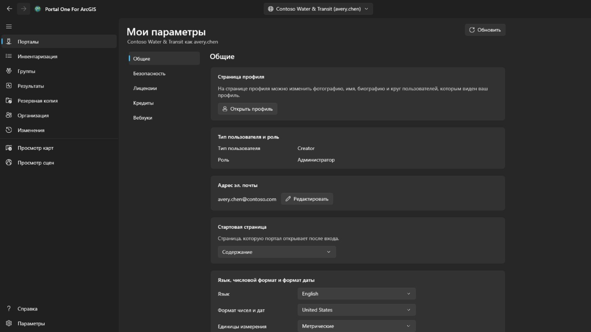

## Инвентаризация

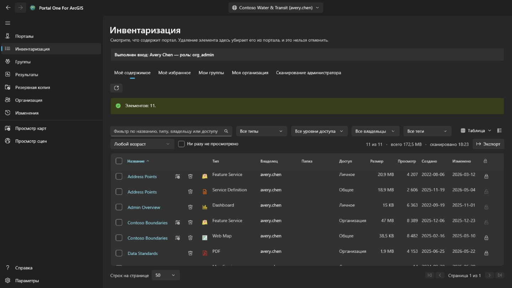

Показывает то, что видит ваша учётная запись, на четырёх вкладках, как на странице ресурсов портала: **Моё содержимое**, **Моё избранное**, **Мои группы** (все вместе или одна, включая группы, которые вы видите, не состоя в них) и **Моя организация** (то, чем делится организация). Они читаются сразу при открытии страницы и сохраняются; кнопка рядом перечитывает показанную вкладку. Контекстное меню строки зависит от типа элемента: веб-карту можно также открыть в Map Viewer портала, в Field Maps Designer или в ArcGIS Pro, панель — в Dashboards, историю — в ArcGIS StoryMaps; файл можно скачать; а любой элемент можно добавить в избранное или удалить из него. **Сравнить с другой картой…** у веб-карты или веб-сцены читает её и выбранную карту того же типа с портала в их текущем виде и перечисляет различия: добавленные, удалённые, перемещённые или переименованные слои, изменённые фильтры, символы, подписи и всплывающие окна, базовую карту, закладки и начальный экстент; список можно скопировать. **Создать копию…** копирует её в ваше содержимое на этом или другом портале, где выполнен вход, под новым названием, в папку или с передачей другому участнику; копия частная, а на другом портале сначала ищется элемент каждого слоя, и слой без элемента там загружается по адресу — это показывается до того, как что-либо будет записано. Меню вида справа вверху показывает строки как **Таблицу**, **Список** с эскизом и кратким описанием каждого элемента или **Плитки**, как страница содержимого портала, и сортирует их; фильтры, страницы и отмеченные строки во всех трёх видах одни и те же. На вкладках **Моё избранное**, **Мои группы** и **Моя организация** папка, размер и защита появляются вскоре после показа страницы: поиск их не возвращает, поэтому каждый элемент читается отдельно, сначала видимая страница. Папка видна только для ваших элементов, а администратору — для всех. Название элемента в таблице, списке и плитках открывает страницу элемента в отдельном окне, устроенную как на портале: на вкладке **Обзор** — карточка элемента с эскизом, типом, датами и кратким описанием, затем его **Описание**, содержимое для его типа (для сервиса — **Слои** и таблицы, для карты — слои, для сервиса геообработки — задачи), **Условия использования** и **Комментарии**, где можно оставить комментарий; рядом находятся **Открыть в просмотре карт**, **Открыть в просмотре сцен**, **Доступ…** и **Открыть в ArcGIS Pro**, а остальные команды — за шевроном, далее **Владелец**, **Сведения** с источником элемента и URL для копирования или открытия, индикатор полноты информации с изменением, которое поможет больше всего, а также **Теги**, **Доступ**, **Папка** и **Благодарности**, у каждого раздела есть действие для изменения; затем вкладки **Данные**, **Визуализация** и **Параметры**, если они есть у этого типа. **Параметры** устроены как на портале: **Общие** для каждого элемента (статус содержания, защита от удаления и удаление элемента, экстент, используемый поиском), собственный раздел элемента — для размещённого векторного слоя редактирование, отслеживание редакторов, синхронизация, экспорт и истинные кривые, сохраняемые вместе кнопкой **Сохранить**; для веб-карты или сцены — автономный режим; для других слоёв — параметры сервиса в том виде, как он их сообщает, — и вебхуки размещённого векторного слоя; каждое изменение подтверждается, если что-то отключает, перечитывается с портала и записывается на страницу **Изменения**, где его можно вернуть.

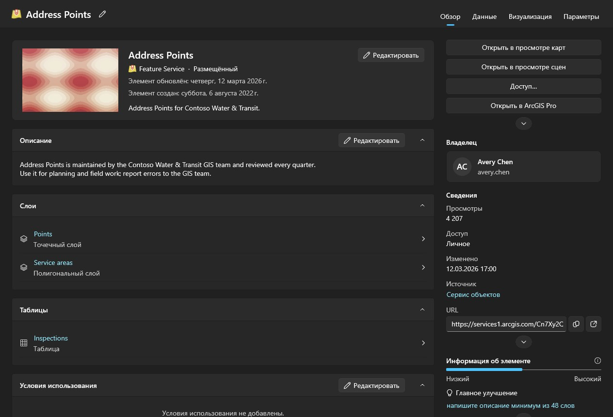

Сканировать чужие ресурсы — дело администратора. Учётная запись, которой разрешено читать то, чем владеют другие участники (portal:admin:viewItems), получает вкладку **Сканирование администратора** на этой странице и сканирование на страницах «Результаты» и «Резервная копия» — один участник, одна группа или вся организация — и вкладку **Передача** страницы **Организация**; другие учётные записи их не видят. Обход организации запрашивает ресурсы у каждого участника, а не ищет, потому что поиск возвращает только общедоступное, а аудит не должен пропускать личные элементы. Он занимает время и может быть отменён.

«Результаты», «Резервная копия» и просмотр карт и сцен сами читают ваши ресурсы, когда они впервые нужны, так что заранее заходить на другую страницу не требуется; сканирование администратора заменяет их отсканированным. Каждая таблица указывает, когда прочитан её список. Портал продолжает меняться после прочтения.

В каждой строке есть ещё и кнопка удаления — единственное в этом приложении, что нельзя отменить: в ArcGIS нет корзины. Подтверждение называет элемент, его тип и владельца и сообщает, есть ли копия в папке резервной копии, запомненной для этого подключения, и от какого она числа. Без копии удаление не запрещается, но именно эта строка — единственное, что потом сможет ответить за удаление. Элемент, защищённый от удаления в портале, здесь отклоняется, а не снимается с защиты втихую. Чтобы изменить саму защиту, воспользуйтесь замком в конце строки или меню строки: это отдельный шаг, перед снятием защиты приложение спрашивает подтверждение, а каждое изменение перечитывается из портала и записывается в журнал. Отметьте флажок в начале строки — или в заголовке, чтобы выбрать все строки, которые показывают фильтры, на всех страницах, — и действуйте сразу над многими элементами. **Доступ** задаёт уровень доступа и группы; **Теги** добавляет и удаляет теги, сохраняя остальные; **Переместить** помещает элементы одного владельца в одну из его папок; **Сменить владельца** передаёт их другому участнику, как вкладка **Передача** страницы **Организация**, а страница **Изменения** возвращает их; **Удалить** удаляет их после подтверждения, где указано сколько, чьи и сколько есть в резервной копии, и нужно отметить, что вы понимаете. Элементы, которые эта учётная запись не может менять, и защищённые от удаления не затрагиваются и учитываются. Элементы обрабатываются по одному и записываются в журнал; **Отмена** останавливает между двумя, а итог называет, что не удалось и почему. В контекстном меню строки **Доступ…** меняет уровень доступа и группы элемента, а **Изменить сведения…** — его название, краткое описание, описание, теги, авторство и условия использования. Оба открывают элемент таким, каким его сейчас хранит портал, отправляют только изменённое, проверяют результат и записываются в журнал.

## Находки

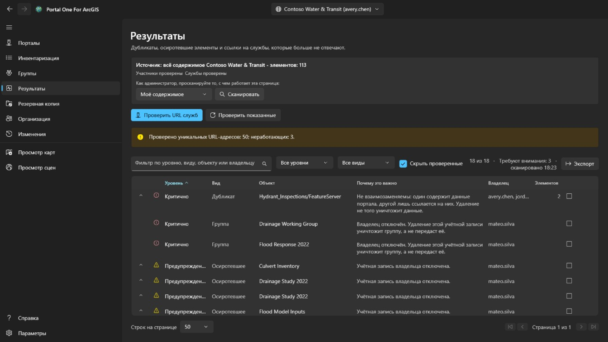

Избыточное и мёртвое содержимое, отсортированное по тому, сколько внимания оно
заслуживает, а не по тому, насколько грозно звучит.

- **Критично** означает, что неосторожное действие здесь уничтожит то, чего нет
  больше нигде: два элемента, указывающие на одну службу, где удаление не того
  необратимо.
- **Предупреждение** — настоящая проблема, с которой безопасно работать:
  элемент, владелец которого ушёл; служба, которая больше не отвечает.
- **К сведению** — стоит знать, и может оказаться, что всё в порядке.
- **Не определено** значит, что установить не удалось. **Служба, не ответившая
  вовремя, — это не исчезнувшая служба**, и этот инструмент не станет так
  утверждать.

Разверните строку, чтобы увидеть элементы, которые она представляет. Отметьте
её как просмотренную, когда решите, что всё в порядке; решение запоминается для
каждого подключения, а строка остаётся видимой, а не исчезает.

Эта страница сообщает. **Она не говорит, какой из двух похожих элементов
оставить**, потому что это зависит от того, кто ими пользуется и что на них
ссылается.

## Резервное копирование

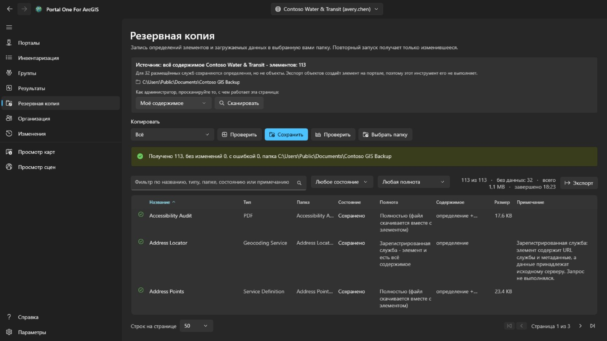

Записывает определения элементов, ресурсы и загружаемые данные в выбранную вами
папку. Повторный запуск в ту же папку забирает только изменившееся, поэтому
**продолжение прерванной копии и инкрементное копирование — это одно и то же**.

- **Проверить состояние** сравнивает папку с порталом и сообщает, что *сделал
  бы*, ничего не записывая. Так можно ответить на вопрос «актуальна ли моя
  копия», не потратив на это часы.
- **Проверить целостность** сравнивает папку с её собственной записью, вообще
  без портала. **Именно этот вопрос остаётся, когда портала уже нет, — а
  всерьёз в резервную копию заглядывают обычно как раз тогда.**

Папка запоминается для каждого подключения, а папка с копией другой организации
отклоняется, а не перезаписывается.

**Чего в резервной копии нет.** Объекты внутри размещённой службы лежат в
хранилище данных портала, а не в элементе, и чтобы их извлечь, нужен экспорт,
создающий в портале новый элемент, то есть запись. Этот инструмент так не
делает, поэтому такие строки сохраняются как определение без данных, и страница
сообщает, сколько их. Службы, зарегистрированные с другого сервера, по своей
природе являются указателями, и брать с них больше нечего.

## Вывод участника

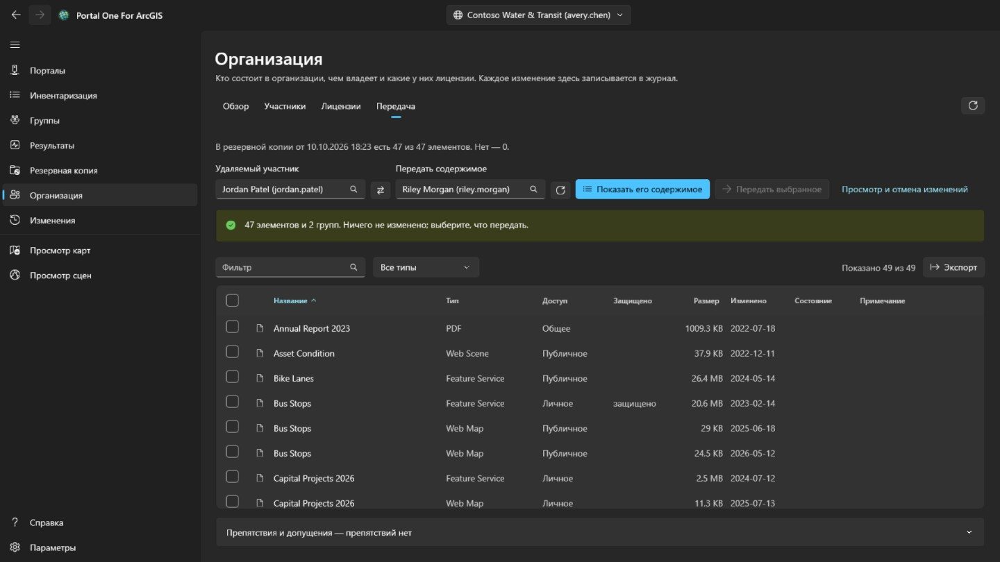

Это вкладка **Передача** страницы **Организация**, видимая только учётным записям, которые администрируют ресурсы (portal:admin:viewItems). Она определяет, что потребуется при удалении участника, и переносит его ресурсы — по одному и с возможностью возврата.

Выберите из списков участника и того, кто получит его содержимое: оба берутся из
собственного каталога организации, поэтому **имя нельзя набрать с ошибкой и
попасть в другое, которое существует**. **Показать его содержимое** ничего не
меняет: оно показывает каждый элемент и каждую группу, а отмечаете то, что
должно уйти, вы.

Ничего не отмечено заранее. Перенести весь аккаунт — это один щелчок по флажку в
заголовке, и **этот щелчок является решением, а не значением по умолчанию**.

- Группы намеренно находятся в той же таблице, что и элементы. При удалении
  участника портал **уничтожает** группы, которыми он ещё владеет, вместо того
  чтобы передать их, поэтому неотмеченная группа — **единственное, что на этой
  странице разрушительно и при этом молчаливо**, и строка счётчиков об этом
  говорит.
- Подтверждение показывает папки получателя и позволяет добавить новую; элементы попадают в выбранную папку. Каждая передача записывается в журнал до начала следующей, а страница **Изменения** возвращает каждый элемент в папку, из которой он пришёл, заново создавая исчезнувшую папку, по одному или всё оставшееся сразу.
- Перемещение одного элемента может переместить вместе с ним другие. Передача shapefile забирает опубликованный из него размещённый сервис, поэтому строка может сообщить, что он прибыл, хотя отправила его не эта передача. Возврат только этой строки на странице **Изменения** не вернёт его; он возвращается вместе с тем, что его перенесло.
- После каждого перемещения элемент считывается из портала заново. **Запрос,
  вернувший успех, — это утверждение о запросе, а не о том, где элемент сейчас.**

Саму учётную запись участника удаляют на странице **Организация**, и только когда ему больше ничего не принадлежит. **Это единственный шаг, который нельзя отменить.**

## Организация

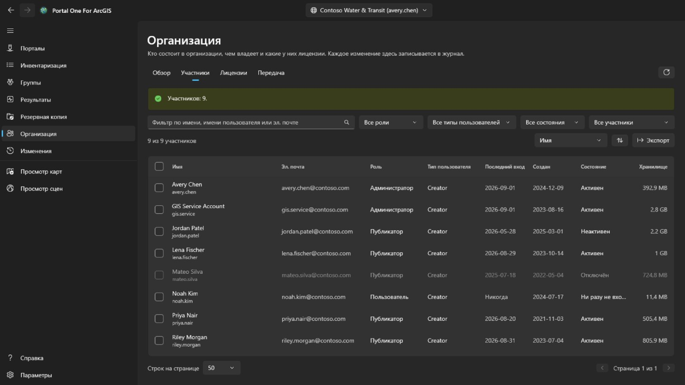

Эту страницу видит каждый участник, как и в портале. **Обзор**, где также названы контакты администраторов организации, доступен всем, а с правом просматривать участников — и вкладка **Участники** только для чтения, без электронной почты, входов, статуса и хранилища. Отметка участников, **Экспорт**, **Лицензии** и любые изменения доступны только учётным записям, которые управляют участниками (portal:admin:viewUsers). **Обзор** подводит итог по организации: в ArcGIS Online — подписка, места и кредиты; участники по статусу, роли и типу пользователя; сколько занимают ресурсы и хранилище.

**Участники** перечисляет всех в организации: с фильтром по имени, роли, типу пользователя, статусу или группе, с сортировкой по любому столбцу и сохранением в CSV-файл кнопкой **Экспорт**. Отметьте участников, чтобы отключить или включить их, сменить им роль или тип пользователя, исключить из групп или удалить; если отмечен один, **Удаление участника** открывает вкладку **Передача** этой страницы. Вашу собственную учётную запись это никогда не затрагивает, а владелец группы остаётся в ней.

Щелчок правой кнопкой по участнику открывает его меню. **Просмотр** показывает его **Профиль**, **Элементы** и, для администратора, **Группы** — здесь, в приложении, а не в портале; обычный участник видит только элементы, которыми с ним поделились. **Управление** доступно администраторам, и каждый пункт — только при нужном праве: **Дополнительные лицензии** задают, какие права есть у участника, **Изменить адрес эл. почты** меняет его для учётной записи со входом ArcGIS, **Передать ресурсы** открывает для него вкладку **Передача**, а **Передать участника** отдаёт другому участнику его тип пользователя, роль и дополнительные лицензии и затем продолжает на вкладке **Передача** с ресурсами и группами. То же меню меняет тип пользователя, роль, группы, статус или учётную запись одного участника, как панель — для нескольких.

**Удалить** убирает только участников, которым не принадлежат ни элементы, ни группы. При удалении учётной записи ArcGIS никому их не передаёт, поэтому сначала перенесите их на вкладке **Передача**. Прежде чем что-либо произойдёт, вы вводите имя пользователя, а для нескольких участников — их число. Удаление нельзя отменить.

**Лицензии** показывает, сколько назначено каждого типа пользователя и, в ArcGIS Online, сколько входит в подписку; **Показать участников** перечисляет, у кого этот тип. Выберите дополнительную лицензию, чтобы увидеть, у кого она есть, и отзовите её у отмеченных участников.

Каждое изменение перечитывается из портала и записывается вместе с тем, что было раньше, и отображается на странице **Изменения**. Эти изменения участников оттуда не отменяются: чтобы обратить одно из них, выполните противоположное изменение.

## Изменения

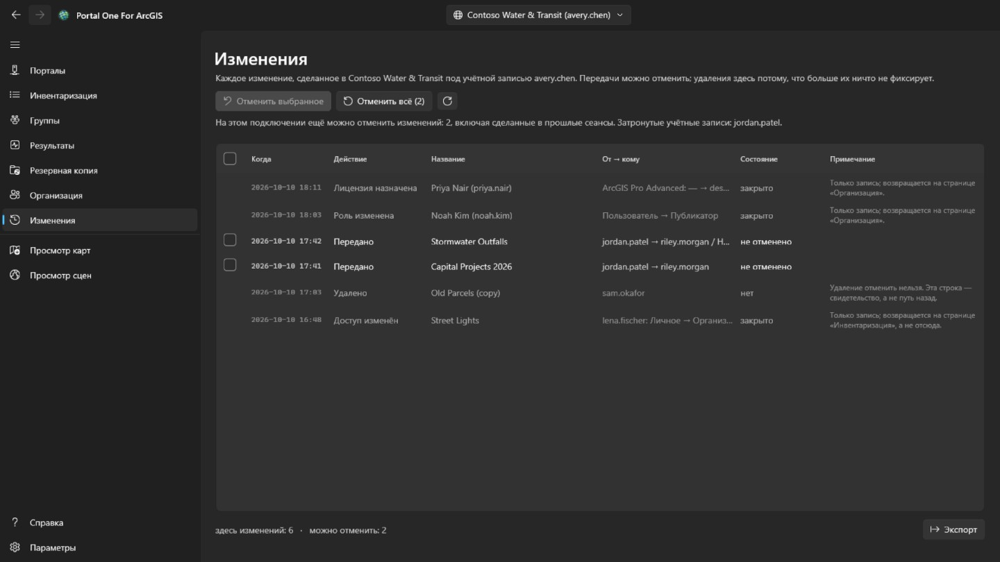

Страница **Изменения** видна каждой вошедшей учётной записи. Она показывает от новых к старым всё, что этот инструмент изменил на выбранном сейчас портале: передачи, удаления, общий доступ, теги, папки, сведения, защиту и изменения участников. Изменения на других порталах подсчитываются, но не перечисляются. Список можно экспортировать в CSV.

У передач, которые можно вернуть, есть флажок. **Отменить выбранное** возвращает отмеченные передачи, а **Отменить всё** возвращает всё ещё не возвращённое в этом подключении после подтверждения с указанием, чьи это ресурсы. Элементы возвращаются в папки, из которых пришли, исчезнувшая папка создаётся заново. Удаления и изменения участников здесь только записываются: удаление нельзя отменить, а изменение участника обращается противоположным изменением. Отмена передачи — это тоже передача, и для неё нужно то же право (portal:admin:reassignItems, для группы — reassignGroups); учётная запись без него видит только запись.

Веб-карту, сохранённую поверх из просмотра карт, и объект, добавленный, изменённый или удалённый там, можно вернуть из меню их строки. Правка объекта отменяется, только пока объект остаётся таким, каким его оставила правка: добавленный объект удаляется, изменённый получает прежние значения и форму, а удалённый добавляется снова с новым идентификатором. Отмена тоже записывается, поэтому её можно отменить так же. Прежде чем вернуть веб-карту, **Сравнить с картой сейчас** в том же меню покажет, чем копия, сохранённая перед той записью, отличается от карты в нынешнем виде на портале: базовая карта, добавленные, удалённые, переименованные или перемещённые слои, а для каждого слоя — видимость, непрозрачность, стиль, подписи, фильтр, диапазон масштабов, всплывающее окно и обновление, таблицы, закладки и место, где открывается карта.

## Просмотр карт и просмотр сцен

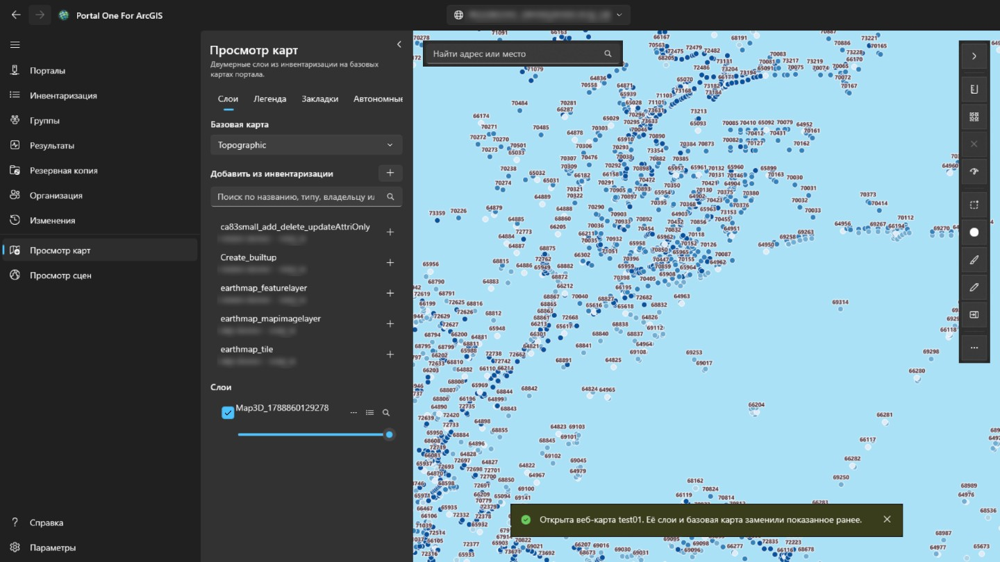

**Просмотр карт** показывает двумерные слои на базовых картах портала; **просмотр сцен** показывает их и трёхмерные — слои сцен, сетки, облака точек, 3D Tiles — на глобусе с рельефом. Панель слева ищет среди того, что прочитано для этого портала, — ваших ресурсов, которые читаются автоматически, того, что просканировал администратор, и того, что прочитали вкладки страницы «Инвентаризация», — и показывает только то, что этот просмотр умеет нарисовать. Выберите элемент, чтобы добавить его. Веб-карта открывается в просмотре карт, а веб-сцена — в просмотре сцен, целиком, со своими слоями и базовой картой. На странице «Инвентаризация» кнопка просмотра рядом с названием (есть и в контекстном меню строки) открывает элемент в том просмотре, который может его показать.

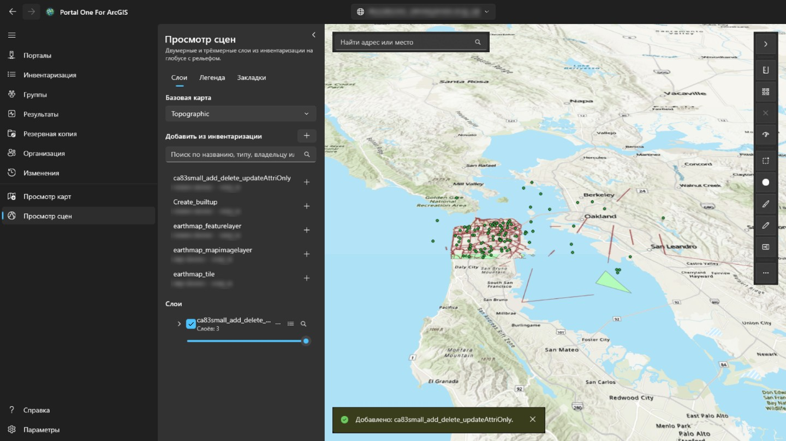

Кнопка в правом верхнем углу панели сворачивает её, отдавая всю ширину карте или сцене, и разворачивает снова; при каждом входе в просмотрщик панель развёрнута. Каждый слой можно показать или скрыть, сделать прозрачнее, поднять или опустить, приблизить к нему или убрать. Щелчок по объекту на карте показывает его поля: если у слоя в портале настроено всплывающее окно — те, что в нём выбраны, с его подписями и форматами; иначе все. Вкладка **Легенда** рядом со вкладкой **Слои** показывает, что означают символы каждого видимого слоя. **Закладки** перечисляют места, сохранённые с веб-картой или веб-сценой; чтобы добавить свою, назовите там текущий вид, а чтобы вернуться, выберите закладку. Закладка сцены сохраняет направление и наклон камеры. Кнопка таблицы у слоя с объектами открывает под картой его **таблицу атрибутов** — по двести строк за раз, с тем же фильтром, с которым рисуется слой; выбор строки выделяет объект и приближает к нему. **Экспорт** записывает все строки таблицы с её фильтрами и сортировкой, до 50 000, а не только загруженные: в CSV так, как их показывает таблица, в GeoJSON в широте и долготе или в шейп-файл в zip в системе координат слоя (имена полей сокращаются до десяти символов). Заголовок столбца сортирует по нему таблицу, фильтрует её (как фильтр слоя, одно условие на столбец, все сразу) или показывает статистику: сколько строк имеют значение, наименьшее и наибольшее, для чисел сумму, среднее и стандартное отклонение, а также самые частые значения — по всем строкам, прошедшим фильтры, а не только по загруженным. **Только выбранные** сужает таблицу до выбранных строк. В просмотре карт кнопки **Расстояние** и **Площадь** над картой измеряют то, что вы рисуете щелчками: по поверхности Земли, а не по плоской карте, в метрических или имперских единицах в зависимости от региона Windows. В просмотре сцен **Расстояние** измеряет между двумя щелчками по рельефу или модели (прямая, по земле и по вертикали), а **Площадь** — по углам на рельефе. **Сохранить как веб-карту** создаёт в ваших ресурсах, в выбранной папке, новый элемент веб-карты с показанными сейчас базовой картой, слоями и закладками; он открывается там, где сейчас карта, а миниатюрой служит её снимок. **Сохранить** перезаписывает веб-карту, открытую из портала, если она ваша или вы можете менять чужие ресурсы, предварительно сохранив копию на этом компьютере; просмотр сцен сохранять не умеет. Поиск также находит адреса и места геокодером портала. **Экспорт** сохраняет PNG вида, а если портал предлагает службу печати, **Печать** её запускает. Временные слои открывают панель **Время** для шага или воспроизведения диапазона. Слои остаются, пока вы работаете на других страницах, и начинаются заново при переключении на другой портал. Вход в портал используется для его собственных слоёв и никогда не отправляется на сервер другой организации, поэтому слой, зарегистрированный с другого сервера и требующий входа, не загрузится. При измерении на карте набросок завершает двойной щелчок, клавиша Enter или кнопка **Готово**: он остаётся на карте вместе с результатом до следующего измерения или до ✕ рядом с инструментами. Esc отменяет набросок, а Ctrl+Z или Backspace убирает последнюю точку. Кнопка стиля у слоя с объектами меняет его отображение: один символ выбранного цвета и размера, цвет для каждого значения поля (**Категории**) или классы числового поля по цветовой шкале (**Классы** — естественные границы, равные интервалы или квантили). Карта сразу показывает изменения; **Применить** сохраняет их, **Отмена** возвращает прежний вид, а **Вернуть исходный** — стиль, с которым пришёл слой. Легенда тоже обновляется, а сохранение карты как веб-карты сохраняет стиль. Кнопка **…** в той же строке открывает также **Подписи…**, чтобы показывать значение поля у каждого объекта выбранного размера и цвета, с ореолом и начиная с заданного масштаба, и **Фильтр…**, чтобы показывать только объекты, отвечающие условиям из поля, сравнения и значения — всем или любому; число подходящих считается сразу, фильтр из веб-карты слоя сохраняется, а таблица атрибутов следует фильтру. В левом нижнем углу карты компас поворачивается вместе с картой (нажмите его, чтобы вернуть север); рядом — масштабная линейка, измеренная по земле, масштаб и координаты под указателем (нажмите, чтобы скопировать или переключиться между десятичными градусами и градусами, минутами, секундами), и кнопка обзорной карты, щелчок по которой перемещает карту. **Выбрать** выбирает объекты всех видимых слоёв внутри прямоугольника, произвольной фигуры или многоугольника: панель показывает их число по слоям, сумму, среднее, минимум и максимум числового поля и может показать их в таблице, приблизить или сохранить в CSV. **Буфер** строит область на заданном расстоянии от выбранных объектов или от точки, линии или области, которую вы нарисуете, измеряет её по поверхности Земли на этом компьютере (без службы анализа и кредитов) и может выбрать попавшие в неё объекты. **Шторка** показывает слой слева от перетаскиваемого разделителя, а карту без него — справа. **Проверить карту** просматривает каждый слой и сообщает, что не сработает или введёт в заблуждение тех, кому карта открыта: слои, которые не загружаются, элементы, которые исчезли или открыты уже, чем карта, службы по http или вне портала, устаревшие элементы и элементы другой организации, большие слои без диапазона масштабов и полное отсутствие всплывающих окон; отчёт можно скопировать. Она также называет поля, на которые ссылаются всплывающее окно, символы или подписи слоя, но которых у слоя нет, и замеряет, сколько длится подсчёт объектов каждого слоя службы: свыше 3 секунд это отмечается, свыше 10 или без ответа за 30 — это предупреждение. В меню **…** слоя пункт **Где используется…** читает карты и приложения из инвентаря и перечисляет те, что используют слой напрямую или через карту, а **Свойства…** показывает источник, владельца, отображение и для объектов — их число и поля. Поле поиска принимает и координаты — два десятичных числа в любом порядке, градусы/минуты/секунды, UTM или MGRS — и переходит туда без геокодера. **Экспорт** может скопировать ссылку, открывающую веб-карту в просмотре портала на этом месте, или координаты центра. При сохранении поверх веб-карты её прежнее определение сохраняется, и страница **Изменения** может вернуть его из меню этого сохранения. Настройки слоя в его меню задают видимый диапазон масштаба, всплывающие окна векторных слоев (заполнители заголовка, подписи полей, видимость и порядок) и поддерживаемые интервалы обновления; предпросмотр выполняется сразу, а сохранение веб-карты сохраняет эти параметры. Диалог стиля теперь может отображать точечные слои как тепловые карты, менять размер точечных символов или ширину линий по числовому полю и включать кластеры точек с подписями количества; полигональные слои сохраняют существующие цветовые стили. Меню «Добавить» на вкладке «Слои» также может добавить URL-адрес сервиса или локальный файл: CSV и GeoJSON при сохранении становятся встроенными коллекциями объектов, а шейп-файлы и файлы KML или KMZ остаются локальными, и об этом предупреждается перед сохранением. Эскиз добавляет сохраняемый слой разметки с точками, линиями, областями, прямоугольниками, кругами или эллипсами, фигурами от руки и текстом; выберите объект эскиза, чтобы изменить его форму, стиль, удалить его, отменить последнюю отметку или очистить слой, а коллекция объектов эскиза сохраняется вместе с веб-картой. Инструмент **Редактировать** в просмотре карт перечисляет слои объектов сервиса, которые допускают редактирование, объясняет, почему слой доступен только для чтения, позволяет нарисовать новый объект по шаблону или выбрать существующий на карте, проверяет редактируемые поля и применяет подтверждённые изменения к рабочему сервису объектов. В таблице атрибутов редактируемого слоя выделите строки с Ctrl или Shift (Ctrl+A — все загруженные): **Изменить** открывает одну из них в форме правки, а **Изменить поле** задаёт одному полю одно значение во всех, проверив его по правилам каждого объекта.  **Изменить поле** можно и выражением — имена полей в скобках, текст в кавычках, + - * / и несколько функций — чтобы каждая выбранная строка получила своё значение из других полей.  На панели **Правка** **Инструменты геометрии** позволяют **Выбрать на карте**, **Объединить** формы, **Разделить** линии или полигоны линией разреза, **Обрезать** по нарисованной области или **Копировать в слой** в другой редактируемый слой того же вида формы; каждое действие записывается на странице **Изменения**. Каждое изменение записывается на странице **Изменения** (изменение поля — одной записью) и отменяется оттуда. Для выбранного объекта форма правки также показывает его вложения, если слой их хранит, — их можно открыть, добавить или удалить (удаляемый файл сначала копируется на этот компьютер, а каждое изменение записывается на странице **Изменения**), — и связанные с ним записи, только для чтения. Пока объект рисуется или меняет форму, его вершины привязываются к объектам слоёв, отмеченных в разделе **Привязка** панели правки, а направляющие предлагают прямые углы и параллели; и то и другое можно выключить, а расстояние привязки — задать. Измерения, эскиз и остальные инструменты не привязываются. **Поделиться** рядом с **Сохранить как веб-карту** открывает доступ к показанной веб-карте или веб-сцене так же, как страница «Инвентаризация» открывает доступ к элементу, если эта учётная запись владеет ею или может открывать доступ к чужим ресурсам: после выбора уровня и групп карта проверяется в том виде, в каком будет открыта, и всё, что на этом уровне не сработает или введёт в заблуждение, перечисляется до того, как доступ будет открыт. **Сведения** изменяют название, краткое описание, описание, теги, благодарности и условия использования элемента так же, как страница «Инвентаризация», а также могут сделать снимок вида миниатюрой и задать экстент элемента, по которому ищет портал, по виду; где открывается карта, задаётся сохранением поверх неё. Всплывающее окно объекта также показывает, в порядке, заданном автором, изображения, диаграммы и вложения окна, настроенного на портале, и связанные записи; выражения Arcade вычисляются заранее. Диаграммы рисуются в теме приложения, изображения загружаются только по адресам https, а вложение открывается щелчком. Когда сервис переезжает или заменяется, пункт **Заменить в веб-картах…** в меню **…** слоя перенаправляет на новый адрес все веб-карты и веб-сцены из инвентаря, которые его используют (слои целого сервиса сохраняют номера), предварительно перечислив, что изменится в каждой; каждая карта перед записью сохраняется и записывается на странице **Изменения**, где её можно сравнить и восстановить. Список слоёв показывает групповые слои в виде дерева: разверните группу, чтобы управлять её слоями, переименуйте любой слой, создайте новую группу из выбранных слоёв верхнего уровня, переместите слой в группу или из неё либо снова разгруппируйте её. Вьюер карты может построить профиль высот по линии, используя тайловый рельеф вместо аналитических сервисов, расходующих кредиты, и позволяет копировать или экспортировать отобранные расстояния и высоты. Сервисный векторный слой также может открыть под картой диаграмму только для чтения; она использует статистику сервиса вместо загрузки всех объектов, может ограничиваться видом или выборкой, экспортирует PNG или CSV и не сохраняется в веб-карту.  CSV, GeoJSON или shapefile, добавленные с компьютера, можно опубликовать из меню слоя как размещённый векторный слой: исходный файл загружается, сервис создаётся в вашем содержании, а локальный слой заменяется. KML и KMZ не предлагаются, потому что портал не публикует их как сервисы объектов.  Диалог стиля также предлагает типы с полем размера и карты связи по двум полям; непрерывные цветовые шкалы, точечная плотность и бининг не показываются, потому что ArcGIS Maps SDK for .NET 300.1 здесь не поддерживает их безопасно. Подписи и поля всплывающих окон также могут использовать выражения Arcade: с вставкой полей, частыми фрагментами и проверкой на реальном объекте перед применением.  Редактируемые векторные слои также могут содержать форму, сохраненную в веб-карте: панель редактирования учитывает ее группы, обязательные правила и вычисляемые значения, а команда **Форма…** в меню слоя изменяет эту форму. Веб-карты портала можно сделать автономными из просмотрщика карт: приложение проверяет автономные возможности, загружает заранее подготовленную область или текущий вид в LocalState, открывает его на вкладке автономных карт, фиксирует правки локально и синхронизирует их обратно одной записью Changes, если у учетной записи есть лицензия Runtime Basic или выше.  Сетевой анализ карты добавляет маршруты, зоны и ближайшие объекты из служб портала; ArcGIS Online расходует кредиты.  Разделы связанных записей также читают связи через таблицы связей в скрытой карте SDK, поэтому связи «многие ко многим» и связи с атрибутами работают, когда связанные таблицы отсутствуют в веб-карте.  В сценах векторные слои также можно выбирать щелчком, прямоугольником на поверхности или полигоном, нарисованным щелчками, строить буфер от выбранных объектов или от точки, линии либо области, заданных щелчками, показывать в диаграммах и редактировать: атрибуты через форму слоя, новые объекты и перерисовку всей формы по щелчкам, а также объединение, копирование, разделение и обрезку; только правка по вершинам остается для карты, потому что SDK предоставляет редактор геометрии только для MapView. Наброски в сценах (точки, линии, полигоны, прямоугольники, эллипсы и текст, поставленные щелчками) живут только в сеансе, так как веб-сцены здесь нельзя сохранить; рисование от руки есть только в карте. **Экспортировать набросок как GeoJSON** на панели «Эскиз» сохраняет в файл пометки как из просмотра карт, так и из просмотра сцен. Сцены также строят **Профиль высот** вдоль линии, заданной щелчками, по собственному рельефу сцены, если он есть, а иначе по тому же источнику, что и просмотр карт; панель **Сеть** тоже работает в сценах: щелчки по поверхности ставят остановки, объекты и инциденты, результаты накладываются на сцену, а маршрут, добавленный как слой, живет только в сеансе.  Действия сцены также делятся, редактируют сведения, копируют ссылки или центры, экспортируют изображения, проверяют слои, показывают использование и заменяют источники; виджеты сцены показывают направление, координаты указателя, обзор и высоту камеры, а локальные мобильные пакеты сцен открываются только для чтения. **Сравнение** в сцене использует синхронизированную обрезанную копию всей сцены; навигация остается в основной сцене, а разделитель сравнивает ее с выбранным слоем и без него.  Короткое поле поиска мест остается слева вверху; стрелка на правой панели инструментов скрывает или возвращает оба элемента с анимацией, а Другие команды содержат реже используемые команды элемента, проверки, времени и экспорта.

## Работа в фоне

Закрытие окна убирает приложение в область уведомлений, а не завершает его,
**чтобы многочасовое обследование или копирование не погибло от жеста, которым
убирают окно с глаз**. Значок сообщает, что выполняется, и **Выход** там —
настоящий выход. Через его меню также можно добавить портал, проверить обновление в Microsoft Store или установить найденное.

Если выключить значок в области уведомлений, закрытие окна завершит приложение:
без значка ничто не смогло бы вернуть окно.

**Запускать вместе с Windows** открывает приложение прямо в области уведомлений
при входе, так что нужное подключение уже в системе, когда вы его открываете.

## Параметры

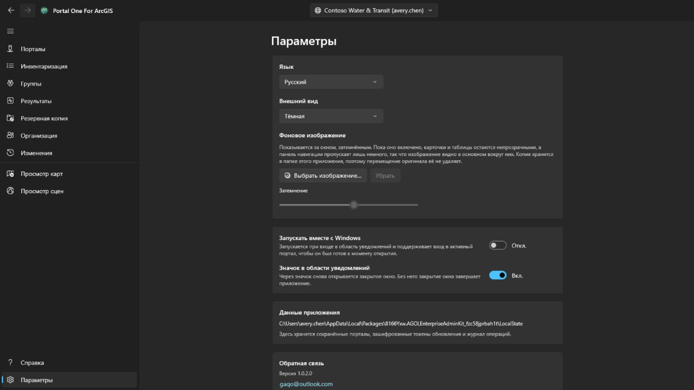

Светлая, тёмная или как в Windows; тема меняется в момент выбора. Когда в Microsoft Store есть более новая версия, на панели навигации рядом с «Параметрами» появляется кнопка **Обновить**; на время установки приложение закрывается, затем запускается в новой версии, и кнопка исчезает. Под окном можно поставить **фоновое изображение**; пока оно показано, карточки и таблицы остаются непрозрачными, а панель навигации пропускает лишь немного, так что оно видно в основном вокруг них, а **Затемнение** задаёт, насколько оно приглушено.

Интерфейс поставляется на четырнадцати языках и следует за Windows, если не
закрепить один. **Смена языка вступает в силу при следующем запуске**, там же
предлагается кнопка, потому что платформа читает текст каждого экрана один раз
при его построении: немедленное применение изменило бы только то, что откроется
после.

**Подписка** — это то, что снимает метку со страниц, и больше за ней ничего нет: вход в портал, его опись, резервная копия и печать карты остаются бесплатными независимо от того, заплачено или нет. Это ежемесячная подписка, покупаемая через Microsoft Store и отменяемая в любой момент; когда она есть, карточка говорит, сколько она стоит и когда продлевается. *Восстановить покупку* — для случая, когда вы заплатили, а метка всё ещё на месте: подписку могли купить в собственном окне Store, о чём это приложение не узнаёт.

**Водяной знак** ставит вашу строку в правый нижний угол каждой страницы: до двадцати четырёх символов, тем шрифтом, размером, начертанием, цветом и с той насыщенностью, которые вы выберете за **Дополнительные параметры**, — сама карточка не показывает ничего, кроме выключателя, который его включает. Сначала это надпись в тридцать пикселей красным при полной насыщенности, и каждые шесть минут знак одну минуту ходит по странице: пять минут в углу, одну минуту в пути, затем снова в угол. Он ходит потому, что кто делает снимок окна, тот и решает, где будут его края, а угол — самая легкая часть, чтобы остаться за кадром; он отдыхает потому, что на странице, с которой работают, не должно быть строки, идущей поперёк её строк, — выключатель, который останавливает его совсем, находится за **Дополнительные параметры**. Он включён, когда вы приходите сюда в первый раз, и читается как *Нет подписки* — потому что то, что выходит из приложения, рассматривают там, где ничего не говорит о том, чем оно сделано. **Насыщенность** — это сколько цвета взято: на нижнем конце любой цвет выходит одним и тем же бледным налётом, поэтому один цвет не отвечает на вопрос, насколько это видно. Оставленная пустой, строка берёт значение по умолчанию. Пока подписки нет, на этой карточке ничего нельзя изменить — ни выключатель, ни надпись: он читается как *Нет подписки*, и нажатие открывает карточку выше; подписка — это то, что позволяет его выключить и выбрать, что он говорит; если ничего не выбрано, он читается как имя приложения. Отмечается экран: изображения, которые сохраняет приложение, приходят из собственной службы печати портала и уходят такими, какими портал их прислал.

## Клавиатура

В любой из таблиц:

- **Ctrl+F** ставит курсор в поле фильтра.
- **Ctrl+E** выгружает показанные строки — с теми столбцами и в том порядке, что перед вами.

## Где что хранится

- Резервные копии лежат в выбранной вами папке — обычной папке, которую можно
  открыть, скопировать и перенести.
- Подключения, настройки и журнал вывода участников хранятся в собственном
  хранилище приложения, зашифрованные там, где это учётные данные.
- Экспортированные файлы CSV остаются там, где вы их сохранили.

Никуда ничего не выгружается. **У создателей этого инструмента нет ни учётной
записи для вас, ни телеметрии.**

## Обратная связь

Если что-то не работает или делает не то, чего вы ждали: **gaqo@outlook.com**.

Больше всего помогает: что вы делали, что произошло вместо этого, ArcGIS Online это или ArcGIS Enterprise и какой версии — страница «Подключения» показывает и то и другое — и на каком языке был интерфейс.

Пожалуйста, не прикладывайте пароли, токены и файлы из папки данных приложения. Там хранится активный сеанс, и ничего из этого не нужно, чтобы ответить на вопрос.
