# Yardım

**Portal One For ArcGIS**, bir ArcGIS kuruluşunu kendi bilgisayarınızdan denetler ve bakımını yapar. **ArcGIS Online** ve **ArcGIS Enterprise** ile aynı şekilde çalışır.

Adın nedeni: ArcGIS Online ve ArcGIS Enterprise özünde birer portaldır; bu yüzden tek **Portal** sözcüğü ikisini de kapsar — bu uygulama da onları eklediğiniz **Portallar** sayfasında böyle adlandırır. **One** uygulamanın kendisidir: çalıştığınız her portal için tek yer, aynı anda birkaçında oturum açık. **For ArcGIS**, hangi platform için geliştirildiğini söyler.

Bu uygulama oturum açtığınız portallarla, içeriklerinin işaret ettiği harita servisleri, altlık haritalar ve yükseklik verileriyle, bu sayfanın en güncel yardımı okuduğu yardım web sitesiyle konuşur — web sitesine ulaşılamadığında uygulamayla yüklenen yardımı gösterir — ve güncellemelerle abonelik için Microsoft Store ile konuşur. Kimlik bilgileriniz Windows hesabınız için şifrelenir ve yalnızca ait oldukları portala gönderilir.

## Sayfaların sırası, işin sırasıdır

Oku, yedekle, deneme çalıştır, uygula. Her sayfa bir sonrakini güvenli kılar ve
gezinme listesi, yukarıdan aşağı inmek güvenli yol olacak şekilde dizilmiştir.

## Bağlantılar

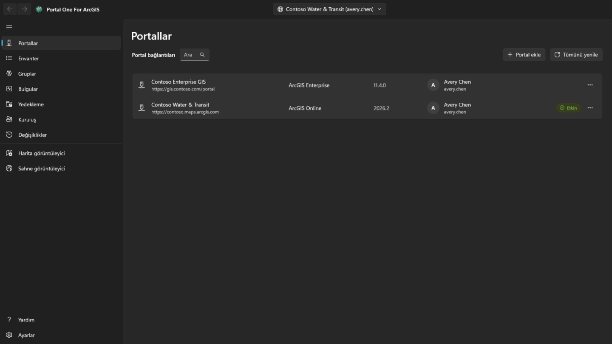

Portal adresiyle bir bağlantı ekleyin: ArcGIS Online için
`https://kurulusunuz.maps.arcgis.com`; ArcGIS Enterprise için bağlam yolunu da
içeren tam adres, örneğin `https://portal.example.com/portal`. Portalda önceden
hiçbir şey kaydetmek gerekmez. Portal, Microsoft Entra uygulama ara sunucusu veya Google Cloud IAP gibi kimlik tabanlı bir proxy'nin arkasındaysa **Portal, kimlik tabanlı proxy kimlik doğrulaması gerektiriyor** seçeneğini işaretleyin: portal okunmadan önce proxy'de oturum açmak için bir pencere açılır, portal yanıt verince kendiliğinden kapanır ve proxy oturumu her sona erdiğinde yeniden açılır; o sırada çalışan iş devam eder.

Kullanıcı adı ve parolayla ya da uygulamanın içinde gösterilen portalın kendi
oturum açma sayfasıyla giriş yapın. **Kuruluşunuz çoklu oturum açma veya çok
faktörlü kimlik doğrulama kullanıyorsa ikincisini kullanın**: o zaman bu
uygulamaya hiç parola girilmez.

Aynı portala ait iki hesap dahil, birden çok bağlantıda aynı anda oturum
açılabilir. **Oturumu açık tut**, kimlik bilgisini Windows hesabınız için
şifreli saklar, böylece bağlantı yeniden başlatmadan sonra da yaşar.

Yalnızca yöneldiğiniz bağlantı yenilenmeye devam eder. Diğerleri belirteçleri
sona erdiğinde çıkış yapar ve geçiş yaptığınızda sessizce geri döner.

Oturum açılmış bir bağlantı hesabın profil resmini, resim yoksa baş harflerini gösterir. **Profilim**, **Ayarlarım** veya **Yardım** için onu seçin. **Yardım** bu yardımı yardım web sitesinde, tarayıcınızda ve uygulamanın gösterdiği dilde açar; ağ yoksa bunun yerine uygulamanın **Yardım** sayfasını açar. Profil resminin yanındaki **Uygulama başlatıcı** düğmesi, bu hesabın o portalda kullanabileceği ArcGIS uygulamalarını portalın kendi uygulama başlatıcısının listelediği gibi ve hesabın orada düzenlediği sırayla açar; uygulama, oturum açılmış olarak kendi penceresinde açılır. **Profilim** hesabı portalın profil sayfasında olduğu gibi gösterir: fotoğraf, ad, biyografi, gruplar ve kuruluşla ya da herkesle paylaştığı öğeler; **Profili düzenle** adları, biyografiyi, profil görünürlüğünü ve fotoğrafı değiştirir. **Ayarlarım** portal bölümlerini içerir: **Genel** (e-posta adresi, başlangıç sayfası, dil, sayı ve tarih biçimi, birimler), **Güvenlik** (ArcGIS oturum açması için parola ve güvenlik sorusu), **Lisanslar** (kullanıcı türü ve rol, ayrıca portalın kendi sayfasının listelediği biçimde ve resimleriyle lisanslı ürünler: kendi uygulamalarına açılan uygulama paketleri, onlardan sonra diğer tüm ürünler, her eklenti lisansında bir nokta ve bir arama kutusu), kuruluşun tahsis ettiği **Krediler** ve hesabın sahip olduğu **Web kancaları**. Her değişiklik ne yazacağını söyler, portaldan geri okunur ve profili, ayarları, başlangıç sayfasını, fotoğrafı ve web kancalarını geri koyabilen **Değişiklikler** sayfasına kaydedilir; yeni parola, güvenlik sorusu ve silinen web kancası yalnızca kaydedilir. Çok faktörlü kimlik doğrulama, güvenlik anahtarları, kurtarma kodları, bağlı hesaplar ve Esri e-posta tercihleri yalnızca gösterilir veya açıklanır: bunlar ArcGIS web sitesinde yönetilir. Parola değişikliğinden sonra veya portal bağlantıyı kabul etmeyi bıraktığında, yeni parolayla yeniden oturum açabilmeniz için **Portallar** sayfası o bağlantının oturum açma penceresiyle açılır.

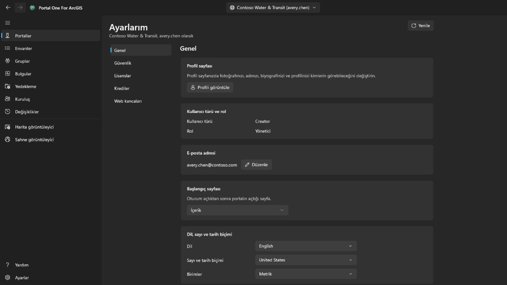

## Envanter

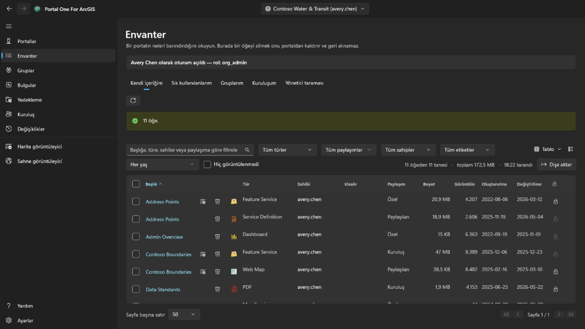

Hesabınızın görebildiklerini, portalın kendi içerik sayfasındaki gibi dört sekmede gösterir: **Kendi içeriğim**, **Sık kullanılanlarım**, **Gruplarım** (hepsi birlikte ya da tek bir grup; üyesi olmadan görebildiğiniz gruplar dahil) ve **Kuruluşum** (kuruluşun paylaştıkları). Sayfa açılır açılmaz okunur ve saklanır; yanlarındaki düğme gösterilen sekmeyi yeniden okur. Bir satırın sağ tıklama menüsü öğenin türüne göre değişir: bir web haritası portalın Map Viewer'ında, Field Maps Designer'da veya ArcGIS Pro'da da açılabilir, bir pano Dashboards'da, bir hikâye ArcGIS StoryMaps'te; bir dosya indirilebilir; ve her öğe sık kullanılanlara eklenebilir ya da oradan kaldırılabilir. Bir web haritası veya web sahnesindeki **Başka bir haritayla karşılaştır…**, onu ve seçilen aynı türdeki haritayı portaldaki şu anki hâlleriyle okur ve farkları listeler: eklenen, kaldırılan, taşınan veya yeniden adlandırılan katmanlar, değişen filtreler, semboloji, etiketler ve açılır pencereler, altlık harita, yer imleri ve başlangıç görünümü; liste kopyalanabilir. **Kopya oluştur…** onu bu portalda ya da oturum açtığınız başka bir portalda içeriğinize, yeni bir başlıkla, bir klasöre ya da başka bir üyeye vererek kopyalar; kopya özeldir ve başka bir portalda her katmanın öğesi önce orada aranır, öğesi orada olmayan katman adresinden yüklenir ve bu, hiçbir şey yazılmadan önce gösterilir. Sağ üstteki görünüm menüsü satırları portalın içerik sayfası gibi **Tablo**, her öğenin küçük resmi ve özetiyle **Liste** ya da kartlardan oluşan **Izgara** olarak gösterir ve sıralar; filtreler, sayfalama ve işaretli satırlar üçünde de aynı kalır. **Sık kullanılanlarım**, **Gruplarım** ve **Kuruluşum** sekmelerinde klasör, boyut ve koruma sayfa göründükten kısa süre sonra dolar: arama bunları döndürmez, bu yüzden her öğe okunur, önce görünen sayfa. Klasör yalnızca kendi öğelerinizde, yöneticiyseniz herkesinkinde gösterilir. Bir öğenin tablodaki, listedeki ve ızgaradaki başlığı, öğenin sayfasını portalınki gibi düzenlenmiş ayrı bir pencerede açar: **Genel bakış** üzerinde öğenin küçük resmi, türü, tarihleri ve özetiyle kartı, ardından **Açıklama**, türüne göre içerdiği şeyler (bir hizmetin **Katmanlar** ve tabloları, bir haritanın katmanları, bir coğrafi işlem hizmetinin görevleri), **Kullanım koşulları** ve yorum bırakılabilen **Yorumlar**; yanlarında **Harita görüntüleyicide aç**, **Sahne görüntüleyicide aç**, **Paylaş…** ve **ArcGIS Pro'da aç**, geri kalanı bir şevronun arkasında — barındırılan detay katmanı için, portalın sunduğu şekilde, **Yayınla** (döşeme, vektör döşeme, WFS, OGC detay veya 3B katman olarak), **Görüntü katmanı oluştur** (portalın kendi görüntü tasarımcısında, uygulamanın bir penceresinde), **Verileri dışa aktar** (shapefile, CSV, Excel, dosya coğrafi veritabanı, GeoJSON, KML, detay koleksiyonu veya GeoPackage öğesine) ve **Verileri güncelle** (dosyadan detay ekleyin veya güncelleyin, alan alan, ya da tüm katmanın üzerine dosyadan yazın, çalışmadan önce her şey listelenir); dosya, paket veya servis tanımı için **Yayınla** (ondan barındırılan katman, bir tane yayımlanana kadar sunulur; enlem ve boylam alanıyla yerleştirilen ya da tablo olarak tutulan CSV veya Excel dosyası) ve **Verileri güncelle** (aynı adlı dosya onun yerini alır, geçerli dosya önce bu bilgisayarda kaydedilir); vektör döşeme katmanı için **Stili görüntüle**, **Stili indir** ve portalın barındırmadığı bir katman için **Stili güncelle**; barındırılan döşeme, vektör döşeme veya sahne katmanı için **Katmanı değiştir**; web haritası veya web sahnesi için **Uygulama oluştur**; pano, hikâye, deneyim, web uygulaması, site, form veya not defteri için onu açan uygulama ve değiştirebiliyorsanız onu düzenleyen uygulama — her tür, portalın kendi öğe sayfasının verdiği düğmelerle, aynı sırada; ardından her öğe için **Meta verileri düzenle** veya **Meta verileri görüntüle** ve **Sık kullanılanlara ekle**; her biri **Değişiklikler** sayfasına kaydedilir — **Sahibi**, öğenin kaynağı ve kopyalanacak veya açılacak URL ile **Ayrıntılar**, bilgilerinin ne kadar tamam olduğunu en çok yardımcı olacak değişiklikle gösteren bir çubuk ve **Etiketler**, **Paylaşım**, **Klasör** ve **Teşekkürler**, her birini değiştiren eylemle birlikte; ardından türünün sahip olduğu **Veri**, **Görselleştirme** ve **Ayarlar** sekmeleri. **Ayarlar** portalı izler: her öğe için **Genel** (içerik durumu, silme koruması ve öğeyi silme, aramaların kullandığı kapsam), öğenin kendi bölümü — barındırılan detay katmanı için düzenleme, editör izleme, eşitleme, dışa aktarma ve gerçek eğriler, **Kaydet** ile birlikte kaydedilir; web haritası veya sahne için çevrimdışı modu; diğer katmanlar için servisin bildirdiği ayarlar — ve barındırılan detay katmanının web kancaları; her değişiklik bir şeyi kaldırıyorsa onaylanır, portaldan yeniden okunur ve geri koyabilen **Değişiklikler** sayfasına kaydedilir.

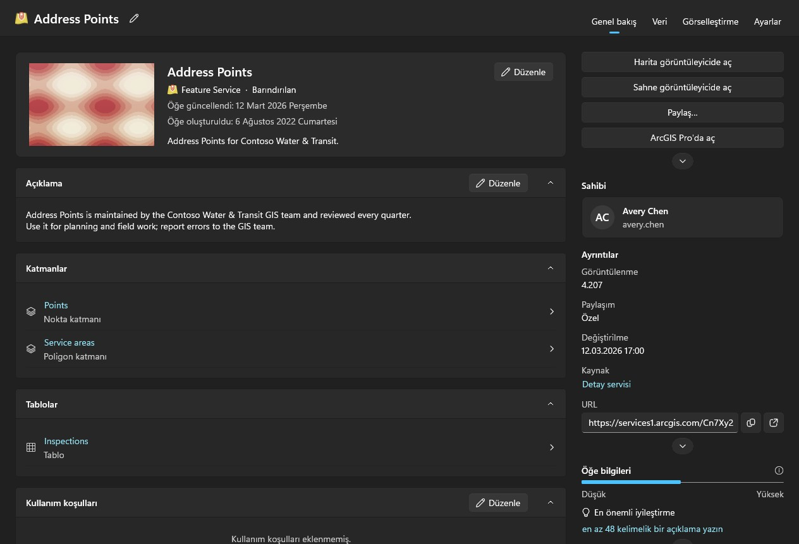

Başkalarının içeriğini taramak yöneticinin işidir. Diğer üyelerin sahip olduklarını okuyabilen bir hesap (portal:admin:viewItems), bu sayfada **Yönetici taraması** sekmesini, Bulgular ve Yedekleme sayfalarında bir tarama — bir üye, bir grup veya tüm kuruluş — ve **Kuruluş** sayfasının **Aktarım** sekmesini görür; diğer hesaplar bunları görmez. Kuruluş taraması arama yapmak yerine her üyeden içeriğini ister, çünkü arama yalnızca paylaşılanı döndürür ve bir denetim özel öğeleri kaçırmamalıdır. Biraz sürer ve iptal edilebilir.

Bulgular, Yedekleme ve görüntüleyiciler kendi içeriğinizi ilk ihtiyaç duyduklarında kendileri okur; önce başka bir sayfayı ziyaret etmeniz gerekmez. Bir yöneticinin taraması bunun yerine taranan içeriği koyar. Her tablo listesinin ne zaman okunduğunu söyler. Bir portal okunduktan sonra da değişmeye devam eder.

Her satırda ayrıca bir silme düğmesi var ve bu, uygulamadaki geri alınamayan tek şey: ArcGIS'te geri alma yok. Onay penceresi öğeyi, türünü ve sahibini adlandırır ve bu bağlantı için hatırlanan yedek klasöründe bir kopya bulunup bulunmadığını, varsa ne zamanki olduğunu söyler. Kopya yoksa engellemez, ama o satır sonradan silme işleminin hesabını verebilecek tek şeydir. Portalda silme korumalı bir öğe burada sessizce korumadan çıkarılmaz, reddedilir. Korumanın kendisini değiştirmek için satırın sonundaki kilidi ya da satırın menüsünü kullanın: bu ayrı bir adımdır, korumayı kaldırmadan önce onay istenir ve her değişiklik portaldan yeniden okunup günlüğe yazılır. Birçok öğe üzerinde aynı anda işlem yapmak için satırın başındaki kutuyu — veya filtrelerin tüm sayfalarda gösterdiği tüm satırlar için başlıktakini — işaretleyin. **Paylaş** paylaşım düzeyini ve grupları ayarlar; **Etiketler** etiket ekler ve kaldırır, diğerlerini korur; **Taşı** bir sahibin öğelerini onun klasörlerinden birine koyar; **Sahibi değiştir** onları **Kuruluş** sayfasının **Aktarım** sekmesi gibi başka bir üyeye aktarır ve **Değişiklikler** sayfası geri getirir; **Sil** kaç tane, kime ait ve yedekte kaç tane olduğunu söyleyen ve anladığınızı işaretlemenizi isteyen bir onaydan sonra kaldırır. Bu hesabın değiştiremediği öğelere ve silmeye karşı korumalı olanlara dokunulmaz ve bunlar sayılır. Öğeler tek tek işlenir ve günlüğe yazılır; **İptal** iki öğe arasında durur, özet de neyin neden başarısız olduğunu belirtir. Bir satırın sağ tıklama menüsünde **Paylaş…** o öğenin düzeyini ve gruplarını, **Ayrıntıları düzenle…** ise başlığını, özetini, açıklamasını, etiketlerini, katkıda bulunanları ve kullanım koşullarını değiştirir. İkisi de öğeyi portalda şu an olduğu hâliyle açar, yalnızca değiştirdiklerinizi gönderir, sonucu denetler ve günlüğe yazılır.

## Bulgular

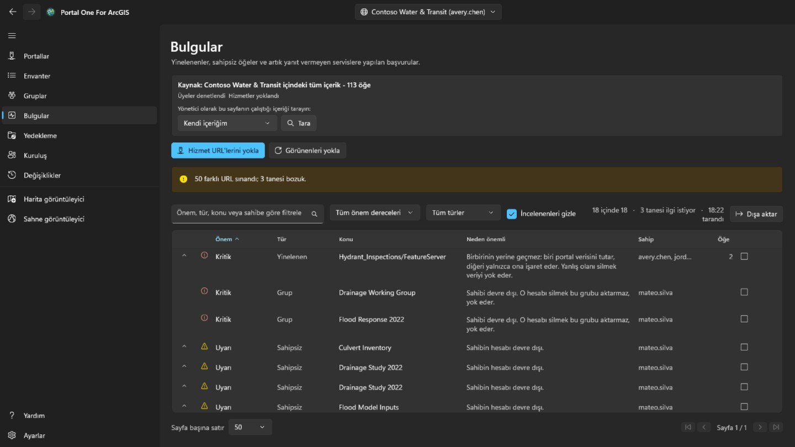

Gereksiz ve ölü içerik; kulağa ne kadar kötü geldiğine göre değil, ne kadar
dikkat hak ettiğine göre sıralanır.

- **Kritik**, burada dikkatsiz davranmanın başka hiçbir yerde bulunmayan bir
  şeyi yok edeceği anlamına gelir: aynı servise işaret eden iki öğe, yanlış
  olanı silmenin geri dönüşü yoktur.
- **Uyarı**, gerçek ve üzerinde güvenle işlem yapılabilir bir sorundur: sahibi
  ayrılmış bir öğe, artık yanıt vermeyen bir servis.
- **Bilgi**, bilinmeye değer ve sonunda sorunsuz çıkabilir.
- **Belirsiz**, saptanamadığı anlamına gelir. **Zaman aşımına uğrayan bir servis,
  ortadan kalkmış bir servis değildir** ve bu araç öyle demez.

Bir satırı açarak temsil ettiği öğeleri görün. Sorunsuz olduğuna karar verdiğinizde
incelendi olarak işaretleyin; karar her bağlantı için ayrı hatırlanır ve satır
kaybolmak yerine görünür kalır.

Bu sayfa bildirir. **Birbirine benzeyen iki öğeden hangisinin tutulacağını
söylemez**; çünkü bu, onları kimin kullandığına ve neyin onlara işaret ettiğine
bağlıdır.

## Yedekleme

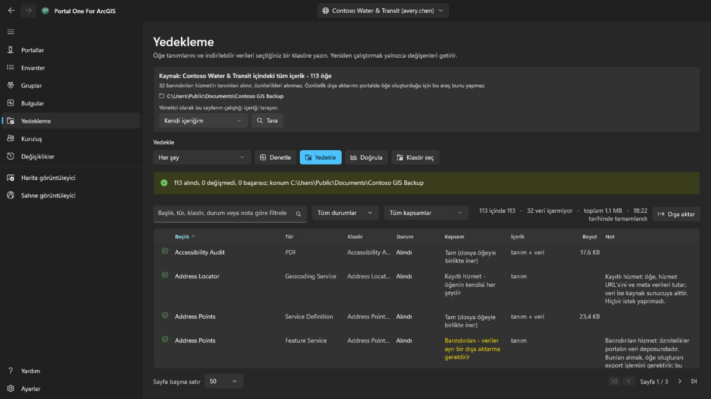

Öğe tanımlarını, kaynakları ve indirilebilir verileri seçtiğiniz bir klasöre
yazar. Aynı klasöre yeniden çalıştırmak yalnızca değişeni getirir; bu yüzden
**yarıda kalmış bir yedeği sürdürmek ile artımlı yedek almak aynı şeydir**.

- **Durumu denetle**, klasörü portalla karşılaştırır ve ne *yapacağını* bildirir,
  hiçbir şey yazmaz. "Yedeğim güncel mi" sorusunu saatler harcamadan böyle
  yanıtlarsınız.
- **Doğrula**, klasörü kendi kaydıyla karşılaştırır; portal hiç gerekmez.
  **Portal artık yokken geriye kalan soru budur — ve insanlar bir yedeği ciddi
  ciddi genellikle tam o anda açar.**

Klasör her bağlantı için ayrı hatırlanır ve başka bir kuruluşun yedeğini içeren
bir klasör üzerine yazılmak yerine reddedilir.

**Bir yedeğin içermediği şey.** Barındırılan bir servisin içindeki özellikler
öğede değil, portalın veri deposunda durur; onları çıkarmak, portalda yeni bir
öğe oluşturan bir dışa aktarma, yani bir yazma gerektirir. Bu araç bunu yapmaz;
dolayısıyla o satırlar verisiz, yalnızca tanım olarak alınır ve sayfa kaç tane
olduğunu söyler. Başka bir sunucudan kaydedilen servisler doğaları gereği
işaretçidir ve alınacak başka bir şeyleri yoktur.

## Üye ayrılışı

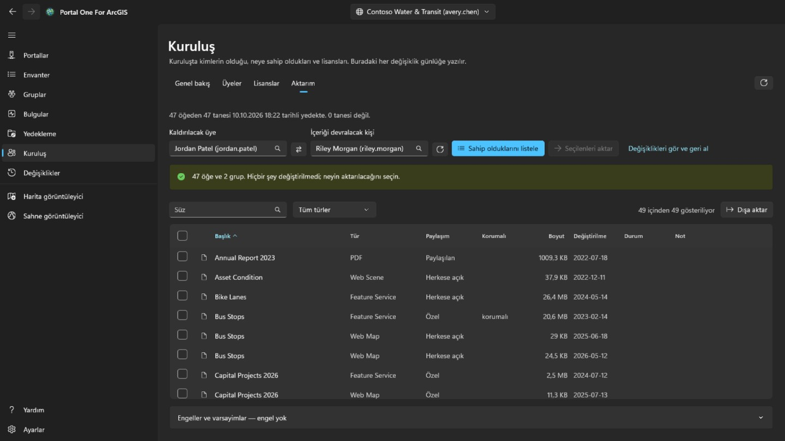

Bu, **Kuruluş** sayfasının **Aktarım** sekmesidir ve yalnızca içerik yöneten hesaplara gösterilir (portal:admin:viewItems). Bir üyeyi kaldırmanın ne anlama geldiğini hesaplar ve içeriğini tek tek, geri alınabilir biçimde taşır.

Kaldırılacak üyeyi ve içeriği devralacak kişiyi listelerden seçin; ikisi de
kuruluşun kendi rehberinden gelir, böylece **bir ad yanlış yazılıp gerçekten var
olan bir başkasına dönüşemez**. **Sahip olduklarını listele** hiçbir şeyi
değiştirmez: her öğeyi ve her grubu gösterir, taşınacakları işaretleyen sizsiniz.

Sizin için önceden işaretlenen hiçbir şey yoktur. Bütün bir hesabı taşımak başlık
satırındaki kutuya tek tıklamadır ve **o tıklama bir varsayılan değil, bir
karardır**.

- Gruplar bilerek öğelerle aynı tablodadır. Bir üye silindiğinde portal, onun
  hâlâ sahip olduğu grupları aktarmak yerine **yok eder**; bu yüzden
  işaretlenmemiş bir grup, **bu sayfadaki sessizce yıkıcı tek şeydir** ve sayım
  satırı bunu söyler.
- Onay alıcının klasörlerini listeler ve yenisini eklemenize izin verir; öğeler seçtiğiniz klasöre iner. Her aktarım bir sonraki başlamadan önce kayda yazılır ve **Değişiklikler** sayfası her birini geldiği klasöre geri koyar, yok olmuş klasörü yeniden oluşturur; tek tek veya bekleyenlerin tümünü birden.
- Bir öğeyi taşımak başkalarını da beraberinde taşıyabilir. Bir shapefile aktarmak, ondan yayımlanmış barındırılan servisi de götürür; bu yüzden bir satır, onu bu aktarım göndermediği hâlde geldiğini bildirebilir. **Değişiklikler** sayfasında yalnızca o satırı geri almak onu geri getirmez; onu taşıyan şeyle birlikte döner.
- Her taşımadan sonra öğe portaldan geri okunur. **Başarı döndüren bir istek, o
  istek hakkında bir ifadedir; öğenin şu an nerede olduğu hakkında değil.**

Üyenin hesabı ise **Kuruluş** sayfasında ve ancak üyeye ait hiçbir şey kalmadığında silinir. **Geri alınamayan tek adım odur.**

## Kuruluş

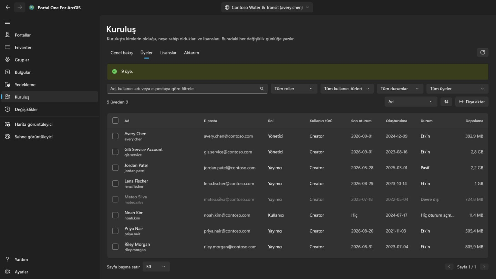

Portalda olduğu gibi bu sayfayı her üye görür. Kuruluşun yönetim irtibat kişilerini de gösteren **Genel bakış** herkes içindir; üyeleri görme ayrıcalığıyla e-posta, oturum açma, durum ve depolama olmadan salt okunur bir **Üyeler** sekmesi de. Üye işaretleme, **Dışa aktar**, **Lisanslar** ve her değişiklik yalnızca üyeleri yöneten hesaplar içindir (portal:admin:viewUsers). **Genel bakış** kuruluşu özetler: ArcGIS Online'da aboneliği, kullanıcı haklarını ve kredileri; üyeleri duruma, role ve kullanıcı türüne göre; ve ne kadar içerik ve depolama kullandığını.

**Üyeler** kuruluştaki herkesi listeler; ada, role, kullanıcı türüne, duruma veya gruba göre süzülür, herhangi bir sütuna göre sıralanır ve **Dışa aktar** ile bir CSV dosyasına kaydedilir. Üyeleri devre dışı bırakmak veya etkinleştirmek, rollerini ya da kullanıcı türlerini değiştirmek, gruplardan çıkarmak veya silmek için işaretleyin; yalnızca biri işaretliyse **Üye çıkışı** bu sayfanın **Aktarım** sekmesini açar. Kendi hesabınıza hiç dokunulmaz ve bir grubun sahibi grupta kalır.

Bir üyenin kendi menüsü için üzerine sağ tıklayın. **Görüntüle**, **Profil**, **Öğeler** ve yöneticiler için **Gruplar** bilgisini portalda değil burada, uygulamada gösterir; sıradan bir üye yalnızca kendisiyle paylaşılan öğeleri görür. **Yönet** yöneticiler içindir ve her öğe yalnızca gerektirdiği ayrıcalıkla görünür: **Eklenti lisansları** üyenin hangi yetkilere sahip olduğunu belirler, **E-posta adresini düzenle** ArcGIS ile oturum açan hesaplarda adresi değiştirir, **İçeriği aktar** üye için **Aktarım** sekmesini açar, **Üyeyi aktar** ise kullanıcı türünü, rolünü ve eklenti lisanslarını başka bir üyeye verip içerik ve gruplarla **Aktarım** sekmesinde devam eder. Aynı menü, çubuğun birden çok üye için yaptığı gibi tek bir üyenin kullanıcı türünü, rolünü, gruplarını, durumunu veya hesabını değiştirir.

**Sil** yalnızca hiçbir öğesi ve grubu olmayan üyeleri kaldırır. ArcGIS bir hesap silinirken bunları kimseye devretmez; bu yüzden önce **Aktarım** sekmesinde taşıyın. Bir şey olmadan önce kullanıcı adını, birden çok üyede ise kaç kişi olduğunu yazarsınız. Silme geri alınamaz.

**Lisanslar** her kullanıcı türünden kaçının atandığını ve ArcGIS Online'da aboneliğin kaç tane içerdiğini gösterir; **Üyeleri göster** o türe sahip olanları listeler. Kimde olduğunu görmek için bir eklenti lisansı seçin ve işaretlediğiniz üyelerden geri alın.

Her değişiklik portaldan yeniden okunur, öncesinde ne olduğu ile birlikte kaydedilir ve **Değişiklikler** sayfasında listelenir. Bu üye değişiklikleri oradan geri alınmaz: birini tersine çevirmek için karşıt değişikliği yapın.

## Değişiklikler

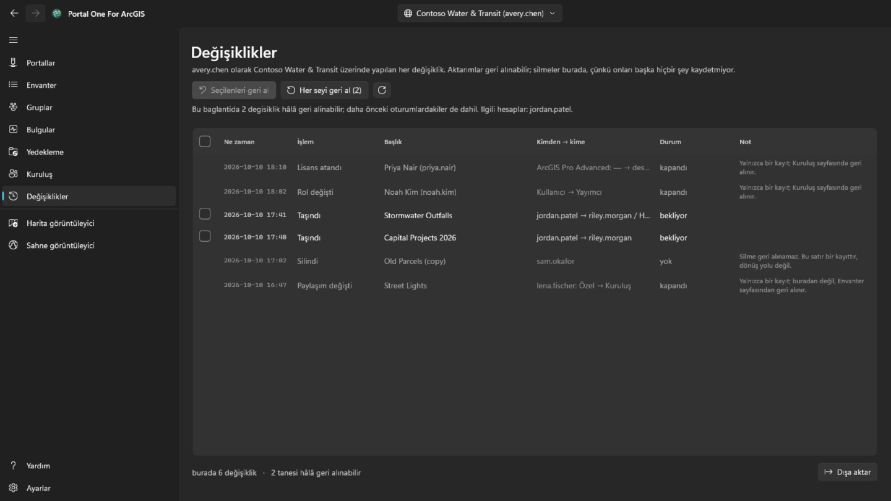

**Değişiklikler** sayfası oturum açmış her hesaba gösterilir. Bu aracın şu anda seçili portalda değiştirdiği her şeyi en yeniden başlayarak listeler: aktarımlar, silmeler, paylaşım, etiketler, klasörler, ayrıntılar, koruma ve üye değişiklikleri. Başka portallarda yapılan değişiklikler sayılır, listelenmez. Liste CSV’ye aktarılabilir.

Geri konabilen aktarımlarda bir işaret kutusu vardır. **Seçilenleri geri al** işaretli aktarımları geri koyar; **Her şeyi geri al** ise kimin içeriği olduğunu söyleyen bir onaydan sonra bu bağlantıda hâlâ bekleyen her şeyi geri koyar. Öğeler geldikleri klasörlere döner, yok olmuş bir klasör yeniden oluşturulur. Silmeler ve üye değişiklikleri yalnızca kayıttır: silme geri alınamaz, üye değişikliği ise karşıt değişiklik yapılarak tersine çevrilir. Bir aktarımı geri almak da bir aktarımdır ve aynı ayrıcalığı gerektirir (portal:admin:reassignItems, bir grup için reassignGroups); bu ayrıcalığı olmayan bir hesap yalnızca kaydı görür.

Harita görüntüleyiciden üzerine kaydedilen bir web haritası ve orada eklenen, düzenlenen veya silinen bir detay, satırının menüsünden geri alınır. Bir detay düzenlemesi yalnızca detay, düzenlemenin bıraktığı gibi kaldıysa geri alınır: eklenen detay silinir, düzenlenen detay önceki değerlerine ve şekline döner, silinen detay yeni bir nesne kimliğiyle yeniden eklenir. Geri alma da kaydedilir, böylece o da aynı şekilde geri alınabilir. Bir web haritasını geri almadan önce aynı menüdeki **Şimdiki haritayla karşılaştır**, o kayıttan önce saklanan kopyanın portalın şu an tuttuğu haritadan nasıl farklı olduğunu listeler: altlık harita, eklenen, kaldırılan, yeniden adlandırılan veya taşınan katmanlar ve her katmanın görünürlüğü, opaklığı, stili, etiketleri, filtresi, ölçek aralığı, açılır penceresi ve yenilemesi, tablolar, yer imleri ve haritanın açıldığı yer.

## Harita görüntüleyici ve sahne görüntüleyici

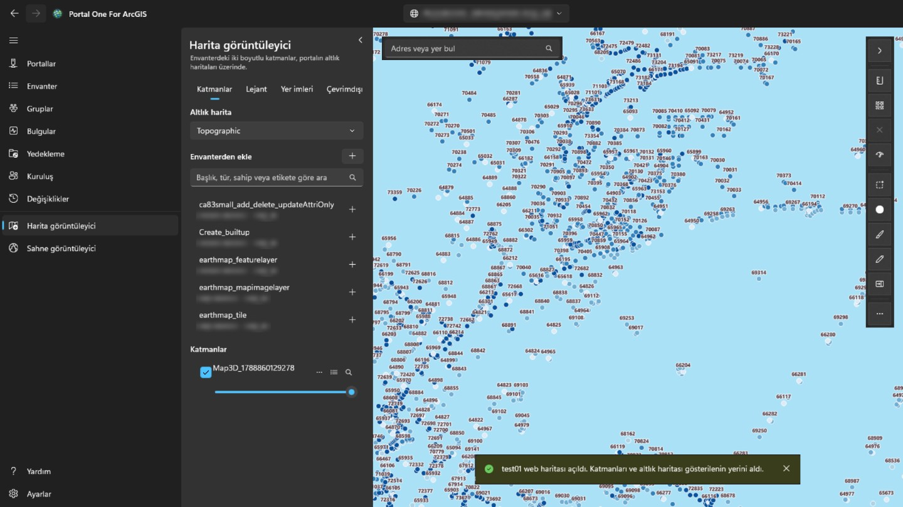

**Harita görüntüleyici** iki boyutlu katmanları portalın altlık haritaları üzerinde gösterir; **sahne görüntüleyici** bunları ve üç boyutlu olanları — sahne katmanları, ağlar, nokta bulutları, 3D Tiles — arazili bir küre üzerinde gösterir. Soldaki panel bu portal için okunanlarda arar — otomatik okunan kendi içeriğiniz, bir yöneticinin taradıkları ve Envanter sayfasının sekmelerinin okudukları — ve yalnızca o görüntüleyicinin çizebildiklerini listeler. Eklemek için bir öğe seçin. Bir web haritası harita görüntüleyicide, bir web sahnesi sahne görüntüleyicide, kendi katmanları ve altlık haritasıyla bütün olarak açılır. Envanter sayfasında bir başlığın yanındaki görüntüleyici düğmesi (satırın sağ tıklama menüsünde de var), öğeyi onu gösterebilen görüntüleyicide açar.

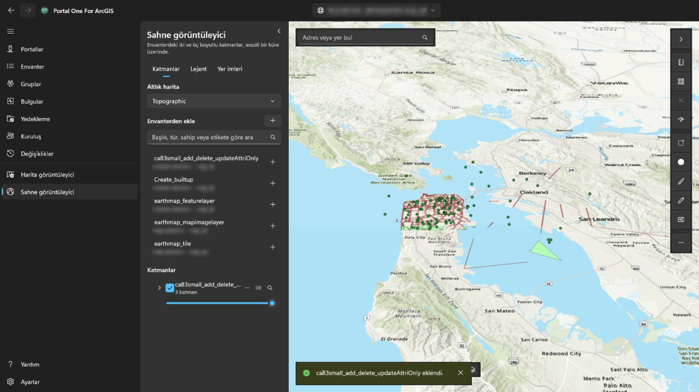

Panelin sağ üst köşesindeki düğme paneli daraltarak tüm genişliği haritaya veya sahneye bırakır ve yeniden açar; görüntüleyiciye her girişte panel açık olur. Her katman gösterilebilir veya gizlenebilir, daha saydam yapılabilir, yukarı ya da aşağı taşınabilir, ona yakınlaştırılabilir veya kaldırılabilir. Haritada bir detaya tıklamak alanlarını gösterir: katmanın portalda ayarlanmış bir açılır penceresi varsa onun seçtiği alanları, onun etiketleri ve biçimleriyle; yoksa hepsini. **Katmanlar** sekmesinin yanındaki **Lejant** sekmesi, görünür her katmanın sembollerinin ne anlama geldiğini gösterir. **Yer imleri**, bir web haritası veya web sahnesiyle kaydedilmiş yerleri listeler; kendi yer iminizi eklemek için orada geçerli görünüme bir ad verin, geri dönmek için birini seçin. Sahne yer imi kameranın yönünü ve eğimini korur. Detay içeren bir katmanın tablo düğmesi, haritanın altında **öznitelik tablosunu** açar; satırlar ikişer yüzlük gelir ve katmanın çizildiği gibi filtrelenir. Bir satır seçmek o detayı vurgular ve ona yakınlaştırır. **Dışa aktar**, yalnızca yüklenenleri değil, tablonun filtreleri ve sıralamasıyla tuttuğu tüm satırları (en fazla 50.000) yazar: tablonun gösterdiği gibi CSV, enlem ve boylamda GeoJSON ya da katmanın kendi koordinat sisteminde sıkıştırılmış shapefile olarak (alan adları on karaktere kısaltılır). Bir sütun başlığı tabloyu o sütuna göre sıralar, filtreler (katman filtresi gibi, sütun başına bir koşul, hepsi birlikte) ya da istatistiklerini gösterir: kaç satırda değer olduğu, en küçük ve en büyük değer, sayılar için toplam, ortalama ve standart sapma ile en sık değerler; yalnızca yüklenen satırlar değil, filtrelerden geçen tüm satırlar üzerinden. **Yalnızca seçilenler** tabloyu seçili satırlara daraltır. Harita görüntüleyicide, haritanın üzerindeki **Mesafe** ve **Alan**, noktalara tıklayarak çizdiğiniz şekli ölçer: düz harita üzerinde değil, yeryüzü boyunca; Windows bölgenize göre metrik veya İngiliz birimleriyle. Sahne görüntüleyicide **Mesafe**, arazi veya model üzerinde iki tıklama arasında (doğrudan, zemin boyunca ve dikey) ölçer; **Alan** araziye oturtulmuş köşeleri izler. **Web haritası olarak kaydet**, kendi içeriğinizde seçtiğiniz bir klasörde, şu anda gösterilen altlık harita, katmanlar ve yer imleriyle yeni bir web haritası öğesi oluşturur; harita şu an nerede ise orada açılır ve küçük resmi haritanın bir görüntüsüdür. **Kaydet**, size ait olduğunda veya başkalarının içeriğini güncelleyebildiğinizde, bu bilgisayarda bir kopya tuttuktan sonra portaldan açılan web haritasının üzerine yazar; sahne görüntüleyici kaydedemez. Arama kutusu portalın coğrafi kodlayıcısıyla adres ve yer de bulur. **Dışa aktar** görünümün PNG'sini kaydeder; portalda yazdırma hizmeti varsa **Yazdır** onu çalıştırır. Zaman duyarlı katmanlar aralığı adım adım veya oynatmak için **Zaman** çubuğu açar. Katmanlar siz başka sayfalarda çalışırken kalır ve başka bir portala geçtiğinizde baştan başlar. Portalın oturumu yalnızca kendi katmanları için kullanılır ve hiçbir zaman başka bir kuruluşun sunucusuna gönderilmez; bu yüzden başka bir yerden kaydedilmiş ve oturum açılmasını isteyen bir katman yüklenmez. Haritada ölçerken çizimi bitirmek için çift tıklayın, Enter'a basın veya **Bitir**'i seçin: çizim, bir sonraki ölçüme ya da araçların yanındaki ✕'e kadar sonucuyla birlikte haritada kalır. Esc çizimi iptal eder, Ctrl+Z veya Geri tuşu son noktayı geri alır. Özellikleri olan bir katmandaki stil düğmesi katmanın nasıl çizileceğini değiştirir: seçtiğiniz renk ve boyutta tek bir sembol, bir alanın her değeri için bir renk (**Kategoriler**) ya da sayısal bir alanın bir renk rampası boyunca sınıfları (**Sınıflar**; doğal kırılmalar, eşit aralık veya yüzdelik dilime göre). Harita her değişikliği anında gösterir; **Uygula** korur, **İptal** önceki çizimi geri getirir, **Özgün stile dön** ise katmanın geldiği stili. Gösterge de güncellenir ve haritayı web haritası olarak kaydetmek stili korur. Aynı satırdaki **…** düğmesi ayrıca **Etiketler…** ile bir alanın değerini her özellikte seçtiğiniz boyut ve renkte, hale ile ve belirli bir ölçekten itibaren gösterir; **Filtre…** ile de yalnızca bir alan, bir karşılaştırma ve bir değerden oluşan koşulları (tümünü veya herhangi birini) sağlayan özellikleri gösterir. Eşleşen sayısı anında sayılır, katmanın web haritasından gelen filtre korunur ve öznitelik tablosu da filtreye uyar. Haritanın sol altında pusula haritayla döner (yeniden kuzeye çevirmek için seçin); yanında zemin üzerinde ölçülen ölçek çubuğu, ölçek ve işaretçinin altındaki koordinatlar (kopyalamak ya da ondalık derece ile derece, dakika, saniye arasında geçmek için seçin) ve tıklandığında haritayı taşıyan bir genel bakış haritası düğmesi bulunur. **Seç**, görünür tüm katmanlardaki özellikleri bir dikdörtgen, serbest çizim ya da çokgen içinde seçer: bir panel her katmandaki sayıyı ve sayısal bir alanın toplamını, ortalamasını, en küçük ve en büyük değerini gösterir; bunları tabloda gösterir, yakınlaştırır ya da CSV olarak kaydeder. **Tampon**, seçili özelliklerden ya da çizdiğiniz bir nokta, çizgi veya alandan belirli bir uzaklıktaki alanı çizer, bu bilgisayarda yeryüzü üzerinde ölçer (analiz servisi ve kredi yok) ve kapsadığı özellikleri seçebilir. **Kaydır**, sürüklediğiniz ayırıcının solunda bir katmanı, sağında ise o katman olmadan haritayı gösterir. **Haritayı denetle** haritadaki her katmana bakar ve paylaşıldığı kişiler için neyin çalışmayacağını ya da yanıltacağını söyler: yüklenmeyen katmanlar, silinmiş ya da haritadan dar paylaşılmış öğeler, http üzerinden ya da portal dışından sunulan servisler, kullanımdan kaldırılmış veya başka kuruluşun öğeleri, ölçek aralığı olmayan büyük katmanlar ve hiç açılır pencere olmaması; rapor kopyalanabilir. Ayrıca bir katmanın açılır penceresinin, semasının veya etiketlerinin andığı ama katmanda olmayan alanları söyler ve her hizmet katmanının detaylarını saymanın ne kadar sürdüğünü ölçer: 3 saniyeyi geçerse not edilir, 10 saniyeyi geçerse ya da 30 saniyede yanıt gelmezse uyarıdır. Bir katmanın **…** menüsünde **Kullananlar…** envanterdeki harita ve uygulamaları okuyup katmanı doğrudan ya da bir harita üzerinden kullananları listeler; **Özellikler…** kaynağını, sahibini, çizimini ve özellikler için sayı ve alanlarını gösterir. Arama kutusu koordinat da alır — herhangi sırada iki ondalık sayı, derece/dakika/saniye, UTM veya MGRS — ve coğrafi kodlayıcı olmadan oraya gider. **Dışa aktar**, web haritasını portalın görüntüleyicisinde bu konumda açan bir bağlantıyı ya da merkezin koordinatlarını kopyalayabilir. Bir web haritasının üzerine kaydetmek önceki tanımını saklar ve **Değişiklikler** sayfası onu o kaydın menüsünden geri yükleyebilir. Katman menüsündeki katman ayarları görünür ölçek aralığını, detay katmanı açılır pencerelerini (başlık yer tutucuları, alan etiketleri, görünürlük ve sıra) ve desteklenen yenileme aralıklarını ayarlar; önizleme canlıdır ve web haritasını kaydetmek bunları korur. Stil iletişim kutusu artık nokta katmanlarını ısı haritası olarak çizebilir, nokta simgelerini veya çizgi genişliklerini sayısal bir alana göre boyutlandırabilir ve sayı etiketli nokta kümelerini açabilir; poligon katmanları mevcut renk stillerini korur. Katmanlar sekmesindeki Ekle menüsü bir servis URL'si ya da yerel dosya da ekleyebilir: CSV ve GeoJSON kaydedilirken gömülü detay koleksiyonlarına dönüşür, shapefile ile KML veya KMZ dosyaları yerel kalır ve kaydetmeden önce belirtilir. Çizim; noktalar, çizgiler, alanlar, dikdörtgenler, daireler veya elipsler, serbest şekiller ve metin içeren kaydedilen bir işaretleme katmanı ekler; bir çizim detayını seçerek yeniden şekillendirin, stilini değiştirin, silin, son işareti geri alın veya katmanı temizleyin; çizim detay koleksiyonu web haritası ile kaydedilir. Harita görüntüleyicinin **Düzenle** aracı, düzenlemeye izin veren servis detay katmanlarını listeler, salt okunur katmanları açıklar, bir şablondan yeni detay çizmenizi veya haritadaki mevcut bir detayı seçmenizi sağlar, düzenlenebilir alanları doğrular ve onaylanan değişiklikleri canlı detay servisine uygular. Düzenlenebilir bir katmanın öznitelik tablosunda Ctrl veya Shift ile satır seçin (yüklenenlerin tümü için Ctrl+A): **Düzenle** bunlardan birini düzenleme formunda açar, **Alanı değiştir** ise değeri her detayın kendi kurallarına göre denetledikten sonra hepsinde bir alanı tek bir değere ayarlar.  **Alan değiştir** ayrıca bir ifade kullanabilir — köşeli parantezde alan adları, tırnak içinde metin, + - * / ve birkaç işlev — böylece seçilen her satır diğer alanlarından kendi değerini alır.  Düzenleme panelinde **Geometri araçları** **Haritada seç**, **Birleştir**, kesme çizgisiyle çizgi veya polygon **Böl**, çizilen alana **Kırp** veya aynı şekil türündeki başka düzenlenebilir katmana **Katmana kopyala** işlemlerini sunar; her biri **Değişiklikler** sayfasına kaydedilir. Her biri **Değişiklikler** sayfasına kaydedilir, bir alan değişikliği tek kayıt olarak, ve oradan geri alınır. Seçili bir detay için, katman ek tutuyorsa düzenleme formu eklerini de açmak, eklemek veya kaldırmak üzere listeler (kaldırılan dosya önce bu bilgisayara kopyalanır ve her değişiklik **Değişiklikler** sayfasına kaydedilir) ve onunla ilişkili kayıtları salt okunur gösterir. Bir detay çizilirken veya yeniden şekillendirilirken köşeleri, düzenleme panelinde **Yakalama** altında işaretli katmanların detaylarına yakalanır ve geometri kılavuzları dik açılar ile paraleller önerir; ikisi de kapatılabilir ve yakalama mesafesi ayarlanabilir. Ölçüm, Çizim ve diğer araçlar yakalama yapmaz. **Web haritası olarak kaydet** yanındaki **Paylaş**, bu hesap sahibi olduğunda ya da başkalarının içeriğini paylaşabildiğinde, ekrandaki web haritasını veya web sahnesini Envanter sayfasının bir öğeyi paylaştığı gibi paylaşır: düzey ve gruplar seçildikten sonra harita paylaşılacağı hâliyle denetlenir ve o düzeyde çalışmayacak ya da yanıltacak olanlar paylaşım yapılmadan önce listelenir. **Ayrıntılar**, Envanter sayfasında olduğu gibi öğenin başlığını, özetini, açıklamasını, etiketlerini, katkı bilgilerini ve kullanım koşullarını düzenler; ayrıca görünümün resmini küçük resim olarak kullanabilir ve portal aramasının kullandığı öğe kapsamını görünüme ayarlayabilir. Haritanın nerede açılacağı, üzerine kaydedilerek belirlenir. Bir detayın açılır penceresi, yazarının belirlediği sırayla, portalda yapılandırılan pencerenin resimlerini, grafiklerini ve eklerini ve ilişkili kayıtlarını da gösterir; Arcade ifadeleri önce değerlendirilir. Grafikler uygulamanın temasında çizilir, resimler yalnızca https adreslerinden yüklenir ve bir ek tıklanınca açılır. Bir servis taşındığında veya değiştirildiğinde, katmanın **…** menüsündeki **Web haritalarında değiştir…**, onu kullanan envanterdeki her web haritasını ve web sahnesini, her birinde neyin değişeceğini listeledikten sonra yeni adrese yönlendirir (tüm servisin katmanları numaralarını korur); her harita yazılmadan önce saklanır ve **Değişiklikler** sayfasına kaydedilir, orada karşılaştırılıp geri yüklenebilir. Katman listesi grup katmanlarını ağaç olarak gösterir: içindeki katmanları yönetmek için bir grubu genişletin, herhangi bir katmanı yeniden adlandırın, seçtiğiniz üst düzey katmanlardan yeni bir grup oluşturun, bir katmanı gruba taşıyın veya gruptan çıkarın ya da grubu yeniden çözün. Harita görüntüleyici bir çizgiden yükseklik profili çizebilir; kredi harcayan analiz servisleri yerine döşemeli araziyi kullanır ve örneklenen mesafeler ile yükseklikleri kopyalamanıza veya dışa aktarmanıza izin verir. Bir servis detay katmanı haritanın altında salt okunur bir grafik de açabilir; tüm detayları indirmek yerine servis istatistiklerini kullanır, görünüme veya seçime sınırlandırılabilir, PNG ya da CSV dışa aktarır ve web haritasına kaydedilmez.  Bilgisayarınızdan eklenen CSV, GeoJSON veya shapefile, katman menüsünden barındırılan detay katmanı olarak yayımlanabilir; kaynak dosya yüklenir, servis içeriğinizde oluşturulur ve yerel katmanın yerini alır. Portal bunları detay servisi olarak yayımlamadığı için KML ve KMZ sunulmaz.  Stil iletişim kutusu ayrıca boyut alanına sahip türler ve iki alanlı ilişki haritaları sunar; sürekli renk rampaları, nokta yoğunluğu ve binning burada ArcGIS Maps SDK for .NET 300.1 tarafından güvenli biçimde desteklenmediği için gösterilmez. Etiketler ve açılır pencere alanları, uygulamadan önce gerçek bir detayla test edilen alan ekleme ve yaygın parçalarla Arcade ifadeleri de kullanabilir.  Düzenlenebilir detay katmanları web haritasına kaydedilmiş bir form da taşıyabilir: Düzenleme paneli formun gruplarını, zorunluluk kurallarını ve hesaplanan değerlerini izler; katman menüsündeki **Formu düzenle…** komutu bu formu düzenler. Portal web haritaları harita görüntüleyicisinden çevrimdışı alınabilir: uygulama çevrimdışı yetenekleri denetler, önceden planlanmış bir alanı veya geçerli görünümü LocalState altına indirir, Çevrimdışı haritalar sekmesinden açar, düzenlemeleri yerel olarak kaydeder ve hesap Basic Runtime lisansı veya üstüne sahipse bunları tek bir Changes girişi olarak geri eşitler.  Harita ağ analizi, portal hizmetlerinden rotalar, hizmet alanları ve en yakın tesisleri ekler; ArcGIS Online kredi tüketir.  İlişkili kayıt bölümleri, gizli bir SDK haritasındaki ilişki tabloları üzerinden ilişkileri de okur; böylece ilişkili tablolar web haritasında olmasa bile çoktan çoğa ve öznitelikli ilişkiler çalışır.  Sahnelerde detay katmanları tıklamayla, zemine yansıtılan dikdörtgenle veya tıklanarak çizilen poligonla seçilebilir, seçili detaylardan ya da tıklanan bir nokta, çizgi veya alandan tampon oluşturulabilir, grafiklerde gösterilebilir ve düzenlenebilir: öznitelikler katman formuyla, yeni detaylar ve şeklin tamamını yeniden çizme tıklanan noktalarla, ayrıca birleştirme, kopyalama, bölme ve kırpma; yalnızca köşe köşe yeniden şekillendirme haritaya özgü kalır çünkü SDK geometri düzenleyicisini yalnızca MapView üzerinde sunar. Sahne çizimleri (tıklamayla yerleştirilen noktalar, çizgiler, poligonlar, dikdörtgenler, elipsler ve metin) burada web sahneleri kaydedilemediği için yalnızca oturum boyunca kalır; serbest çizim yalnızca haritadadır. Çizim panelindeki **Çizimi GeoJSON olarak dışa aktar**, iki görüntüleyicideki işaretleri de dosya olarak saklar. Sahneler, tıklanan bir çizgi boyunca **Yükseklik profili** de çizer; sahnenin kendi zemini varsa ondan, yoksa harita görüntüleyiciyle aynı kaynaktan okur. **Ağ** paneli de sahnelerde çalışır: zemine tıklamak durak, tesis ve olay ekler, sonuçlar sahneye serilir ve katman olarak eklenen rota yalnızca oturum boyunca kalır.  Sahne işlemleri paylaşır, ayrıntıları düzenler, bağlantı veya merkez kopyalar, görüntü dışa aktarır, katmanları denetler, kullanımları gösterir ve kaynakları değiştirir; sahne araçları yönü, işaretçi koordinatlarını, genel görünümü ve kamera yüksekliğini gösterir, yerel mobil sahne paketleri salt okunur açılır. Sahne **Karşılaştırma** aracı tüm sahnenin eşitlenmiş ve kırpılmış bir kopyasını kullanır; gezinme ana sahnede kalırken ayırıcı sahneyi seçilen katmanla ve katmansız karşılaştırır.  Kısa yer arama kutusu sol üstte kalır; sağ araç çubuğundaki ok aramayı ve araçları animasyonla gizler veya geri getirir, Diğer komutlar ise daha az kullanılan öğe, denetim, zaman ve dışa aktarma komutlarını içerir.

## Arka planda çalışma

Pencereyi kapatmak uygulamayı sonlandırmaz, bildirim alanına alır; **böylece
saatler süren bir tarama ya da yedek, "pencereyi kenara çekme" hareketiyle
ölmez**. Simge neyin çalıştığını söyler ve oradaki **Çıkış** gerçek çıkıştır. Menüsünden ayrıca bir portal ekleyebilir, Microsoft Store'da güncelleme arayabilir veya bulunanı yükleyebilirsiniz.

Bildirim alanı simgesini kapatırsanız pencereyi kapatmak uygulamayı sonlandırır:
simge olmadan pencereyi geri getirecek hiçbir şey olmazdı.

**Windows ile başlat**, oturum açıldığında uygulamayı doğrudan bildirim alanına
başlatır; böylece açtığınızda kullandığınız bağlantı zaten oturum açmış olur.

## Ayarlar

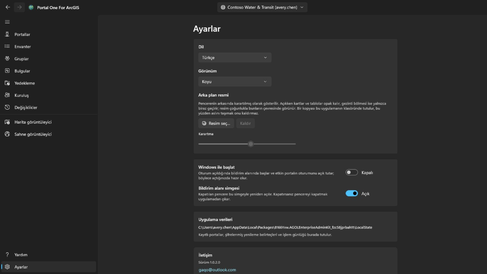

Açık, koyu ya da Windows neyse o; tema seçtiğiniz anda değişir. Microsoft Store'da daha yeni bir sürüm olduğunda gezinti bölmesinde Ayarlar'ın yanında bir **Güncelle** düğmesi görünür; uygulama yükleme sırasında kapanır, yeni sürümle yeniden başlar ve düğme kaybolur. Pencerenin altına bir **arka plan resmi** konabilir; göründüğü sürece kartlar ve tablolar opak kalır, gezinti bölmesi ise yalnızca biraz geçirir, böylece çoğunlukla bunların çevresinde görünür, **Karartma** ise ne kadar koyulaştırılacağını belirler.

Arayüz on dört dilde gelir ve birini sabitlemedikçe Windows'u izler. **Dil
değişikliği bir sonraki başlatmada geçerli olur**, orada bir düğmeyle sunulur;
çünkü çerçeve her ekranın metnini o ekran kurulurken bir kez okur: hemen
uygulamak yalnızca sonradan açılanı değiştirirdi.

**Abonelik**, işareti sayfalardan kaldıran şeydir ve burada onun arkasında başka bir şey yoktur: bir portala oturum açmak, envanterini çıkarmak, yedeğini almak ve harita yazdırmak, ödeme yapıp yapmadığınıza bakılmaksızın ücretsiz kalır. Microsoft Store üzerinden satın alınan, her zaman iptal edilebilen aylık bir aboneliktir; bir abonelik olduğunda kart, ne kadara mal olduğunu ve ne zaman yenilendiğini söyler. *Satın almayı geri yükle*, ödeme yaptığınız ve işaretin hâlâ durduğu durum içindir: abonelik, bu uygulamanın haberdar olmadığı Store'un kendi penceresinde satın alınmış olabilir.

**Filigran**, her sayfanın sağ alt köşesine kendi satırınızı koyar: burada **Diğer ayarlar** altında seçtiğiniz yazı tipi, boyut, kalınlık, renk ve yoğunlukla, en çok yirmi dört karakter — kartın kendisinde yalnızca onu açan anahtar görünür. Otuz piksel boyutunda, tam yoğunlukta koyu kırmızı başlar ve her altı dakikanın bir dakikasında sayfada gezinir: beş dakika köşede, bir dakika yolda, sonra yine köşede. Gezinir, çünkü pencerenin resmini çeken kişi kenarların nerede olacağına karar verir ve bir köşe en kolay dışarıda bırakılan yerdir; durur, çünkü üzerinde çalışılan bir sayfanın satırlarının arasından bir çizgi geçmemelidir — gezinmeyi büsbütün durduran anahtar **Diğer ayarlar** altındadır. Buraya ilk geldiğinizde açıktır ve *Abonelik yok* der — uygulamadan çıkan şey, nasıl yapıldığını söylemeyen bir yerde görülür. **Yoğunluk**, o renkten ne kadar kullanıldığıdır: en altında her renk aynı soluk iz olur, bu yüzden renk tek başına ne kadar göründüğünü söyleyemez. Boş bırakılırsa satır varsayılana döner. Abone olana kadar bu karttaki hiçbir şey değiştirilemez — ne anahtar ne de yazı: *Abonelik yok* der ve ona basmak yukarıdaki kartı açar; abone olmak, onu kapatmanızı ve ne yazdığını seçmenizi sağlayan şeydir; bir şey seçilmezse uygulamanın kendi adını yazar. İşaretlenen ekrandır: uygulamanın kaydettiği görseller portalın kendi baskı hizmetinden gelir ve portalın gönderdiği gibi çıkar.

## Klavye

Tabloların herhangi birinde:

- **Ctrl+F** imleci süzme kutusuna koyar.
- **Ctrl+E** tablonun gösterdiği satırları, gördüğünüz sütun ve sıralamayla dışa aktarır.

## Neyin nerede durduğu

- Yedekler seçtiğiniz klasöre gider; açabileceğiniz, kopyalayabileceğiniz ve
  taşıyabileceğiniz sıradan bir klasördür.
- Bağlantılar, tercihler ve ayrılış günlüğü uygulamanın kendi deposundadır;
  kimlik bilgisi olanlar şifrelidir.
- Dışa aktarılan CSV dosyaları, kaydettiğiniz yerdedir.

Hiçbir şey hiçbir yere yüklenmez. **Bu aracın yapımcılarında ne bir hesap vardır
ne de telemetri.**

## İletişim

Bir şey çalışmıyorsa ya da beklediğinizi yapmıyorsa: **gaqo@outlook.com**.

En çok yardımcı olan şey: ne yapıyordunuz, onun yerine ne oldu, portal ArcGIS Online mı ArcGIS Enterprise mı ve hangi sürüm — Bağlantılar sayfası ikisini de gösterir — ve arayüz hangi dildeydi.

Lütfen parola, belirteç ya da uygulamanın kendi depolama klasöründeki dosyaları eklemeyin. Orada oturum açmış bir oturum tutulur ve bir soruyu yanıtlamak için bunların hiçbiri gerekmez.
