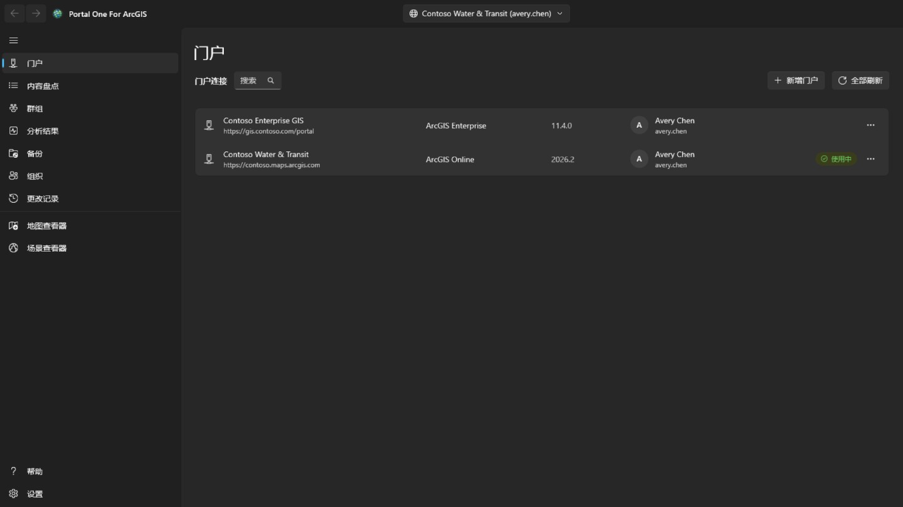
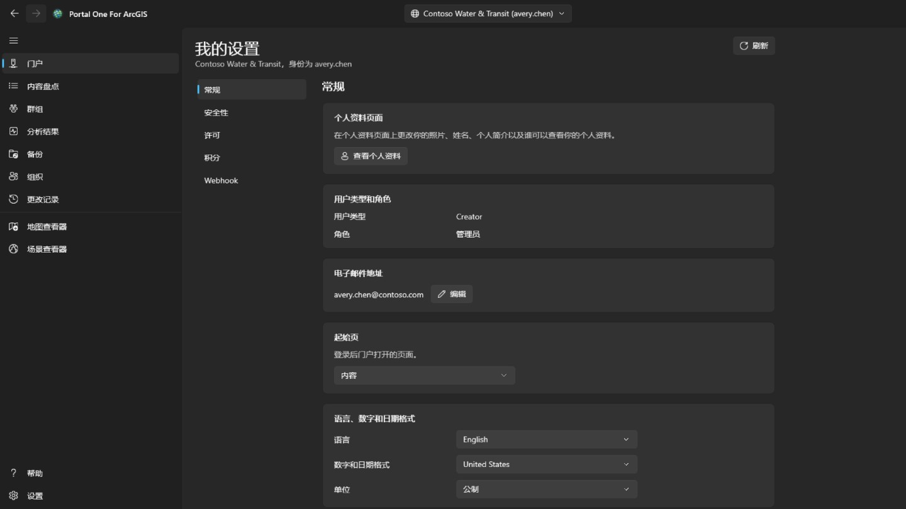
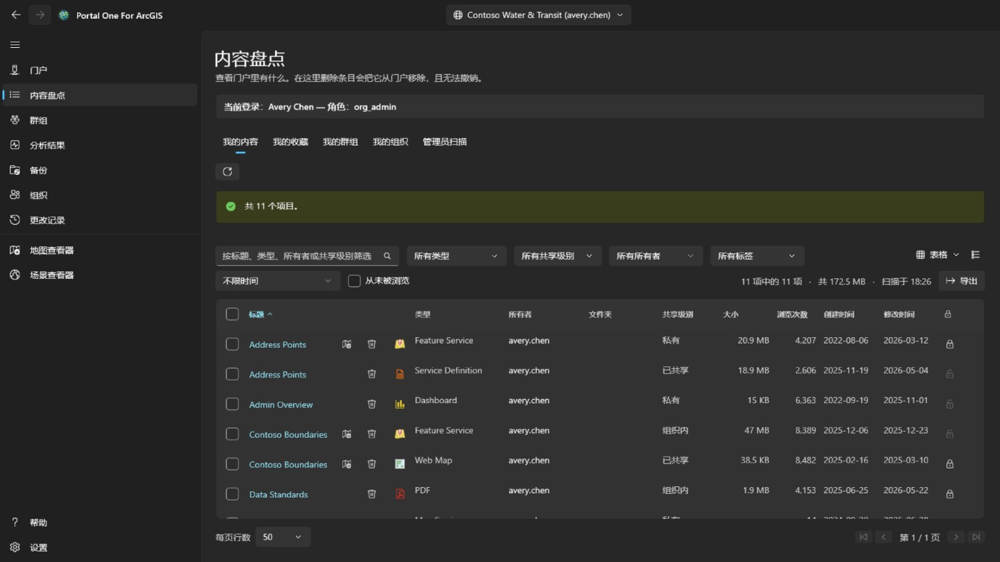
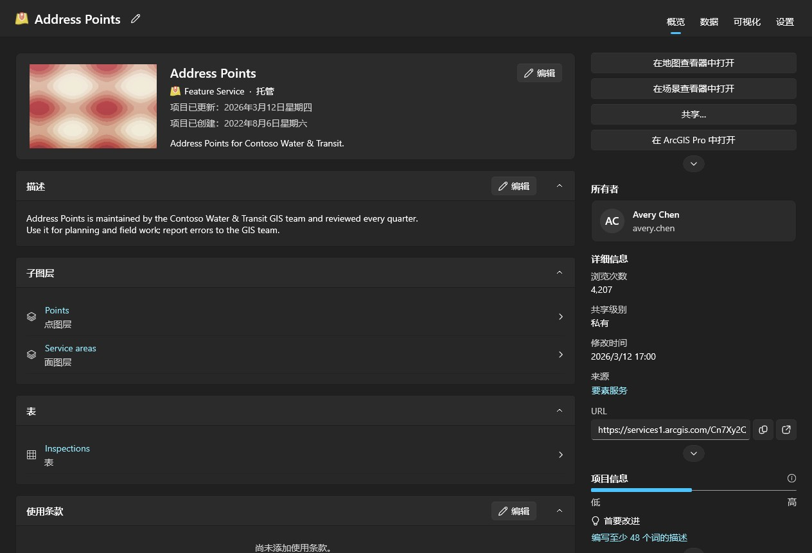
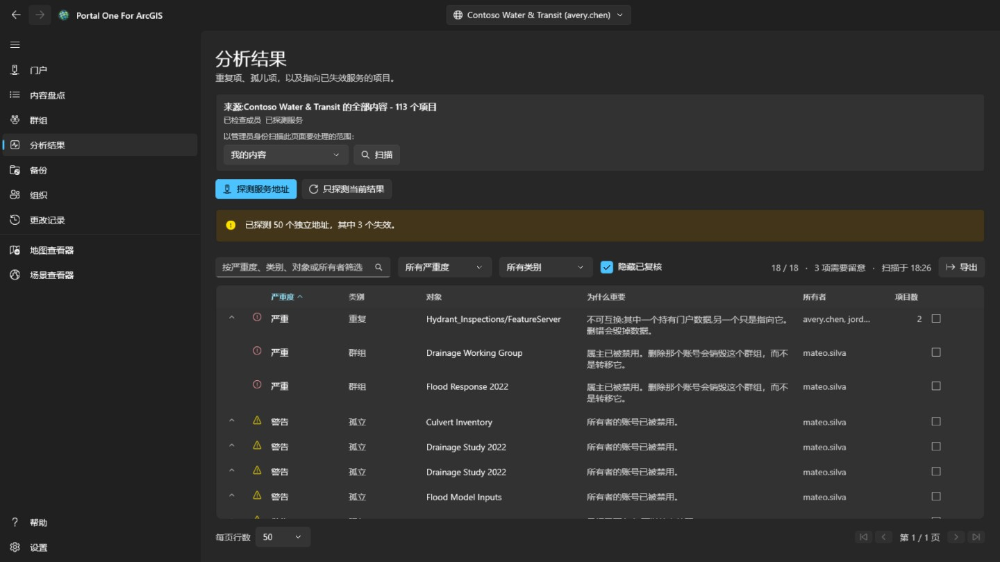
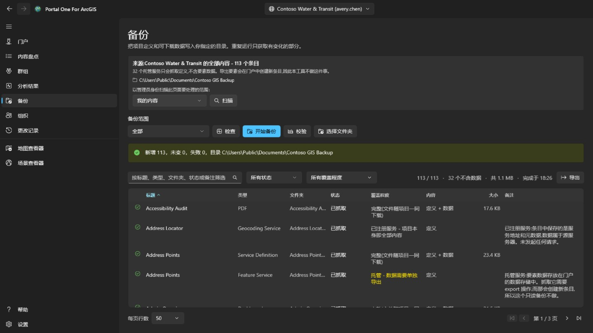
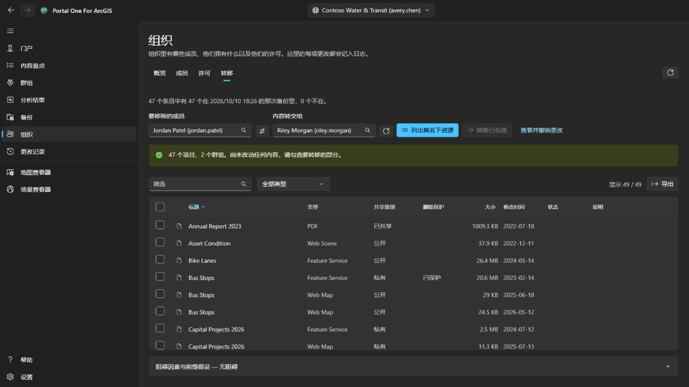
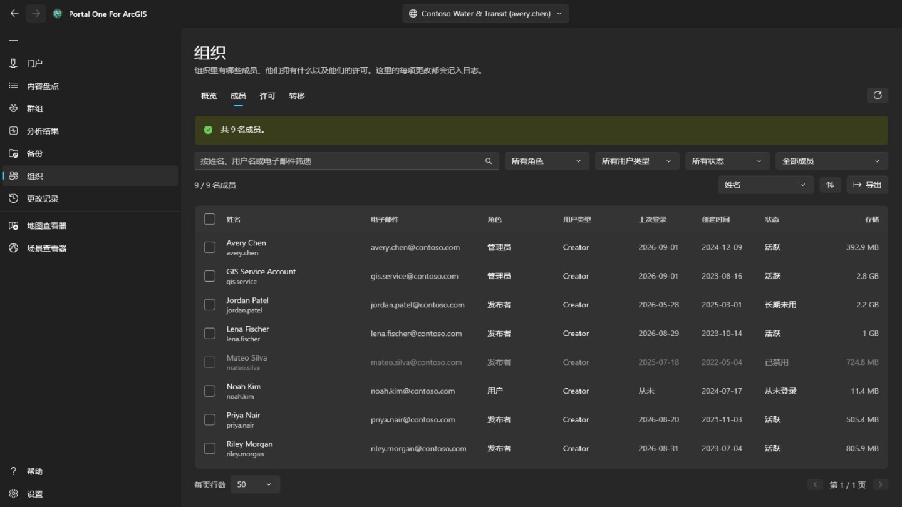
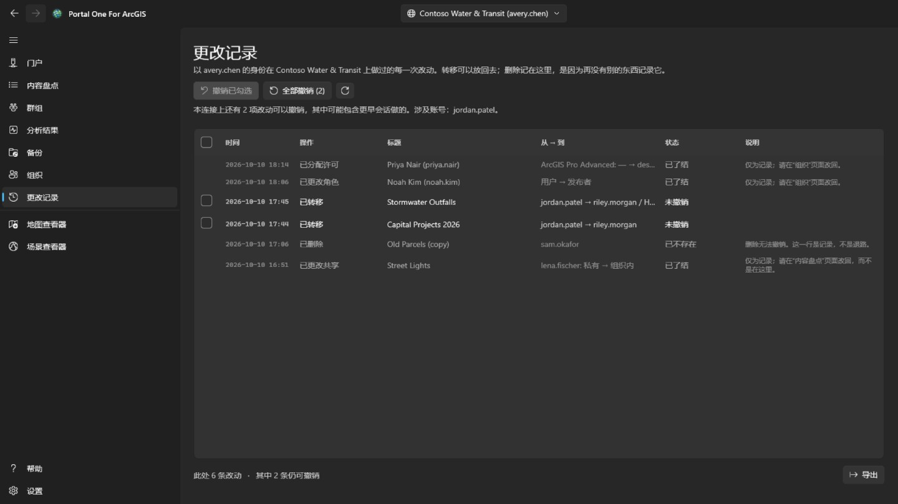
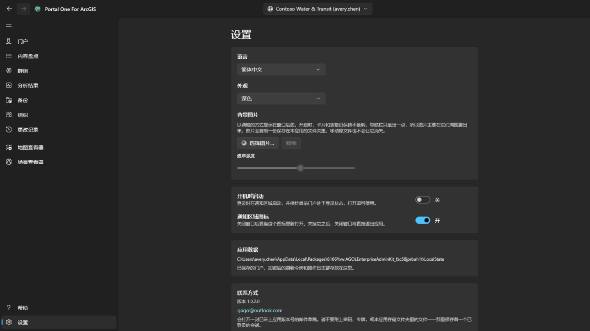

# 帮助

**Portal One For ArcGIS** 在你自己的机器上巡查和维护 ArcGIS 组织，对 **ArcGIS Online** 和 **ArcGIS Enterprise** 的工作方式完全相同。

名字的由来：ArcGIS Online 和 ArcGIS Enterprise 本质上都是“门户”（Portal），所以 **Portal** 一个词就同时涵盖了两者，应用里添加它们的**门户**页面也是这么叫的。**One** 就是这一个应用：你用到的所有门户都在这里管理，还可以同时登录多个。**For ArcGIS** 表明它是为 ArcGIS 平台打造的。

本应用只与以下对象通信：你登录的门户，门户内容所指向的地图服务、底图和高程数据，以及帮助网站——本页面从帮助网站读取最新帮助，无法访问时改为显示随应用安装的帮助。凭据以你的 Windows 账户加密保存，只发送给它所属的门户。

## 页面的先后顺序，就是使用的顺序

读取、备份、试运行、执行。每一页都是为了让下一页安全，导航栏的排列顺序
就是安全的那条路径。

## 连接

用门户地址添加一个连接：ArcGIS Online 用
`https://yourorg.maps.arcgis.com`，ArcGIS Enterprise 用包含上下文路径的
完整地址，例如 `https://portal.example.com/portal`。不需要事先在门户里
注册任何东西。如果门户位于身份感知代理（如 Microsoft Entra 应用程序代理或 Google Cloud IAP）之后，请勾选**门户需要身份感知代理认证**：读取门户之前会打开一个窗口登录代理，门户一旦响应窗口就会自动关闭；代理会话过期时会再次打开，正在进行的操作会继续。

可以用用户名和密码登录，也可以用应用内显示的门户自身登录页。**如果你的
组织使用单点登录或多因素认证，请用后者**：这样不会有任何密码被输入到
本应用里。

可以同时登录多个连接，包括同一门户下的两个账号。**保持登录**会把凭据
以你的 Windows 账户加密保存，重启后连接仍然有效。

只有当前指向的那个连接会被持续续期。其余的在令牌过期后登出，切换回去时
会静默恢复。

已登录的连接会显示该账户的个人资料照片，没有照片时显示姓名首字母。选择它可打开**我的个人资料**、**我的设置**或**帮助**。**我的个人资料**会像门户个人资料页面一样显示该账户：照片、姓名、个人简介、群组，以及它与组织或所有人共享的项目；**编辑个人资料**可更改姓名、个人简介、个人资料可见性和照片。**我的设置**包含门户中的各个部分：**常规**（电子邮件地址、起始页、语言、数字和日期格式、单位）、**安全性**（ArcGIS 登录的密码和安全问题）、**许可**、由组织分配的**积分**，以及该账户拥有的 **Webhook**。每项更改都会说明将写入什么内容，都会从门户重新读取，并记录在**更改记录**页面；该页面可以还原个人资料、设置、起始页、照片和 Webhook 的更改；新密码、安全问题和已删除的 Webhook 仅作记录。多重身份验证、安全密钥、恢复代码、关联账户和 Esri 电子邮件首选项只会显示或说明：它们在 ArcGIS 网站上管理。更改密码后，或每当门户停止接受该连接时，**门户**页面都会打开并显示其登录对话框，以便你使用新密码重新登录。

## 清查

显示你的账户能看到的内容，与门户自己的内容页一样分为四个选项卡：**我的内容**、**我的收藏**、**我的群组**（全部群组，或其中一个群组，包括你能看到但未加入的群组）和**我的组织**（组织共享的内容）。打开页面时就会读取并保留；旁边的按钮可重新读取当前选项卡。行的右键菜单随条目类型而变：Web 地图还可以在门户的 Map Viewer、Field Maps Designer 或 ArcGIS Pro 中打开，仪表盘在 Dashboards 中打开，故事在 ArcGIS StoryMaps 中打开；文件可以下载；任何条目都可以添加到收藏或从收藏中移除。Web 地图或 Web 场景的**与另一张地图比较…**会按门户当前保存的版本读取它和所选的同类型地图，并列出差异：添加、移除、移动或重命名的图层，改变的筛选、符号、标注和弹出窗口，底图、书签和初始视图；列表可以复制。**制作副本…**会以新标题把它复制到你在此门户或另一个已登录门户上的内容中，可放入文件夹或转交给其他成员；副本是私有的，复制到其他门户时会先在那里查找每个图层的条目，条目不在那里的图层按地址加载，这些会在写入任何内容之前显示。右上角的视图菜单可以像门户的内容页一样，以**表格**、带缩略图和摘要的**列表**或卡片**网格**显示各行，并可排序；三种视图中的筛选、分页和勾选的行都保持一致。在**我的收藏**、**我的群组**和**我的组织**中，文件夹、大小和保护状态会在页面出现后稍等片刻再补上：搜索结果不包含这些信息，所以会从当前页开始逐项读取。文件夹只对你自己的项目显示，管理员则对所有项目显示。项目的标题可在表格、列表和网格中打开项目自己的页面窗口，其布局与门户一致：在**概览**上显示项目卡片及其缩略图、类型、日期和摘要，然后是**描述**、按类型包含的内容（服务的**子图层**和表，地图的图层，地理处理服务的任务）、**使用条款**以及可留下评论的**评论**；旁边显示**在地图查看器中打开**、**在场景查看器中打开**、**共享…**和**在 ArcGIS Pro 中打开**，其余操作收在 V 形菜单后面，还有**所有者**、带有项目来源和可复制或打开 URL 的**详细信息**、显示信息完整度及最有帮助改进项的信息栏，以及**标签**、**共享级别**、**文件夹**和**鸣谢**，每一项都有可更改它的操作；然后是该类型拥有的**数据**、**可视化**和**设置**选项卡。**设置**与门户一致：**常规**适用于每个项目（内容状态、删除保护和删除项目、搜索所用的范围）；项目自己的部分——对于托管要素图层，是编辑、编辑者追踪、同步、导出和真曲线，并与**保存**一起保存；对于 Web 地图或场景，是其离线模式；对于其他图层，则显示服务报告的设置——以及托管要素图层的 Webhook；每项更改在会移除内容时都会确认，会从门户重新读取，并记录在**更改记录**页面，可从那里恢复。

扫描他人的内容是管理员的工作。能读取其他成员所拥有内容的账户（portal:admin:viewItems）会在本页看到 **管理员扫描** 选项卡，并在“分析结果”和“备份”页面看到扫描功能——某位成员、某个群组或整个组织——以及 **组织** 页面的 **转移** 选项卡；其他账户看不到这些。整个组织的扫描会逐个向成员索取内容，而不是搜索，因为搜索只返回共享的内容，而审计不能漏掉私有条目。它需要一段时间，可以取消。

“分析结果”、“备份”和查看器会在第一次需要时自行读取你自己的内容，无需先访问其他页面；管理员的扫描会用扫描到的内容替换它。每个表格都会说明其列表是何时读取的。门户在读取之后仍会继续变化。

每一行还带一个删除按钮，而这是本应用里**唯一无法撤销**的操作：ArcGIS 没有回收站。确认框会点名条目、类型和属主，并告诉你本连接记住的备份文件夹里有没有它的副本、那次备份是什么时候做的。没有副本它也不会拒绝，但**那一行是事后唯一能为这次删除作证的东西**。在门户里开启了删除保护的条目会在这里被拒绝，而不是被悄悄解除保护。要更改保护本身，请使用该行末尾的锁按钮或该行的右键菜单：这是单独的一步，解除保护前会先确认，每次更改都会从门户重新读取核实，并写入操作日志。勾选行首的复选框——或标题中的复选框，以选择筛选结果中所有页的全部行——即可一次处理多个项目。**共享**设置共享级别和群组；**标签**添加和移除标签，其余标签保留；**移动**把同一所有者的项目放入其某个文件夹；**更改所有者**像 **组织** 页面的 **转移** 选项卡一样把项目转移给另一位成员，可在 **更改记录** 页面恢复；**删除**会先弹出确认，说明数量、所有者以及备份中有多少项，并要求勾选“我了解”后才能删除。此账户无权更改的项目和受删除保护的项目不会改动，并会计入统计。项目逐个处理并记入日志；**取消**会在两个项目之间停止，摘要会说明哪些失败以及原因。在行的右键菜单中，**共享…**可以更改该项目的共享级别和群组，**编辑详细信息…**可以更改标题、摘要、描述、标签、来源和使用条款。两者都会按门户中的当前状态打开，只提交你改过的内容，核对结果并记入日志。

## 问题发现

冗余和失效的内容，按"应当投入多少注意力"排序，而不是按"听起来有多严重"。

- **严重**表示在这里贸然行动会毁掉别处不存在的东西——两个条目指向同一个
  服务，删错那一个是无法挽回的。
- **警告**是真实存在、但可以安全处理的问题：属主已离开的条目、不再响应的
  服务。
- **提示**值得知道，也可能最终并无问题。
- **无法判定**表示没能确定。**一个超时的服务不等于一个已消失的服务**，
  本工具不会这么说。

展开一行可以看到它所代表的条目。确认某条没问题后可以标记为已审阅；这个
判断按连接分别记住，而且该行仍然可见，不会消失。

这一页只做陈述。**它不会告诉你两个相似条目该留哪一个**，因为那取决于
谁在用它们、以及什么指向了它们。

## 备份

把条目定义、资源和可下载的数据写入你选择的文件夹。对同一文件夹重复运行
只会抓取有变化的部分，所以**续传一次中断的备份和做一次增量备份是同一件事**。

- **检查**把文件夹和门户作对比，报告它*将会*做什么，不写入任何内容。想
  知道"我的备份是不是最新的"，这是不用花几小时的答法。
- **校验**把文件夹和它自己的记录作对比，完全不需要门户。**当门户已经没了
  的时候，剩下的就是这个问题——而那通常正是有人真正去翻备份的时刻。**

文件夹按连接分别记住；如果一个文件夹里装的是另一个组织的备份，会被拒绝
而不是覆盖。

**备份不包含什么。** 托管服务里的要素存放在门户的数据存储里，而不在条目
内；把它们取出来需要一次会在门户中创建新条目的导出操作——那是一次写入。
本工具不做这件事，所以这些行只抓取了定义而没有数据，页面会明确告诉你有
多少行是这样。从其他服务器注册进来的服务本质上只是指针，没有更多可抓的
东西。

## 离职清理

这是 **组织** 页面的 **转移** 选项卡，只向管理内容的账户显示（portal:admin:viewItems）。它会算出移除一位成员需要做什么，并把其内容逐项、可撤销地转移出去。

从列表里选择要移除的成员和接收人——两者都来自组织自己的通讯录，所以
**不可能把名字打错成一个确实存在的另一个人**。**列出其名下资源**不会改动
任何东西；它列出每一个条目和每一个群组，由你勾选应当转移的部分。

不会有任何一项被预先勾上。转移整个账号只需要点一下表头的复选框，而**那
一下是一个决定，不是一个默认值**。

- 群组和条目故意放在同一张表里。删除成员时，门户会**销毁**他名下的群组
  而不是转移它们，所以**没被勾上的群组是这一页上唯一会静默造成破坏的
  东西**，计数行会提醒你。
- 确认框会列出接收人的文件夹，并允许新建一个；条目会进入你选择的文件夹。每次转移都会在下一次开始前写入记录，**更改记录** 页面会把每个条目放回原来的文件夹，原文件夹已不存在时会重新创建；可以逐项撤销，也可以一次撤销本连接上仍未恢复的全部转移。
- 移动一个条目可能会带动其他条目。转移 shapefile 会带走由它发布的托管服务，所以某一行可能显示它已到达，但并不是这次转移把它送过去的。只在 **更改记录** 页面撤销那一行不会把它带回来；它会随带走它的内容一起返回。
- 每次移动之后都会从门户把条目读回来核对。**一个返回成功的请求，是关于
  这个请求的陈述，不是关于条目现在在哪的陈述。**

成员账号本身在 **组织** 页面删除，而且只有在其名下已一无所有时才行。**那是唯一一个无法撤销的步骤。**

## 组织

和门户一样，每位成员都能看到此页面。**概览** 对所有人开放，其中还列出组织的管理联系人；有查看成员权限的人还能看到只读的 **成员** 选项卡，但不显示电子邮件、登录、状态和存储。勾选成员、**导出**、**许可** 以及所有更改仅限管理成员的账号（portal:admin:viewUsers）。**概览** 汇总整个组织：在 ArcGIS Online 上有订阅、席位和积分；还有按状态、角色和用户类型统计的成员，以及内容和存储的用量。

**成员** 列出组织里的所有人，可按名称、角色、用户类型、状态或群组筛选，按任意列排序，并用 **导出** 保存为 CSV 文件。勾选成员后可以禁用或启用、更改角色或用户类型、移出群组或删除；只勾选一人时，**离职清理** 会打开本页的 **转移** 选项卡。你自己的账号始终不会被改动，群组的所有者也会留在群组里。

右键单击成员可打开该成员的菜单。**查看** 在应用内（而不是跳转到门户）显示其 **个人资料**、**条目**，管理员还能看到其 **群组**；普通成员只能看到共享给自己的条目。**管理** 仅供管理员使用，每一项只在具备相应权限时出现：**附加许可** 设置该成员持有哪些授权，**编辑电子邮件地址** 可修改使用 ArcGIS 登录的账号的地址，**转移内容** 会以该成员打开 **转移** 选项卡，**转移成员** 把其用户类型、角色和附加许可交给另一位成员，然后在 **转移** 选项卡继续转移内容和群组。同一菜单也能像操作栏处理多名成员那样，更改单个成员的用户类型、角色、群组、状态或账号。

**删除** 只删除名下没有任何条目和群组的成员。删除账号时 ArcGIS 不会把这些东西交给任何人，所以请先在 **转移** 选项卡把它们转移走。执行前需要输入用户名；删除多名成员时输入人数。删除无法撤销。

**许可** 显示每种用户类型已分配多少，以及在 ArcGIS Online 上订阅包含多少；**查看成员** 列出拥有该类型的人。选择一个附加许可即可看到谁持有它，并从勾选的成员回收。

每项更改都会从门户重新读取核实，并连同更改前的状态一起记录，列在 **更改记录** 页面上。但这些成员更改不能在那里撤销：要恢复某项，请做相反的更改。

## 更改记录

**更改记录** 页面会向每个已登录账户显示。它按最新优先列出本工具在当前选中的门户上更改过的一切：转移、删除、共享、标签、文件夹、详细信息、保护以及成员更改。在其他门户上做出的更改只计数，不列出。列表可以导出为 CSV。

可以恢复的转移带有复选框。**撤销已勾选** 会恢复勾选的转移，**全部撤销** 会在确认其内容属主后，恢复本连接上仍未恢复的一切。条目会回到原来的文件夹；如果文件夹已不存在，会重新创建。删除和成员更改在这里仅作为记录：删除无法撤销；成员更改要通过执行相反的更改来恢复。撤销一次转移本身也是一次转移，需要同样的权限（portal:admin:reassignItems，群组则为 reassignGroups）；没有该权限的账号只能看到记录。

从地图查看器覆盖保存的 Web 地图，以及在那里添加、编辑或删除的要素，可从其所在行的菜单撤消。要素编辑只有在要素仍保持该次编辑后的状态时才会撤消：添加的要素会被删除，编辑过的要素恢复原来的值和形状，删除的要素会以新的对象 ID 重新添加。撤消本身也会被记录，因此同样可以再次撤消。还原 Web 地图之前，可用同一菜单中的**与当前地图比较**，列出那次保存前保留的副本与门户当前保存的地图之间的差异：底图，添加、移除、重命名或移动的图层，以及每个图层的可见性、不透明度、样式、标注、筛选、比例范围、弹出窗口和刷新，还有表、书签和地图打开时的位置。

## 地图查看器和场景查看器

**地图查看器**在门户自己的底图上显示二维图层；**场景查看器**在带地形的地球上显示这些图层，以及场景图层、网格、点云、3D Tiles 等三维图层。左侧面板搜索此门户已读取的内容——自动读取的你自己的内容、管理员扫描到的内容，以及“内容盘点”页面各选项卡读取的内容——只列出该查看器能显示的条目，点一项即可添加。Web 地图在地图查看器中、Web 场景在场景查看器中整体打开，带着它自己的图层和底图。在“内容盘点”页面，标题旁的查看器按钮（行的右键菜单里也有）可在能显示该条目的查看器中打开它。

面板右上角的按钮可以收起面板，让地图或场景占满整个宽度，再按一次即可展开；每次进入查看器时面板都是展开的。每个图层都可以显示或隐藏、调整透明度、上移或下移、缩放至图层或移除。在地图上点击要素会显示它的字段：图层在门户中配置了弹出窗口时，显示其中选定的字段，并使用它设置的标签和格式；否则显示全部字段。“图层”旁边的**图例**选项卡说明每个可见图层的符号代表什么。**书签**列出随 Web 地图或 Web 场景保存的位置；在那里为当前视图命名即可添加自己的书签，选中一个即可回到该处。场景书签会保留相机的朝向和倾角。含要素的图层上的表格按钮会在地图下方打开它的**属性表**，每次加载两百行，筛选条件与图层绘制时一致；选中一行会高亮该要素并缩放到它。**导出**会写出表格按当前筛选和排序包含的全部行（最多 50,000 行），而不只是已加载的行：可导出为按表格显示的 CSV、经纬度坐标的 GeoJSON，或保留图层坐标系的压缩 shapefile（字段名截为十个字符）。点击列标题可按该列排序、筛选（与图层筛选方式相同，每列一个条件，全部同时生效）或查看统计：有值的行数、最小值和最大值，数值字段还有总和、平均值和标准差，以及最常见的值；统计基于通过筛选的全部行，而不只是已加载的行。**仅显示所选**会把表格缩小到所选的行。在地图查看器中，地图上方的**距离**和**面积**工具可测量你通过单击放置点所绘制的图形：沿地球表面测量而非在平面地图上，单位按 Windows 区域设置使用公制或英制。在场景查看器中，**距离**通过在 地形或模型上点击两点进行测量（直线、沿地面与垂直分量），**面积**沿贴地角点测量。**另存为 Web 地图**会在你自己的内容中、你选择的文件夹里创建一个新的 Web 地图项目，包含当前显示的底图、图层和书签，在地图当前位置打开，并以地图截图作为缩略图。**保存**会在你拥有或有权更新他人内容时，在本机保留副本后覆盖从门户打开的 Web 地图；场景查看器不能保存。搜索框还可通过门户地理编码查找地址或地名。**导出**可保存视图的 PNG；门户列出打印服务时，**打印**会调用该服务。支持时间的图层会打开**时间**条以逐步或播放浏览时间范围。切换到其他页面时图层会保留，切换到另一个门户时则重新开始。门户的登录凭据只用于它自己的图层，不会发送到其他组织的服务器，所以从别处注册、又要求登录的图层不会加载。在地图上测量时，双击、按 Enter 或选择 **完成** 即可结束绘制：图形连同结果会留在地图上，直到下一次测量或点击工具旁的 ✕。按 Esc 取消绘制，按 Ctrl+Z 或 Backspace 撤回最后一个点。要素图层上的样式按钮可更改图层的绘制方式：自选颜色和大小的**单一符号**、按字段的每个值各用一种颜色（**分类**），或按数值字段沿色带分级（**分级**，可选自然间断、等间隔或分位数）。每次修改都会立即显示在地图上；**应用**保留修改，**取消**恢复打开前的样子，**恢复原样式**则回到图层本来的样式。图例会随之更新，把地图另存为 Web 地图时样式也会一并保存。同一行的 **…** 按钮还可以打开 **标注…** 和 **筛选…**。标注可在每个要素上显示某个字段的值，字号和颜色可自选，可加描边光晕，并可设置从哪个比例尺开始显示。筛选则用“字段 + 比较方式 + 值”组成条件（满足全部或任一条件），只显示符合的要素，并实时统计符合的数量；图层从 Web 地图带来的筛选会保留，属性表也会随筛选变化。地图左下角有：随地图旋转的指北针（点击可转回正北）；按地面实际距离计算的比例尺条和比例尺；指针所在位置的坐标（点击可复制，或在十进制度与度分秒之间切换）；以及鹰眼图按钮，在鹰眼图上单击可移动地图。**选择** 可用矩形、手绘范围或多边形选中所有可见图层中的要素：面板会列出每个图层选中的数量，以及某个数值字段的合计、平均值、最小值和最大值，并可在属性表中显示、缩放到这些要素或导出为 CSV。**缓冲区** 围绕已选要素，或你绘制的点、线、面，按指定距离生成范围，并在本机沿地球表面计算面积（不调用分析服务，不消耗积分），还可以选中范围内的要素。**卷帘** 在可拖动分隔线的左侧显示某个图层，右侧显示不含该图层的地图。**地图体检** 会检查地图上的每个图层，指出对共享对象来说会出错或产生误导的地方：无法加载的图层、条目已删除或共享范围比地图窄、通过 http 或门户以外服务器提供的服务、已弃用或来自其他组织的条目、未设可见比例范围的大图层，以及整张地图都没有弹窗；报告可以复制。它还会指出图层的弹出窗口、符号或标注引用了、但图层本身没有的字段，并为每个服务图层的要素计数计时：超过 3 秒会记下，超过 10 秒或 30 秒内没有响应则为警告。在图层的 **…** 菜单中，**被谁使用…** 会读取清单中的地图和应用，列出直接或通过某张地图使用该图层的条目；**属性…** 显示它的来源、所有者、绘制方式，以及要素数量和字段。搜索框也可以输入坐标（任意顺序的两个十进制数、度分秒、UTM 或 MGRS），没有地理编码服务也能跳转。**导出** 里可以复制在门户地图查看器中打开此 Web 地图并定位到当前位置的链接，或复制地图中心坐标。覆盖保存 Web 地图时会保留原来的定义，可在 **更改记录** 页面该次保存的右键菜单中还原。 图层菜单中的图层设置可设置可见比例尺范围、要素图层弹出窗口（标题占位符、字段标签、可见性和顺序）以及支持的刷新间隔；预览会实时更新，保存 Web 地图会保留这些设置。样式对话框现在可以把点图层绘制为热力图，用数值字段控制点符号大小或线宽，并启用带计数标注的点聚类；面图层保留现有的颜色样式。“图层”选项卡上的“添加”菜单还可以添加服务 URL 或本地文件：CSV 和 GeoJSON 在保存时会成为嵌入的要素集合，而 shapefile 以及 KML 或 KMZ 文件仍保留在本地，并会在保存前特别指出。草图会添加一个可保存的标注图层，包含点、线、面、矩形、圆或椭圆、手绘形状和文本；选择草图要素后可重塑、改样式、删除、撤消上一笔或清空图层，草图要素集合会随 Web 地图一起保存。地图查看器的**编辑**工具会列出允许编辑的服务要素图层，并说明哪些图层为只读；你可以从模板绘制新要素，或选择地图上已有的要素，工具会校验可编辑字段，并在确认后把更改应用到实时要素服务。在可编辑图层的属性表中，可按住 Ctrl 或 Shift 选择多行（Ctrl+A 选择所有已加载的行）：**编辑**会在编辑表单中打开其中一行，**更改字段**会按每个要素自身的规则校验值后，把所选各行的某个字段设为同一个值。 **更改字段** 也可使用表达式——方括号字段名、引号中的文本、+ - * / 及若干函数——使每个所选行根据其他字段得到各自的值。 在**编辑**面板中，**几何工具**支持**在地图上选择**、**合并**形状、用切割线**分割**线或面、**裁剪**到所绘区域，或**复制到图层**到同种形状的另一可编辑图层；每项操作都会记录在**更改**页面上。每次更改都会记录在**更改记录**页面（字段更改记为一条），并可从那里撤消。对于所选要素，如果图层保存附件，编辑表单还会列出其附件，可打开、添加或移除（移除的文件会先复制到本机，每次更改都会记录在**更改记录**页面），并以只读方式显示与其相关的记录。绘制或重塑要素时，其折点会捕捉到编辑面板**捕捉**中勾选图层的要素，几何参考线会提示直角和平行；两者都可关闭，也可设置捕捉距离。测量、草图和其他工具不会捕捉。**另存为 Web 地图**旁的**共享**按钮，在此账户拥有该项目或可共享他人内容时，会像“内容盘点”页面共享项目那样共享当前的 Web 地图或 Web 场景：选好共享级别和群组后，会先按共享后的状态检查地图，在该级别下会出错或造成误解的问题会在共享前列出。**详细信息**可像“内容盘点”页面一样编辑项目的标题、摘要、描述、标签、致谢和使用条款，还可将视图图片用作缩略图，并把门户搜索所用的项目范围设为当前视图；地图打开时的位置通过覆盖保存来设定。要素的弹出窗口还会按作者设定的顺序显示门户中所配置弹出窗口的图片、图表和附件，以及相关记录；Arcade 表达式会先求值。图表按应用主题绘制，图片仅从 https 地址加载，单击附件即可打开。服务迁移或被替换时，图层 **…** 菜单中的**在 Web 地图中替换…**会先列出每张地图将发生的变化，再把内容盘点中使用该服务的所有 Web 地图和 Web 场景指向新地址（整个服务的图层保留各自编号）；每张地图在写入前都会保留副本并记录在**更改记录**页面，可在那里比较和还原。图层列表以树形显示图层组：展开图层组即可管理其中的图层；还可以重命名任意图层、用选定的顶层图层新建图层组、把图层移入或移出图层组，或取消组合。地图查看器可以从线绘制高程剖面，使用切片地形而不是消耗配额的分析服务，并可复制或导出采样距离和高程。服务要素图层还可以在地图下方打开只读图表；它使用服务统计而不是下载所有要素，可限制为当前视图或所选内容，可导出 PNG 或 CSV，并且不会保存到 Web 地图。 从计算机添加的 CSV、GeoJSON 或 shapefile 可在图层菜单中发布为托管要素图层；源文件会上传，服务会在你的内容中创建，并替换本地图层。KML 和 KMZ 不提供此操作，因为门户不会将它们发布为要素服务。 样式对话框还提供带大小字段的类型以及双字段关系图；连续色带、点密度和分箱不会显示，因为 ArcGIS Maps SDK for .NET 300.1 在此无法安全支持它们。标注和弹出窗口字段也可以使用 Arcade 表达式，可插入字段、使用常用片段，并在应用前用真实要素测试。 可编辑要素图层还可以携带保存在 Web 地图中的表单：编辑面板会遵循其中的分组、必填规则和计算值，图层菜单中的 **表单…** 命令可编辑该表单。门户 Web 地图可以在地图查看器中离线使用：应用会检查离线能力，将预计划区域或当前视图下载到 LocalState，在离线地图选项卡中打开，在本地提交编辑，并在帐户具有 Basic Runtime 或更高级别许可时把它们作为一条 Changes 记录同步回去。地图网络分析使用门户服务添加路线、服务区和最近设施；ArcGIS Online 会消耗积分。 相关记录部分还会通过隐藏 SDK 地图中的关系表读取关系，因此即使相关表不在 Web 地图中，多对多关系和带属性的关系也能正常工作。 在场景中，也可以通过单击、投射到地表的矩形或单击绘制的多边形选择要素图层，围绕已选要素或单击得到的点、线、面创建缓冲区，生成图表，并进行编辑：通过图层表单编辑属性，用单击的点创建新要素或重绘整个形状，以及合并、复制、拆分和裁剪；只有逐顶点整形仍然只属于地图，因为 SDK 只在 MapView 上公开几何编辑器。场景草图（单击放置的点、线、面、矩形、椭圆和文字）只在本会话中保留，因为这里无法保存 Web 场景；手绘只在地图中提供。草图面板中的 **将草图导出为 GeoJSON** 可以把两个查看器中的标记保存为文件。 场景也可以沿单击绘制的线显示 **高程剖面**：场景有自己的地面时从地面读取，否则使用与地图查看器相同的来源；**网络** 面板也能在场景中使用：在地面上单击放置停靠点、设施和事件，结果铺在场景上，作为图层添加的路径只在本会话中保留。 场景项目操作也可共享、编辑详细信息、复制链接或中心、导出图像、检查图层、显示使用情况并替换源；场景小组件显示朝向、指针坐标、概览和相机海拔，本地移动场景包以只读方式打开。 场景 **卷帘** 使用整个场景的同步裁剪副本；导航仍在主场景中进行，分隔线对比包含和不包含所选图层的效果。 较短的地点搜索框固定在左上角；右侧工具栏的箭头会以动画隐藏或恢复搜索框和工具，“更多命令”中收纳较少使用的项目、检查、时间和导出操作。

## 后台运行

关闭窗口会把应用收进通知区域，而不是结束它，这样**一次要跑几小时的扫描
或备份，不会被"把窗口挪开"这个动作杀掉**。托盘图标会说明正在跑什么，
那里的**退出**才是真正的出口。它的菜单还可以添加门户，以及在 Microsoft Store 中检查更新或安装已找到的更新。

如果关闭通知区域图标，关闭窗口就会直接结束应用——因为没有图标就没有任何
东西能把窗口叫回来。

**开机启动**会在登录时把应用直接启动到通知区域，这样你打开它的时候，
常用的那个连接已经是登录状态了。

## 设置

浅色、深色，或跟随 Windows；主题在你选择的那一刻就会改变。Microsoft Store 有新版本时，导航栏里“设置”的右边会出现**更新**按钮；安装期间应用会关闭，以新版本重新启动后按钮自动消失。还可以在窗口底层设置**背景图片**；显示背景时，卡片和表格保持不透明，导航栏只透出一点，图片主要在它们周围露出，**遮罩强度**决定图片被调暗的程度。

界面提供十四种语言，默认跟随 Windows，也可以固定为其中一种。**语言的
改动在下次启动时生效**，那里会提供一个按钮——因为框架在每个界面构建时
只读取一次它的文本：立即应用只会切换之后才打开的那些部分。

## 键盘

在任意一张表格上：

- **Ctrl+F** 把光标放进筛选框。
- **Ctrl+E** 导出表格当前显示的行，列和排序都按你眼前看到的样子。

## 东西存放在哪里

- 备份放在你选的文件夹里，那是一个你可以打开、复制、搬走的普通文件夹。
- 连接、偏好设置和更改记录放在本应用自己的存储区，其中属于凭据的
  部分是加密的。
- 导出的 CSV 文件存放在你保存它的地方。

没有任何东西被上传到别处。**本工具的作者这边没有账号，也没有任何遥测。**

## 联系方式

有什么不工作，或者做的不是你预期的事，请写信到 **gaqo@outlook.com**。

最有帮助的信息是：你当时在做什么、实际发生了什么、门户是 ArcGIS Online 还是 ArcGIS Enterprise 以及版本号（“连接”页面两者都会显示），还有界面当时用的是哪种语言。

请不要附上密码、令牌，或本应用存储文件夹里的文件。那里保存着一个已登录的会话，而回答一个问题用不到其中任何一样。
