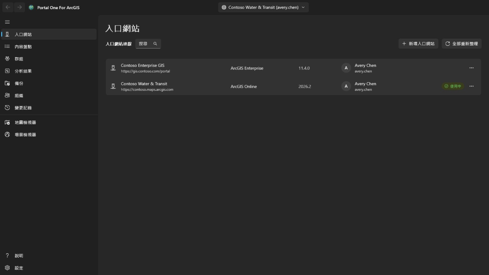
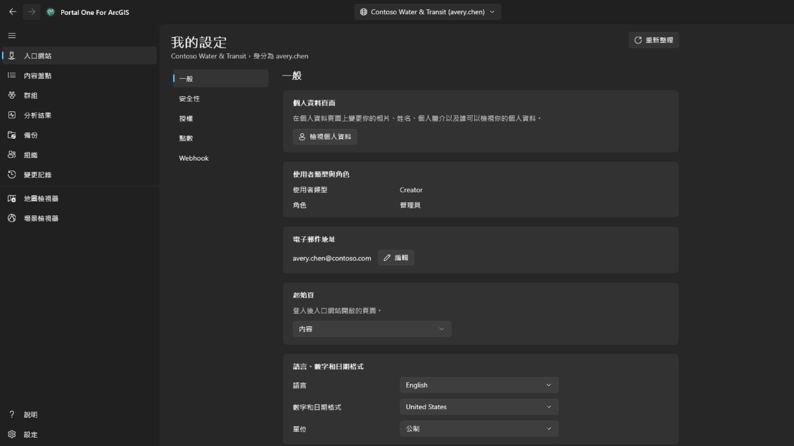
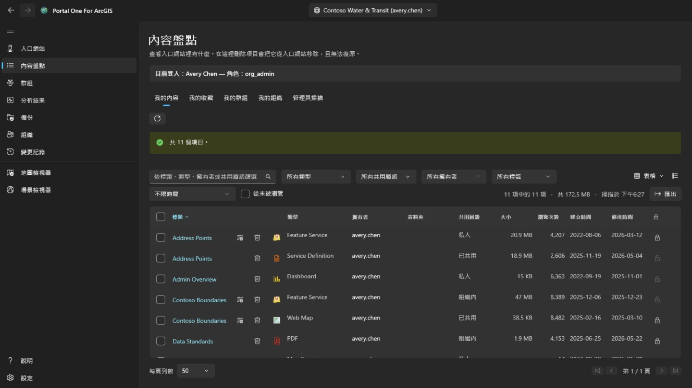
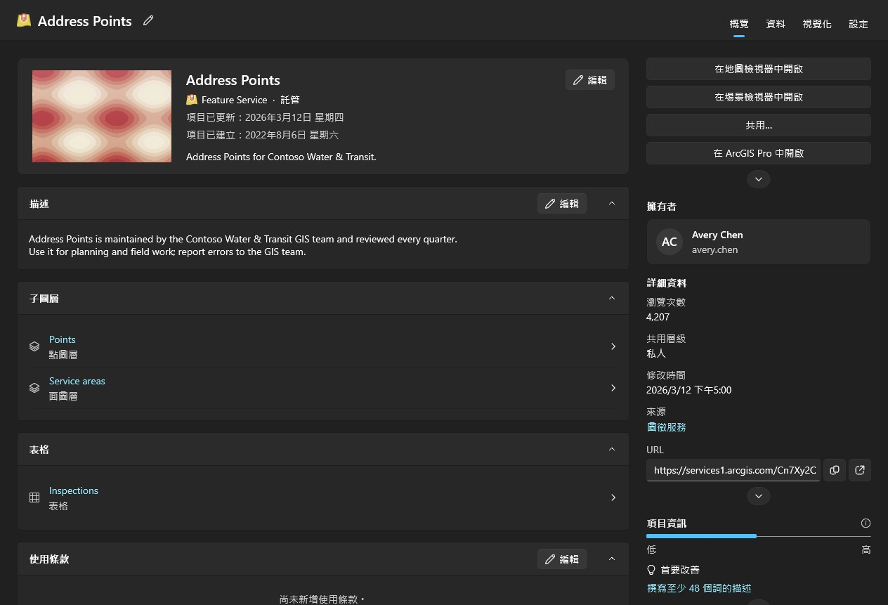
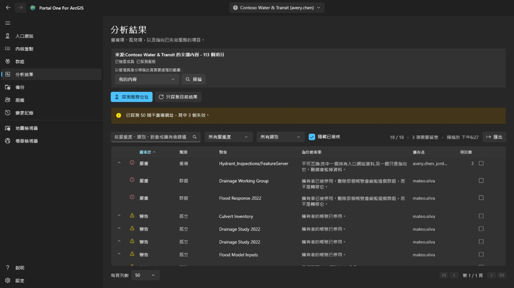
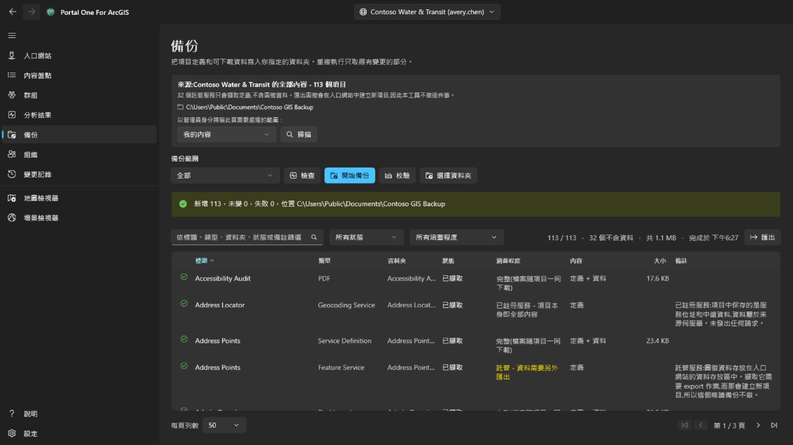
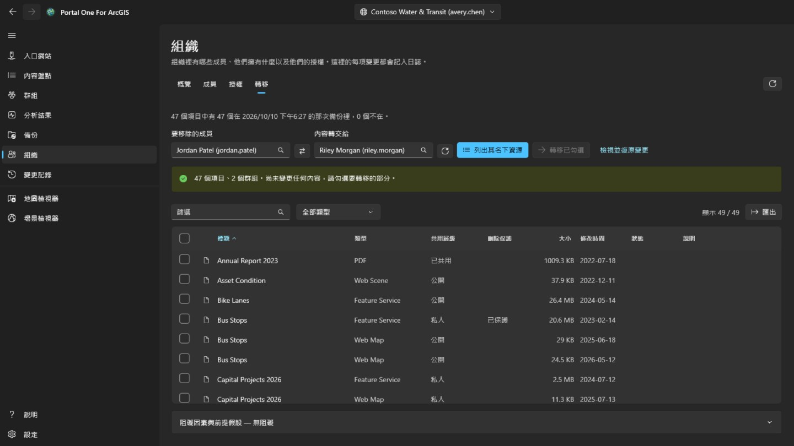
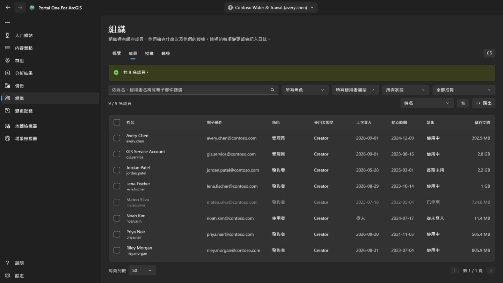
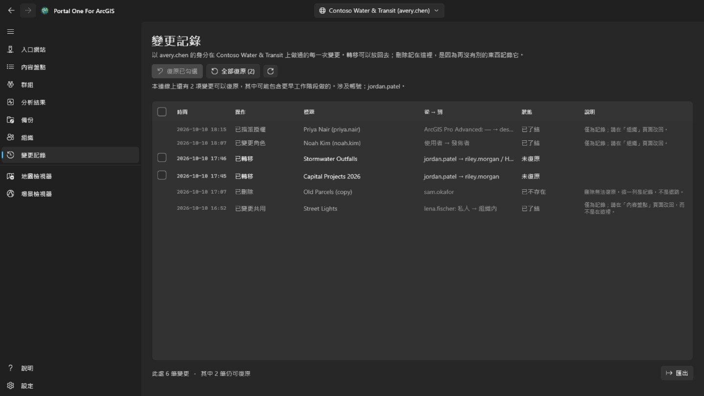
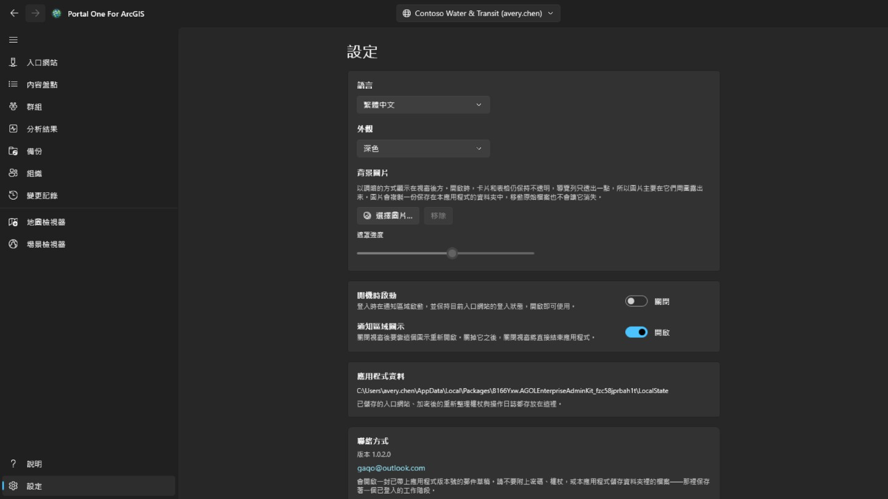

# 說明

**Portal One For ArcGIS** 在你自己的電腦上巡查與維護 ArcGIS 組織，對 **ArcGIS Online** 和 **ArcGIS Enterprise** 的運作方式完全相同。

名稱的由來：ArcGIS Online 和 ArcGIS Enterprise 本質上都是「入口網站」（Portal），所以 **Portal** 一個詞就同時涵蓋了兩者，應用程式裡新增它們的**入口網站**頁面也是這麼叫的。**One** 就是這一個應用程式：你用到的所有入口網站都在這裡管理，還可以同時登入多個。**For ArcGIS** 表明它是為 ArcGIS 平台打造的。

本應用程式只與以下對象通訊：你登入的入口網站，入口網站內容所指向的地圖服務、底圖和高程資料，以及說明網站——本頁面從說明網站讀取最新說明，無法連線時改為顯示隨應用程式安裝的說明。憑證以你的 Windows 帳戶加密儲存，只傳送給它所屬的入口網站。

## 頁面的先後順序，就是使用的順序

讀取、備份、預演、執行。每一頁都是為了讓下一頁安全，導覽列的排列順序
就是安全的那條路徑。

## 連線

用入口網站位址新增一個連線：ArcGIS Online 用
`https://yourorg.maps.arcgis.com`，ArcGIS Enterprise 用包含內容路徑的
完整位址，例如 `https://portal.example.com/portal`。不需要事先在入口網站
註冊任何東西。如果入口網站位於身分感知 Proxy（如 Microsoft Entra 應用程式 Proxy 或 Google Cloud IAP）之後，請勾選**入口網站需要身分感知 Proxy 驗證**：讀取入口網站之前會開啟一個視窗登入 Proxy，入口網站一旦回應視窗就會自動關閉；Proxy 工作階段到期時會再次開啟，正在進行的作業會繼續。

可以用使用者名稱和密碼登入，也可以用應用程式內顯示的入口網站自身登入頁。
**如果你的組織使用單一登入或多因素驗證，請用後者**：這樣不會有任何密碼
被輸入到本應用程式裡。

可以同時登入多個連線，包括同一入口網站下的兩個帳號。**保持登入**會把憑證
以你的 Windows 帳戶加密保存，重新啟動後連線仍然有效。

只有目前指向的那個連線會被持續續期。其餘的在權杖過期後登出，切換回去時
會靜默恢復。

已登入的連線會顯示該帳戶的個人資料相片，沒有相片時顯示姓名縮寫。選取它可開啟**我的個人資料**、**我的設定**或**說明**。**我的個人資料**會像入口網站個人資料頁面一樣顯示該帳戶：相片、姓名、個人簡介、群組，以及它與組織或所有人共用的項目；**編輯個人資料**可變更姓名、個人簡介、個人資料可見性和相片。**我的設定**包含入口網站中的各個區段：**一般**（電子郵件地址、起始頁、語言、數字和日期格式、單位）、**安全性**（ArcGIS 登入的密碼和安全性問題）、**授權**、由組織配置的**點數**，以及該帳戶擁有的 **Webhook**。每項變更都會說明將寫入什麼內容，都會從入口網站重新讀取，並記錄在**變更記錄**頁面；該頁面可以還原個人資料、設定、起始頁、相片和 Webhook 的變更；新密碼、安全性問題和已刪除的 Webhook 僅作記錄。多重要素驗證、安全性金鑰、復原碼、連結帳戶和 Esri 電子郵件偏好設定只會顯示或說明：它們在 ArcGIS 網站上管理。變更密碼後，或每當入口網站停止接受該連線時，**入口網站**頁面都會開啟並顯示其登入對話框，讓你使用新密碼重新登入。

## 清查

顯示你的帳戶能看到的內容，與入口網站自己的內容頁一樣分為四個索引標籤：**我的內容**、**我的收藏**、**我的群組**（全部群組，或其中一個群組，包括你能看到但未加入的群組）和**我的組織**（組織共用的內容）。開啟頁面時就會讀取並保留；旁邊的按鈕可重新讀取目前的索引標籤。列的右鍵選單隨項目類型而變：Web 地圖還可以在入口網站的 Map Viewer、Field Maps Designer 或 ArcGIS Pro 中開啟，儀表板在 Dashboards 中開啟，故事在 ArcGIS StoryMaps 中開啟；檔案可以下載；任何項目都可以加入收藏或從收藏中移除。Web 地圖或 Web 場景的**與另一張地圖比較…**會依入口網站目前保存的版本讀取它和所選的同類型地圖，並列出差異：新增、移除、移動或重新命名的圖層，變更的篩選、符號、標籤和快顯視窗，底圖、書籤和初始檢視；清單可以複製。**製作複本…**會以新標題把它複製到你在此入口網站或另一個已登入入口網站上的內容中，可放入資料夾或轉交給其他成員；複本是私人的，複製到其他入口網站時會先在那裡尋找每個圖層的項目，項目不在那裡的圖層依位址載入，這些會在寫入任何內容之前顯示。右上角的檢視選單可以像入口網站的內容頁一樣，以**表格**、帶縮圖和摘要的**清單**或卡片**格狀**顯示各列，並可排序；三種檢視中的篩選、分頁和勾選的列都保持一致。在**我的收藏**、**我的群組**和**我的組織**中，資料夾、大小和保護狀態會在頁面出現後稍等片刻再補上：搜尋結果不包含這些資訊，所以會從目前頁面開始逐項讀取。資料夾只對你自己的項目顯示，管理員則對所有項目顯示。項目的標題可在表格、清單和格狀中開啟項目自己的頁面視窗，其版面配置與入口網站一致：在**概覽**上顯示項目卡片及其縮圖、類型、日期和摘要，然後是**描述**、依類型包含的內容（服務的**子圖層**和表格，地圖的圖層，地理處理服務的工作）、**使用條款**以及可留下評論的**評論**；旁邊顯示**在地圖檢視器中開啟**、**在場景檢視器中開啟**、**共用…**和**在 ArcGIS Pro 中開啟**，其餘操作收在 V 形選單後面，還有**擁有者**、帶有項目來源和可複製或開啟 URL 的**詳細資料**、顯示資訊完整度及最有幫助改善項目的資訊列，以及**標籤**、**共用層級**、**資料夾**和**致謝**，每一項都有可變更它的操作；然後是該類型擁有的**資料**、**視覺化**和**設定**索引標籤。**設定**與入口網站一致：**一般**適用於每個項目（內容狀態、刪除保護和刪除項目、搜尋所用的範圍）；項目自己的區段——對於託管圖徵圖層，是編輯、編輯者追蹤、同步、匯出和真曲線，並與**儲存**一起儲存；對於 Web 地圖或場景，是其離線模式；對於其他圖層，則顯示服務回報的設定——以及託管圖徵圖層的 Webhook；每項變更在會移除內容時都會確認，會從入口網站重新讀取，並記錄在**變更記錄**頁面，可從那裡復原。

掃描他人的內容是管理員的工作。能讀取其他成員所擁有內容的帳戶（portal:admin:viewItems）會在本頁看到 **管理員掃描** 索引標籤，並在「分析結果」和「備份」頁面看到掃描功能——某位成員、某個群組或整個組織——以及 **組織** 頁面的 **轉移** 索引標籤；其他帳戶看不到這些。整個組織的掃描會逐一向成員索取內容，而不是搜尋，因為搜尋只傳回共用的內容，而稽核不能漏掉私人項目。它需要一段時間，可以取消。

「分析結果」、「備份」和檢視器會在第一次需要時自行讀取你自己的內容，無需先造訪其他頁面；管理員的掃描會以掃描到的內容取代它。每個表格都會說明其清單是何時讀取的。入口網站在讀取之後仍會持續變化。

每一列還帶一個刪除按鈕，而這是本應用程式裡**唯一無法復原**的操作：ArcGIS 沒有資源回收筒。確認框會點名項目、類型和擁有者，並告訴你本連線記住的備份資料夾裡有沒有它的副本、那次備份是什麼時候做的。沒有副本它也不會拒絕，但**那一行是事後唯一能為這次刪除作證的東西**。在入口網站裡開啟了刪除保護的項目會在這裡被拒絕，而不是被悄悄解除保護。要變更保護本身，請使用該列末端的鎖按鈕或該列的右鍵選單：這是單獨的一步，解除保護前會先確認，每次變更都會從入口網站重新讀取核實，並寫入操作日誌。勾選列首的核取方塊——或標題中的核取方塊，以選取篩選結果中所有頁的全部列——即可一次處理多個項目。**共用**設定共用層級和群組；**標籤**新增和移除標籤，其餘標籤保留；**移動**把同一擁有者的項目放入其某個資料夾；**變更擁有者**像 **組織** 頁面的 **轉移** 索引標籤一樣把項目轉移給另一位成員，可在 **變更記錄** 頁面還原；**刪除**會先彈出確認，說明數量、擁有者以及備份中有多少項，並要求勾選「我了解」後才能刪除。此帳戶無權變更的項目和受刪除保護的項目不會變動，並會計入統計。項目逐一處理並記入日誌；**取消**會在兩個項目之間停止，摘要會說明哪些失敗以及原因。在列的右鍵選單中，**共用…**可以變更該項目的共用層級和群組，**編輯詳細資料…**可以變更標題、摘要、描述、標籤、來源和使用條款。兩者都會按入口網站中的目前狀態開啟，只提交你改過的內容，核對結果並記入日誌。

## 問題發現

冗餘與失效的內容，按「應當投入多少注意力」排序，而不是按「聽起來有多嚴重」。

- **嚴重**表示在這裡貿然行動會毀掉別處不存在的東西——兩個項目指向同一個
  服務，刪錯那一個是無法挽回的。
- **警告**是真實存在、但可以安全處理的問題：擁有者已離開的項目、不再回應
  的服務。
- **提示**值得知道，也可能最終並無問題。
- **無法判定**表示沒能確定。**一個逾時的服務不等於一個已消失的服務**，
  本工具不會這麼說。

展開一列可以看到它所代表的項目。確認某列沒問題後可以標記為已檢閱；這個
判斷按連線分別記住，而且該列仍然可見，不會消失。

這一頁只做陳述。**它不會告訴你兩個相似項目該留哪一個**，因為那取決於
誰在用它們、以及什麼指向了它們。

## 備份

把項目定義、資源和可下載的資料寫入你選擇的資料夾。對同一資料夾重複執行
只會抓取有變化的部分，所以**續傳一次中斷的備份和做一次增量備份是同一件事**。

- **檢查**把資料夾和入口網站作比對，回報它*將會*做什麼，不寫入任何內容。
  想知道「我的備份是不是最新的」，這是不用花幾小時的答法。
- **校驗**把資料夾和它自己的紀錄作比對，完全不需要入口網站。**當入口網站
  已經沒了的時候，剩下的就是這個問題——而那通常正是有人真正去翻備份的時刻。**

資料夾按連線分別記住；如果一個資料夾裡裝的是另一個組織的備份，會被拒絕
而不是覆寫。

**備份不包含什麼。** 託管服務裡的圖徵存放在入口網站的資料存放區，而不在
項目內；把它們取出來需要一次會在入口網站中建立新項目的匯出作業——那是一次
寫入。本工具不做這件事，所以這些列只抓取了定義而沒有資料，頁面會明確告訴
你有多少列是這樣。從其他伺服器註冊進來的服務本質上只是指標，沒有更多可抓
的東西。

## 離職清理

這是 **組織** 頁面的 **轉移** 索引標籤，只向管理內容的帳戶顯示（portal:admin:viewItems）。它會算出移除一位成員需要做什麼，並把其內容逐項、可復原地轉移出去。

從清單裡選擇要移除的成員和接收人——兩者都來自組織自己的通訊錄，所以
**不可能把名字打錯成一個確實存在的另一個人**。**列出其名下資源**不會變更
任何東西；它列出每一個項目和每一個群組，由你勾選應當轉移的部分。

不會有任何一項被預先勾上。轉移整個帳號只需要點一下表頭的核取方塊，而**那
一下是一個決定，不是一個預設值**。

- 群組和項目刻意放在同一張表裡。刪除成員時，入口網站會**銷毀**他名下的
  群組而不是轉移它們，所以**沒被勾上的群組是這一頁上唯一會靜默造成破壞的
  東西**，計數列會提醒你。
- 確認框會列出接收人的資料夾，並允許新增一個；項目會進入你選擇的資料夾。每次轉移都會在下一次開始前寫入記錄，**變更記錄** 頁面會把每個項目放回原來的資料夾，原資料夾已不存在時會重新建立；可以逐項復原，也可以一次復原本連線上仍未還原的全部轉移。
- 移動一個項目可能會帶動其他項目。轉移 shapefile 會帶走由它發佈的託管服務，所以某一列可能顯示它已到達，但並不是這次轉移把它送過去的。只在 **變更記錄** 頁面復原那一列不會把它帶回來；它會隨帶走它的內容一起返回。
- 每次移動之後都會從入口網站把項目讀回來核對。**一個回傳成功的請求，是
  關於這個請求的陳述，不是關於項目現在在哪的陳述。**

成員帳號本身在 **組織** 頁面刪除，而且只有在其名下已一無所有時才行。**那是唯一一個無法復原的步驟。**

## 組織

和入口網站一樣，每位成員都能看到此頁面。**概覽** 對所有人開放，其中還列出組織的管理聯絡人；有檢視成員權限的人還能看到唯讀的 **成員** 索引標籤，但不顯示電子郵件、登入、狀態和儲存空間。勾選成員、**匯出**、**授權** 以及所有變更僅限管理成員的帳號（portal:admin:viewUsers）。**概覽** 彙總整個組織：在 ArcGIS Online 上有訂閱、席位和點數；還有依狀態、角色和使用者類型統計的成員，以及內容和儲存空間的用量。

**成員** 列出組織裡的所有人，可依名稱、角色、使用者類型、狀態或群組篩選，依任意欄排序，並用 **匯出** 儲存為 CSV 檔案。勾選成員後可以停用或啟用、變更角色或使用者類型、移出群組或刪除；只勾選一人時，**離職清理** 會開啟本頁的 **轉移** 索引標籤。你自己的帳號始終不會被變動，群組的擁有者也會留在群組裡。

以滑鼠右鍵按一下成員可開啟該成員的選單。**檢視** 在應用程式內（而不是跳轉到入口網站）顯示其 **個人資料**、**項目**，管理員還能看到其 **群組**；一般成員只能看到共用給自己的項目。**管理** 僅供管理員使用，每一項只在具備相應權限時出現：**附加授權** 設定該成員持有哪些權利，**編輯電子郵件地址** 可修改使用 ArcGIS 登入的帳號的地址，**轉移內容** 會以該成員開啟 **轉移** 索引標籤，**轉移成員** 把其使用者類型、角色和附加授權交給另一位成員，然後在 **轉移** 索引標籤繼續轉移內容和群組。同一選單也能像操作列處理多名成員那樣，變更單一成員的使用者類型、角色、群組、狀態或帳號。

**刪除** 只刪除名下沒有任何項目和群組的成員。刪除帳號時 ArcGIS 不會把這些東西交給任何人，所以請先在 **轉移** 索引標籤把它們轉移走。執行前需要輸入使用者名稱；刪除多名成員時輸入人數。刪除無法復原。

**授權** 顯示每種使用者類型已指派多少，以及在 ArcGIS Online 上訂閱包含多少；**檢視成員** 列出擁有該類型的人。選擇一個附加授權即可看到誰持有它，並從勾選的成員收回。

每項變更都會從入口網站重新讀取核實，並連同變更前的狀態一起記錄，列在 **變更記錄** 頁面上。但這些成員變更不能在那裡復原：要還原某項，請做相反的變更。

## 變更記錄

**變更記錄** 頁面會向每個已登入帳戶顯示。它按最新優先列出本工具在目前選取的入口網站上變更過的一切：轉移、刪除、共用、標籤、資料夾、詳細資料、保護以及成員變更。在其他入口網站上做出的變更只計數，不列出。清單可以匯出為 CSV。

可以還原的轉移帶有核取方塊。**復原已勾選** 會還原勾選的轉移，**全部復原** 會在確認其內容擁有者後，還原本連線上仍未還原的一切。項目會回到原來的資料夾；如果資料夾已不存在，會重新建立。刪除和成員變更在這裡僅作為記錄：刪除無法復原；成員變更要透過執行相反的變更來還原。復原一次轉移本身也是一次轉移，需要同樣的權限（portal:admin:reassignItems，群組則為 reassignGroups）；沒有該權限的帳號只能看到記錄。

從地圖檢視器覆寫儲存的 Web 地圖，以及在那裡新增、編輯或刪除的圖徵，可從其所在列的選單復原。圖徵編輯只有在圖徵仍保持該次編輯後的狀態時才會復原：新增的圖徵會被刪除，編輯過的圖徵還原原來的值和形狀，刪除的圖徵會以新的物件 ID 重新新增。復原本身也會被記錄，因此同樣可以再次復原。還原 Web 地圖之前，可用同一選單中的**與目前地圖比較**，列出那次儲存前保留的副本與入口網站目前保存的地圖之間的差異：底圖，新增、移除、重新命名或移動的圖層，以及每個圖層的可見性、不透明度、樣式、標註、篩選、比例範圍、快顯視窗和重新整理，還有表格、書籤和地圖開啟時的位置。

## 地圖檢視器和場景檢視器

**地圖檢視器**在入口網站自己的底圖上顯示二維圖層；**場景檢視器**在帶地形的地球上顯示這些圖層，以及場景圖層、網格、點雲、3D Tiles 等三維圖層。左側面板搜尋此入口網站已讀取的內容——自動讀取的你自己的內容、管理員掃描到的內容，以及「內容盤點」頁面各索引標籤讀取的內容——只列出該檢視器能顯示的項目，按一下即可新增。Web 地圖在地圖檢視器中、Web 場景在場景檢視器中整體開啟，帶著它自己的圖層和底圖。在「內容盤點」頁面，標題旁的檢視器按鈕（列的右鍵選單裡也有）可在能顯示該項目的檢視器中開啟它。

面板右上角的按鈕可以收合面板，讓地圖或場景佔滿整個寬度，再按一次即可展開；每次進入檢視器時面板都是展開的。每個圖層都可以顯示或隱藏、調整透明度、上移或下移、縮放至圖層或移除。在地圖上按一下圖徵會顯示它的欄位：圖層在入口網站中設定了快顯視窗時，顯示其中選定的欄位，並使用它設定的標籤和格式；否則顯示全部欄位。「圖層」旁邊的**圖例**索引標籤說明每個可見圖層的符號代表什麼。**書籤**列出隨 Web 地圖或 Web 場景儲存的位置；在那裡為目前檢視命名即可新增自己的書籤，選取一個即可回到該處。場景書籤會保留相機的方向和傾角。含圖徵的圖層上的表格按鈕會在地圖下方開啟它的**屬性表**，每次載入兩百列，篩選條件與圖層繪製時一致；選取一列會醒目提示該圖徵並縮放至它。**匯出**會寫出表格依目前篩選和排序包含的全部列（最多 50,000 列），而不只是已載入的列：可匯出為依表格顯示的 CSV、經緯度座標的 GeoJSON，或保留圖層座標系的壓縮 shapefile（欄位名稱截為十個字元）。按一下欄標題可依該欄排序、篩選（與圖層篩選方式相同，每欄一個條件，全部同時生效）或查看統計：有值的列數、最小值和最大值，數值欄位還有總和、平均值和標準差，以及最常見的值；統計依通過篩選的全部列，而不只是已載入的列。**僅顯示所選**會把表格縮小到所選的列。在地圖檢視器中，地圖上方的**距離**和**面積**工具可測量你以按一下放置點所繪製的圖形：沿地球表面測量而非在平面地圖上，單位依 Windows 地區設定使用公制或英制。在場景檢視器中，**距離**透過在 地形或模型上按兩下測量（直線、沿地面與垂直分量），**面積**沿貼地角點測量。**另存為 Web 地圖**會在你自己的內容中、你選擇的資料夾裡建立一個新的 Web 地圖項目，包含目前顯示的底圖、圖層和書籤，在地圖目前位置開啟，並以地圖截圖作為縮圖。**儲存**會在你擁有或有權更新他人內容時，在本機保留副本後覆寫從入口網站開啟的 Web 地圖；場景檢視器無法儲存。搜尋方塊還可透過入口網站地理編碼查找地址或地名。**匯出**可儲存檢視的 PNG；入口網站列出列印服務時，**列印**會執行該服務。支援時間的圖層會開啟**時間**列以逐步或播放瀏覽時間範圍。切換到其他頁面時圖層會保留，切換到另一個入口網站時則重新開始。入口網站的登入憑證只用於它自己的圖層，不會傳送到其他組織的伺服器，所以從別處註冊、又要求登入的圖層不會載入。在地圖上測量時，按兩下、按 Enter 或選擇 **完成** 即可結束繪製：圖形連同結果會留在地圖上，直到下一次測量或按下工具旁的 ✕。按 Esc 取消繪製，按 Ctrl+Z 或 Backspace 撤回最後一個點。圖徵圖層上的樣式按鈕可變更圖層的繪製方式：自選顏色和大小的**單一符號**、依欄位的每個值各用一種顏色（**分類**），或依數值欄位沿色帶分級（**分級**，可選自然間斷、等間隔或分位數）。每次修改都會立即顯示在地圖上；**套用**保留修改，**取消**還原開啟前的樣子，**還原原樣式**則回到圖層本來的樣式。圖例會隨之更新，把地圖另存為 Web 地圖時樣式也會一併儲存。同一列的 **…** 按鈕還可以開啟 **標註…** 和 **篩選…**。標註可在每個圖徵上顯示某個欄位的值，字級和顏色可自選，可加描邊光暈，並可設定從哪個比例尺開始顯示。篩選則用「欄位 + 比較方式 + 值」組成條件（符合全部或任一條件），只顯示符合的圖徵，並即時統計符合的數量；圖層從 Web 地圖帶來的篩選會保留，屬性表也會隨篩選變化。地圖左下角有：隨地圖旋轉的指北針（按一下可轉回正北）；依地面實際距離計算的比例尺條和比例尺；指標所在位置的座標（按一下可複製，或在十進位度與度分秒之間切換）；以及鷹眼圖按鈕，在鷹眼圖上按一下可移動地圖。**選取** 可用矩形、手繪範圍或多邊形選取所有可見圖層中的圖徵：面板會列出每個圖層選取的數量，以及某個數值欄位的合計、平均值、最小值和最大值，並可在屬性表中顯示、縮放到這些圖徵或匯出為 CSV。**環域** 圍繞已選圖徵，或你繪製的點、線、面，依指定距離產生範圍，並在本機沿地球表面計算面積（不呼叫分析服務，不消耗點數），還可以選取範圍內的圖徵。**捲簾** 在可拖曳分隔線的左側顯示某個圖層，右側顯示不含該圖層的地圖。**地圖體檢** 會檢查地圖上的每個圖層，指出對共用對象來說會出錯或產生誤導的地方：無法載入的圖層、項目已刪除或共用範圍比地圖窄、透過 http 或入口網站以外伺服器提供的服務、已淘汰或來自其他組織的項目、未設可見比例範圍的大圖層，以及整張地圖都沒有快顯視窗；報告可以複製。它還會指出圖層的快顯視窗、符號或標籤參照了、但圖層本身沒有的欄位，並為每個服務圖層的圖徵計數計時：超過 3 秒會記下，超過 10 秒或 30 秒內沒有回應則為警告。在圖層的 **…** 選單中，**被誰使用…** 會讀取清單中的地圖和應用程式，列出直接或透過某張地圖使用該圖層的項目；**屬性…** 顯示它的來源、擁有者、繪製方式，以及圖徵數量和欄位。搜尋方塊也可以輸入座標（任意順序的兩個十進位數、度分秒、UTM 或 MGRS），沒有地理編碼服務也能跳轉。**匯出** 裡可以複製在入口網站地圖檢視器中開啟此 Web 地圖並定位到目前位置的連結，或複製地圖中心座標。覆寫儲存 Web 地圖時會保留原來的定義，可在 **變更記錄** 頁面該次儲存的右鍵選單中還原。 圖層選單中的圖層設定可設定可見比例尺範圍、圖徵圖層快顯視窗（標題預留位置、欄位標籤、可見性與順序）以及支援的重新整理間隔；預覽會即時更新，儲存 Web 地圖會保留這些設定。樣式對話框現在可以把點圖層繪製為熱力圖，用數值欄位控制點符號大小或線寬，並啟用含計數標註的點叢集；面圖層保留現有的顏色樣式。「圖層」索引標籤上的「新增」選單還可以新增服務 URL 或本機檔案：CSV 和 GeoJSON 在儲存時會成為內嵌的圖徵集合，而 shapefile 以及 KML 或 KMZ 檔案仍保留在本機，並會在儲存前特別指出。草圖會加入一個可儲存的標註圖層，包含點、線、面、矩形、圓或橢圓、手繪形狀和文字；選取草圖圖徵後可重塑、變更樣式、刪除、復原上一筆或清空圖層，草圖圖徵集合會隨 Web 地圖一起儲存。地圖檢視器的**編輯**工具會列出允許編輯的服務圖徵圖層，並說明哪些圖層為唯讀；你可以從範本繪製新圖徵，或選取地圖上既有的圖徵，工具會驗證可編輯欄位，並在確認後將變更套用至即時圖徵服務。在可編輯圖層的屬性表中，可按住 Ctrl 或 Shift 選取多列（Ctrl+A 選取所有已載入的列）：**編輯**會在編輯表單中開啟其中一列，**變更欄位**會依每個圖徵自身的規則驗證值後，把所選各列的某個欄位設為同一個值。 **變更欄位** 也可使用運算式——方括號欄位名稱、引號中的文字、+ - * / 及若干函式——使每個所選列依其他欄位得到各自的值。 在**編輯**面板中，**幾何工具**支援**在地圖上選取**、**合併**形狀、以切割線**分割**線或面、**裁剪**至所繪區域，或**複製到圖層**至同種形狀的另一可編輯圖層；每項作業都會記錄在**變更**頁面上。每次變更都會記錄在**變更記錄**頁面（欄位變更記為一筆），並可從那裡復原。對於所選圖徵，如果圖層保存附件，編輯表單還會列出其附件，可開啟、新增或移除（移除的檔案會先複製到本機，每次變更都會記錄在**變更記錄**頁面），並以唯讀方式顯示與其相關的記錄。繪製或重塑圖徵時，其節點會鎖點至編輯面板**鎖點**中勾選圖層的圖徵，幾何參考線會提示直角和平行；兩者都可關閉，也可設定鎖點距離。測量、草圖和其他工具不會鎖點。**另存為 Web 地圖**旁的**共用**按鈕，在此帳戶擁有該項目或可共用他人內容時，會像「內容盤點」頁面共用項目那樣共用目前的 Web 地圖或 Web 場景：選好共用層級和群組後，會先依共用後的狀態檢查地圖，在該層級下會出錯或造成誤解的問題會在共用前列出。**詳細資料**可像「內容盤點」頁面一樣編輯項目的標題、摘要、描述、標籤、致謝和使用條款，還可將檢視圖片用作縮圖，並把入口網站搜尋所用的項目範圍設為目前檢視；地圖開啟時的位置透過覆寫儲存來設定。圖徵的快顯視窗還會依作者設定的順序顯示入口網站中所設定快顯視窗的圖片、圖表和附件，以及相關記錄；Arcade 運算式會先求值。圖表依應用程式主題繪製，圖片僅從 https 位址載入，按一下附件即可開啟。服務遷移或被取代時，圖層 **…** 選單中的**在 Web 地圖中取代…**會先列出每張地圖將發生的變化，再把內容盤點中使用該服務的所有 Web 地圖和 Web 場景指向新位址（整個服務的圖層保留各自編號）；每張地圖在寫入前都會保留副本並記錄在**變更記錄**頁面，可在那裡比較和還原。圖層清單以樹狀顯示圖層群組：展開群組即可管理其中的圖層；也可以重新命名任意圖層、用選定的最上層圖層新增圖層群組、將圖層移入或移出圖層群組，或取消群組。地圖檢視器可以從線繪製高程剖面，使用圖磚地形而不是消耗點數的分析服務，並可複製或匯出取樣距離和高程。服務圖徵圖層也可以在地圖下方開啟唯讀圖表；它使用服務統計而不是下載所有圖徵，可限制為目前檢視或選取項目，可匯出 PNG 或 CSV，且不會儲存到 Web 地圖。 從電腦新增的 CSV、GeoJSON 或 shapefile 可在圖層功能表中發佈為託管圖徵圖層；來源檔案會上傳，服務會在你的內容中建立，並取代本機圖層。KML 和 KMZ 不提供此操作，因為入口網站不會將它們發佈為圖徵服務。 樣式對話方塊還提供帶大小欄位的類型，以及雙欄位關係圖；連續色帶、點密度和分箱不會顯示，因為 ArcGIS Maps SDK for .NET 300.1 在此無法安全支援它們。標註和快顯視窗欄位也可以使用 Arcade 表達式，可插入欄位、使用常用片段，並在套用前用真實圖徵測試。 可編輯圖徵圖層還可以帶有儲存在 Web 地圖中的表單：編輯面板會遵循其中的群組、必填規則和計算值，圖層選單中的 **表單…** 命令可編輯該表單。入口網站 Web 地圖可以在地圖檢視器中離線使用：應用程式會檢查離線能力，將預先規劃區域或目前檢視下載到 LocalState，在離線地圖索引標籤中開啟，在本機提交編輯，並在帳戶具有 Basic Runtime 或更高層級授權時把它們作為一筆 Changes 記錄同步回去。地圖網路分析使用門戶服務新增路線、服務區和最近設施；ArcGIS Online 會消耗點數。 相關記錄區段還會透過隱藏 SDK 地圖中的關係表讀取關係，因此即使相關表不在 Web 地圖中，多對多關係和帶屬性的關係也能正常運作。 在場景中，也可以透過按一下、投影到地表的矩形或按一下繪製的多邊形選取圖徵圖層，圍繞已選圖徵或按一下得到的點、線、面建立緩衝區，產生圖表，並進行編輯：透過圖層表單編輯屬性，用按一下的點建立新圖徵或重繪整個形狀，以及合併、複製、分割和裁剪；只有逐頂點整形仍然只屬於地圖，因為 SDK 只在 MapView 上公開幾何編輯器。場景草圖（按一下放置的點、線、面、矩形、橢圓和文字）只在本工作階段中保留，因為這裡無法儲存 Web 場景；手繪只在地圖中提供。草圖面板中的 **將草圖匯出為 GeoJSON** 可以把兩個檢視器中的標記儲存為檔案。 場景也可以沿按一下繪製的線顯示 **高程剖面**：場景有自己的地面時從地面讀取，否則使用與地圖檢視器相同的來源；**網路** 面板也能在場景中使用：在地面上按一下放置停靠點、設施和事件，結果鋪在場景上，作為圖層新增的路徑只在本工作階段中保留。 場景項目操作也可共用、編輯詳細資訊、複製連結或中心、匯出影像、檢查圖層、顯示使用情況並取代來源；場景小工具顯示朝向、指標座標、概覽和相機海拔，本機行動場景套件以唯讀方式開啟。 場景 **捲簾** 使用整個場景的同步裁剪複本；導覽仍在主場景中進行，分隔線比較包含與不包含所選圖層的效果。 較短的地點搜尋方塊固定在左上角；右側工具列的箭頭會以動畫隱藏或還原搜尋方塊和工具，「更多命令」中收納較少使用的項目、檢查、時間和匯出操作。

## 背景執行

關閉視窗會把應用程式收進通知區域，而不是結束它，這樣**一次要跑幾小時的
掃描或備份，不會被「把視窗挪開」這個動作殺掉**。系統匣圖示會說明正在跑
什麼，那裡的**結束**才是真正的出口。它的選單還可以新增入口網站，以及在 Microsoft Store 中檢查更新或安裝已找到的更新。

如果關閉通知區域圖示，關閉視窗就會直接結束應用程式——因為沒有圖示就沒有
任何東西能把視窗叫回來。

**開機時啟動**會在登入時把應用程式直接啟動到通知區域，這樣你打開它的時候，
常用的那個連線已經是登入狀態了。

## 設定

淺色、深色，或跟隨 Windows；佈景主題在你選擇的那一刻就會改變。Microsoft Store 有新版本時，導覽列裡「設定」的右邊會出現**更新**按鈕；安裝期間應用程式會關閉，以新版本重新啟動後按鈕自動消失。還可以在視窗底層設定**背景圖片**；顯示背景時，卡片和表格保持不透明，導覽列只透出一點，圖片主要在它們周圍露出，**遮罩強度**決定圖片被調暗的程度。

介面提供十四種語言，預設跟隨 Windows，也可以固定為其中一種。**語言的
變更在下次啟動時生效**，那裡會提供一個按鈕——因為框架在每個畫面建構時
只讀取一次它的文字：立即套用只會切換之後才開啟的那些部分。

## 鍵盤

在任意一張表格上：

- **Ctrl+F** 把游標放進篩選框。
- **Ctrl+E** 匯出表格目前顯示的列，欄位和排序都按你眼前看到的樣子。

## 東西存放在哪裡

- 備份放在你選的資料夾裡，那是一個你可以開啟、複製、搬走的普通資料夾。
- 連線、偏好設定和變更記錄放在本應用程式自己的儲存區，其中屬於憑證的
  部分是加密的。
- 匯出的 CSV 檔案存放在你儲存它的地方。

沒有任何東西被上傳到別處。**本工具的作者這邊沒有帳號，也沒有任何遙測。**

## 聯絡方式

有什麼不運作，或者做的不是你預期的事，請寫信到 **gaqo@outlook.com**。

最有幫助的資訊是：你當時在做什麼、實際發生了什麼、入口網站是 ArcGIS Online 還是 ArcGIS Enterprise 以及版本號（「連線」頁面兩者都會顯示），還有介面當時用的是哪種語言。

請不要附上密碼、權杖，或本應用程式儲存資料夾裡的檔案。那裡保存著一個已登入的工作階段，而回答一個問題用不到其中任何一樣。
